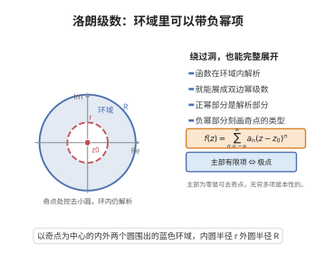

# 洛朗级数展开定理

> **一句话大白话**：Taylor 级数在函数出"毛病"的奇点附近会失灵，但洛朗级数允许出现负次幂项，于是绕着一个洞也能把函数完整展开出来。
>
> **小例子**：$f(z)=\frac{1}{z}$ 在 $0<|z|<1$ 的环域中展开为 $f(z)=\frac1z+0+0z+\cdots$，主部只有 $z^{-1}$ 一项。

## 介绍

洛朗级数展开定理（Laurent Series Expansion Theorem）是复分析中处理奇点附近函数展开的核心定理。它将 Taylor 级数推广到含有负幂项的情形，使得在环域内解析的函数可以展开为双边幂级数。该定理由 Pierre Alphonse Laurent 在 1843 年提出，是留数理论、奇点分类和实积分计算的基础。

## 几何直观

图意在说明：在挖去奇点的环域内，函数仍能展开成双边幂级数，负幂部分记录了奇点的性质。

## 分析

**前置依赖**：柯西积分公式、Taylor 级数、幂级数理论

**定理内容**：设函数 $f(z)$ 在环域 $D: r<|z-z_0|<R$（$0\leq r<R\leq\infty$）内解析，则在 $D$ 内 $f(z)$ 可唯一展开为洛朗级数
$$f(z)=\sum_{n=-\infty}^{\infty}a_n(z-z_0)^n$$
其中系数由积分公式给出
$$a_n=\frac{1}{2\pi i}\oint_C\frac{f(\zeta)}{(\zeta-z_0)^{n+1}}d\zeta$$
$C$ 为环域内任意一条环绕 $z_0$ 的简单闭曲线。

**数学内涵**：洛朗级数将函数分解为解析部分（$\sum_{n=0}^{\infty}a_n(z-z_0)^n$，Taylor 级数）和主部（$\sum_{n=-\infty}^{-1}a_n(z-z_0)^n$，反映奇点性质）。主部的结构决定了 $z_0$ 是何种类型的奇点：若主部为零则为可去奇点，若只有有限项则为极点，若有无穷多项则为本性奇点。

**证明策略**：利用柯西积分公式将环域内的函数值表示为两个积分之和，分别对应内圆和外圆，再将两个积分展开为幂级数（一个为正幂，一个为负幂）。

## 思考过程

洛朗级数的核心思想是将 Taylor 级数推广到含有奇点的情形。在环域内，函数不能直接展开为 Taylor 级数（因为 $z_0$ 可能不是解析点），但可以通过将柯西积分公式中的积分路径分解为外圆和内圆两部分，分别导出正幂项和负幂项。

## 证明过程

**定理**：设 $f(z)$ 在环域 $D: r<|z-z_0|<R$ 内解析，则在 $D$ 内 $f(z)$ 可展开为洛朗级数
$$f(z)=\sum_{n=-\infty}^{\infty}a_n(z-z_0)^n$$
其中
$$a_n=\frac{1}{2\pi i}\oint_{C}\frac{f(\zeta)}{(\zeta-z_0)^{n+1}}d\zeta$$
$C$ 为环域内任意一条环绕 $z_0$ 的正向简单闭曲线。

**证明**：

取 $r<\rho_1<\rho_2<R$，令 $C_1$ 为圆周 $|\zeta-z_0|=\rho_1$（正向），$C_2$ 为圆周 $|\zeta-z_0|=\rho_2$（正向）。对环域内任意一点 $z$（$|z-z_0|=\rho$，$\rho_1<\rho<\rho_2$），由柯西积分公式（在复连通区域上）：
$$f(z)=\frac{1}{2\pi i}\oint_{C_2}\frac{f(\zeta)}{\zeta-z}d\zeta-\frac{1}{2\pi i}\oint_{C_1}\frac{f(\zeta)}{\zeta-z}d\zeta$$

**处理外圆积分**：当 $\zeta\in C_2$ 时，$|\zeta-z_0|>|z-z_0|$，故
$$\frac{1}{\zeta-z}=\frac{1}{(\zeta-z_0)-(z-z_0)}=\frac{1}{\zeta-z_0}\cdot\frac{1}{1-\frac{z-z_0}{\zeta-z_0}}=\sum_{n=0}^{\infty}\frac{(z-z_0)^n}{(\zeta-z_0)^{n+1}}$$
该级数一致收敛，可逐项积分：
$$\frac{1}{2\pi i}\oint_{C_2}\frac{f(\zeta)}{\zeta-z}d\zeta=\sum_{n=0}^{\infty}\left(\frac{1}{2\pi i}\oint_{C_2}\frac{f(\zeta)}{(\zeta-z_0)^{n+1}}d\zeta\right)(z-z_0)^n$$

**处理内圆积分**：当 $\zeta\in C_1$ 时，$|\zeta-z_0|<|z-z_0|$，故
$$\frac{1}{\zeta-z}=\frac{1}{(z-z_0)-(\zeta-z_0)}=-\frac{1}{z-z_0}\cdot\frac{1}{1-\frac{\zeta-z_0}{z-z_0}}=-\sum_{n=1}^{\infty}\frac{(\zeta-z_0)^{n-1}}{(z-z_0)^n}$$
因此
$$-\frac{1}{2\pi i}\oint_{C_1}\frac{f(\zeta)}{\zeta-z}d\zeta=\sum_{n=1}^{\infty}\left(\frac{1}{2\pi i}\oint_{C_1}\frac{f(\zeta)}{(\zeta-z_0)^{-n+1}}d\zeta\right)(z-z_0)^{-n}$$

令 $n'=-n$，将负幂项写为
$$\sum_{n=-\infty}^{-1}a_n(z-z_0)^n$$
其中
$$a_n=\frac{1}{2\pi i}\oint_{C_1}\frac{f(\zeta)}{(\zeta-z_0)^{n+1}}d\zeta,\quad n\leq -1$$

由柯西积分定理，积分路径可以替换为环域内任意一条环绕 $z_0$ 的简单闭曲线 $C$，且系数 $a_n$ 与路径选取无关。因此
$$f(z)=\sum_{n=-\infty}^{\infty}a_n(z-z_0)^n,\quad a_n=\frac{1}{2\pi i}\oint_C\frac{f(\zeta)}{(\zeta-z_0)^{n+1}}d\zeta$$

系数的唯一性可由在环域内逐项积分或 Taylor 展开的唯一性导出。

$\square$

## 课堂问答

**老师**：函数在奇点附近 Taylor 展开失灵了，该怎么办？

**学生**：结论：环域 $r<|z-z_0|<R$ 内解析的 $f$ 可唯一展开为双边级数 $f(z)=\sum_{n=-\infty}^{\infty}a_n(z-z_0)^n$，其中 $a_n=\frac{1}{2\pi i}\oint_C\frac{f(\zeta)}{(\zeta-z_0)^{n+1}}\,d\zeta$。理由：取同心圆 $C_1$（内）、$C_2$（外），由复连通柯西积分公式把 $f(z)$ 写成两积分之差；外圆上 $\frac{1}{\zeta-z}=\sum_{n\ge0}\frac{(z-z_0)^n}{(\zeta-z_0)^{n+1}}$ 给出正幂项，内圆上按 $\frac{1}{z-\zeta}$ 展开给出负幂项。

**老师（追问）**：主部能告诉我们什么？

**学生**：主部 $\sum_{n<0}a_n(z-z_0)^n$ 决定奇点类型：全为零是可去奇点，只有有限项非零是极点（项数即阶），有无穷多项则是本性奇点。误区是以为在奇点处也能像 Taylor 那样展开——必须在挖去奇点的环域上进行。

**老师（拓展）**：它和留数是什么关系？

**学生**：留数就是 $a_{-1}$ 这一项的系数，正是它使留数定理能够绕开逐项积分来计算围道积分。
