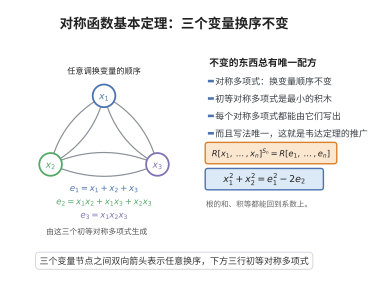

# 对称函数基本定理

> **一句话大白话**：任何"调换变量顺序也不变"的多项式，都能用最基本的那几个（各次初等对称多项式）唯一地写出来。
>
> **小例子**：$x_1^2+x_2^2=(x_1+x_2)^2-2x_1x_2=e_1^2-2e_2$，把对称多项式 $x_1^2+x_2^2$ 用 $e_1,e_2$ 表示了出来。

## 介绍

设 $R$ 是交换环，$R[x_1,\dots,x_n]$ 是 $n$ 元多项式环。称多项式 $f$ 为**对称多项式**，若对任意置换 $\sigma\in S_n$，把变量 $x_i$ 换成 $x_{\sigma(i)}$ 之后 $f$ 不变。最基本的一族对称多项式是**初等对称多项式**

$$
e_1=\sum_i x_i,\quad e_2=\sum_{i<j}x_ix_j,\quad \dots,\quad e_k=\sum_{i_1<\cdots<i_k}x_{i_1}\cdots x_{i_k},\quad\dots,\quad e_n=x_1x_2\cdots x_n
$$

一般地 $e_k=\sum_{1\le i_1<\cdots<i_k\le n}x_{i_1}\cdots x_{i_k}$。

对称函数基本定理断言：$R[x_1,\dots,x_n]^{S_n}=R[e_1,\dots,e_n]$，即每个对称多项式都能**唯一**地写成 $e_1,\dots,e_n$ 的多项式。

这一定理的系统陈述与证明归于 Newton（1707 年的《普遍算术》中给出用幂和表示初等对称多项式的 Newton 恒等式）以及后来的代数传统；它也是判别式、结式、Galois 理论中"用系数表达根的对称函数"的基础。

它的重要性体现在多个层面。第一，它是"不变量理论"的最早且最完美的例子：在一个群作用下不变的多项式环仍是多项式环，且能显式给出。第二，它把关于"根"的信息转化为关于"系数"的信息，这正是韦达定理的推广：对首一多项式 $t^n-a_1t^{n-1}+\cdots+(-1)^n a_n$ 的根 $x_1,\dots,x_n$，有 $e_k(x_1,\dots,x_n)=a_k$。第三，它保证了对称多项式的表达唯一，从而可以无歧义地谈论"对称函数在系数上的取值"，这是 Galois 理论中把对称函数降为有理系数的核心机制。

## 几何直观

图意在说明：对称多项式在变量重排下不变，而所有这样的多项式都能由三个初等对称多项式唯一写出。

## 分析

**前置依赖**：多项式环、对称群与群作用、单项式与字典序（或某个单项式序）、初等对称多项式、良基序与归纳法、交换环上的多项式表示唯一性

**定理内容**：设 $R$ 为交换环，则

$$
R[x_1,\dots,x_n]^{S_n}=R[e_1,\dots,e_n]
$$

其中 $R[x_1,\dots,x_n]^{S_n}$ 表示在变量置换下不变的全体多项式。换言之，映射

$$
\varphi:R[y_1,\dots,y_n]\to R[x_1,\dots,x_n],\qquad y_k\mapsto e_k
$$

是单同态，且其像恰为所有对称多项式。

证明的两大支柱是：

**存在性**：对单项式序下的**领先单项式**用归纳法。给定对称多项式 $f$，设其领先单项式（按字典序最大）为 $c\,x_1^{a_1}x_2^{a_2}\cdots x_n^{a_n}$。由 $f$ 对称可知 $a_1\ge a_2\ge\cdots\ge a_n$（否则通过对换变量可得到序更大的单项式，与领先性矛盾）。构造

$$
g=c\,e_1^{a_1-a_2}e_2^{a_2-a_3}\cdots e_{n-1}^{a_{n-1}-a_n}e_n^{a_n}
$$

可以验证 $g$ 的领先单项式恰好也是 $c\,x_1^{a_1}\cdots x_n^{a_n}$。于是 $f-g$ 是对称多项式且领先单项式严格变小，由单项式序的良基性递归下去，有限步后得到 $f\in R[e_1,\dots,e_n]$。

**唯一性**：需要证明 $e_1,\dots,e_n$ 代数无关，即 $\varphi$ 是单射。等价地，$R[e_1,\dots,e_n]$ 中非零多项式在 $\varphi$ 下不为零多项式。用领先单项式的比较即可：若 $h(y_1,\dots,y_n)\neq 0$，取 $h$ 在字典序下领先的单项式 $c\,y_1^{b_1}\cdots y_n^{b_n}$，则 $\varphi$ 把它映为某个多项式，其领先单项式为 $c\,x_1^{b_1+\cdots+b_n}x_2^{b_2+\cdots+b_n}\cdots x_n^{b_n}$（因为 $e_1^{b_1}\cdots e_n^{b_n}$ 的领先单项式是 $x_1^{b_1+\cdots+b_n}x_2^{b_2+\cdots+b_n}\cdots x_n^{b_n}$）。映射 $(b_1,\dots,b_n)\mapsto(b_1+\cdots+b_n,\,b_2+\cdots+b_n,\dots,b_n)$ 是单射，且与原单项式序相容（严格递增），所以不同单项式给出不同的领先单项式，最大的那个不会被抵消，$\varphi(h)\neq 0$。

## 思考过程

第一，为什么用字典序以及领先单项式？字典序把多项式按"指数向量"排序，使得"消去最大项"成为一个单调下降的过程。只要领先单项式每一步都严格变小，而指数向量构成的集合在字典序下是良基的（没有无穷严格下降链），过程就会终止。这是 Hilbert 基定理证明中"单项式序归纳"的同一思想。

第二，为什么领先单项式的指数满足 $a_1\ge\cdots\ge a_n$？因为 $f$ 对称。若某处 $a_i<a_{i+1}$，则对换 $x_i,x_{i+1}$ 得到的单项式指数向量在字典序下更大（前面相同、这一位变大），仍在 $f$ 中（对称性），与领先性矛盾。这种"指数递减"的单项式叫分划型单项式，它与 $e_1,\dots,e_n$ 中的单项式一一对应。

第三，构造的 $g$ 为什么恰好消掉领先项？$e_1$ 的领先单项式是 $x_1$，$e_2$ 的是 $x_1x_2$，一般 $e_k$ 的领先单项式是 $x_1x_2\cdots x_k$。相乘后指数向量的第 $i$ 位累计为 $(a_i-a_{i+1})+(a_{i+1}-a_{i+2})+\cdots+a_n$（当 $i<n$）或者用一般公式 $\sum_{k\ge i}(a_k-a_{k+1})$（约定 $a_{n+1}=0$），恰为 $a_i$。所以 $g$ 的领先单项式指数就是 $(a_1,\dots,a_n)$，系数为 $c$，与 $f$ 相同。

第四，唯一性为什么与存在性用的是同一套工具？因为 $e_1,\dots,e_n$ 的领先单项式互相"错开"，使得乘积的领先单项式唯一地记录了指数的部分和。这个"三角"结构使 $\varphi$ 保持领先项，因而必是单射。

## 证明过程

**步骤 1：单项式序的良基性。**

在 $\mathbb N^n$ 上定义字典序 $\succ$：对向量 $a,b$，令 $j$ 为第一个满足 $a_j\neq b_j$ 的下标，若 $a_j>b_j$ 则 $a\succ b$。与之对应的单项式序也记作 $\succ$：$x^a\succ x^b$ 当且仅当 $a\succ b$。该序是良基的，即不存在无穷严格下降链。因为若 $a^{(1)}\succ a^{(2)}\succ\cdots$，则每步下降时要么第一个坐标减小，要么第一个坐标相同而第二个坐标起在更后的位置上减小；考虑首个坐标序列：它非增且非负，必最终稳定在 $a_1$；再考虑第二个坐标，同理最终稳定；如此在至多 $n$ 个坐标上依次稳定，得到最终的常序列，而严格下降不可能在稳定后继续。更严格地，$\mathbb N^n$ 在字典序下没有无穷下降链（因为 $\mathbb N$ 是良基序，而字典序是良基序的字典积，保持良基性）。良基性保证下述递归终止。

**步骤 2：领先单项式的形状。**

设 $f$ 为非零对称多项式，其领先单项式为 $c\,x^a$，$c\neq 0$，$a=(a_1,\dots,a_n)$。断言 $a_1\ge a_2\ge\cdots\ge a_n$。若不然，存在 $i$ 使 $a_i<a_{i+1}$。取对换 $(i\ i+1)$ 对应的置换 $\sigma$，由 $f$ 对称，$\sigma(f)=f$，所以单项式 $x^{\sigma(a)}$（指数向量为前 $i-1$ 位不变、第 $i$ 位为 $a_{i+1}$、第 $i+1$ 位为 $a_i$、后面不变）也出现在 $f$ 中。比较 $a$ 与 $\sigma(a)$：首个不同位置是第 $i$ 位，且 $a_{i+1}>a_i$，故 $\sigma(a)\succ a$，即 $x^{\sigma(a)}\succ x^a$，与 $x^a$ 是领先单项式矛盾。故 $a_1\ge\cdots\ge a_n$。

**步骤 3：构造消项多项式（存在性的递归步）。**

记 $e_0=1$。对步骤 2 中的 $a$，令

$$
g=c\,e_1^{a_1-a_2}e_2^{a_2-a_3}\cdots e_{n-1}^{a_{n-1}-a_n}e_n^{a_n}
$$

先求每个 $e_k$ 的领先单项式。$e_k=\sum_{i_1<\cdots<i_k}x_{i_1}\cdots x_{i_k}$，按字典序比较其中单项式，$x_1x_2\cdots x_k$ 的指数向量是 $(1,1,\dots,1,0,\dots,0)$（前 $k$ 个为 $1$），它大于任何其他单项式（其他单项式在首个"不是 $1,2,\dots,k$"的位置上取的值更大，导致该位置字典序更大，需注意比较方式：任何含下标 $>k$ 而缺少某个 $\le k$ 的单项式，其指数向量在某个前 $k$ 位为 $0$ 而 $x_1\cdots x_k$ 为 $1$，故后者更大）。因此 $e_k$ 的领先单项式是 $x_1x_2\cdots x_k$。

于是 $e_1^{a_1-a_2}\cdots e_n^{a_n}$ 的领先单项式，其指数向量的第 $i$ 位为所有含 $x_i$ 的 $e_k$（即 $k\ge i$）贡献之指数和：

$$
\sum_{k=i}^{n}(a_k-a_{k+1})\quad(\text{约定 }a_{n+1}=0)
$$

这是望远镜求和，等于 $a_i$。且领先单项式的系数为 $1$（每个 $e_k$ 的领先项系数为 $1$，乘积领先项系数为 $1$）。故 $g$ 的领先单项式为 $c\,x^a$，与 $f$ 相同。

**步骤 4：递归终止（存在性）。**

令 $f_1=f-g$。因 $f$ 与 $g$ 都对称，$f_1$ 对称；又二者领先项相同且系数相同，相减后 $x^a$ 被消去，故 $f_1=0$ 或 $f_1$ 的领先单项式严格小于 $x^a$。对 $f_1$ 重复步骤 2、3 得 $f_2=f_1-g_1$，领先项继续严格下降。由步骤 1 的良基性，此过程不能无限进行，必在有限步 $m$ 后 $f_m=0$。于是

$$
f=g+g_1+\cdots+g_{m-1}\in R[e_1,\dots,e_n]
$$

存在性得证。

**步骤 5：唯一性（$e_1,\dots,e_n$ 代数无关）。**

设 $h\in R[y_1,\dots,y_n]$ 满足 $\varphi(h)=0$，其中 $\varphi(y_k)=e_k$。若 $h\neq 0$，取 $h$ 按字典序的领先单项式 $c\,y_1^{b_1}\cdots y_n^{b_n}$，$c\neq 0$。则 $\varphi$ 把该单项式映为 $e_1^{b_1}\cdots e_n^{b_n}$，其领先单项式的指数向量为

$$
\beta=(b_1+\cdots+b_n,\ b_2+\cdots+b_n,\ \dots,\ b_n)
$$

系数为 $c\neq 0$。映射 $b\mapsto\beta$ 是 $\mathbb Z$-线性单射（下三角、对角元全为 $1$ 的整数矩阵可逆），且对字典序严格保序：若 $b\succ b'$，设首个不同位置为 $j$，则 $\beta-\beta'$ 的前 $j-1$ 个坐标差为 $0$（因这些坐标是 $b_j$ 以后各项之和，首 $j-1$ 位差为 $0$ 迫使更后各项差相消），第 $j$ 个坐标差为 $b$ 与 $b'$ 在位置 $j$ 及之后若干项的差，恰是 $(b_j-b'_j)$ 加上其后各项差；需要更精细地看，但至少 $\beta\succ\beta'$ 成立（这是"部分和变换保持字典序"的标准事实：$b\mapsto\beta$ 的逆由差分 $b_i=\beta_i-\beta_{i+1}$ 给出，且 $\beta$ 与 $b$ 的第 $i$ 个坐标的首次差异位置一致）。

因此 $h$ 中不同的单项式给出 $\varphi(h)$ 中不同的领先单项式。取 $h$ 中领先单项式对应的那一个，它是 $\varphi(h)$ 中字典序最大的单项式，无法被其他项抵消（其他项的领先项都更小，且每项内部非领先项更小）。故 $\varphi(h)$ 的领先项非零，$\varphi(h)\neq 0$，矛盾。故 $h=0$，$\varphi$ 为单射。

**步骤 6：结论。**

步骤 4 表明像包含全体对称多项式，步骤 5 表明映射单且像为 $R[e_1,\dots,e_n]$。故

$$
R[x_1,\dots,x_n]^{S_n}=R[e_1,\dots,e_n]
$$

且表示唯一。定理证毕。

## 课堂问答

**老师**：为什么每个对称多项式都能写成初等对称多项式的多项式？

**学生**：结论：$R[x_1,\dots,x_n]^{S_n}=R[e_1,\dots,e_n]$，且表示唯一。存在性对字典序领先单项式 $c\,x_1^{a_1}\cdots x_n^{a_n}$ 递归，唯一性即 $e_1,\dots,e_n$ 代数无关。

**老师（追问）**：领先单项式的指数为什么必满足 $a_1\ge a_2\ge\cdots\ge a_n$？

**学生**：因为 $f$ 对称：若某处 $a_i<a_{i+1}$，对换 $x_i,x_{i+1}$ 得到的单项式指数向量在字典序下更大且仍在 $f$ 中，与领先性矛盾。

**老师（拓展）**：消项多项式怎么造，唯一性为何用同一套工具？

**学生**：令 $g=c\,e_1^{a_1-a_2}e_2^{a_2-a_3}\cdots e_n^{a_n}$，因 $e_k$ 的领先单项式是 $x_1\cdots x_k$，乘积指数经望远镜求和恰为 $a_i$，故 $g$ 领先项与 $f$ 一致，递归由字典序良基性终止。唯一性同样靠领先项：$b\mapsto(b_1+\cdots+b_n,\dots,b_n)$ 单射且保序，故 $\varphi(h)\ne0$；它是韦达定理 $e_k=a_k$ 的不变量论推广。

## 相关条目

- [环同态基本定理](./环同态基本定理.md)：本证明中把 $R[y_1,\dots,y_n]\to R[x_1,\dots,x_n]$ 的单同态视为嵌入，其像刻画即同态基本定理的应用。
- [PID是UFD](./PID是UFD.md)：对称多项式与判别式理论在整环上的讨论常需唯一析因性质。
