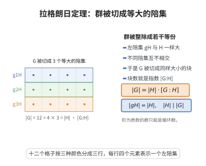

# 拉格朗日定理（群论）

> **一句话大白话**：一个有限群的任何子结构（子群）的大小都必须是整个群大小的整数分之一——整个群可以被切成大小完全一样的若干份，子群加大小的份数正好整除总人数。
>
> **小例子**：群 $G$ 有 $12$ 个元素，则其子群 $H$ 的阶只能是 $1,2,3,4,6,12$ 之一，比如 $|H|=4$ 时陪集个数 $[G:H]=3$。

## 介绍

拉格朗日定理（Lagrange's Theorem）是群论中最基本的计数定理之一。它断言：有限群 $G$ 的子群 $H$ 的阶整除 $G$ 的阶，且 $|G| = |H| \cdot [G:H]$，其中 $[G:H]$ 是 $H$ 在 $G$ 中的指数（即陪集的个数）。这个定理将群的阶与子群的阶联系起来，是群论中许多计数论证的基础，也是理解群结构的重要工具。

## 几何直观

图意在说明：子群与每个陪集大小相同，群因此被均匀分割，子群的阶必整除群的阶。

## 分析

**前置依赖**：子群、左陪集、等价关系、双射。

**定理的精确表述**：设 $G$ 是有限群，$H$ 是 $G$ 的子群。则 $|H|$ 整除 $|G|$，且

$$
|G| = |H| \cdot [G:H],
$$

其中 $[G:H]$ 是 $H$ 在 $G$ 中的指数，即 $G$ 中 $H$ 的左陪集（或右陪集）的个数。

**推论**：
1. 有限群 $G$ 中每个元素的阶整除 $|G|$。
2. 阶为质数的群是循环群。
3. 若 $|G| = p$ 是质数，则 $G \cong \mathbb{Z}_p$。

## 思考过程

拉格朗日定理的证明基于陪集分解的基本性质。$G$ 可以划分为 $H$ 的左陪集的不交并，每个左陪集与 $H$ 有相同的大小（因为映射 $h \mapsto gh$ 是 $H$ 到 $gH$ 的双射）。因此 $|G| = |H| \times \text{陪集个数}$。

这个定理虽然简单，但它的推论非常强大。例如，元素的阶整除群的阶意味着：若群阶为质数 $p$，则非单位元元素的阶只能是 $p$，从而整个群由该元素生成，是循环群。

需要注意的是，拉格朗日定理的逆命题不成立——如果 $d$ 整除 $|G|$，$G$ 不一定有阶为 $d$ 的子群。例如，交错群 $A_4$ 的阶为 $12$，但它没有阶为 $6$ 的子群。不过，Sylow 定理给出了部分逆命题。

## 证明过程

**证明**：设 $G$ 是有限群，$H \le G$。定义 $G$ 上的等价关系：$g_1 \sim g_2$ 当且仅当 $g_1^{-1}g_2 \in H$。$g$ 所在的等价类就是左陪集 $gH = \{gh: h \in H\}$。

**步骤 1**：每个左陪集 $gH$ 与 $H$ 有相同的大小。定义映射 $\psi: H \to gH$ 为 $\psi(h) = gh$。$\psi$ 是满射（由定义），且若 $gh_1 = gh_2$，则左乘 $g^{-1}$ 得 $h_1 = h_2$，故 $\psi$ 是单射。因此 $|gH| = |H|$。

**步骤 2**：$G$ 是左陪集的不交并。$G = \bigcup_{g \in G} gH$，且若 $g_1H \cap g_2H \neq \varnothing$，则 $g_1H = g_2H$（等价类要么相等要么不交）。

**步骤 3**：设 $[G:H]$ 是左陪集的个数（即指数）。则

$$
|G| = \sum_{\text{陪集}} |gH| = |H| \cdot [G:H].
$$

因此 $|H|$ 整除 $|G|$。$\square$

**推论 1**：有限群 $G$ 中每个元素的阶整除 $|G|$。

**证明**：设 $g \in G$，$g$ 的阶为 $n$，即 $n$ 是满足 $g^n = e$ 的最小正整数。考虑循环子群 $\langle g \rangle = \{e, g, g^2, \ldots, g^{n-1}\}$，其阶为 $n$。由拉格朗日定理，$n = |\langle g \rangle|$ 整除 $|G|$。$\square$

**推论 2**：阶为质数 $p$ 的群是循环群。

**证明**：设 $|G| = p$ 是质数。取 $g \in G$ 且 $g \neq e$，则 $g$ 的阶整除 $p$，故为 $p$（因为 $g \neq e$，阶不为 $1$）。因此 $\langle g \rangle$ 是 $G$ 的 $p$ 阶子群，从而 $\langle g \rangle = G$，$G$ 是循环群。$\square$

## 课堂问答

**老师**：有限群里子群的阶为什么整除整个群的阶？

**学生**：结论：$|G|=|H|\cdot[G:H]$，故 $|H|\mid|G|$。证明是陪集分解：$G$ 是左陪集 $gH$ 的不交并，且 $h\mapsto gh$ 给出 $H\to gH$ 的双射，每个陪集大小都等于 $|H|$。

**老师（追问）**：由它能得到哪些常用推论？

**学生**：元素阶整除 $|G|$（因 $|\langle g\rangle|$ 就是 $g$ 的阶）；进而质数阶群必循环：非单位元阶只能为 $p$，由它生成全群，故 $G\cong\mathbb{Z}_p$。

**老师（拓展）**：逆命题成立吗？

**学生**：不成立。常见误区是以为 $d\mid|G|$ 就必有 $d$ 阶子群；$A_4$ 阶为 $12$ 却没有 $6$ 阶子群。部分逆命题由 Sylow 定理与 Cauchy 定理给出：$p\mid|G|$ 时必有 $p$ 阶元。
