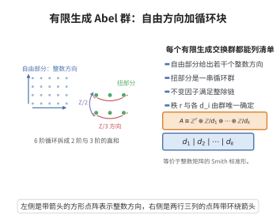

# 有限生成 Abel 群基本定理

> **一句话大白话**：任何由有限多个元素生成的交换群，都只是一堆"整数方向"加上一堆"循环方向"拼起来的，结构完全清楚。
>
> **小例子**：$\mathbb Z^2$ 由两个自由方向组成；$\mathbb Z/6\cong\mathbb Z/2\oplus\mathbb Z/3$，一个六阶循环群拆成 2 阶与 3 阶两部分。

## 介绍

有限生成的 Abel 群是代数中最先被完全分类的一类结构。它的分类定理断言：若 $A$ 是有限生成 Abel 群，则

$$
A\cong\mathbb Z^r\oplus\mathbb Z/d_1\oplus\mathbb Z/d_2\oplus\cdots\oplus\mathbb Z/d_k
$$

其中 $r\ge 0$ 是整数，每个 $d_i>1$ 且满足整除链

$$
d_1\mid d_2\mid\cdots\mid d_k
$$

并且 $r$ 与各 $d_i$ 由 $A$ 唯一确定。$r$ 称为 $A$ 的秩（或自由秩），$d_1,\dots,d_k$ 称为不变因子。

这个定理是 19 世纪末由 Kronecker、Frobenius、Stickelberger 与 Poincaré 等人在研究与数论和拓扑相关问题（如有限 Abel 群的结构、二次型分类）时逐步发现并证明的。它等价于关于整数矩阵的 Smith 标准形理论：任意整数矩阵都可以通过左右乘可逆整数矩阵化为对角形，且对角元满足整除链。

它的意义在于把"群"这种抽象对象下降为可以逐项算出来的数据。有限 Abel 群的分类是群论中最早完成的故事，其有限形式（$r=0$ 的情形）直接用于刻画有限交换群，例如说明有限交换群是若干循环 $p$-群的直积。它也是有限生成模理论（主理想整环上有限生成模结构定理）的原型和特例。

## 几何直观

图意在说明：有限生成交换群拆成若干整数方向与一串满足整除链的循环群。

## 分析

**前置依赖**：Abel 群、自由 Abel 群、子群与商群、直和、群同态基本定理、整数矩阵的初等变换与 Smith 标准形、带余除法

**定理内容**：设 $A$ 是有限生成 Abel 群，则存在唯一确定的整数 $r\ge 0$ 与整数 $d_1,\dots,d_k>1$，使得

$$
A\cong\mathbb Z^r\oplus\mathbb Z/d_1\oplus\cdots\oplus\mathbb Z/d_k,\qquad d_1\mid d_2\mid\cdots\mid d_k
$$

证明思路分三步：

第一步，把 $A$ 写成自由群的商。因 $A$ 有限生成，取生成元 $a_1,\dots,a_n$，定义满同态

$$
\pi:\mathbb Z^n\longrightarrow A,\qquad \pi(e_i)=a_i
$$

设 $K=\ker\pi$，则 $K$ 是 $\mathbb Z^n$ 的子群，由群同态基本定理 $A\cong\mathbb Z^n/K$。

第二步，把 $K$ 化为标准形。$K$ 作为 $\mathbb Z^n$ 的子群仍是自由 Abel 群且秩不超过 $n$（这是关键事实，用带余除法论证）。取 $K$ 的一组基构成的 $n\times m$ 整数矩阵，通过整数初等行、列变换（对应两组基的更换）把它化为 Smith 标准形：对角形，对角元 $d_1\mid d_2\mid\cdots\mid d_k$ 为正整数。

第三步，读出商群。$\mathbb Z^n/K$ 在标准基下化为

$$
\mathbb Z^{n-k}\oplus\mathbb Z/d_1\oplus\cdots\oplus\mathbb Z/d_k
$$

去掉平凡因子 $\mathbb Z/1$ 并把自由部分的秩记为 $r=n-k$，即得结论。唯一性由不变因子的内在描述（例如 $d_1\cdots d_i$ 等于 $A$ 中所有不超过 $i$ 个元素生成的子群阶的最大公因子相关量）保证。

## 思考过程

第一，为什么把群问题化为矩阵问题？Abel 群与 $\mathbb Z$-模是一回事，而有限生成的 $\mathbb Z$-模由有限多个生成元描述，其间的关系就是一个整数矩阵。用矩阵的初等变换代替"换生成元与换关系"，几何上就是把一个格 $K$ 在 $\mathbb Z^n$ 中摆正。

第二，为什么 $K$ 是自由的？这是 $\mathbb Z$ 作为主理想整环的性质：PID 上的自由模的子模仍是自由的。具体论证用"最小正坐标"配合带余除法，逐次削减，类似欧几里得算法。秩不超过 $n$ 因为它含在 $\mathbb Z^n$ 里。

第三，为什么对角元之间能要求整除链？Smith 标准形算法在被除的主元不能整除其他元素时，用一次"行列互加"把更小的余数换进主元位置，从而严格减小主元绝对值，反复进行必然终止。终态即每个主元整除同行同列其他元素，再调整即得整除链。

第四，唯一性从哪里来？Smith 标准形本身的唯一性给出矩阵层面的唯一性；群层面也可用"$A$ 的 $p$-初等分量"或"最小生成元个数的上界"等内在量刻画 $r$ 与 $d_i$。证明存在性后，唯一性只需比较两组的 $n$ 阶导群或多重整除乘积。

## 证明过程

**步骤 1：$K$ 是自由 Abel 群，秩不超过 $n$。**

设 $K\le\mathbb Z^n$ 为子群。若 $K=0$ 结论显然。否则取 $K$ 中第一个坐标不为 $0$ 的元素（按坐标序号从小到大找第一非零坐标），在这个"首个非零坐标位置"上取 $K$ 中该坐标绝对值最小者 $g_1$。对该位置上的任意元素 $x\in K$，用 $g_1$ 的该坐标对 $x$ 的该坐标做带余除法：$x$ 的该坐标 $=q\cdot(g_1\text{ 的该坐标})+s$，$0\le s<|g_1\text{ 的该坐标}|$。则 $x-q g_1\in K$ 且该坐标余 $s$。由 $g_1$ 的极小性 $s=0$，即 $x-qg_1$ 在该位置为 $0$。于是所有 $K$ 中元素的这个坐标都被 $g_1$ 整除，且 $x-qg_1$ 落在"该坐标为零"的坐标子空间内。对剩余坐标用归纳法（维数下降），可证 $K$ 是自由群且有一组基大小不超过 $n$。归纳基始 $n=1$ 显然。这就得到秩 $\mathrm{rank}\,K\le n$。

**步骤 2：Smith 标准形。**

设 $K$ 有一组基 $f_1,\dots,f_m$（$m\le n$），每个 $f_j\in\mathbb Z^n$。相对于 $\mathbb Z^n$ 的标准基 $\{e_i\}$，写成矩阵 $M=(m_{ij})$，其中 $f_j=\sum_i m_{ij} e_i$。我们允许如下两类操作：

- 左乘可逆整数矩阵：等价于更换 $\mathbb Z^n$ 的基 $\{e_i\}$；
- 右乘可逆整数矩阵：等价于更换 $K$ 的基 $\{f_j\}$。

这两类操作合起来就是整数初等变换。标准算法：若 $M=0$ 结束；否则取 $M$ 中绝对值最小的非零元，用行列交换把它移到 $(1,1)$ 位置。用 $(1,1)$ 元对其所在行与列的其余元素做带余除法，把余数放入相应位置；若有余数非零，则它与主元在同位置比较更小，与主元最小性矛盾——除非用"行列相减"确实产生更小的非零元，此时回到取最小元一步，主元绝对值严格减小。由于非负整数不能无限下降，算法终止于：$(1,1)$ 元整除其所在行与列的所有元素。

此时把 $(1,1)$ 元的倍数从第一行、第一列的其他位置消去，得到形如

$$
\begin{pmatrix} d_1 & 0\\ 0 & M'\end{pmatrix}
$$

的矩阵，$d_1>0$，$d_1$ 整除 $M'$ 的所有元素（若不整除，用一次行变换把余数移到第二行第一列，再回到取最小元步骤）。对子矩阵 $M'$ 递归处理，得对角形 $\mathrm{diag}(d_1,\dots,d_k)$，其中每个 $d_i>0$，且由"$d_i$ 整除其后所有元素"的维护得

$$
d_1\mid d_2\mid\cdots\mid d_k
$$

（把等于 $1$ 的因子略去即可，它们对应 $\mathbb Z/1=0$。）

**步骤 3：读出商群。**

初等变换对应换基，因此不改变商群 $\mathbb Z^n/K$ 的同构类。设 $K$ 在新基下由 $d_1 e_1,\dots,d_k e_k$ 生成（$d_i>1$）。则

$$
\mathbb Z^n/K\cong\big(\mathbb Z e_1/\langle d_1 e_1\rangle\big)\oplus\cdots\oplus\big(\mathbb Z e_k/\langle d_k e_k\rangle\big)\oplus\mathbb Z e_{k+1}\oplus\cdots\oplus\mathbb Z e_n
$$

每个 $\mathbb Z e_i/\langle d_i e_i\rangle\cong\mathbb Z/d_i$，后 $n-k$ 项各为 $\mathbb Z$。记 $r=n-k$，得

$$
A\cong\mathbb Z^r\oplus\mathbb Z/d_1\oplus\cdots\oplus\mathbb Z/d_k,\qquad d_1\mid\cdots\mid d_k
$$

这就是存在性。

**步骤 4：唯一性。**

称 $A$ 的**挠子群**为所有有限阶元素构成的子群 $T(A)$。则 $T(A)=\mathbb Z/d_1\oplus\cdots\oplus\mathbb Z/d_k$ 是有限群，而 $A/T(A)\cong\mathbb Z^r$。秩 $r$ 由 $A/T(A)$ 的秩唯一确定（自由 Abel 群的秩是其基元素个数，是内在不变量，可用线性无关性刻画）。

对挠部分 $T=T(A)$：它在每个素数 $p$ 处分解为 $p$-初等分量 $T_p$，$T=\bigoplus_p T_p$，且 $|T_p|=p^{\sum_i v_p(d_i)}$。设 $T_p\cong\mathbb Z/p^{e_1}\oplus\cdots\oplus\mathbb Z/p^{e_s}$（按指数递增排列），则各 $e_j$ 唯一。可由 $p^j T_p/p^{j+1}T_p$ 的维数唯一确定：$T_p$ 中能被 $p^j$ 整除元与 $p^{j+1}$ 整除元的商，其大小为 $p$ 的幂，指数等于 $\#\{i:e_i>j\}$；这给出了划分 $\{e_i\}$ 的共轭分划，从而唯一。合并所有 $p$ 的指数并按整除链排序，即唯一确定不一定因子 $d_1\mid\cdots\mid d_k$（也可用另一种唯一形：$p$ 的幂次基本不变量，二者一一对应）。故 $r$ 与 $d_1,\dots,d_k$ 唯一。定理证毕。

## 课堂问答

**老师**：有限生成 Abel 群怎样被完全分类？

**学生**：结论：$A\cong\mathbb{Z}^r\oplus\mathbb{Z}/d_1\oplus\cdots\oplus\mathbb{Z}/d_k$，$d_1\mid\cdots\mid d_k$，且 $r$ 与 $d_i$ 唯一。证明把 $A$ 写成 $\mathbb{Z}^n/K$，再用整数初等变换把关系矩阵化为 Smith 标准形 $\mathrm{diag}(d_1,\dots,d_k)$ 读出商群。

**老师（追问）**：为什么 $K$ 一定是自由群？

**学生**：因为 $\mathbb{Z}$ 是 PID，而 PID 上自由模的子模仍自由；具体用"最小正坐标 + 带余除法"逐次削减，秩不超过 $n$。

**老师（拓展）**：唯一性从哪里来？

**学生**：挠子群 $T(A)$ 是有限群、$A/T(A)\cong\mathbb{Z}^r$，故 $r$ 唯一；对每个素数 $p$，$p$-初等分量的块指数由 $\dim(p^{j-1}T_p/p^jT_p)$ 唯一确定。注意 $\mathbb{Z}/6\cong\mathbb{Z}/2\oplus\mathbb{Z}/3$ 依赖 $\gcd(2,3)=1$（中国剩余定理），不互素则不能这样拆。

## 相关条目

- [群同态基本定理](./群同态基本定理.md)：本证明第一步将有限生成 Abel 群写成自由群的商，正是此定理的直接应用。
- [中国剩余定理](./中国剩余定理.md)：说明 $\mathbb Z/mn\cong\mathbb Z/m\oplus\mathbb Z/n$（$(m,n)=1$），是不变因子与初等因子互相转化的桥梁。
- [PID是UFD](./PID是UFD.md)：$\mathbb Z$ 是主理想整环，其上的有限生成模结构定理是本定理的推广背景。
