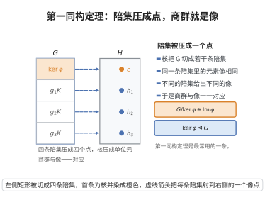

# 第一同构定理

> **一句话大白话**：任何群映射都把"缩成核"的商群和它的"像"绑在一起——压缩之后的样子与打过去之后的样子完全一致。
>
> **小例子**：$\varphi:\mathbb{Z}_6\to\mathbb{Z}_2$，$x\mapsto x\bmod2$，则 $\mathbb{Z}_6/\ker\varphi\cong\mathbb{Z}_2$，即 $G/\ker\varphi\cong\text{Im}\varphi$。

## 介绍

第一同构定理（First Isomorphism Theorem）是群论中三个同构定理中的第一个，它描述了群同态与商群之间的关系。该定理就是群同态基本定理：若 $\varphi: G \to H$ 是群同态，则 $G/\ker\varphi \cong \text{Im}\varphi$。这个定理是群同态理论的核心，它揭示了核、像和商群之间的内在联系，是理解群结构的基本工具。

## 几何直观

图意在说明：核把群切成陪集，同一条陪集里的元素像相同，于是商群与像一一对应并同构。

## 分析

**前置依赖**：群同态、核与正规子群、商群、同构。

**定理的精确表述**：设 $\varphi: G \to H$ 是群同态，则

$$
G/\ker\varphi \cong \text{Im}\varphi.
$$

**等价形式**：每个群同态 $\varphi$ 可以分解为

$$
G \xrightarrow{\pi} G/\ker\varphi \xrightarrow{\overline{\varphi}} \text{Im}\varphi \xrightarrow{i} H,
$$

其中 $\pi$ 是自然满射，$\overline{\varphi}$ 是同构，$i$ 是包含映射。

**证明**：见"群同态基本定理"的证明。

## 思考过程

第一同构定理的核心思想是：同态 $\varphi$ 将 $G$ 中那些在核中的元素"压缩"为零，剩下的元素结构正好与 $\varphi$ 的像同构。这个定理是理解群论中同态、商群和正规子群之间关系的基础。

## 证明过程

**证明**：见"群同态基本定理"的证明。$\square$

**例**：$\varphi: \mathbb{Z} \to \mathbb{Z}_n$，$\varphi(k) = k \bmod n$。$\ker\varphi = n\mathbb{Z}$，$\text{Im}\varphi = \mathbb{Z}_n$，故 $\mathbb{Z}/n\mathbb{Z} \cong \mathbb{Z}_n$。

## 课堂问答

**老师**：第一同构定理说的是什么？

**学生**：结论：$\varphi:G\to H$ 时 $G/\ker\varphi\cong\mathrm{Im}\,\varphi$，它就是群同态基本定理；进一步 $\varphi$ 可分解为 $G\twoheadrightarrow G/\ker\varphi\xrightarrow{\sim}\mathrm{Im}\,\varphi\hookrightarrow H$。

**老师（追问）**：定理的核心机制在哪一步？

**学生**：在"良定义"：$\bar\varphi(g\ker\varphi)=\varphi(g)$ 必须与代表元无关——若 $g_1\ker\varphi=g_2\ker\varphi$ 则 $g_1^{-1}g_2\in\ker\varphi$，得 $\varphi(g_1)=\varphi(g_2)$。正是核把同态压成了商群。

**老师（拓展）**：给个例子，并说说它与另两个同构定理的关系。

**学生**：例如 $\varphi:\mathbb{Z}\to\mathbb{Z}_n$，$k\mapsto k\bmod n$，核 $n\mathbb{Z}$、像 $\mathbb{Z}_n$，故 $\mathbb{Z}/n\mathbb{Z}\cong\mathbb{Z}_n$。第一同构定理是枢纽：第二定理用 $\varphi(h)=hN$ 得 $H/(H\cap N)\cong HN/N$，第三定理用 $\Theta(gN)=gM$ 得 $(G/N)/(M/N)\cong G/M$。
