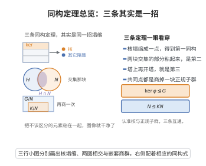

# 群论同构定理

> **一句话大白话**：群之间的同态把群"压扁"成商群；无论怎么取子群、正规子群，最后得到的商群结构都被同一批公式说清楚。
>
> **小例子**：模 $n$ 映射 $\mathbb Z\to\mathbb Z/n$ 的核是 $n\mathbb Z$，于是 $\mathbb Z/n\mathbb Z\cong\mathbb Z_n$，这就是第一同构定理。

## 介绍

同构定理是 Emmy Noether 于 1927 年整理并系统命名的（她称之为 "Satz von Homomorphismus"），其内容早在群论形成初期就被陆续发现：第一同构定理与群的同态像的结构有关，Jordan、Hölder 等人在研究商群和合成列时使用过类似结果。Noether 把它们抽象为统一的三条定理，并推广到模与环，成为现代代数的通用语言。

三条定理统一描述了群同态、商群与子群之间"约分"的规律：

- **第一同构定理**：$G/\ker\varphi\cong\mathrm{Im}\,\varphi$；
- **第二同构定理**（菱形定理）：设 $H\le G$，$N\trianglelefteq G$，则 $HN/N\cong H/(H\cap N)$；
- **第三同构定理**：设 $N\trianglelefteq M\trianglelefteq G$ 且 $N\trianglelefteq G$，则 $(G/N)/(M/N)\cong G/M$。

它们是群论中使用频率最高的工具：几乎每个关于商群的计算都要先"约去"一个核或一个中间正规子群。第一同构定理把"同态"这一外部概念翻译为"商群"这一内部构造，使对同态的研究完全归约为对正规子群的研究。第二同构定理说明子群与正规子群如何相互"交换"，是格同构（对应定理）的一部分。第三同构定理说明可以像分数一样"约分"，是商群层级结构的基本规律。

## 几何直观

图意在说明：三条同构定理都在做同一件事，把不该区分的元素粘成一块，商掉之后图像就与原来的像对上。

## 分析

**前置依赖**：群与子群、正规子群、商群、群同态、同态的核与像、正规子群判定、拉格朗日定理（用于阶的计数）

**定理内容**：

**第一同构定理**：设 $\varphi:G\to G'$ 是群同态，则 $\ker\varphi\trianglelefteq G$，$\mathrm{Im}\,\varphi\le G'$，且

$$
G/\ker\varphi\ \cong\ \mathrm{Im}\,\varphi
$$

同构由 $\bar\varphi(g\ker\varphi)=\varphi(g)$ 给出。

**第二同构定理**：设 $H\le G$，$N\trianglelefteq G$，则 $HN\le G$，$H\cap N\trianglelefteq H$，$N\trianglelefteq HN$，且

$$
HN/N\ \cong\ H/(H\cap N)
$$

**第三同构定理**：设 $N\trianglelefteq G$，$M\trianglelefteq G$ 且 $N\subseteq M$，则 $M/N\trianglelefteq G/N$，且

$$
(G/N)\big/(M/N)\ \cong\ G/M
$$

三者的证明都归结为：造出正确的同态，验证其核恰好是待约去的正规子群，再引用第一同构定理。这也是为什么第一同构定理是三者的核心。

## 思考过程

第一，第一同构定理的关键是"良定义"。定义 $\bar\varphi(g\ker\varphi)=\varphi(g)$ 时，同一个陪集可能有不同的代表元 $g$，必须验证 $\bar\varphi$ 的值不随代表元改变。若 $g\ker\varphi=g'\ker\varphi$，则 $g^{-1}g'\in\ker\varphi$，于是 $\varphi(g^{-1}g')=e'$，即 $\varphi(g)^{-1}\varphi(g')=e'$，得 $\varphi(g)=\varphi(g')$。这一步正是"核"的作用：正是核把同态压成商群。

第二，第二同构定理的自然同态是"$H\hookrightarrow HN\to HN/N$"这条复合路径，其核是 $N$ 中落在 $H$ 里的部分，即 $H\cap N$。像正好是 $HN/N$，因为 $HN/N$ 中每个元素是 $hnN=hN$，来自 $h\in H$。于是 $H/(H\cap N)\cong HN/N$。

第三，第三同构定理的自然同态是"$G\to G/N\to (G/N)/(M/N)$"合成，或更直接地取 $G\to G/M$，其核是 $M$。用第一同构定理需验证核是 $M$，同态是 $g\mapsto gM$。也可以写显式映射 $\theta(gN)=gM$，验证良定义与核为 $M/N$。

## 证明过程

**步骤 1：第一同构定理。**

设 $\varphi:G\to G'$ 是群同态，记 $K=\ker\varphi=\{g\in G:\varphi(g)=e'\}$。

先证 $K\trianglelefteq G$。$K$ 非空（$e\in K$）。若 $a,b\in K$，则 $\varphi(ab^{-1})=\varphi(a)\varphi(b^{-1})=\varphi(a)\varphi(b)^{-1}=e'(e')^{-1}=e'$，故 $ab^{-1}\in K$，$K\le G$。再对 $g\in G$、$k\in K$：

$$
\varphi(gkg^{-1})=\varphi(g)\varphi(k)\varphi(g)^{-1}=\varphi(g)e'\varphi(g)^{-1}=e'
$$

故 $gkg^{-1}\in K$，即 $K\trianglelefteq G$。$\mathrm{Im}\,\varphi=\varphi(G)$ 是 $G'$ 的子群（同样由 $ab^{-1}$ 检验）。

定义

$$
\bar\varphi:G/K\to G',\qquad \bar\varphi(gK)=\varphi(g)
$$

**良定义**：设 $gK=g'K$，则 $g^{-1}g'\in K$，于是 $\varphi(g^{-1}g')=e'$，即 $\varphi(g)^{-1}\varphi(g')=e'$，得 $\varphi(g)=\varphi(g')$，故 $\bar\varphi$ 良定义。

**同态**：$\bar\varphi(gK\cdot hK)=\bar\varphi(ghK)=\varphi(gh)=\varphi(g)\varphi(h)=\bar\varphi(gK)\bar\varphi(hK)$。

**单射**：$\ker\bar\varphi=\{gK:\varphi(g)=e'\}=\{gK:g\in K\}=K$（陪集 $K$ 是 $G/K$ 的单位元）。故 $\bar\varphi$ 单。

**满射**：任取 $y\in\mathrm{Im}\,\varphi$，存在 $g$ 使 $y=\varphi(g)=\bar\varphi(gK)$。故 $\bar\varphi$ 满射到 $\mathrm{Im}\,\varphi$。

综上 $\bar\varphi$ 是 $G/K$ 到 $\mathrm{Im}\,\varphi$ 的同构：

$$
G/\ker\varphi\cong\mathrm{Im}\,\varphi
$$

**步骤 2：第二同构定理。**

设 $H\le G$，$N\trianglelefteq G$。

先证 $HN=NH$ 是子群。对 $h_1n_1,h_2n_2\in HN$，需 $(h_1n_1)(h_2n_2)^{-1}\in HN$。由 $N\trianglelefteq G$ 有 $n_1 h_2^{-1}=h_2^{-1}n_3$ 对某 $n_3\in N$（因 $n_1h_2^{-1}\in h_2^{-1}N$ 且 $h_2^{-1}N=Nh_2^{-1}$，或直接用 $h_2 n_1 h_2^{-1}\in N$）。于是

$$
(h_1n_1)(h_2n_2)^{-1}=h_1n_1n_2^{-1}h_2^{-1}=h_1(n_1n_2^{-1})h_2^{-1}=h_1h_2^{-1}n_4
$$

其中 $n_4=h_2(n_1n_2^{-1})h_2^{-1}\in N$。故结果属于 $HN$，$HN\le G$。且 $N\subseteq HN$ 正规：对 $hn\in HN$ 与 $k\in N$，$(hn)k(hn)^{-1}=h(nkn^{-1})h^{-1}\in hNh^{-1}=N$；因 $N\trianglelefteq G$ 对任意 $h\in H\subseteq G$ 成立，故 $N\trianglelefteq HN$。

考虑映射 $\theta:H\to HN/N$，$\theta(h)=hN$。它是 $h\mapsto hN$ 在 $H$ 上的限制，因此是同态（嵌入 $H\subseteq HN$ 后取商）。求核：

$$
\ker\theta=\{h\in H:hN=N\}=\{h\in H:h\in N\}=H\cap N
$$

故 $H\cap N\trianglelefteq H$（第一同构定理的核正规）。$\theta$ 的像是 $\{hN:h\in H\}$。又 $HN/N$ 中每个元素形如 $(hn)N=hN$（$n\in N$），所以像恰为 $HN/N$。由第一同构定理

$$
H/(H\cap N)\cong HN/N
$$

**步骤 3：第三同构定理。**

设 $N\trianglelefteq G$，$M\trianglelefteq G$，$N\subseteq M$。

先证 $M/N\trianglelefteq G/N$：任取 $mN\in M/N$ 与 $gN\in G/N$，则

$$
(gN)(mN)(gN)^{-1}=gmg^{-1}N\in M/N
$$

因 $gmg^{-1}\in M$（$M\trianglelefteq G$），故 $M/N\trianglelefteq G/N$。

定义

$$
\Theta:G/N\to G/M,\qquad \Theta(gN)=gM
$$

**良定义**：若 $gN=g'N$，则 $g^{-1}g'\in N\subseteq M$，故 $gM=g'M$。

**同态**：$\Theta(gN\cdot hN)=\Theta(ghN)=ghM=(gM)(hM)=\Theta(gN)\Theta(hN)$。

**核**：$\Theta(gN)=M$（$G/M$ 的单位元）当且仅当 $gM=M$ 当且仅当 $g\in M$。故

$$
\ker\Theta=\{gN:g\in M\}=M/N
$$

由步骤 1 的论证（$N$ 已正规）$\Theta$ 诱导同构

$$
(G/N)\big/(M/N)\cong G/M
$$

**步骤 4：三定理的关系。**

三条定理的证明都只用到：$K=\ker\varphi\trianglelefteq G$、商群构造、以及核的显式计算。第一同构定理是三者的枢纽；第二、第三同构定理的映射 $\theta,\Theta$ 都是自然投影与包含的复合，其核分别正好是 $H\cap N$ 与 $M/N$。定理证毕。

## 课堂问答

**老师**：三个同构定理统一的图景是什么？

**学生**：结论：第一 $G/\ker\varphi\cong\mathrm{Im}\,\varphi$；第二（$H\le G$、$N\trianglelefteq G$）$HN/N\cong H/(H\cap N)$；第三（$N\trianglelefteq M\trianglelefteq G$ 且 $N\trianglelefteq G$）$(G/N)/(M/N)\cong G/M$。三者证明都归结为"造同态 + 算核 + 套第一同构定理"。

**老师（追问）**：第二、第三的自然同态与核分别是什么？

**学生**：第二是 $\theta(h)=hN:H\to HN/N$，核 $H\cap N$；第三是 $\Theta(gN)=gM:G/N\to G/M$，核 $M/N$；二者都是包含映射与自然投影的复合。

**老师（拓展）**：为什么说第一同构定理是三者的枢纽？

**学生**：因为它把外部概念"同态"翻译为内部构造"商群"，使同态研究完全归约为正规子群研究。常见误区：第二定理要求 $N\trianglelefteq G$（不只是 $N\le G$），否则 $HN$ 未必是子群、$H\cap N$ 未必在 $H$ 中正规。

## 相关条目

- [第一同构定理](./第一同构定理.md)：本条目中第一部分的独立成篇陈述。
- [第二同构定理](./第二同构定理.md)：菱形定理的独立条目，与本文第二部分内容一致。
- [第三同构定理](./第三同构定理.md)：商群"约分"规则的独立条目，对应本文第三部分。
