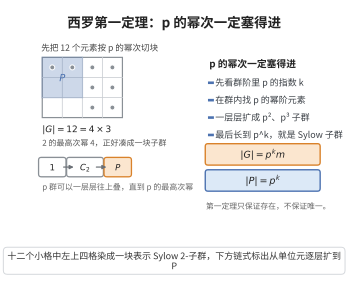

# 西罗第一定理

> **一句话大白话**：只要群的大小能被某个质数的最高次幂整除，就能在群里找到一块大小恰好为这个最高次幂的子群——"完整满血的 $p$ 房"必存在，一切的 $p^i$ 房都能逐步造出。
>
> **小例子**：$|G|=12=2^2\cdot3$，则 $G$ 必含阶为 $4$ 的 Sylow $2$-子群和阶为 $3$ 的 Sylow $3$-子群。

## 介绍

西罗第一定理（Sylow's First Theorem）是有限群论中 Sylow 定理系列的第一个，它给出了有限群中 $p$-子群存在的充分条件。具体地，若 $p$ 是整除 $|G|$ 的质数，$p^k$ 是 $p$ 的最高幂整除 $|G|$，则 $G$ 存在阶为 $p^k$ 的子群（称为 Sylow $p$-子群）。更一般地，对任意 $1 \le i \le k$，$G$ 存在阶为 $p^i$ 的子群。Sylow 定理是有限群论中最强大的工具之一，它们为研究有限群的结构提供了深刻的计数信息。

## 几何直观

图意在说明：群阶中 p 的最高次幂一定对应某个子群的阶，p 群可以从单位元一层层扩到 p 的满次幂。

## 分析

**前置依赖**：群作用、轨道-稳定子定理、组合数模 p 性质、稳定子群。

**定理的精确表述**：设 $G$ 是有限群，$p$ 是质数，$|G| = p^k m$，其中 $p \nmid m$。则 $G$ 存在阶为 $p^k$ 的子群（称为 Sylow $p$-子群）。更一般地，对每个 $1 \le i \le k$，$G$ 存在阶为 $p^i$ 的子群。

**证明方法**：有多种证明方法，包括：
- 利用群作用在 $G$ 的子集族上
- 利用 Cauchy 定理（存在阶为 $p$ 的元素）和归纳法
- 利用群作用在陪集上

## 思考过程

西罗第一定理的证明通常使用群作用在 $G$ 的所有 $p^k$ 元子集上的方法。考虑 $G$ 的所有 $p^k$ 元子集构成的集合 $\Omega$，$G$ 通过左乘作用在 $\Omega$ 上。每个轨道的大小整除 $|G|$。通过分析轨道大小的模 $p$ 性质，可以证明存在一个轨道，其大小不能被 $p$ 整除，从而该轨道的稳定子群就是阶为 $p^k$ 的 Sylow $p$-子群。

另一种证明思路是用归纳法：先由 Cauchy 定理得到阶为 $p$ 的元素，然后考虑商群 $G/\langle g \rangle$，由归纳假设得到 Sylow $p$-子群，再通过自然同态的原像得到 $G$ 的 Sylow $p$-子群。

## 证明过程

**证明（群作用方法）**：

设 $|G| = p^k m$，$p \nmid m$。

**步骤 1**：考虑集合 $\Omega$，它是 $G$ 的所有 $p^k$ 元子集构成的集合。$|\Omega| = \binom{p^k m}{p^k}$。

**步骤 2**：计算 $|\Omega| \bmod p$。由组合恒等式，$\binom{p^k m}{p^k} \equiv m \pmod{p}$（因为 $\binom{p^k m}{p^k}$ 的分子中有 $p^k$ 个因子，分母中也有 $p^k$ 个因子，约去后剩下的因子恰为 $m$）。因此 $p \nmid |\Omega|$。

**步骤 3**：$G$ 通过左乘作用在 $\Omega$ 上：$g \cdot A = \{ga: a \in A\}$。$\Omega$ 被划分为 $G$-轨道。每个轨道的大小整除 $|G|$（因为稳定子群的指数等于轨道大小）。

由于 $p \nmid |\Omega|$，存在一个轨道 $\mathcal{O}$ 使得 $p \nmid |\mathcal{O}|$（否则每个轨道大小都被 $p$ 整除，其和 $|\Omega|$ 也被 $p$ 整除）。设 $A \in \mathcal{O}$，$H = \text{Stab}_G(A) = \{g \in G: gA = A\}$，则 $|\mathcal{O}| = [G:H]$。

**步骤 4**：证明 $|H| = p^k$。由 $p \nmid |\mathcal{O}| = [G:H]$，且 $|G| = p^k m$，故 $p^k \mid |H|$。另一方面，固定 $a \in A$，映射 $H \to A$，$h \mapsto ha$ 是单射（因为若 $h_1 a = h_2 a$，则 $h_1 = h_2$），故 $|H| \le |A| = p^k$。因此 $|H| = p^k$。

**步骤 5**：$H$ 即为 $G$ 的 Sylow $p$-子群。

**一般阶 $p^i$ 的子群的存在性**：对 $i$ 进行归纳。$i = 1$ 时由 Cauchy 定理存在。假设 $G$ 有阶为 $p^i$ 的子群 $H$（$i < k$）。考虑 $H$ 在 $G$ 上的作用，由类方程可证 $N_G(H) \neq H$（正规化子严格大于 $H$），从而 $N_G(H)/H$ 有阶为 $p$ 的子群，其原像即为 $G$ 中阶为 $p^{i+1}$ 的子群。$\square$

## 课堂问答

**老师**：Sylow 第一定理保证了什么？

**学生**：结论：若 $|G|=p^km$、$p\nmid m$，则 $G$ 有 $p^k$ 阶子群（Sylow $p$-子群）；更一般地，对每个 $1\le i\le k$ 都有 $p^i$ 阶子群。

**老师（追问）**：存在性怎么证？

**学生**：让 $G$ 左乘作用在所有 $p^k$ 元子集构成的 $\Omega$ 上，$|\Omega|=\binom{p^km}{p^k}\equiv m\pmod p$ 不被 $p$ 整除，故有轨道大小不被 $p$ 整除；其稳定子 $H$ 满足 $p^k\mid|H|$，又 $h\mapsto ha$ 给出 $H\to A$ 的单射，故 $|H|\le p^k$，于是 $|H|=p^k$。

**老师（拓展）**：较低阶 $p^i$ 子群怎么得到？

**学生**：对 $i$ 归纳：$i=1$ 由 Cauchy 定理给阶 $p$ 的元素；由 $p^i$ 阶子群 $H$ 出发，类方程可证 $N_G(H)\supsetneq H$，于是 $N_G(H)/H$ 有 $p$ 阶子群，其原像为 $p^{i+1}$ 阶子群。常见误区是把第一定理说成只给出 $p^k$ 阶——它其实还保证所有中间幂次。
