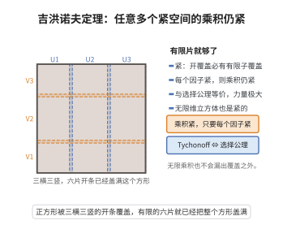

# 吉洪诺夫定理

> **一句话大白话**：把一大堆"各自都封闭不漏点"的盒子拼成一个超大的盒子，这个大盒子照样"封闭不漏点"——很少的限制条件却换来了很强的结论，是选择公理的一个脸面。
>
> **小例子**：无限多个 $[0,1]$ 线段连成的高维立方体 $\prod [0,1]$ 仍是紧的；也就是说在任何维度下，把无限个"有窗都能盯住"的线段叠起来，整体依然不会"跑漏"。

## 介绍

吉洪诺夫定理是点集拓扑学中最深刻的定理之一，它断言任意一族紧致拓扑空间的乘积空间（在积拓扑下）仍然是紧致的。这一定理在泛函分析、拓扑代数和一般拓扑学中有着广泛的应用，例如巴拿赫-阿劳格鲁定理（Banach-Alaoglu theorem）断言巴拿赫空间的对偶空间中的单位闭球在弱*拓扑下是紧致的，其证明就依赖于吉洪诺夫定理。吉洪诺夫定理与选择公理是等价的，这揭示了它在集合论基础中的重要地位。

## 几何直观

图意在说明：每个因子都紧，则无论因子有多少个，乘积空间里的任何开覆盖都抽得出有限子覆盖。

## 分析

**前置依赖**：选择公理、积拓扑的定义、紧致空间的定义、开覆盖。

**数学内涵**：
- 吉洪诺夫定理的完整表述：设 $\{X_i\}_{i \in I}$ 是一族紧致拓扑空间，则积空间 $\prod_{i \in I} X_i$（赋予积拓扑）是紧致的。
- 定理的证明需要用到选择公理（当指标集 $I$ 无限时），实际上吉洪诺夫定理与选择公理在 ZF 集合论中是等价的。
- 证明方法通常有两种：一种是使用 Alexander 子基定理（基于有限交性质），另一种是使用标准子基覆盖的论证。
- 对于有限个紧致空间的乘积，吉洪诺夫定理的证明不需要选择公理。

**结构**：
1. 利用 Alexander 子基定理转化为对子基开覆盖的讨论。
2. 积拓扑的子基由形如 $p_i^{-1}(U_i)$ 的集合构成，其中 $U_i \subseteq X_i$ 开集。
3. 对任意子基开覆盖，构造一个极大子覆盖，利用选择公理在每个坐标上选取适当的点。

## 思考过程

吉洪诺夫定理的证明并不直观，尤其是无限乘积的情形。关键在于选择合适的证明工具。Alexander 子基定理提供了一个有力的手段：要证明紧致性，只需证明任意子基开覆盖都有有限子覆盖。

利用这一工具，考虑积空间的子基开覆盖 $\mathcal{S}$。如果 $\mathcal{S}$ 中任意有限个元素都不能覆盖整个空间，我们可以构造一个点 $x = (x_i)$ 使得对每个坐标 $i$，$x_i$ 不在任何形如 $p_i^{-1}(U_i) \in \mathcal{S}$ 的集合中（即 $x_i$ 不被任何 $U_i$ 覆盖），从而每个坐标 $x_i$ 都在 $X_i \setminus \bigcup\{U_i \mid p_i^{-1}(U_i) \in \mathcal{S}\}$ 中。但由 $X_i$ 紧致，如果 $\mathcal{S}$ 中没有有限子覆盖，则每个 $X_i$ 中会存在一个"漏网"的点，组合起来就得到整个积空间中的"漏网"点，矛盾。

## 证明过程

**定理**（吉洪诺夫）：设 $\{X_i\}_{i \in I}$ 是一族紧致拓扑空间，则 $\prod_{i \in I} X_i$ 在积拓扑下是紧致的。

**证明**：使用 Alexander 子基定理。积拓扑的子基由以下集合构成：
$$\mathcal{S} = \{p_i^{-1}(U_i) \mid i \in I,\ U_i \subseteq X_i \text{ 开}\}$$

其中 $p_i: \prod_{j \in I} X_j \to X_i$ 是投影映射。

设 $\mathcal{U} \subseteq \mathcal{S}$ 是 $\prod_{i \in I} X_i$ 的子基开覆盖。对每个 $i \in I$，令
$$\mathcal{U}_i = \{U_i \subseteq X_i \text{ 开} \mid p_i^{-1}(U_i) \in \mathcal{U}\}$$

我们断言：存在 $i_0 \in I$ 使得 $\mathcal{U}_{i_0}$ 覆盖 $X_{i_0}$。

若不然，对每个 $i \in I$，$\mathcal{U}_i$ 不覆盖 $X_i$，即存在 $x_i \in X_i \setminus \bigcup_{U_i \in \mathcal{U}_i} U_i$。由选择公理，选取这样的 $x_i$ 构成点 $x = (x_i)_{i \in I} \in \prod_{i \in I} X_i$。

由于 $\mathcal{U}$ 覆盖 $\prod_{i \in I} X_i$，存在 $p_i^{-1}(U_i) \in \mathcal{U}$ 使得 $x \in p_i^{-1}(U_i)$，即 $x_i \in U_i$。但 $U_i \in \mathcal{U}_i$，这与 $x_i$ 的选取矛盾（$x_i$ 不在任何 $\mathcal{U}_i$ 中的开集内）。

因此存在 $i_0 \in I$ 使得 $\mathcal{U}_{i_0}$ 覆盖 $X_{i_0}$。由 $X_{i_0}$ 的紧致性，存在有限个 $U_{i_0,1}, \ldots, U_{i_0,n} \in \mathcal{U}_{i_0}$ 覆盖 $X_{i_0}$。于是 $\{p_{i_0}^{-1}(U_{i_0,1}), \ldots, p_{i_0}^{-1}(U_{i_0,n})\}$ 是 $\mathcal{U}$ 的有限子覆盖，覆盖 $\prod_{i \in I} X_i$。

由 Alexander 子基定理，$\prod_{i \in I} X_i$ 紧致。$\square$

**注记**：上述证明中，当 $I$ 是有限集时，不需要选择公理，因为有限次选择可在 ZF 中完成。当 $I$ 无限时，选择公理是必需的。实际上，在 ZF 集合论中，吉洪诺夫定理等价于选择公理。

## 课堂问答

**老师**：无穷多个紧致空间的乘积还紧致吗？这定理和哪条公理绑在一起？

**学生**：紧致，这就是吉洪诺夫定理；它在 ZF 中与选择公理等价，只有无限指标集时才需要选择公理，有限乘积不需要。证明走 Alexander 子基定理：积拓扑的子基是 $p_i^{-1}(U_i)$，故只需对子基开覆盖验证。

**老师（追问）**：施 Alexander 子基定理后，关键那步断言是什么？

**学生**：断言存在 $i_0$ 使 $\mathcal{U}_{i_0}=\{U_i\mid p_i^{-1}(U_i)\in\mathcal{U}\}$ 覆盖 $X_{i_0}$。否则每个 $i$ 都能选漏网点 $x_i\notin\bigcup\mathcal{U}_i$，由选择公理拼成 $x=(x_i)$；因 $\mathcal{U}$ 覆盖积空间，有 $x\in p_i^{-1}(U_i)$ 即 $x_i\in U_i$，与 $x_i$ 的选取矛盾。再用 $X_{i_0}$ 紧致取有限覆盖即可。这一"逐坐标选点"正是 AC 的用武之地。

**老师（拓展）**：为什么任意的开覆盖可以用子基覆盖代替？

**学生**：Alexander 子基定理保证：紧致性只需对子基开覆盖验证存在有限子覆盖。因为由子基生成的拓扑里，若每个子基覆盖都有有限子覆盖，则任意开覆盖也有；这就把无限乘积的难点压缩到只含"单坐标约束"的集合上。应用上如 Banach-Alaoglu 定理（弱*拓扑下对偶单位球紧）就靠它。
