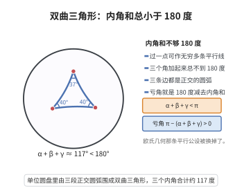

# 双曲三角形内角和定理

> **一句话大白话**：在双曲几何里，三角形的三个内角加起来永远"不够"$180^\circ$——而且缺得越多，这个三角形就越大。
>
> **小例子**：取一个边长都很小的双曲三角形，它看起来几乎和欧氏三角形一样，内角和只比 $\pi$ 小一丁点；而把三条边都拉长到"几乎发散"，内角和可以趋近于 $0$，面积则趋近于 $\pi$。

## 介绍

双曲三角形内角和定理是双曲几何（罗巴切夫斯基几何）区别于欧氏几何的标志性结论。欧氏几何中三角形内角和恒为 $\pi$，这一事实与平行公设等价；而在双曲几何中，内角和恒小于 $\pi$，且"缺失的角度"$\pi-(\alpha+\beta+\gamma)$ 恰好等于三角形的面积（取曲率为 $-1$）。

历史上，萨凯里（Saccheri）在 1733 年试图通过否定平行公设导出矛盾，却发现了内角和小于 $\pi$ 的自洽体系；勒让德（Legendre）系统研究了不依赖平行公设的"绝对几何"，证明了内角和恒不超过 $\pi$，并证明"恒等于 $\pi$"与平行公设等价；最终罗巴切夫斯基与鲍耶（Bolyai）各自独立地把内角和小于 $\pi$ 的几何建立为合法的数学对象。

该定理给出了双曲几何可被"测量"的判据：只要量出足够大的三角形内角和明显小于 $\pi$，就说明空间是双曲的。现代物理中，这一事实与广义相对论里的负曲率空间以及高斯–博内公式紧密相关。

## 几何直观

图意在说明：双曲平面里的测地三角形由三段正交圆弧围成，三个内角之和总差 180 度一截，这段亏角还随面积增大。

## 分析

**前置依赖**：双曲平行公设、庞加莱上半平面模型、双曲度量与测地线、格林定理、外角定理（绝对几何）。

**定理内容**：在双曲几何中，设 $\alpha,\beta,\gamma$ 是任一非退化三角形的三个内角，则

$$\alpha+\beta+\gamma<\pi$$

更精确地，若采用曲率为 $-1$ 的双曲度量，则三角形的面积 $A$ 满足

$$A=\pi-(\alpha+\beta+\gamma)$$

## 思考过程

证明分两块。第一块是"内角和不超过 $\pi$"，这属于不依赖平行公设的绝对几何，可用勒让德的中线构造法证明：反复对三角形作"取一边中点、把中线延长一倍"的操作，内角和保持不变，但其中一个角可以任意变小；再用外角定理（三角形任意两内角之和小于 $\pi$）夹逼，即得内角和 $\le\pi$。

第二块是"严格小于 $\pi$"，关键是算出面积。上半平面模型中的双曲度量与欧氏度量共形，故双曲角等于欧氏角；而面积元 $\frac{dx\,dy}{y^2}$ 可以写成某个函数沿边界的全微分，于是用格林公式把面积化为沿三条测地圆弧的边界积分。对每条圆弧作参数化会发现被积式恰是参数角的微分，而三条边积分之和与边界总转角 $2\pi$ 及三个内角拼合，得到面积 $=\pi-(\alpha+\beta+\gamma)$。面积为正，于是内角和严格小于 $\pi$。

## 证明过程

**步骤 1：外角定理。**

设 $\triangle ABC$。延长 $BC$ 至 $D$，证明外角 $\angle ACD$ 大于内角 $\angle A$ 与 $\angle B$：取 $AC$ 的中点 $M$，连接 $BM$ 并延长至 $E$ 使 $ME=BM$。由 $AM=MC$、$BM=ME$、对顶角 $\angle AMB=\angle CME$，得 $\triangle AMB\cong\triangle CME$，故 $\angle MCE=\angle MAB=\angle A$。因为 $E$ 与 $C$ 分居射线 $BC$ 两侧（$E$ 在直线 $BM$ 上、位于 $AC$ 的另侧），有 $\angle ACD>\angle ACE=\angle MCE=\angle A$。同理 $\angle ACD>\angle B$。

于是三角形任意两个内角之和 $<\pi$（它等于相应的外角，而外角小于 $\pi$）。特别地，若三角形内角和为 $S$，则 $S-\theta<\pi$ 对任意内角 $\theta$ 成立。

**步骤 2：勒让德第一定理（绝对几何中内角和 $\le\pi$）。**

反设存在内角和 $S=\pi+\delta$（$\delta>0$）的三角形 $T_0$。对任意三角形 $XYZ$，取 $YZ$ 中点 $M$，把 $XM$ 延长至 $X'$ 使 $MX'=XM$。由 $YM=MZ$、$XM=MX'$、对顶角 $\angle YMX=\angle ZMX'$，得 $\triangle XMY\cong\triangle X'MZ$，从而 $\angle MYX=\angle MZX'$、$\angle YXM=\angle MX'Z$。考察三角形 $XX'Z$，其角为

$$\angle ZXX'=\angle ZXM,\quad \angle XX'Z=\angle MX'Z=\angle YXM,\quad \angle XZX'=\angle XZY+\angle YXZ$$

注意 $\angle ZXX'+\angle XX'Z=\angle ZXM+\angle YXM=\angle X$，且三内角之和为 $\angle X+\angle Y+\angle Z$。

据此构造序列：对 $T_n$（内角和 $S$，已选定一个角 $\theta_n$）以该角的顶点为 $X$ 施行上述操作，得到的新三角形内角和仍为 $S$，且它有两个内角之和等于 $\theta_n$，故其较小者不超过 $\theta_n/2$；取它为 $\theta_{n+1}\le\theta_n/2$。于是 $\theta_n\le\theta_0/2^n\to0$。

对每个 $n$，$T_n$ 中除 $\theta_n$ 外的两角之和为 $S-\theta_n$，由步骤 1 知 $S-\theta_n<\pi$，即 $S<\pi+\theta_n$。令 $n\to\infty$ 得 $S\le\pi$，与 $S=\pi+\delta$ 矛盾。故任何三角形的内角和满足 $S\le\pi$。

**步骤 3：在上半平面模型中面积 $=\pi-(\alpha+\beta+\gamma)$。**

取上半平面 $\mathbb{H}=\{z=x+iy:y>0\}$，双曲度量为 $ds^2=\frac{dx^2+dy^2}{y^2}$，面积元 $dA=\frac{dx\,dy}{y^2}$。该度量与欧氏度量共形，故双曲角等于欧氏角；测地线是垂直于实轴的直线与圆心在实轴上的半圆。

设三角形 $T$ 的三条边是测地圆弧，边界 $\partial T$ 取逆时针方向。

**(a) 化为边界积分。** 取 $P(x,y)=\frac1y$，由 $\frac{\partial}{\partial y}\frac1y=-\frac1{y^2}$ 与格林公式，

$$A=\iint_T \frac{dx\,dy}{y^2}=\iint_T\Big(-\frac{\partial P}{\partial y}\Big)\,dx\,dy=\oint_{\partial T}\frac{1}{y}\,dx$$

**(b) 单边积分。** 一段测地圆弧是半径 $R$、圆心 $(c,0)$ 的半圆的一部分（竖直线视为 $R\to\infty$ 的极限）。以

$$(x,y)=(c+R\cos\theta,\;R\sin\theta),\qquad \theta\in(0,\pi)$$

参数化，则 $dx=-R\sin\theta\,d\theta$，故

$$\frac{1}{y}\,dx=\frac{-R\sin\theta}{R\sin\theta}\,d\theta=-d\theta$$

于是沿该边的积分为 $-(\theta_{\text{末}}-\theta_{\text{初}})=:-\Delta\theta_i$。

**(c) 边的转向。** 沿该边行进时切向量与 $\pm(-\sin\theta,\cos\theta)$ 平行，其方向角与 $\theta$ 只差一个常数，故切向方向角的变化量（即该边的转向）恰为 $\Delta\theta_i$。

**(d) 与内角拼合。** $\partial T$ 是简单的逆时针闭曲线，其总转角为 $2\pi$。总转角等于各顶点处的外角之和加上各边上的转向之和：

$$2\pi=\sum_{i}\big(\pi-\alpha_i\big)+\sum_i\Delta\theta_i=\big(3\pi-(\alpha+\beta+\gamma)\big)+\sum_i\Delta\theta_i$$

故

$$\sum_i\Delta\theta_i=(\alpha+\beta+\gamma)-\pi$$

**(e) 面积公式。** 由 (a)(b) 得

$$A=\sum_i\big(-\Delta\theta_i\big)=-\sum_i\Delta\theta_i=\pi-(\alpha+\beta+\gamma)$$

**步骤 4：严格小于 $\pi$。** 非退化三角形的面积 $A>0$，由步骤 3 得 $\pi-(\alpha+\beta+\gamma)>0$，即

$$\alpha+\beta+\gamma<\pi$$

定理得证。作为特例，三条边的"极限三角形"（顶点在无穷远，$\alpha=\beta=\gamma=0$）面积等于 $\pi$，与公式一致。

## 课堂问答

**老师**：双曲三角形内角和与 $\pi$ 的关系，以及角亏意味着什么？

**学生**：$\alpha+\beta+\gamma<\pi$，且角亏 $\pi-(\alpha+\beta+\gamma)$ 恰等于面积（$K=-1$ 时）。两块证明：先用绝对几何证"不大于 $\pi$"，再用面积为正逼出"严格小于 $\pi$"。

**老师（追问）**：勒让德怎么只用绝对几何证出"不大于 $\pi$"？

**学生**：反设存在内角和 $S=\pi+\delta$（$\delta>0$）的三角形。对任意三角形取一边中点、把中线延长一倍，得到内角和相同（仍为 $S$）、但含一个角不超过原角一半的新三角形；迭代得到任意小的角 $\theta_n\leq\theta_0/2^n\to0$。由外角定理其余两角之和 $<\pi$，即 $S<\pi+\theta_n$，令 $n\to\infty$ 得 $S\leq\pi$，矛盾。

**老师（拓展）**：面积公式那步的巧劲在哪？

**学生**：上半平面模型里 $dA=\frac{dx\,dy}{y^2}$，取 $P=1/y$，由格林公式把面积化为 $\oint_{\partial T}\frac1y\,dx$。沿测地圆弧参数化 $x=c+R\cos\theta$、$y=R\sin\theta$，被积式恰为 $-d\theta$，故每边积分 $=-\Delta\theta_i$；再由闭曲线总转角 $2\pi=\sum(\pi-\alpha_i)+\sum\Delta\theta_i$ 拼出 $\sum\Delta\theta_i=(\alpha+\beta+\gamma)-\pi$，得 $A=\pi-(\alpha+\beta+\gamma)>0$。这正解释了球面、双曲、欧氏三种几何内角和的差异。

## 相关条目

- [双曲几何三角形内角和](./双曲几何三角形内角和.md)：同一结论的另一处整理，可与本文对照阅读。
- [双曲几何面积公式](./双曲几何面积公式.md)：由内角和给出的面积公式 $\pi-(\alpha+\beta+\gamma)$。
- [庞加莱圆盘模型](./庞加莱圆盘模型.md)：本文证明所用的上半平面模型与圆盘模型等距，可互相转换。
