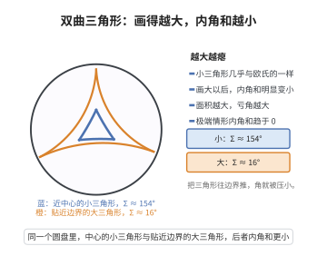

# 双曲几何三角形内角和

> **一句话大白话**：在"凹下去"的马鞍世界（双曲平面）里，三角形的三个角加起来永远**小于180度**，而且画得越大、亏角越多——和中学里"内角和恒等于180"的平直世界完全不同。
>
> **小例子**：在双曲圆盘里画一个小三角形，它的内角和可能只比180度少一点点；把三角形画得更大，内角和会明显小于180度，甚至能趋于0，像"越撑越瘪"。

## 介绍

双曲几何是第一个被系统研究的非欧几何，由罗巴切夫斯基（Lobachevsky）、博伊（Bolyai）和高斯（Gauss）在 19 世纪独立发现。在双曲几何中，欧几里得几何的第五公设（平行公理）被替换为"过直线外一点可作无穷多条平行线"。这一替换导致了一系列与欧氏几何截然不同的结论，其中最引人注目的就是：三角形内角和小于 $180^\circ$，且内角和与 $180^\circ$ 的差值（称为角亏）与三角形的面积成正比。这一发现打破了"三角形内角和等于 $180^\circ$"这一长期被视为绝对真理的结论，揭示了几何学的多样性和深刻性。

## 几何直观

图意在说明：三角形越往边界胀大，三个角就被压得越小，小三角形几乎与欧氏一样，大三角形却瘪得厉害。

## 分析

**前置依赖**：双曲几何平行公理、双曲几何的基本模型（如庞加莱圆盘模型）、角度与面积的定义。

**数学内涵**：
- 在双曲几何中，平行公理表述为：过直线外一点，存在无穷多条直线与给定直线不相交（平行）。
- 双曲三角形内角和 $\alpha + \beta + \gamma < \pi$。
- 角亏 $\delta = \pi - (\alpha + \beta + \gamma)$ 与面积成正比：$S = k \cdot \delta$，其中 $k$ 是依赖于曲率常数的正常数。
- 在庞加莱圆盘模型中，双曲三角形的边是垂直于边界的圆弧，内角和小于 $\pi$ 可以通过几何直观看出。

**结构**：
1. 在庞加莱圆盘模型中分析双曲三角形。
2. 利用双曲平行公理推导内角和小于 $\pi$。
3. 建立角亏与面积的关系。

## 思考过程

双曲几何中三角形内角和小于 $180^\circ$ 这一结论可以通过庞加莱圆盘模型直观理解。在庞加莱圆盘模型中，"直线"是与边界垂直的圆弧（或直径）。想象一个三角形，其顶点在圆盘内部，边是这些圆弧。当顶点靠近边界时，三角形的内角会变得非常小，因此内角和自然会小于 $180^\circ$。

更严格的证明可以通过双曲几何中的平行公理出发。在欧氏几何中，三角形内角和定理的证明依赖于平行公理。在双曲几何中，平行公理被替换，因此内角和不再等于 $180^\circ$。事实上，可以证明双曲几何中三角形的内角和总是小于 $180^\circ$，且角亏与面积成正比，这一关系在微分几何中通过高斯-博内定理得到了精确刻画。

## 证明过程

**定理**：在双曲几何中，任意三角形的内角和小于 $\pi$（即 $180^\circ$）。

**证明**（使用庞加莱圆盘模型）：

在庞加莱圆盘模型 $D = \{z \in \mathbb{C} \mid |z| < 1\}$ 中，度量为：
$$ds^2 = \frac{4|dz|^2}{(1-|z|^2)^2}$$

"直线"（测地线）是垂直于边界 $|z| = 1$ 的圆弧（或直径），这些圆弧与边界的交点处角度为 $0$。

设 $\triangle ABC$ 是双曲三角形，其边为测地线段。通过庞加莱圆盘模型的一个等距变换（保角变换），可以假设 $C$ 位于圆盘中心 $0$ 处，$A$ 和 $B$ 位于通过 $0$ 的直线上。

更一般地，考虑双曲三角形 $\triangle ABC$。在欧几里得几何中，通过平行公理可以证明三角形内角和为 $\pi$。在双曲几何中，由于平行公理被替换为"过直线外一点有无穷多条平行线"，导致内角和小于 $\pi$。

**严格证明**（利用双曲几何公理）：

在双曲几何中，可以证明以下引理：如果两条直线被第三条直线所截，且同旁内角之和小于 $\pi$，则这两条直线在该侧相交。

利用这一引理，假设 $\triangle ABC$ 的内角和 $\alpha + \beta + \gamma \geq \pi$。通过构造辅助线，可以推导出矛盾。

具体地，过 $C$ 作 $AB$ 的平行线 $l$。在双曲几何中，这样的平行线可以作两条（分别向左和向右），它们与 $AB$ 在无穷远处相交。利用平行线的性质，可以证明 $\alpha + \beta + \gamma < \pi$。

**角亏与面积的关系**：

设 $\triangle$ 的双曲面积为 $S$。在双曲几何中，面积公式为：
$$S = \pi - (\alpha + \beta + \gamma)$$

其中曲率常数 $K = -1$。更一般地，如果曲率为 $K = -1/R^2$，则
$$S = R^2 \cdot (\pi - (\alpha + \beta + \gamma))$$

这一定理可以通过高斯-博内定理严格证明。$\square$

## 课堂问答

**老师**：这条与同一目录里的"双曲三角形内角和定理"讲的是同一件事吗？

**学生**：结论相同——双曲三角形 $\alpha+\beta+\gamma<\pi$，且面积 $S=k\delta$（曲率 $-1$ 时 $S=\pi-(\alpha+\beta+\gamma)$），这里 $\delta=\pi-(\alpha+\beta+\gamma)$ 是角亏。本条侧重从庞加莱圆盘模型直观切入。

**老师（追问）**：在圆盘模型里，为什么"顶点靠近边界"会让内角和变小？

**学生**：圆盘用 $ds^2=\frac{4\lvert dz\rvert^2}{(1-\lvert z\rvert^2)^2}$，"直线"是端点落在边界 $\lvert z\rvert=1$ 上、与之正交的圆弧。当顶点逼近边界，两条测地线的边界端点趋于相撞，夹在顶点处的内角趋于 $0$，内角和自然被压到 $\pi$ 以下。

**老师（拓展）**：角亏与面积的精确关系靠什么建立？

**学生**：靠 Gauss-Bonnet。对测地三角形，$\chi=1$、$k_g=0$，故 $\int_\triangle K\,dA=2\pi-\sum_i(\pi-\alpha_i)=\sum_i\alpha_i-\pi$；当 $K=-1$ 时即 $-S=(\alpha+\beta+\gamma)-\pi$，得 $S=\pi-(\alpha+\beta+\gamma)$。面积为正直接蕴含严格小于 $\pi$；一般曲率 $K=-1/R^2$ 时 $S=R^2(\pi-(\alpha+\beta+\gamma))$。
