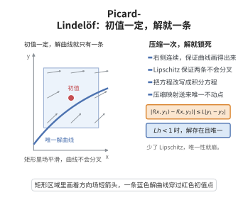

# Picard-Lindelöf 定理

> **一句话大白话**：只要微分方程右侧"够平稳"（光滑/Lipschitz），又给了一个起点（初值），那就**恰好有一条**解曲线从这个起点出发——不多不少，既存在又唯一。这给"有解吗？有几个？"一个干脆的回答。
>
> **小例子**：$y'=y,\ y(0)=1$ 只有唯一解 $y=e^x$；而 $y'=\sqrt{y},\ y(0)=0$ 因右侧不够光滑，就会蹦出多条解，正是定理前提失效的例子。

## 介绍

Picard-Lindelöf 定理（又称解的存在唯一性定理）是常微分方程理论中最基本的定理之一，它给出了初值问题 $y' = f(x, y)$，$y(x_0) = y_0$ 在局部范围内存在唯一解的充分条件。该定理由法国数学家 Émile Picard 和瑞典数学家 Ernst Lindelöf 在 19 世纪末独立证明。定理的核心思想是利用压缩映射原理（Banach 不动点定理），将微分方程转化为积分方程，然后在适当的函数空间中证明解的存在性和唯一性。这一定理是常微分方程理论的基石，也是后续研究解的延拓、解对参数的依赖等问题的基础。

## 几何直观

图意在说明：方向场平滑且 Lipschitz 时，过同一初值只有一条积分曲线，不会分叉。

## 分析

**前置依赖**：Banach不动点定理、一致收敛、连续函数空间、Lipschitz 条件。

**数学内涵**：
- 考虑初值问题：$y' = f(x, y)$，$y(x_0) = y_0$，其中 $f: D \subseteq \mathbb{R}^2 \to \mathbb{R}$ 连续。
- 定理条件：$f$ 在 $y$ 方向上满足 Lipschitz 条件，即存在常数 $L > 0$ 使得 $|f(x, y_1) - f(x, y_2)| \leq L|y_1 - y_2|$。
- 结论：存在 $\delta > 0$，使得在区间 $[x_0 - \delta, x_0 + \delta]$ 上存在唯一解 $y(x)$。
- 证明方法：将 ODE 转化为积分方程 $y(x) = y_0 + \int_{x_0}^x f(t, y(t)) dt$，然后在连续函数空间上定义算子 $T$，证明 $T$ 是压缩映射。

**结构**：
1. 将微分方程转化为等价积分方程。
2. 构造 Picard 迭代算子 $T$。
3. 选择适当的函数空间（完备度量空间）。
4. 验证 $T$ 是压缩映射。
5. 由压缩映射原理得唯一不动点，即解。

## 思考过程

Picard-Lindelöf 定理的证明是压缩映射原理在微分方程中的经典应用。基本思路是：微分方程 $y' = f(x, y)$ 等价于积分方程 $y(x) = y_0 + \int_{x_0}^x f(t, y(t)) dt$。这一转化利用微积分基本定理，将微分问题转化为积分问题。

然后定义算子 $T: y \mapsto y_0 + \int_{x_0}^\cdot f(t, y(t)) dt$。如果 $T$ 是压缩映射，则存在唯一的不动点，即微分方程的解。为了确保 $T$ 是压缩映射，需要 $f$ 满足 Lipschitz 条件，并且工作区间足够小。

## 证明过程

**定理**（Picard-Lindelöf）：设 $f$ 在矩形区域 $R = [x_0 - a, x_0 + a] \times [y_0 - b, y_0 + b]$ 上连续，且关于 $y$ 满足 Lipschitz 条件：
$$|f(x, y_1) - f(x, y_2)| \leq L|y_1 - y_2|,\quad \forall (x, y_1), (x, y_2) \in R$$
则初值问题 $y' = f(x, y)$，$y(x_0) = y_0$ 在区间 $[x_0 - h, x_0 + h]$ 上存在唯一解，其中 $h = \min\{a, b/M\}$，$M = \max_{(x, y) \in R} |f(x, y)|$。

**证明**：

### 1. 转化为积分方程

初值问题等价于积分方程：
$$y(x) = y_0 + \int_{x_0}^x f(t, y(t)) dt$$

### 2. 定义完备度量空间

令 $C([x_0 - h, x_0 + h])$ 为区间 $I = [x_0 - h, x_0 + h]$ 上的连续函数空间，配备上确界范数 $\|y\| = \sup_{x \in I} |y(x)|$。该空间是 Banach 空间。

考虑闭子空间：
$$B = \{y \in C(I) \mid |y(x) - y_0| \leq b,\ \forall x \in I\}$$
$B$ 是 $C(I)$ 的闭子集，因此是完备度量空间。

### 3. 定义 Picard 算子

定义 $T: B \to C(I)$ 为：
$$(Ty)(x) = y_0 + \int_{x_0}^x f(t, y(t)) dt$$

### 4. 验证 $T(B) \subseteq B$

对任意 $y \in B$ 和 $x \in I$，
$$|(Ty)(x) - y_0| = \left|\int_{x_0}^x f(t, y(t)) dt\right| \leq M|x - x_0| \leq Mh \leq b$$
故 $Ty \in B$。

### 5. 验证 $T$ 是压缩映射

对任意 $y_1, y_2 \in B$ 和 $x \in I$，
$$|(Ty_1)(x) - (Ty_2)(x)| = \left|\int_{x_0}^x [f(t, y_1(t)) - f(t, y_2(t))] dt\right|$$
$$\leq \int_{x_0}^x |f(t, y_1(t)) - f(t, y_2(t))| dt \leq L \int_{x_0}^x |y_1(t) - y_2(t)| dt$$
$$\leq Lh \cdot \|y_1 - y_2\|$$

因此 $\|Ty_1 - Ty_2\| \leq Lh \|y_1 - y_2\|$。由于 $h \leq \frac{b}{M}$ 且 $Lh \leq \frac{Lb}{M}$，我们可以选择 $h$ 使得 $Lh < 1$（例如取 $h < 1/L$），则 $T$ 是压缩映射。

### 6. 应用压缩映射原理

由 Banach 不动点定理，$T$ 在 $B$ 中存在唯一不动点 $y \in B$，即 $y = Ty$，满足
$$y(x) = y_0 + \int_{x_0}^x f(t, y(t)) dt$$
由微积分基本定理，$y$ 可微且满足 $y'(x) = f(x, y(x))$，$y(x_0) = y_0$。$\square$

## 课堂问答

**老师**：$y'=f(x,y)$，$f$ 关于 $y$ 满足 Lipschitz 条件。为什么仅凭这个条件，就能断言解存在且唯一？

**学生**：因为它把微分方程换成了积分方程，再变成不动点问题。$y=y_0+\int_{x_0}^x f(t,y)\,dt$ 定义算子 $T$，Lipschitz 条件给出 $\|Ty_1-Ty_2\|\le Lh\|y_1-y_2\|$；只要区间足够短使 $Lh<1$，$T$ 就是压缩映射，压缩映射原理直接送来唯一不动点。

**老师（追问）**：$h$ 为什么不能随便取大？如果 $Lh\ge1$ 会怎样？

**学生**：$h=\min\{a,b/M\}$ 要同时保证 $T(B)\subseteq B$ 和压缩性。$Lh\ge1$ 时 $T$ 可能伸长而非压缩，不动点论证失效；但解本身仍可能局部存在，只是这个证明派不上用场。常见误区是把 $Lh<1$ 当成解存在的必要条件——它只是本证明策略的充分条件。

**老师（拓展）**：如果 $f$ 只连续、并不 Lipschitz，结论还剩什么？

**学生**：存在性仍成立（Peano 定理，用 Arzelà-Ascoli 或欧拉折线），但唯一性会崩掉。典型反例 $y'=\sqrt{y},\ y(0)=0$：既有 $y\equiv0$，又有 $y=x^2/4$（$x\ge0$），正因为 $\sqrt{y}$ 在 $0$ 处不满足 Lipschitz 条件。这说明 Lipschitz 条件是"锁住唯一性"的那把钥匙。
