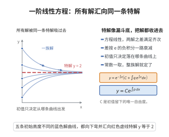

# 一阶线性 ODE 通解公式

> **一句话大白话**：形如 $y'+p(x)y=q(x)$ 这种"线性"方程，解可以一招制敌：先灌一个"积分因子" $e^{\int p}$ 把左边收成 $(e^{\int p}y)'$，再一积分就给出通解公式——一套流程对付一整类方程。
>
> **小例子**：解 $y'+2y=e^{-x}$，积分因子是 $e^{2x}$，乘上改写为 $(e^{2x}y)'=e^x$，积分得 $e^{2x}y=e^x+C$，所以 $y=e^{-x}+Ce^{-2x}$。

## 介绍

一阶线性常微分方程通解公式是微分方程理论中最基本的结果之一，给出了形如 $y'+p(x)y=q(x)$ 的方程显式通解。该公式由 Leibniz 在 17 世纪末期提出，是常数变易法（Variation of Parameters）的典型应用，在物理、工程、生物模型等领域有广泛应用。

## 几何直观

图意在说明：线性方程任意两解之差按指数衰减，整族解被同一条特解牵着走。

## 分析

**前置依赖**：常数变易法、一阶线性微分方程通解公式、积分因子法

**定理内容**：一阶线性常微分方程
$$y'+p(x)y=q(x)$$
的通解为
$$y=e^{-\int p(x)\,dx}\left(\int q(x)e^{\int p(x)\,dx}\,dx+C\right)$$
其中 $C$ 为任意常数。

**数学内涵**：该公式表明一阶线性 ODE 的解空间由一个特解加上齐次方程的通解构成。积分因子 $\mu(x)=e^{\int p(x)dx}$ 将方程转化为恰当微分方程，使得左边成为 $(y\mu)'$ 的形式。

**证明策略**：引入积分因子 $\mu(x)=e^{\int p(x)dx}$，将原方程乘以 $\mu(x)$ 后化为 $(y\mu)'=q\mu$，然后直接积分。

## 思考过程

解一阶线性 ODE 的核心思想是"化归"——通过引入积分因子将非恰当方程变为恰当方程。积分因子的构造源于观察到 $(y\mu)'=y'\mu+y\mu'$，若令 $\mu'=p\mu$，则左边恰好是 $(y\mu)'$，从而将问题转化为简单的积分运算。

## 证明过程

**定理**：一阶线性微分方程 $y'+p(x)y=q(x)$ 的通解为
$$y=e^{-\int p(x)\,dx}\left(\int q(x)e^{\int p(x)\,dx}\,dx+C\right)$$

**证明**：

考虑方程
$$y'+p(x)y=q(x)$$

引入积分因子 $\mu(x)=e^{\int p(x)\,dx}$，则
$$\mu'(x)=p(x)e^{\int p(x)\,dx}=p(x)\mu(x)$$

将原方程两边乘以 $\mu(x)$：
$$\mu(x)y'+p(x)\mu(x)y=\mu(x)q(x)$$

注意到左边恰好是 $(\mu y)'$ 的展开：
$$\frac{d}{dx}(\mu y)=\mu'y+\mu y'=p\mu y+\mu y'$$

因此
$$\frac{d}{dx}(\mu y)=\mu q$$

两边积分：
$$\mu y=\int \mu(x)q(x)\,dx+C$$

代入 $\mu(x)=e^{\int p(x)dx}$：
$$e^{\int p(x)dx}y=\int q(x)e^{\int p(x)dx}\,dx+C$$

解得
$$y=e^{-\int p(x)dx}\left(\int q(x)e^{\int p(x)dx}\,dx+C\right)$$

$\square$

## 课堂问答

**老师**：解 $y'+p(x)y=q(x)$，你的核心动作是什么？

**学生**：核心是"积分因子化归"。取 $\mu=e^{\int p}$，注意 $\mu'=p\mu$，乘上去左边恰好收成 $(\mu y)'=\mu q$，两边积分即得通解
$$y=e^{-\int p(x)\,dx}\left(\int q(x)e^{\int p(x)\,dx}\,dx+C\right).$$

**老师（追问）**：$\mu=e^{\int p}$ 里那个不定积分的任意常数要不要写？

**学生**：不用，也不需要。$\mu$ 只需满足 $\mu'=p\mu$，差一个非零常数因子只是两边同乘同一个倍数，不影响解；真正引入任意常数的地方是最后一步 $\int\mu q\,dx+C$。常见误区是把两处的"$+C$"混在一起，导致常数重复或漏掉。

**老师（拓展）**：这个公式与"通解 $=$ 齐次解 $+$ 特解"是什么关系？

**学生**：公式本身就体现了它：$e^{-\int p}\cdot C$ 是齐次通解，$e^{-\int p}\int q e^{\int p}$ 是一个特解，两者相加恰为该结构。这也说明一阶线性方程的解空间是 $1$ 维，初值 $y(x_0)=y_0$ 正好定出那个 $C$。
