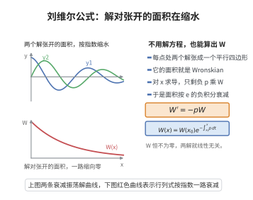

# 刘维尔公式

> **一句话大白话**：对线性方程，只要知道它的两个线性无关解（或其中一组），就能用行列式（Wronskian）算出"解的分布密度"如何随位置变化，而且可以由系数直接定死，不用真解出来。
>
> **小例子**：对 $y''+p(x)y'+q(x)y=0$，两个解的行列式满足 $W'=-pW$，即 $W(x)=W(x_0)e^{-\int_{x_0}^x p}$；这说明解族的"面积"随 $p$ 的积分指数衰减。

## 介绍

刘维尔公式（Liouville's Formula）是常微分方程理论中关于 Wronskian 的重要结论。对于 $n$ 阶线性齐次微分方程 $y^{(n)} + a_1(x)y^{(n-1)} + \cdots + a_n(x)y = 0$，刘维尔公式给出了 Wronskian 的显式表达式：
$$W(x) = W(x_0) \exp\left(-\int_{x_0}^x a_1(t) dt\right)$$
这一公式表明，Wronskian 要么恒为零（当解线性相关时），要么处处非零（当解线性无关时），且其变化完全由 $a_1(x)$ 决定。刘维尔公式在判断解线性无关性、求解高阶线性微分方程以及 Sturm-Liouville 理论中都有重要应用。

## 几何直观

图意在说明：两个解张成的面积由系数直接定死，随 p 的积分指数衰减，无需解出方程。

## 分析

**前置依赖**：线性微分方程解的结构、Wronskian 的定义、行列式的导数。

**数学内涵**：
- 对于二阶方程 $y'' + p(x)y' + q(x)y = 0$，刘维尔公式为
  $$W(x) = W(x_0) \exp\left(-\int_{x_0}^x p(t) dt\right)$$
- 其中 $W(x) = y_1(x)y_2'(x) - y_2(x)y_1'(x)$。
- 公式的推导通过对 Wronskian 求导，利用原方程消去高阶导数项。
- 这一公式在已知一个解的情况下，可以构造另一个线性无关的解。

**结构**：
1. 计算 Wronskian 的导数。
2. 利用微分方程化简。
3. 求解关于 $W$ 的一阶微分方程。

## 思考过程

刘维尔公式的推导思路非常直接：计算 $W'(x)$，然后利用微分方程将结果表示为 $W(x)$ 乘以某个已知函数，从而得到一个关于 $W(x)$ 的一阶线性微分方程，求解即得。

具体来说，对于二阶方程 $y'' + p(x)y' + q(x)y = 0$，设 $y_1, y_2$ 是两个解，则
$$W' = y_1'y_2' + y_1y_2'' - y_2'y_1' - y_2y_1'' = y_1y_2'' - y_2y_1''$$
代入 $y_i'' = -p(x)y_i' - q(x)y_i$，得
$$W' = y_1(-p y_2' - q y_2) - y_2(-p y_1' - q y_1) = -p(y_1y_2' - y_2y_1') = -pW$$
解之即得 $W(x) = W(x_0) \exp(-\int_{x_0}^x p(t) dt)$。

## 证明过程

**定理**（刘维尔公式）：设 $y_1, y_2, \ldots, y_n$ 是 $n$ 阶线性齐次微分方程
$$y^{(n)} + a_1(x)y^{(n-1)} + \cdots + a_n(x)y = 0$$
的 $n$ 个解，$W(x)$ 是它们的 Wronskian。则
$$W(x) = W(x_0) \exp\left(-\int_{x_0}^x a_1(t) dt\right)$$

**证明**（对 $n=2$ 的情形）：

### 1. 二阶方程

考虑 $y'' + p(x)y' + q(x)y = 0$，其中 $p(x) = a_1(x)$。

设 $y_1, y_2$ 是两个解，Wronskian 为 $W(x) = y_1y_2' - y_2y_1'$。

计算导数：
$$W' = (y_1'y_2' + y_1y_2'') - (y_2'y_1' + y_2y_1'') = y_1y_2'' - y_2y_1''$$

由于 $y_1, y_2$ 满足方程：
$$y_1'' = -p y_1' - q y_1$$
$$y_2'' = -p y_2' - q y_2$$

代入得：
$$W' = y_1(-p y_2' - q y_2) - y_2(-p y_1' - q y_1)$$
$$= -p y_1y_2' - q y_1y_2 + p y_2y_1' + q y_1y_2$$
$$= -p(y_1y_2' - y_2y_1') = -pW$$

### 2. 求解一阶方程

$W' = -p(x)W$ 是可分离变量的一阶线性方程：
$$\frac{dW}{W} = -p(x)dx$$
从 $x_0$ 到 $x$ 积分：
$$\ln|W(x)| - \ln|W(x_0)| = -\int_{x_0}^x p(t) dt$$
$$W(x) = W(x_0) \exp\left(-\int_{x_0}^x p(t) dt\right)$$

### 3. $n$ 阶情形

对于 $n$ 阶方程，Wronskian 的导数满足类似的公式：
$$W' = -a_1(x)W$$
因此
$$W(x) = W(x_0) \exp\left(-\int_{x_0}^x a_1(t) dt\right)$$

详细推导需要利用行列式的求导公式和微分方程消去高阶项。$\square$

**推论**：若已知 $y'' + p(x)y' + q(x)y = 0$ 的一个非零解 $y_1$，则另一个线性无关的解为
$$y_2(x) = y_1(x) \int_{x_0}^x \frac{\exp(-\int_{x_0}^t p(s) ds)}{y_1(t)^2} dt$$

**证明**：由刘维尔公式，$W(x) = y_1y_2' - y_2y_1' = C \exp(-\int p dx)$。整理得
$$\left(\frac{y_2}{y_1}\right)' = \frac{W}{y_1^2} = \frac{C \exp(-\int p dx)}{y_1^2}$$
积分即得。$\square$

## 课堂问答

**老师**：Wronskian 为什么满足 $W'=-pW$？这个微分方程是怎么冒出来的？

**学生**：对 $W=y_1y_2'-y_2y_1'$ 求导，$y_1'y_2'$ 与 $y_2'y_1'$ 相消，只剩 $W'=y_1y_2''-y_2y_1''$；再用方程 $y_i''=-py_i'-qy_i$ 代入，$-q$ 项也相消，得 $W'=-p(y_1y_2'-y_2y_1')=-pW$。

**老师（追问）**：这个式子最有威力的地方在哪里？

**学生**：它把 Wronskian 的变化完全交给系数 $p(x)$ 决定，不必真的解出 $y_1,y_2$，积分即得
$$W(x)=W(x_0)\exp\!\Big(-\int_{x_0}^x p(t)\,dt\Big).$$
由此立刻读出：$W(x_0)\neq0$ 则 $W$ 处处非零，解组线性无关；否则线性相关。常见误区是以为 $W\equiv0$ 就一定线性相关——这只对"同一方程的 $n$ 个解"成立，对一般函数组并不成立。

**老师（拓展）**：已知一个非零解 $y_1$，怎么用这个公式补齐第二个解？

**学生**：由 $W=y_1y_2'-y_2y_1'=Ce^{-\int p}$ 整理出 $\big(\frac{y_2}{y_1}\big)'=\frac{W}{y_1^2}$，积分得
$$y_2=y_1\int_{x_0}^x\frac{e^{-\int p(s)\,ds}}{y_1(t)^2}\,dt.$$
这正是降阶法求第二解的公式，也说明刘维尔公式对 $n$ 阶方程形式 $W'=-a_1W$ 同样成立。
