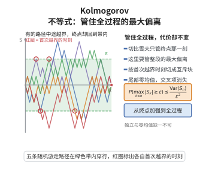

# Kolmogorov 不等式

> **一句话大白话**：对独立零均值的和，过程里的"最大偏离"不会比终点偏离大多少——最大值的尾概率被总方差除以 $\epsilon^2$ 控制。
>
> **小例子**：抛 $n$ 次公平硬币，$S_k$ 为前 $k$ 次得分之和（每次取 $\pm1$），则 $P\big(\max_{1\le k\le n}|S_k|\ge\epsilon\big)\le n/\epsilon^2$。

## 介绍

Kolmogorov 不等式由 A. N. Kolmogorov 于 1928 年提出，是独立随机变量部分和的极大值的一个概率上界。它把切比雪夫不等式从"终点" $S_n$ 加强到"全过程最大值" $\max_{1\le k\le n}|S_k|$，代价仅仅是右端保持相同（不出现额外常数）。

Kolmogorov 不等式是证明强大数定律的关键步骤：它保证部分和的上穿次数有限，从而极限几乎必然存在。它也是鞅极大不等式的离散先驱，Doob 极大不等式正是它在鞅框架下的推广。

## 几何直观

图意在说明：有些路径中途越界后又回到带内，所以最大值事件比终点事件更大，界却不变。

## 分析

**前置依赖**：切比雪夫不等式、马尔可夫不等式、独立性与方差可加性、按首次越界时刻的分割技巧

**定理内容**：设 $X_1,\dots,X_n$ 相互独立，$\mathbb E[X_i]=0$，$\operatorname{Var}(X_i)<\infty$，记 $S_k=X_1+\dots+X_k$（$S_0=0$）。则对任意 $\epsilon>0$，

$$\mathbb P\Big(\max_{1\le k\le n}|S_k|\ge\epsilon\Big)\le\frac{1}{\epsilon^2}\sum_{i=1}^n\operatorname{Var}(X_i).$$

**关键要点**：

- 结论对"上穿" $\max_k S_k$ 与"下穿" $\max_k(-S_k)$ 都成立，只需对 $X_i$ 或 $-X_i$ 应用；
- 与切比雪夫不等式相比，把 $|S_n|$ 换成 $\max_{k\le n}|S_k|$，右端不变；
- 独立性用于两方面：终点方差的加性，以及"停止时刻后的增量与停止信息正交"。

## 思考过程

核心想法是"按首次越界时刻分块"。把事件 $\{\max_k|S_k|\ge\epsilon\}$ 按首次达到或超过 $\epsilon$ 的时刻 $k$ 分成互不相交的块 $A_k$。在每块上，$S_k^2\ge\epsilon^2$，这给出 $\epsilon^2$ 的贡献。

接下来的关键是把终点二阶矩 $\mathbb E[S_n^2]$ 与这些块的贡献联系起来。在 $A_k$ 上把 $S_n$ 拆成 $S_k+(S_n-S_k)$：因为 $A_k$ 只依赖 $X_1,\dots,X_k$，与尾部增量 $S_n-S_k$ 独立且 $\mathbb E[S_n-S_k]=0$，交叉项为零；于是

$$\mathbb E[S_n^2\mathbf 1_{A_k}]=\mathbb E[S_k^2\mathbf 1_{A_k}]+\mathbb E[(S_n-S_k)^2\mathbf 1_{A_k}]\ge\mathbb E[S_k^2\mathbf 1_{A_k}]\ge\epsilon^2\mathbb P(A_k).$$

对所有 $k$ 求和即得。这个"在首次越界处截断、再利用尾部零均值消交叉项"的手法是鞅极大不等式的通用套路。

## 证明过程

**步骤 1：定义首次越界事件。** 令

$$A_k=\Big\{\max_{1\le j<k}|S_j|<\epsilon,\ |S_k|\ge\epsilon\Big\},\qquad 1\le k\le n.$$

这些事件两两不交，且

$$\bigcup_{k=1}^n A_k=\Big\{\max_{1\le k\le n}|S_k|\ge\epsilon\Big\}.$$

**步骤 2：正交分解。** 因 $A_k\in\sigma(X_1,\dots,X_k)$，与尾部增量 $S_n-S_k=\sum_{i=k+1}^n X_i$ 独立；又由零均值假设 $\mathbb E[S_n-S_k]=0$，于是

$$\mathbb E\big[S_k(S_n-S_k)\mathbf 1_{A_k}\big]=\mathbb E\big[S_k\mathbf 1_{A_k}\big]\,\mathbb E\big[S_n-S_k\big]=0.$$

因此

$$\mathbb E\big[S_n^2\mathbf 1_{A_k}\big]=\mathbb E\big[S_k^2\mathbf 1_{A_k}\big]+\mathbb E\big[(S_n-S_k)^2\mathbf 1_{A_k}\big]\ge\mathbb E\big[S_k^2\mathbf 1_{A_k}\big].$$

**步骤 3：用越界定界。** 在 $A_k$ 上有 $|S_k|\ge\epsilon$，故

$$\mathbb E\big[S_k^2\mathbf 1_{A_k}\big]\ge\epsilon^2\,\mathbb P(A_k).$$

**步骤 4：求和。** 由于 $A_k$ 两两不交，

$$\mathbb E[S_n^2]=\sum_{k=1}^n\mathbb E\big[S_n^2\mathbf 1_{A_k}\big]\ge\sum_{k=1}^n\epsilon^2\mathbb P(A_k)=\epsilon^2\,\mathbb P\Big(\max_{1\le k\le n}|S_k|\ge\epsilon\Big).$$

再由独立性 $\mathbb E[S_n^2]=\sum_{i=1}^n\operatorname{Var}(X_i)$，即得所需不等式。$\square$

**推论（强大数定律的辅助估计）**：若独立零均值随机变量满足 $\sum_{i=1}^\infty \operatorname{Var}(X_i)/i^2<\infty$，在每个区间 $[m,n]$ 上应用本不等式并配合 Borel–Cantelli 引理，可得 $\frac{1}{n}\sum_{i=1}^n X_i\to0$ 几乎必然成立。

## 课堂问答

**老师**：想要控制部分和的"最大值"$\max_{k\le n}|S_k|$，代价会比控制终点 $|S_n|$ 大很多吗？

**学生**：不会，右端完全一样：$\mathbb P\big(\max_{1\le k\le n}|S_k|\ge\epsilon\big)\le\frac{1}{\epsilon^2}\sum_{i=1}^n\operatorname{Var}(X_i)$。切比雪夫只能管终点，Kolmogorov 不等式把它加强到全过程。

**老师（追问）**：越过阈值之后那段随机游走，凭什么不干扰估计？

**学生**：按首次越界时刻分割。在 $A_k=\{\max_{j<k}|S_j|<\epsilon,\ |S_k|\ge\epsilon\}$ 上把 $S_n$ 拆为 $S_k+(S_n-S_k)$，$A_k$ 只依赖前 $k$ 项，与独立零均值的尾增量正交，交叉项为零。

**老师（拓展）**：这个技巧后来长成了什么？

**学生**：它是 Doob 极大不等式的离散雏形——把"可预测停止时刻加尾增量正交"换成鞅语言即可推广。常见误区是以为需要独立同分布，其实只要独立、零均值、方差有限即可。

## 相关条目

- [切比雪夫不等式](./切比雪夫不等式.md)：本不等式是其从终点到极大值的加强。
- [强大数定律](./强大数定律.md)：借助本不等式控制上穿次数以证明几乎必然收敛。
