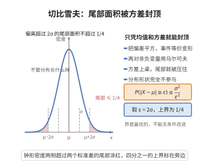

# 切比雪夫不等式

> **一句话大白话**：只知道平均值和波动大小（方差）时，就能给"随机值远离平均值"的概率封个顶——偏离均值越远，能出现的概率就越小，而且这个上界连分布长相都不用知道。
>
> **小例子**：若随机变量均值为 $\mu$、标准差 $\sigma$，则 $P(|X-\mu|\ge 2\sigma)\le 1/4$；也就是说再古怪的分布，取到"偏离期望 2 个标准差外"的次数也不会超过四分之一。

## 介绍

切比雪夫不等式（Chebyshev's Inequality）是概率论中最重要的矩不等式之一，由俄罗斯数学家帕夫努季·切比雪夫（Pafnuty Chebyshev）在 1867 年提出。该不等式指出，对于具有有限期望 $\mu$ 和方差 $\sigma^2$ 的随机变量 $X$，任意 $\varepsilon > 0$ 有 $P(|X - \mu| \geq \varepsilon) \leq \sigma^2/\varepsilon^2$。这一不等式是马尔可夫不等式的直接推论，它定量地刻画了随机变量偏离其均值的概率与方差之间的关系。切比雪夫不等式是证明弱大数定律和许多其他极限定理的关键工具，也是统计推断中置信区间构造的理论基础。

## 几何直观

图意在说明：偏离超过若干倍标准差之外的尾部面积，被方差与阈值的比值压住。

## 分析

**前置依赖**：马尔可夫不等式、期望、方差、概率公理。

**数学内涵**：
- 设 $X$ 是随机变量，$E[X] = \mu$，$\text{Var}(X) = \sigma^2 < \infty$。则 $P(|X - \mu| \geq \varepsilon) \leq \sigma^2/\varepsilon^2$。
- 证明：将马尔可夫不等式应用于非负随机变量 $(X - \mu)^2$ 和阈值 $\varepsilon^2$。
- 该不等式对任意分布都成立，只要方差有限。
- 切比雪夫不等式是最优的（紧的）——存在分布使等号成立。

**结构**：
1. 注意到 $|X - \mu| \geq \varepsilon$ 等价于 $(X - \mu)^2 \geq \varepsilon^2$。
2. 对 $(X - \mu)^2$ 应用马尔可夫不等式。
3. 利用 $\text{Var}(X) = E[(X - \mu)^2]$。

## 思考过程

切比雪夫不等式的证明是马尔可夫不等式的直接应用。关键步骤是将绝对偏差转化为平方偏差，因为 $(X - \mu)^2$ 是非负随机变量，且其期望正是方差。

这一转化非常巧妙：原始的 $|X - \mu| \geq \varepsilon$ 事件等价于 $(X - \mu)^2 \geq \varepsilon^2$，然后对 $(X - \mu)^2$ 应用马尔可夫不等式即得 $P((X - \mu)^2 \geq \varepsilon^2) \leq E[(X - \mu)^2]/\varepsilon^2 = \sigma^2/\varepsilon^2$。

## 证明过程

**定理**（切比雪夫不等式）：设 $X$ 是随机变量，$E[X] = \mu$，$\text{Var}(X) = \sigma^2 < \infty$。则对任意 $\varepsilon > 0$，
$$P(|X - \mu| \geq \varepsilon) \leq \frac{\sigma^2}{\varepsilon^2}$$

**证明**：

注意到 $|X - \mu| \geq \varepsilon$ 当且仅当 $(X - \mu)^2 \geq \varepsilon^2$。因此
$$P(|X - \mu| \geq \varepsilon) = P((X - \mu)^2 \geq \varepsilon^2)$$

由于 $(X - \mu)^2$ 是非负随机变量，对 $a = \varepsilon^2$ 应用马尔可夫不等式：
$$P((X - \mu)^2 \geq \varepsilon^2) \leq \frac{E[(X - \mu)^2]}{\varepsilon^2} = \frac{\text{Var}(X)}{\varepsilon^2} = \frac{\sigma^2}{\varepsilon^2}$$

$\square$

**推论**（单侧切比雪夫不等式，Cantelli 不等式）：对任意 $t > 0$，
$$P(X - \mu \geq t) \leq \frac{\sigma^2}{\sigma^2 + t^2}$$
$$P(X - \mu \leq -t) \leq \frac{\sigma^2}{\sigma^2 + t^2}$$

**应用**：切比雪夫不等式的一个重要应用是证明弱大数定律。设 $X_1, \ldots, X_n$ 是独立同分布随机变量，$E[X_i] = \mu$，$\text{Var}(X_i) = \sigma^2$。则样本均值 $\bar{X}_n = \frac{1}{n}\sum_{i=1}^n X_i$ 满足 $E[\bar{X}_n] = \mu$，$\text{Var}(\bar{X}_n) = \sigma^2/n$。由切比雪夫不等式，
$$P(|\bar{X}_n - \mu| \geq \varepsilon) \leq \frac{\sigma^2}{n\varepsilon^2} \to 0 \quad (n \to \infty)$$
即 $\bar{X}_n$ 依概率收敛到 $\mu$。

## 课堂问答

**老师**：只知道均值和方差，能对"偏离均值很远"的概率说点什么硬话吗？

**学生**：能。对任意 $\varepsilon>0$，$P(|X-\mu|\ge\varepsilon)\le\frac{\sigma^2}{\varepsilon^2}$；取 $\varepsilon=2\sigma$ 得 $P(|X-\mu|\ge2\sigma)\le\frac14$，且完全不依赖分布形状。

**老师（追问）**：这条不等式是怎么从马尔可夫不等式冒出来的？

**学生**：把 $|X-\mu|\ge\varepsilon$ 平方化为 $(X-\mu)^2\ge\varepsilon^2$，对非负变量 $(X-\mu)^2$ 用马尔可夫不等式：$P((X-\mu)^2\ge\varepsilon^2)\le\frac{\mathbb E[(X-\mu)^2]}{\varepsilon^2}=\frac{\sigma^2}{\varepsilon^2}$。

**老师（拓展）**：这个界够紧吗？

**学生**：它是紧的：两点分布取值 $0$ 与 $2\sigma$ 时等号可成立，故不能无条件改进。常见误区是把它当成精确值——它只是仅凭二阶矩能给出的最坏上界。
