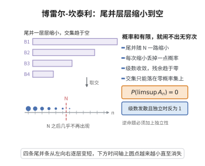

# 博雷尔-坎泰利引理

> **一句话大白话**：如果一堆"坏事件"各自的概率加起来的和还是有限的，那么"这些坏事件无限次地反复发生"的概率是0——坏事能量有限，就不会没完没了地缠着你。
>
> **小例子**：每次掷硬币出现"连续10个正面"这样的事件概率很小且可数和，求和有限，那么"这件事无限次出现"几乎不可能；若反过来概率和发散，则几乎一定无穷次发生。

## 介绍

博雷尔-坎泰利引理（Borel-Cantelli Lemma）是概率论中关于无穷多个事件发生概率的基本引理，由法国数学家埃米尔·博雷尔（Émile Borel）和意大利数学家弗朗切斯科·坎泰利（Francesco Cantelli）提出。该引理指出：如果事件序列 $\{A_n\}$ 的概率之和有限，则无穷多个事件同时发生的概率为零。即若 $\sum_{n=1}^\infty P(A_n) < \infty$，则 $P(\limsup_{n \to \infty} A_n) = 0$。这一引理是证明强大数定律和 Kolmogorov 0-1 律的关键工具，也是概率论中从"平均"收敛到"几乎必然"收敛的重要桥梁。

## 几何直观

图意在说明：尾并随着起点后移不断丢掉概率，交集只能落在零概率的地方。

## 分析

**前置依赖**：概率公理（可列可加性）、$\limsup$ 的定义、测度论基本概念。

**数学内涵**：
- $\limsup_{n \to \infty} A_n = \bigcap_{n=1}^\infty \bigcup_{k=n}^\infty A_k$，即无穷多个 $A_n$ 发生的集合。
- 博雷尔-坎泰利引理：若 $\sum P(A_n) < \infty$，则 $P(\limsup A_n) = 0$。
- 该引理不需要独立性假设。
- 逆命题在独立性条件下成立：若 $\sum P(A_n) = \infty$ 且 $\{A_n\}$ 独立，则 $P(\limsup A_n) = 1$。

**结构**：
1. 利用概率的可列次可加性。
2. 将 $\limsup$ 表示为可数交并。
3. 利用 $\sum P(A_n) < \infty$ 得到余项趋于零。

## 思考过程

博雷尔-坎泰利引理的证明非常简洁。首先注意到 $\limsup A_n = \bigcap_{n=1}^\infty \bigcup_{k=n}^\infty A_k$，因此
$$P(\limsup A_n) = \lim_{n \to \infty} P\left(\bigcup_{k=n}^\infty A_k\right) \leq \lim_{n \to \infty} \sum_{k=n}^\infty P(A_k)$$
如果 $\sum_{k=1}^\infty P(A_k) < \infty$，则余项 $\sum_{k=n}^\infty P(A_k) \to 0$，故 $P(\limsup A_n) = 0$。

## 证明过程

**定理**（博雷尔-坎泰利引理）：设 $\{A_n\}_{n=1}^\infty$ 是概率空间 $(\Omega, \mathcal{F}, P)$ 中的事件序列。

1. 若 $\sum_{n=1}^\infty P(A_n) < \infty$，则 $P(\limsup_{n \to \infty} A_n) = 0$。
2. 若 $\sum_{n=1}^\infty P(A_n) = \infty$ 且 $\{A_n\}$ 相互独立，则 $P(\limsup_{n \to \infty} A_n) = 1$。

**证明**：

### 第一部分

由 $\limsup$ 的定义，
$$\limsup_{n \to \infty} A_n = \bigcap_{n=1}^\infty \bigcup_{k=n}^\infty A_k$$

对任意 $n$，
$$P(\limsup A_n) \leq P\left(\bigcup_{k=n}^\infty A_k\right) \leq \sum_{k=n}^\infty P(A_k)$$

由于 $\sum_{k=1}^\infty P(A_k) < \infty$，余项 $\sum_{k=n}^\infty P(A_k) \to 0$（$n \to \infty$）。因此
$$P(\limsup A_n) = 0$$

### 第二部分（Borel-Cantelli 逆命题）

假设 $\{A_n\}$ 独立且 $\sum P(A_n) = \infty$。考虑 $\limsup A_n$ 的补集：
$$(\limsup A_n)^c = \bigcup_{n=1}^\infty \bigcap_{k=n}^\infty A_k^c$$

对任意 $n$ 和 $m \geq n$，
$$P\left(\bigcap_{k=n}^m A_k^c\right) = \prod_{k=n}^m P(A_k^c) = \prod_{k=n}^m (1 - P(A_k))$$

利用 $1 - x \leq e^{-x}$，
$$\prod_{k=n}^m (1 - P(A_k)) \leq \exp\left(-\sum_{k=n}^m P(A_k)\right)$$

令 $m \to \infty$，由于 $\sum_{k=n}^\infty P(A_k) = \infty$，指数部分趋于 $-\infty$，故
$$P\left(\bigcap_{k=n}^\infty A_k^c\right) = 0$$

因此 $P\left(\bigcup_{n=1}^\infty \bigcap_{k=n}^\infty A_k^c\right) = 0$，即 $P(\limsup A_n) = 1$。$\square$

## 课堂问答

**老师**：一列"坏事件"若概率和有限，能断言它不会反复出现吗？

**学生**：能。$\sum_n P(A_n)<\infty$ 蕴含 $P(\limsup_n A_n)=0$，即坏事件几乎必然只发生有限多次；这只用到次可加性，无需任何独立性。

**老师（追问）**：逆命题也这么省事吗？

**学生**：不省事。$\sum_n P(A_n)=\infty$ 时要有 $P(\limsup A_n)=1$，必须补上 $\{A_n\}$ 相互独立；否则如 $A_n=A$ 且 $P(A)=1/2$，级数发散但 $\limsup A_n=A$ 的概率只有 $1/2$。

**老师（拓展）**：为什么它是通往"几乎必然"的桥？

**学生**：因为它把"概率级数可和"翻译成"上极限零概率"，正是强大数定律、Kolmogorov 0-1 律里从依概率收敛升级到几乎必然收敛的通用入口。
