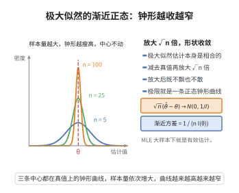

# 似然方程渐近正态性

> **一句话大白话**：样本很多时，极大似然估计 $\hat\theta_n$ 大致像一个钟形，围绕真值 $\theta$ 展开，方差是 $\frac{1}{nI(\theta)}$——即 $\sqrt{n}(\hat\theta_n-\theta)\to N(0,1/I(\theta))$。
>
> **小例子**：$X_i\sim Exp(\lambda)$，$I(\lambda)=1/\lambda^2$，MLE $\hat\lambda=1/\bar X$，当 $n$ 大时 $\sqrt n(\hat\lambda-\lambda)\to N(0,\lambda^2)$。

## 介绍

似然方程渐近正态性定理（Asymptotic Normality of MLE）是数理统计中关于极大似然估计（MLE）渐近分布的重要结论。该定理断言：在正则条件下，极大似然估计 $\hat{\theta}_n$ 渐近服从正态分布 $N(\theta, 1/(n I(\theta)))$，其中 $I(\theta)$ 是 Fisher 信息量。这一结论表明 MLE 不仅是相合的，而且渐近有效（达到 Cramér-Rao 下界）。它是统计推断中构造置信区间和假设检验的理论基础，也是大样本统计理论的核心结果之一。

## 几何直观

图意在说明：样本量增大时估计量并不跑偏，只是分布不断收窄，放大 √n 倍后正好收敛到一条固定的正态曲线。

## 分析

**前置依赖**：中心极限定理、弱收敛与大数定律、Fisher 信息量、Taylor 展开。

**数学内涵**：
- 设 $X_1, \ldots, X_n$ 独立同分布，密度 $f(x;\theta)$，MLE 为 $\hat{\theta}_n$。
- 得分函数 $S_n(\theta) = \sum_{i=1}^n \frac{\partial}{\partial\theta}\ln f(X_i;\theta)$。
- MLE 满足似然方程 $S_n(\hat{\theta}_n) = 0$。
- 渐近正态性：$\sqrt{n}(\hat{\theta}_n - \theta) \xrightarrow{d} N(0, 1/I(\theta))$。
- 证明通过对得分函数在真实值处做 Taylor 展开，利用中心极限定理和弱大数定律。

**结构**：
1. 将 $S_n(\hat{\theta}_n) = 0$ 在 $\theta$ 处 Taylor 展开。
2. 利用中心极限定理处理 $S_n(\theta)/\sqrt{n}$。
3. 利用大数定律处理 $S_n'(\theta)/n$。
4. 结合 Slutsky 定理得到渐近正态性。

## 思考过程

似然方程渐近正态性的证明利用了经典的"Delta 方法"思路。对得分函数 $S_n(\hat{\theta}_n) = 0$ 在 $\theta$ 处做一阶 Taylor 展开：
$$0 = S_n(\hat{\theta}_n) = S_n(\theta) + S_n'(\theta^*)(\hat{\theta}_n - \theta)$$
其中 $\theta^*$ 在 $\theta$ 和 $\hat{\theta}_n$ 之间。整理得
$$\sqrt{n}(\hat{\theta}_n - \theta) = -\frac{S_n(\theta)/\sqrt{n}}{S_n'(\theta^*)/n}$$

由中心极限定理，$S_n(\theta)/\sqrt{n} \xrightarrow{d} N(0, I(\theta))$。由弱大数定律，$S_n'(\theta^*)/n \xrightarrow{p} E[\partial^2 \ln f/\partial\theta^2] = -I(\theta)$。因此
$$\sqrt{n}(\hat{\theta}_n - \theta) \xrightarrow{d} \frac{N(0, I(\theta))}{I(\theta)} = N(0, 1/I(\theta))$$

## 证明过程

**定理**（MLE 的渐近正态性）：设 $X_1, \ldots, X_n$ 独立同分布，密度 $f(x;\theta)$ 满足正则条件。$\hat{\theta}_n$ 是 $\theta$ 的极大似然估计。则
$$\sqrt{n}(\hat{\theta}_n - \theta) \xrightarrow{d} N\left(0, \frac{1}{I(\theta)}\right)$$
其中 $I(\theta)$ 是 Fisher 信息量。

**证明**：

### 1. 记号与正则条件

令 $l(x;\theta) = \ln f(x;\theta)$，$S_i(\theta) = \frac{\partial}{\partial\theta} l(X_i;\theta)$，$S_n(\theta) = \sum_{i=1}^n S_i(\theta)$。

正则条件：
1. $\hat{\theta}_n$ 是相合估计：$\hat{\theta}_n \xrightarrow{p} \theta$。
2. $E[S_i(\theta)] = 0$，$\text{Var}(S_i(\theta)) = I(\theta)$。
3. $E[-\partial^2 l/\partial\theta^2] = I(\theta)$。
4. 积分与求导可交换。

### 2. Taylor 展开

MLE 满足似然方程 $S_n(\hat{\theta}_n) = 0$。在 $\theta$ 处展开：
$$0 = S_n(\hat{\theta}_n) = S_n(\theta) + S_n'(\theta^*)(\hat{\theta}_n - \theta)$$
其中 $\theta^*$ 在 $\theta$ 和 $\hat{\theta}_n$ 之间，$S_n'(\theta) = \sum_{i=1}^n \frac{\partial^2}{\partial\theta^2} l(X_i;\theta)$。

整理得
$$\sqrt{n}(\hat{\theta}_n - \theta) = -\frac{S_n(\theta)/\sqrt{n}}{S_n'(\theta^*)/n}$$

### 3. 分子部分

由中心极限定理，$S_n(\theta)/\sqrt{n} = \frac{1}{\sqrt{n}}\sum_{i=1}^n S_i(\theta)$ 满足：
$$\frac{S_n(\theta)}{\sqrt{n}} \xrightarrow{d} N(0, I(\theta))$$

### 4. 分母部分

由弱大数定律和 $\hat{\theta}_n$ 的相合性，
$$\frac{S_n'(\theta^*)}{n} = \frac{1}{n}\sum_{i=1}^n \frac{\partial^2}{\partial\theta^2} l(X_i;\theta^*) \xrightarrow{p} E\left[\frac{\partial^2}{\partial\theta^2} l(X;\theta)\right] = -I(\theta)$$

### 5. 应用 Slutsky 定理

由 Slutsky 定理，
$$\sqrt{n}(\hat{\theta}_n - \theta) = -\frac{S_n(\theta)/\sqrt{n}}{S_n'(\theta^*)/n} \xrightarrow{d} -\frac{N(0, I(\theta))}{-I(\theta)} = N\left(0, \frac{1}{I(\theta)}\right)$$

$\square$

**推论**：$\hat{\theta}_n$ 的渐近方差为 $1/(n I(\theta))$，达到 Cramér-Rao 下界，故 MLE 是渐近有效估计。

## 课堂问答

**老师**：MLE 的渐近正态性 $\sqrt n(\hat\theta_n-\theta)\xrightarrow{d}N(0,1/I(\theta))$，你是怎么推出来的？

**学生**：结论：方差恰为 Fisher 信息的倒数，证明核心是"似然方程 + Taylor + Slutsky"。因为 MLE 满足 $S_n(\hat\theta_n)=0$，在真值 $\theta$ 处展开得 $0=S_n(\theta)+S_n'(\theta^*)(\hat\theta_n-\theta)$，于是

$$\sqrt n(\hat\theta_n-\theta)=-\frac{S_n(\theta)/\sqrt n}{S_n'(\theta^*)/n}$$

分子由中心极限定理收敛到 $N(0,I(\theta))$，分母由弱大数定律收敛到 $-I(\theta)$，相除即得 $N(0,1/I(\theta))$。

**老师（追问）**：分母里的 $\theta^*$ 随样本而变、夹在 $\theta$ 与 $\hat\theta_n$ 之间，你凭什么把 $S_n'(\theta^*)/n$ 当作常数处理？

**学生**：靠 MLE 的相合性 $\hat\theta_n\xrightarrow{P}\theta$，从而 $\theta^*\xrightarrow{P}\theta$，再由 $S_n'(\theta^*)/n\xrightarrow{P}E[\partial_\theta^2\ln f]=-I(\theta)$。这一步需要 $\partial_\theta^2\ln f(x;\theta)$ 在 $\theta$ 邻域内满足一致大数律（正则条件），否则随机点处的平均未必收敛到该期望——忽略一致性条件、直接套固定点大数律是常见误区。

**老师（拓展）**：为什么渐近方差 $1/(nI(\theta))$ 意味着 MLE "渐近有效"？

**学生**：因为它是 $\hat\theta_n$ 的渐近方差，而 Cramér-Rao 下界断言任何无偏估计的方差都不小于 $1/(nI(\theta))$，MLE 在 $n\to\infty$ 时取到等号，故渐近有效。更一般地，两个正则估计若都达到下界，就"一阶等价"，差异只在 $o_p(n^{-1/2})$ 的高阶项。
