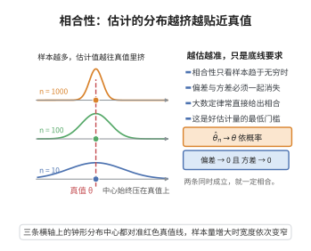

# 点估计的相合性

> **一句话大白话**：样本量足够大时，估计量 $\hat\theta_n$ 会"收敛"到真值 $\theta$（$\hat\theta_n\xrightarrow{P}\theta$），数据越多估得越准，这是好估计器的底线要求。
>
> **小例子**：抛硬币 $n$ 次，用正面频率 $\hat p$ 估计 $p$。由大数定律 $\hat p\xrightarrow{P}p$，所以频率估计是相合的，样本越多越接近真实正面概率。

## 介绍

点估计的相合性（Consistency of Estimators）是数理统计中评价估计量优劣的基本准则之一。一个相合估计量（consistent estimator）是指随着样本量 $n$ 增大，估计量依概率收敛到真实参数值。即 $\hat{\theta}_n \xrightarrow{P} \theta$。相合性是最基本的渐近性质——它保证了当样本量足够大时，估计量可以任意接近真实参数。弱大数定律和强大数定律是证明相合性的主要工具。相合性通常分为弱相合（依概率收敛）和强相合（几乎必然收敛）两种。

## 几何直观

图意在说明：相合性要求样本趋于无穷时偏差与方差一起消失，估计值被压到真值上，而不只是偶尔估得准。

## 分析

**前置依赖**：弱收敛与大数定律、依概率收敛、几乎必然收敛。

**数学内涵**：
- $\hat{\theta}_n$ 是 $\theta$ 的**弱相合估计**，如果 $\hat{\theta}_n \xrightarrow{P} \theta$。
- $\hat{\theta}_n$ 是 $\theta$ 的**强相合估计**，如果 $\hat{\theta}_n \xrightarrow{a.s.} \theta$。
- 矩估计的相合性通常由大数定律直接得到。
- 极大似然估计在正则条件下是相合的。
- 证明相合性的常用方法：大数定律 + 连续映射定理、Chebyshev 不等式、直接概率估计。

**结构**：
1. 相合性的定义。
2. 利用大数定律证明矩估计的相合性。
3. 利用 Chebyshev 不等式证明方差趋于零的估计量的相合性。
4. 讨论 MLE 的相合性。

## 思考过程

相合性的证明通常依赖于大数定律。例如，样本均值 $\bar{X}_n$ 是总体均值 $\mu$ 的相合估计，因为由弱大数定律，$\bar{X}_n \xrightarrow{P} \mu$。

对于更一般的估计量，如果 $\hat{\theta}_n$ 可以表示为样本均值的函数，则可通过连续映射定理证明相合性。例如，样本方差 $S_n^2 = \frac{1}{n-1}\sum (X_i - \bar{X}_n)^2$ 的相合性可通过展开和使用大数定律证明。

另一种常用的方法是证明 $E[\hat{\theta}_n] \to \theta$ 且 $\text{Var}(\hat{\theta}_n) \to 0$，由 Chebyshev 不等式即得相合性。

## 证明过程

**定理**（点估计的相合性）：设 $X_1, \ldots, X_n$ 是独立同分布样本，$E[X_i] = \mu$，$\text{Var}(X_i) = \sigma^2 < \infty$。则：

1. **样本均值** $\bar{X}_n = \frac{1}{n}\sum_{i=1}^n X_i$ 是 $\mu$ 的弱相合估计。
2. **样本方差** $S_n^2 = \frac{1}{n-1}\sum_{i=1}^n (X_i - \bar{X}_n)^2$ 是 $\sigma^2$ 的弱相合估计。
3. 若 $E[X_i^4] < \infty$，则 $S_n^2$ 是 $\sigma^2$ 的强相合估计。

**证明**：

### 1. 样本均值的相合性

由弱大数定律，$\bar{X}_n \xrightarrow{P} \mu$，故 $\bar{X}_n$ 是 $\mu$ 的弱相合估计。

### 2. 样本方差的相合性

展开样本方差：
$$S_n^2 = \frac{1}{n-1}\sum_{i=1}^n (X_i - \bar{X}_n)^2 = \frac{1}{n-1}\left(\sum_{i=1}^n X_i^2 - n\bar{X}_n^2\right)$$

由弱大数定律，$\frac{1}{n}\sum X_i^2 \xrightarrow{P} E[X_1^2] = \sigma^2 + \mu^2$，且 $\bar{X}_n \xrightarrow{P} \mu$。由连续映射定理，$\bar{X}_n^2 \xrightarrow{P} \mu^2$。

因此
$$\frac{1}{n}\sum_{i=1}^n X_i^2 - \bar{X}_n^2 \xrightarrow{P} (\sigma^2 + \mu^2) - \mu^2 = \sigma^2$$

又 $\frac{n}{n-1} \to 1$，故 $S_n^2 \xrightarrow{P} \sigma^2$。

### 3. 一般情形

设 $\hat{\theta}_n$ 是 $\theta$ 的估计量。若 $\lim_{n \to \infty} E[\hat{\theta}_n] = \theta$ 且 $\lim_{n \to \infty} \text{Var}(\hat{\theta}_n) = 0$，则 $\hat{\theta}_n$ 是 $\theta$ 的相合估计。

**证明**：由 Chebyshev 不等式，对任意 $\varepsilon > 0$，
$$P(|\hat{\theta}_n - \theta| \geq \varepsilon) \leq P(|\hat{\theta}_n - E[\hat{\theta}_n]| \geq \varepsilon/2) + P(|E[\hat{\theta}_n] - \theta| \geq \varepsilon/2)$$
当 $n$ 足够大时，第二项为 $0$（由渐近无偏性），第一项由 Chebyshev 不等式控制：
$$P(|\hat{\theta}_n - E[\hat{\theta}_n]| \geq \varepsilon/2) \leq \frac{4\text{Var}(\hat{\theta}_n)}{\varepsilon^2} \to 0$$

故 $\hat{\theta}_n \xrightarrow{P} \theta$。$\square$

## 课堂问答

**老师**：样本频率为什么能估出真实的成功概率？判定一个估计量"相合"，你有什么通用套路？

**学生**：结论：相合最常用的两条路是大数定律和 Chebyshev 不等式。若估计量满足 $E[\hat\theta_n]\to\theta$ 且 $\operatorname{Var}(\hat\theta_n)\to0$，则 $\hat\theta_n\xrightarrow{P}\theta$。理由是 Chebyshev 不等式，对任意 $\varepsilon>0$，

$$P(|\hat\theta_n-\theta|\geq\varepsilon)\leq\frac{4\operatorname{Var}(\hat\theta_n)}{\varepsilon^2}\to0$$

**老师（追问）**：样本方差 $S_n^2=\frac1{n-1}\sum(X_i-\bar X_n)^2$ 无偏，是不是只要方差趋零就相合？你展开时的关键一步是什么？

**学生**：关键是把它写成样本均值的函数再用连续映射定理：$S_n^2=\frac{n}{n-1}\left(\frac1n\sum X_i^2-\bar X_n^2\right)$。由弱大数定律 $\frac1n\sum X_i^2\xrightarrow{P}E X_1^2=\sigma^2+\mu^2$ 且 $\bar X_n\xrightarrow{P}\mu$，连续映射定理给出 $\bar X_n^2\xrightarrow{P}\mu^2$，相减得 $\sigma^2$，再乘 $\frac n{n-1}\to1$。常见误区是以为要"$E X^4<\infty$"才相合——其实那只是强相合的充分条件，弱相合只需 $\sigma^2<\infty$。

**老师（拓展）**：弱相合与强相合的本质差别在哪？矩估计的相合性能只靠弱大数定律得到吗？

**学生**：差别在收敛方式：$\hat\theta_n\xrightarrow{P}\theta$ 是弱相合，$\hat\theta_n\xrightarrow{a.s.}\theta$ 是强相合，后者沿几乎每条样本路径成立、更强。矩估计 $\hat\theta=g(\hat m_1,\dots)$ 只要 $g$ 连续，由弱大数定律配连续映射定理即得弱相合；升级到强相合需强大数定律与 $g$ 的相应连续性。还有一点易被忽视：相合只保证大样本趋近，与有限样本无偏无关——$S_n^2$ 无偏，而 $S_n=\sqrt{S_n^2}$ 有偏却仍相合。
