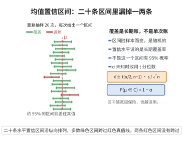

# 正态总体均值置信区间

> **一句话大白话**：用样本均值 $\bar X$ 去圈定总体均值 $\mu$：$\sigma$ 已知用 $\bar X\pm z_{\alpha/2}\frac{\sigma}{\sqrt n}$（正态），$\sigma$ 未知则改用 $t_{n-1}$，得到一个以 $1-\alpha$ 概率覆盖 $\mu$ 的区间。
>
> **小例子**：某厂灯泡寿命 $X\sim N(\mu,\sigma^2)$（$\sigma$ 未知），抽 $n=25$ 只得 $\bar x=1000$ 时、$s=40$，则 95% 置信区间为 $1000\pm t_{24,0.025}\frac{40}{5}\approx1000\pm16.5$。

## 介绍

正态总体均值置信区间是统计推断中最基本的区间估计问题，用于在给定置信水平下估计正态分布总体的均值。该问题由 William Gosset（笔名 Student）在 20 世纪初引入 t 分布后得到完善解决，是假设检验、质量控制和科学实验数据分析的基础工具。

## 几何直观

图意在说明：置信水平描述的是长期覆盖率，每次抽样得到的区间或覆盖真值或漏掉，并不是单个区间的概率。

## 分析

**前置依赖**：正态总体抽样分布定理、t 分布构造、标准正态分布

**定理内容**：设 $X_1,\ldots,X_n$ 为来自正态总体 $N(\mu,\sigma^2)$ 的简单随机样本，样本均值为 $\bar{X}$，样本方差为 $S^2$。

- 当方差 $\sigma^2$ 已知时，$\mu$ 的 $1-\alpha$ 置信区间为
  $$\left(\bar{X}-z_{\alpha/2}\frac{\sigma}{\sqrt{n}},\;\bar{X}+z_{\alpha/2}\frac{\sigma}{\sqrt{n}}\right)$$
  其中 $z_{\alpha/2}$ 为标准正态分布的上 $\alpha/2$ 分位数。

- 当方差 $\sigma^2$ 未知时，$\mu$ 的 $1-\alpha$ 置信区间为
  $$\left(\bar{X}-t_{\alpha/2}(n-1)\frac{S}{\sqrt{n}},\;\bar{X}+t_{\alpha/2}(n-1)\frac{S}{\sqrt{n}}\right)$$
  其中 $t_{\alpha/2}(n-1)$ 为自由度为 $n-1$ 的 t 分布的上 $\alpha/2$ 分位数，$S=\sqrt{\frac{1}{n-1}\sum_{i=1}^n(X_i-\bar{X})^2}$。

**数学内涵**：置信区间给出了参数估计的不确定性度量。方差已知时利用 $\frac{\bar{X}-\mu}{\sigma/\sqrt{n}}\sim N(0,1)$ 构造枢轴量；方差未知时用 $S$ 代替 $\sigma$，枢轴量 $\frac{\bar{X}-\mu}{S/\sqrt{n}}\sim t(n-1)$，反映了用样本标准差估计总体标准差带来的额外不确定性。

**证明策略**：构造枢轴量（pivot），利用抽样分布定理确定枢轴量服从的分布，再根据分位数反解出 $\mu$ 的置信区间。

## 思考过程

置信区间的构造逻辑是"倒推"：先构造一个包含待估参数和样本且分布已知的枢轴量，然后利用该分布的分位数确定区间端点。方差已知时用正态分布，方差未知时用 t 分布——t 分布比正态分布有更厚的尾部，反映了用 $S$ 估计 $\sigma$ 引入的额外不确定性，样本量越大 t 分布越接近正态分布。

## 证明过程

**定理**：设 $X_1,\ldots,X_n\overset{\text{i.i.d.}}{\sim}N(\mu,\sigma^2)$，则 $\mu$ 的 $1-\alpha$ 置信区间如下。

### 方差 $\sigma^2$ 已知

由正态总体抽样分布定理，$\bar{X}\sim N(\mu,\sigma^2/n)$，因此
$$Z=\frac{\bar{X}-\mu}{\sigma/\sqrt{n}}\sim N(0,1)$$

对给定的置信水平 $1-\alpha$，有
$$P\left(-z_{\alpha/2}\leq Z\leq z_{\alpha/2}\right)=1-\alpha$$

代入 $Z$：
$$P\left(-z_{\alpha/2}\leq\frac{\bar{X}-\mu}{\sigma/\sqrt{n}}\leq z_{\alpha/2}\right)=1-\alpha$$

解出 $\mu$：
$$P\left(\bar{X}-z_{\alpha/2}\frac{\sigma}{\sqrt{n}}\leq\mu\leq\bar{X}+z_{\alpha/2}\frac{\sigma}{\sqrt{n}}\right)=1-\alpha$$

故 $\mu$ 的 $1-\alpha$ 置信区间为 $(\bar{X}-z_{\alpha/2}\sigma/\sqrt{n},\;\bar{X}+z_{\alpha/2}\sigma/\sqrt{n})$。

### 方差 $\sigma^2$ 未知

由正态总体抽样分布定理，
$$\frac{(n-1)S^2}{\sigma^2}\sim\chi^2(n-1)$$
且 $\bar{X}$ 与 $S^2$ 独立。因此
$$T=\frac{\bar{X}-\mu}{S/\sqrt{n}}=\frac{(\bar{X}-\mu)/(\sigma/\sqrt{n})}{\sqrt{(n-1)S^2/(\sigma^2(n-1))}}\sim t(n-1)$$

对给定的置信水平 $1-\alpha$，有
$$P\left(-t_{\alpha/2}(n-1)\leq T\leq t_{\alpha/2}(n-1)\right)=1-\alpha$$

代入 $T$：
$$P\left(-t_{\alpha/2}(n-1)\leq\frac{\bar{X}-\mu}{S/\sqrt{n}}\leq t_{\alpha/2}(n-1)\right)=1-\alpha$$

解出 $\mu$：
$$P\left(\bar{X}-t_{\alpha/2}(n-1)\frac{S}{\sqrt{n}}\leq\mu\leq\bar{X}+t_{\alpha/2}(n-1)\frac{S}{\sqrt{n}}\right)=1-\alpha$$

故 $\mu$ 的 $1-\alpha$ 置信区间为 $(\bar{X}-t_{\alpha/2}(n-1)S/\sqrt{n},\;\bar{X}+t_{\alpha/2}(n-1)S/\sqrt{n})$。

$\square$

## 课堂问答

**老师**：构造正态均值 $\mu$ 的置信区间，方差已知与未知分别怎么做？

**学生**：结论：都靠枢轴量。$\sigma$ 已知时 $Z=\frac{\bar X-\mu}{\sigma/\sqrt n}\sim N(0,1)$，得 $\bar X\pm z_{\alpha/2}\frac{\sigma}{\sqrt n}$；$\sigma$ 未知时用 $T=\frac{\bar X-\mu}{S/\sqrt n}\sim t_{n-1}$，得 $\bar X\pm t_{\alpha/2}(n-1)\frac{S}{\sqrt n}$。

**老师（追问）**：为什么 $\sigma$ 未知时把 $\sigma$ 换成 $S$ 得到的不是正态而是 $t$ 分布？$t$ 的分位数为什么比 $z$ 大？

**学生**：因为分母 $S$ 也随机，有 $T=\frac{(\bar X-\mu)/(\sigma/\sqrt n)}{\sqrt{(n-1)S^2/[\sigma^2(n-1)]}}$，恰是"标准正态除以卡方自由度开方"的 $t_{n-1}$ 定义，这里用到了 $\bar X\perp S^2$ 这一正态特有性质。$S$ 带来额外不确定性使尾部更厚，故 $t_{\alpha/2}(n-1)>z_{\alpha/2}$、区间更宽；$n\to\infty$ 时 $t_{n-1}\to N(0,1)$，区间收缩到正态版。

**老师（拓展）**：这个"$1-\alpha$ 覆盖率"该怎么正确理解？它是关于 $\mu$ 的概率吗？

**学生**：不是。频率派下 $\mu$ 是固定常数、随机的是区间，$P(\bar X-t_{\alpha/2}(n-1)\frac{S}{\sqrt n}\leq\mu\leq\bar X+t_{\alpha/2}(n-1)\frac{S}{\sqrt n})=1-\alpha$ 说的是"随机区间覆盖固定真值"的概率，即重复抽样中约 $1-\alpha$ 比例的区间命中 $\mu$；一旦算出具体区间，只能说它是这套构造的一个实现，不能说 $\mu$ 以 $1-\alpha$ 概率落在其中。
