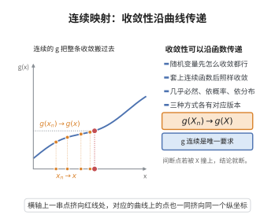

# 连续映射定理

> **一句话大白话**：只要函数是连续的，随机变量怎么收敛，函数值就跟着同样方式收敛——"收敛性"可以被连续函数搬运过去。
>
> **小例子**：若 $\bar X_n\xrightarrow{P}\mu$，而 $g(x)=x^2$ 连续，则 $\bar X_n^2\xrightarrow{P}\mu^2$；这正是把"样本均值收敛"升级为"样本二阶矩收敛"的那一步。

## 介绍

连续映射定理（Continuous Mapping Theorem）是概率论中把随机变量的收敛性沿连续函数"传递"的基本工具。它指出：若一列随机变量在依概率收敛、几乎必然收敛或依分布收敛的意义下收敛，则经任意（相应合适的）连续函数作用后仍以同样方式收敛。

这一定理的价值在于：它把"分布收敛"这种看似只关于分布的结论，转化为可以直接对随机变量做代数与连续运算的规则，因而是 Slutsky 定理、Delta 方法以及各类渐近正态性论证的第一步。

## 几何直观

图意在说明：只要函数连续，随机变量的收敛方式就能原样搬到函数值上，这是所有渐近论证的第一步。

## 分析

**前置依赖**：依分布收敛的定义、依概率收敛的定义、几乎必然收敛、连续函数的性质、Borel-Cantelli 引理

**定理内容**：设 $X_n$（$n\ge1$）与 $X$ 是随机变量，$g:\mathbb{R}\to\mathbb{R}$ 是连续函数（更一般地，$g$ 的间断点集合 $D_g$ 满足 $P(X\in D_g)=0$）。

1. 若 $X_n\xrightarrow{a.s.}X$，则 $g(X_n)\xrightarrow{a.s.}g(X)$；
2. 若 $X_n\xrightarrow{P}X$，则 $g(X_n)\xrightarrow{P}g(X)$；
3. 若 $X_n\xrightarrow{d}X$，则 $g(X_n)\xrightarrow{d}g(X)$。

**前置知识**：
- 依分布收敛：$X_n\xrightarrow{d}X$ 当且仅当对 $X$ 的分布函数的每个连续点 $x$，$F_{X_n}(x)\to F_X(x)$
- 依概率收敛蕴含依分布收敛
- 几乎必然收敛的等价刻画：每个子序列都有进一步几乎必然收敛的子子序列

## 思考过程

三个断言按"由强到弱"排布。几乎必然收敛情形是纯分析事实：连续函数把逐点收敛搬运为逐点收敛。依概率收敛情形用"几乎必然收敛的子子序列判据"：只要证明每个子序列都含一个几乎必然收敛的子子序列即可，这正好把问题归约到第一种情形。

依分布收敛情形最有趣：此时 $\{X_n\}$ 与 $X$ 甚至不必定义在同一个概率空间上，无法直接比较 $g(X_n)$ 与 $g(X)$。技巧是先用 Skorokhod 表示定理把依分布收敛"实现"为同一空间上的几乎必然收敛，再调用第一种情形。若不想引入 Skorokhod 定理，也可用分布函数的连续性点论证。

## 证明过程

**步骤 1：几乎必然收敛情形**

设 $X_n(\omega)\to X(\omega)$，即对固定的 $\omega$ 有实数序列 $X_n(\omega)\to X(\omega)$。由于 $g$ 连续，由连续函数的序列刻画得 $g(X_n(\omega))\to g(X(\omega))$。这对每个 $\omega$ 成立，故 $g(X_n)\xrightarrow{a.s.}g(X)$。

**步骤 2：依概率收敛情形**

设 $X_n\xrightarrow{P}X$。必要性用子子序列判据：任取子序列 $\{X_{n_k}\}$，由 $X_{n_k}\xrightarrow{P}X$ 知其存在进一步子序列 $\{X_{n_{k_j}}\}$ 使 $X_{n_{k_j}}\xrightarrow{a.s.}X$。由步骤 1，$g(X_{n_{k_j}})\xrightarrow{a.s.}g(X)$，从而 $g(X_{n_{k_j}})\xrightarrow{P}g(X)$。

于是 $g(X_n)$ 的每个子序列都含一个依概率收敛到 $g(X)$ 的子子序列，这蕴含 $g(X_n)\xrightarrow{P}g(X)$。

**步骤 3：依分布收敛情形**

设 $X_n\xrightarrow{d}X$。取概率空间与随机变量 $Y_n,Y$ 使 $Y_n\stackrel{d}{=}X_n$、$Y\stackrel{d}{=}X$ 且 $Y_n\xrightarrow{a.s.}Y$（Skorokhod 表示定理）。由步骤 1，$g(Y_n)\xrightarrow{a.s.}g(Y)$。因 $g(Y_n)\stackrel{d}{=}g(X_n)$、$g(Y)\stackrel{d}{=}g(X)$，且几乎必然收敛蕴含依分布收敛，

$$
g(X_n)\stackrel{d}{=}g(Y_n)\xrightarrow{d}g(Y)\stackrel{d}{=}g(X).
$$

故 $g(X_n)\xrightarrow{d}g(X)$。

**步骤 4：间断点集合的处理**

若 $g$ 有间断点但 $P(X\in D_g)=0$，则把 $g$ 替换为在 $D_g$ 上重定义的连续函数 $g'$。因 $P(X\in D_g)=0$ 有 $g(X)=g'(X)$ 几乎必然。且由 $X_n\xrightarrow{P}X$ 与 $P(X\in D_g)=0$，对任意 $\eta>0$ 有 $P(X_n\in D_g)\to0$（对 $X$ 的连续点附近的邻域取极限），从而 $g'(X_n)-g(X_n)\xrightarrow{P}0$。对 $g'$ 用前述结论并由 Slutsky 定理合并，得到 $g(X_n)\xrightarrow{P}g(X)$。依分布情形同理。

## 课堂问答

**老师**：连续映射定理一句话怎么概括？它通常在哪一步派上用场？

**学生**：结论：连续函数把收敛方式原样搬运，$X_n\xrightarrow{a.s./P/d}X\Rightarrow g(X_n)$ 以同种方式收敛到 $g(X)$。它把"$\bar X_n\xrightarrow{P}\mu$"升级为"$\bar X_n^2\xrightarrow{P}\mu^2$"，是 Slutsky 定理与 Delta 方法的铺路石。

**老师（追问）**：三种收敛的证明思路各是什么？依分布情形为什么最麻烦？

**学生**：几乎必然情形是纯分析事实：逐点连续把逐点收敛搬过去。依概率情形用"子子序列判据"——每个子序列都有进一步子序列几乎必然收敛，把问题归约到第一种。依分布情形最麻烦，因为 $\{X_n\}$ 与 $X$ 甚至不必定义在同一概率空间、无法直接比较 $g(X_n)$ 与 $g(X)$；办法是用 Skorokhod 表示定理把依分布收敛实现为同一空间上的几乎必然收敛，再调用第一种情形。

**老师（拓展）**：依分布情形能否不用 Skorokhod、直接走分布函数？"连续映射"真正的边界条件是什么？

**学生**：可以，只需对各连续点论证 $P(g(X_n)\leq y)\to P(g(X)\leq y)$，但要处理 $g$ 的水平集，更繁琐。真正的边界条件是"$g$ 的间断点集 $D_g$ 满足 $P(X\in D_g)=0$"：例如 $g(x)=\mathbf 1_{\{x>0\}}$ 在 0 处间断，若 $X$ 在 0 有原子，则结论可能失效——所以用连续映射定理前，必须检查 $g$ 的间断点与极限分布的原子是否重合。

## 相关条目

- [Slutsky定理](./Slutsky定理.md)：以连续映射定理为基础的渐近理论工具
- [Delta方法](./Delta方法.md)：把连续映射定理用于可微函数得到渐近方差
- [弱大数定律](../第24级-概率论基础/弱大数定律.md)：依概率收敛的起点
