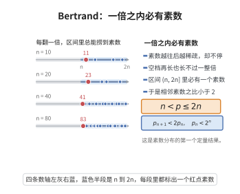

# Bertrand 素数定理

> **一句话大白话**：随便给一个整数 $n>1$，在 $n$ 与 $2n$ 之间（严格大于 $n$、不超过 $2n$）一定还藏着一个素数——素数再稀疏，也不会稀疏到留下这么长的空档。

> **小例子**：$n=10$ 时区间 $(10,20]$ 中有 $11,13,17,19$；$n=100$ 时 $(100,200]$ 中有 $101,103,107,109,113,\dots$ 共 $21$ 个素数。

## 介绍

Bertrand 素数定理（Bertrand's postulate，亦称 Chebyshev 定理）最初由 Joseph Bertrand 在 1845 年研究置换群时猜想，他手工验证到 $3\times10^6$；1850 年 Pafnuty Chebyshev 用解析方法给出证明；1919 年 Ramanujan 给出初等证明的雏形，1932 年 Paul Erdős 用二项式系数给出了著名的漂亮初等证明，即"用 $\binom{2n}{n}$ 的素因子结构"这一路。它要解决的是一个关于素数"间隔"的存在性问题：素数虽然越来越稀疏，但任意区间 $(n,2n]$ 都不能是空的，即相邻素数之比不超过 $2$（本定理等价于第 $n$ 个素数 $p_n<2^n$）。它是素数分布的第一个定量结果，其初等证明也直接给出 $\sum_p 1/p$ 发散的初等论证，因而是解析数论与初等数论之间的重要桥梁。

## 几何直观

图意在说明：无论 n 多大，区间 n 到 2n 之间总还藏着一个素数，素数的空档长不过一倍。

## 分析

**前置依赖**：算术基本定理、二项式系数与二项式定理、Legendre 公式（阶乘中素因子的指数）、素数乘积的初等估计。

**定理内容**：对每个整数 $n\ge1$，存在素数 $p$ 满足

$$n<p\le 2n .$$

**推论**：记第 $n$ 个素数为 $p_n$，则 $p_n<2^n$；相邻素数满足 $p_{n+1}<2p_n$；从而 $\pi(x)\ge\log_2 x-1$，且可由本定理初等地证明级数 $\sum_p\frac1p$ 发散。

## 思考过程

核心工具是一个"人为造出来"的数：$\binom{2n}{n}$。它有两个恰好互补的性质。其一，它不太大：$\binom{2n}{n}\le4^n$，因为 $4^n$ 是全部 $2n+1$ 个二项式系数之和，而中间那个最大；同时它也不太小：$4^n\le(2n+1)\binom{2n}{n}$，因为 $4^n$ 是最大值乘以项数得到的上界。其二，它的素因子结构极其规整：由 Legendre 公式，素数 $p$ 在 $\binom{2n}{n}$ 中的指数是 $\sum_i(\lfloor 2n/p^i\rfloor-2\lfloor n/p^i\rfloor)$，每个求和项只可能是 $0$ 或 $1$。于是落在 $(n,2n]$ 的素因子恰好出现一次，落在 $(\sqrt{2n},2n/3]$ 的素因子至多出现一次，而小素数（$\le\sqrt{2n}$）的贡献可以用 $2n$ 逐项控制。

把两侧拼起来：假设 $(n,2n]$ 中没有素数，则左端给出 $\binom{2n}{n}\ge4^n/(2n+1)$，右端给出 $\binom{2n}{n}\le4^{2n/3}(2n)^{\sqrt{2n}}$，两者产生一个"指数级对次指数级"的矛盾，只在 $n$ 充分大（$n\ge468$）时才可能不成立；剩下的小范围用一条相邻比值都小于 $2$ 的素数链手工覆盖。这就是 Erdős 证明的全部骨架。

## 证明过程

**步骤 1：素数乘积的上界。** 先证对一切实数 $x\ge1$ 有 $\prod_{p\le x}p\le4^{x}$。只需对整数 $m$ 归纳证明 $\prod_{p\le m}p\le4^m$。设 $m=2k+1$ 为奇数（$k\ge0$）：数 $\binom{2k+1}{k}=\frac{(2k+1)!}{k!(k+1)!}$ 是 $2^{2k+1}$ 个系数中最大的一个，而有 $\binom{2k+1}{k}=\binom{2k+1}{k+1}$ 两项同时取到最大值，故 $2\binom{2k+1}{k}\le2^{2k+1}$，即

$$\binom{2k+1}{k}\le4^k .$$

另一方面，所有满足 $k+1<p\le 2k+1$ 的素数 $p$ 都整除 $(2k+1)!$ 却不整除 $k!$ 与 $(k+1)!$，故这些素数的乘积整除 $\binom{2k+1}{k}$。由归纳假设 $\prod_{p\le k+1}p\le4^{k+1}$，于是

$$\prod_{p\le 2k+1}p=\Big(\prod_{p\le k+1}p\Big)\Big(\prod_{k+1<p\le2k+1}p\Big)\le4^{k+1}\cdot4^k=4^{2k+1}.$$

偶数 $m=2k$ 的情形：$m=2$ 时 $\prod_{p\le2}p=2\le16$；$m\ge4$ 时 $2k$ 本身是合数，最大素数 $\le2k-1$，由奇数情形 $\prod_{p\le2k}p=\prod_{p\le2k-1}p\le4^{2k-1}\le4^{2k}$。归纳完成。

**步骤 2：$\binom{2n}{n}$ 的两个界。** 由二项式定理 $4^n=\sum_{k=0}^{2n}\binom{2n}{k}$，共有 $2n+1$ 项且 $\binom{2n}{n}$ 是最大项，故

$$\binom{2n}{n}\le4^n\le(2n+1)\binom{2n}{n},\qquad\text{即}\qquad \frac{4^n}{2n+1}\le\binom{2n}{n}\le4^n .$$

**步骤 3：Legendre 公式与指数结构。** 由 Legendre 公式 $\nu_p(m!)=\sum_{i\ge1}\lfloor m/p^i\rfloor$，素数 $p$ 在 $\binom{2n}{n}=\frac{(2n)!}{n!\,n!}$ 中的指数为

$$\nu_p=\sum_{i\ge1}\Big(\Big\lfloor\frac{2n}{p^i}\Big\rfloor-2\Big\lfloor\frac{n}{p^i}\Big\rfloor\Big),$$

每个求和项取值为 $0$ 或 $1$（因为 $2y-2\lfloor y\rfloor\in\{0,1\}$ 对任意实数 $y$ 成立）。由此得到三条事实：

1. 若 $n<p\le2n$，则 $\nu_p=\lfloor2n/p\rfloor-2\lfloor n/p\rfloor=1-0=1$；
2. 若 $p>\sqrt{2n}$，则 $i\ge2$ 时 $\lfloor2n/p^i\rfloor=0=\lfloor n/p^i\rfloor$，故 $\nu_p\le1$；进一步若还有 $p>2n/3$ 且 $p\le n$，则 $\lfloor2n/p\rfloor=2$、$\lfloor n/p\rfloor=1$，故 $\nu_p=0$；
3. 若 $p\le\sqrt{2n}$，则 $\nu_p\le\log_p(2n)\le\log_2(2n)$，故 $p^{\nu_p}\le2n$。

**步骤 4：假设无素数并导出指数级矛盾。** 反设存在 $n\ge468$ 使 $(n,2n]$ 中无素数。由算术基本定理与步骤 3，

$$\binom{2n}{n}=\prod_{p\le2n}p^{\nu_p}.$$

由事实 2、3：凡是 $\nu_p\ge1$ 且 $p>\sqrt{2n}$ 的素数必满足 $p\le2n/3$（因为 $p>2n/3$ 且 $p\le n$ 时 $\nu_p=0$，而 $p>n$ 的素数由反设不存在）；而所有 $p\le\sqrt{2n}$ 的贡献合计不超过 $(2n)^{\pi(\sqrt{2n})}\le(2n)^{\sqrt{2n}}$。于是

$$\binom{2n}{n}\le\Big(\prod_{p\le2n/3}p\Big)\cdot(2n)^{\sqrt{2n}}\le4^{2n/3}(2n)^{\sqrt{2n}} .$$

结合步骤 2 的下界 $\binom{2n}{n}\ge\frac{4^n}{2n+1}$ 得

$$\frac{4^n}{2n+1}\le4^{2n/3}(2n)^{\sqrt{2n}} .$$

两边取自然对数：

$$\frac{n}{3}\ln4\le\ln(2n+1)+\sqrt{2n}\,\ln(2n).$$

左端随 $n$ 线性增长，右端仅为次线性增长；直接代入可验证 $n\ge468$ 时左端已大于右端，且随 $n$ 增大差距单调扩大。故上式在 $n\ge468$ 时不成立，矛盾。因此对一切 $n\ge468$，区间 $(n,2n]$ 中必有素数。

**步骤 5：小范围用素数链覆盖。** 考虑素数链

$$2,\ 3,\ 5,\ 7,\ 13,\ 23,\ 43,\ 83,\ 163,\ 317,\ 631 ,$$

其中每个素数都小于前一个的 $2$ 倍（例如 $3<2\cdot2$，$5<2\cdot3$，$13<2\cdot7$，$631<2\cdot317$，逐项验证）。任取 $n<631$，设 $p_k$ 是链中大于 $n$ 的最小素数，则链中前一项满足 $p_{k-1}\le n$，于是

$$n<p_k<2p_{k-1}\le2n,$$

即 $p_k\in(n,2n]$。所以对一切 $n<631$ 定理成立。

**步骤 6：合并。** 由 $468<631$，任意整数 $n\ge1$ 或满足 $n\ge468$（步骤 4），或满足 $n<631$（步骤 5），两种情况都保证 $(n,2n]$ 中存在素数。

证毕。

## 课堂问答

**老师**：Bertrand 定理说 $(n,2n]$ 里必有素数，你能说出 Erdős 证明里那个"人造数"是什么、它为什么好用吗？

**学生**：用人造数 $\binom{2n}{n}$。它有两面互补性质：一方面 $4^n/(2n+1)\le\binom{2n}{n}\le4^n$，因为它是 $2n+1$ 个二项式系数中的最大项；另一方面由 Legendre 公式，素数 $p$ 的指数 $\nu_p=\sum_i(\lfloor2n/p^i\rfloor-2\lfloor n/p^i\rfloor)$ 每项只取 $0$ 或 $1$，结构极规整。

**老师（追问）**：那反设 $(n,2n]$ 无素数时，怎么导出"指数级对次指数级"的矛盾？

**学生**：此时 $\nu_p\ge1$ 且 $p>\sqrt{2n}$ 的素数必满足 $p\le2n/3$，而小素数贡献合计不超过 $(2n)^{\sqrt{2n}}$，于是 $\binom{2n}{n}\le4^{2n/3}(2n)^{\sqrt{2n}}$。与下界 $4^n/(2n+1)$ 联立取对数得 $\frac n3\ln4\le\ln(2n+1)+\sqrt{2n}\ln(2n)$，左端线性增长、右端次线性，$n\ge468$ 时矛盾。

**老师（拓展）**：这只覆盖 $n\ge468$，小范围怎么办？定理还有哪些推论？

**学生**：小范围用素数链 $2,3,5,7,13,23,43,83,163,317,631$ 覆盖，每项都小于前一项的两倍，故任意 $n<631$ 都有链中素数落入 $(n,2n]$。推论有第 $n$ 个素数 $p_n<2^n$、$\pi(x)\ge\log_2x-1$，还能初等地推出 $\sum_p1/p$ 发散。

## 相关条目

- [算术基本定理](./算术基本定理.md)：证明中把 $\binom{2n}{n}$ 写成素因子乘积并逐项估计指数，正是算术基本定理的直接使用。
- [狄利克雷定理](./狄利克雷定理.md)：它给出等差数列中素数的存在性，与 Bertrand 定理同属"素数的存在性"结果，但方法与结论都更强。
- [欧拉乘积公式](./欧拉乘积公式.md)：本定理可用于初等地证明 $\sum_p1/p$ 发散，而欧拉乘积公式给出该发散的解析途径。
