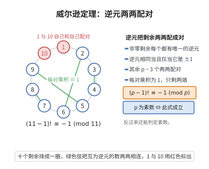

# 威尔逊定理

> **一句话大白话**：判断 $p$ 是不是素数，可以看 $(p-1)!$ 除以 $p$ 的余数：是素数当且仅当余数等于 $-1$（即 $p-1$）。
>
> **小例子**：$p=7$ 时 $(7-1)!=720$，$720=7\cdot103-1$ 即 $6!\equiv-1\pmod 7$，说明 $7$ 是素数（而 $p=6$ 时 $5!=120\equiv0\not\equiv-1\pmod6$）。

## 介绍

威尔逊定理（Wilson's Theorem）给出了一个整数是素数的充要条件：$p$ 是素数当且仅当 $(p-1)! \equiv -1 \pmod{p}$。这一定理由 John Wilson 发现，尽管其理论意义重大，但由于计算 $(p-1)!$ 的复杂度太高，实际中并不用于素数检测。然而，这一定理在数论的理论研究中具有重要地位，它揭示了素数阶乘模的结构性质，并与二次剩余、原根等概念有密切联系。

## 几何直观

图意在说明：模素数时除正负一之外的元素都成对互逆，每对乘积为 1，阶乘便只剩负一。

## 分析

**前置依赖**：乘法逆元、费马小定理、素数定义、同余理论。

**数学内涵**：
- 若 $p$ 是素数，则 $(p-1)! \equiv -1 \pmod{p}$。
- 反之，若 $(n-1)! \equiv -1 \pmod{n}$，则 $n$ 是素数。
- 定理的核心在于：模 $p$ 的非零剩余中，除了 $1$ 和 $p-1$ 外，每个元素都与自己的逆元配对。

**结构**：
1. 正向证明：配对模 $p$ 的非零剩余。
2. 反向证明：利用反证法。

## 思考过程

对于素数 $p$，考虑集合 $\{1, 2, \ldots, p-1\}$。每个元素 $a$ 在模 $p$ 下有唯一的乘法逆元 $a^{-1}$。方程 $a = a^{-1}$ 等价于 $a^2 \equiv 1 \pmod{p}$，即 $a \equiv \pm 1 \pmod{p}$。因此，$1$ 和 $p-1$ 是自逆的，其余 $p-3$ 个元素可以两两配对为互为逆元的对子。

将这些对子相乘，每对乘积为 $1$，再乘以 $1$ 和 $p-1$，得到 $(p-1)! \equiv -1 \pmod{p}$。

反向证明则利用反证法：如果 $n$ 是合数，则 $n$ 有真因子 $d$，$d$ 会整除 $(n-1)!$，从而 $(n-1)! \not\equiv -1 \pmod{n}$。

## 证明过程

**定理**：$p$ 是素数当且仅当 $(p-1)! \equiv -1 \pmod{p}$。

**证明**：

### 必要性（$p$ 是素数 $\Rightarrow$ $(p-1)! \equiv -1 \pmod{p}$）

对 $p = 2$，$(2-1)! = 1 \equiv -1 \pmod{2}$，结论成立。

设 $p \geq 3$ 是素数。对任意 $a \in \{1, 2, \ldots, p-1\}$，存在唯一的乘法逆元 $a^{-1} \in \{1, 2, \ldots, p-1\}$ 使得 $a a^{-1} \equiv 1 \pmod{p}$。

若 $a = a^{-1}$，则 $a^2 \equiv 1 \pmod{p}$，即 $p \mid (a-1)(a+1)$，故 $a \equiv \pm 1 \pmod{p}$，即 $a = 1$ 或 $a = p-1$。

因此，集合 $\{2, 3, \ldots, p-2\}$ 中的元素可以分成 $\frac{p-3}{2}$ 对，每对 $(a, a^{-1})$ 满足 $a \neq a^{-1}$ 且 $a a^{-1} \equiv 1 \pmod{p}$。

于是
$$
(p-1)! = 1 \cdot 2 \cdots (p-2) \cdot (p-1) \equiv 1 \cdot 1^{\frac{p-3}{2}} \cdot (-1) \equiv -1 \pmod{p}
$$

### 充分性（$(n-1)! \equiv -1 \pmod{n}$ $\Rightarrow$ $n$ 是素数）

用反证法。假设 $n$ 是合数，则存在 $d$ 满足 $1 < d < n$ 且 $d \mid n$。于是 $d$ 出现在 $(n-1)!$ 中，故 $d \mid (n-1)!$。

若 $(n-1)! \equiv -1 \pmod{n}$，则存在整数 $k$ 使得 $(n-1)! = kn - 1$。由于 $d \mid n$，有 $d \mid kn$，从而 $d \mid 1$，矛盾。故 $n$ 不能是合数，$n$ 是素数。$\square$

## 课堂问答

**老师**：威尔逊定理给的是素数的充要条件，它怎么把 $(p-1)!$ 和 $-1$ 联系起来？

**学生**：对素数 $p$，模 $p$ 的每个非零剩余有唯一逆元；而 $a=a^{-1}$ 当且仅当 $a^2\equiv1$，即 $a=\pm1$。故 $\{2,\dots,p-2\}$ 的 $p-3$ 个元素两两配成 $\frac{p-3}2$ 对逆元，每对乘积为 $1$，于是 $(p-1)!\equiv1\cdot(-1)\equiv-1\pmod p$。

**老师（追问）**：反过来为什么成立？合数时哪里坏掉？

**学生**：用反证。若 $n$ 是合数，取真因子 $d$（$1<d<n$），则 $d\mid(n-1)!$。而 $(n-1)!\equiv-1$ 意味着 $(n-1)!=kn-1$，由 $d\mid n$ 得 $d\mid kn$，从而 $d\mid1$，矛盾。

**老师（拓展）**：它实际能用来判素数吗？还和什么有关？

**学生**：理论上可判素，但计算 $(p-1)!$ 代价太高，实用性差；它的价值在理论上——揭示了模 $p$ 非零剩余的自逆结构，并与二次剩余、原根紧密相关。
