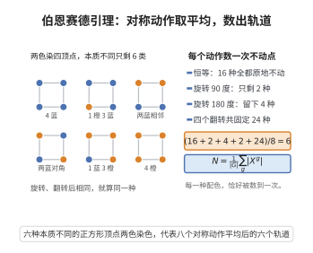

# 伯恩赛德引理

> **一句话大白话**：数"本质不同"的对象有多少个（比如手链旋转翻转算同一种），只需把每个对称动作下"不动"的情形数一数再取平均。
>
> **小例子**：给正方形的 4 个顶点用两种颜色上色（8 个旋转/翻转动作），各动作的不动点数目相加 ÷8，得到轨道数 6，即本质不同的顶点着色方案有 6 种。

## 介绍

伯恩赛德引理（Burnside's Lemma），又称 Cauchy-Frobenius 引理，是群论在组合计数中的重要应用。它给出了在群作用下轨道数的计算公式：有限群 $G$ 作用在集合 $X$ 上时，轨道数等于群中每个元素作用下不动点个数的平均值。这一引理是波利亚计数定理的基础，广泛应用于化学中分子异构体的计数、对称性图案的计数等问题。

## 几何直观

图意在说明：把所有对称动作各自固定的着色数取平均，正好等于真正不同的着色类数。

## 分析

**前置依赖**：轨道-稳定子定理、群作用定义、群作用方程。

**数学内涵**：
- 设有限群 $G$ 作用在有限集 $X$ 上，则轨道数 $N = \frac{1}{|G|} \sum_{g \in G} |X^g|$，其中 $X^g = \{x \in X \mid g \cdot x = x\}$ 是 $g$ 的不动点集。
- 引理提供了一种通过平均不动点个数来计数等价类的方法。

**结构**：
1. 使用双计数法：计算 $\{(g, x) \in G \times X \mid g \cdot x = x\}$ 的大小。
2. 分别按群元素和轨道两种方式求和。
3. 利用轨道-稳定子定理建立联系。

## 思考过程

伯恩赛德引理的证明是一个典型的"双计数"论证。考虑集合 $S = \{(g, x) \in G \times X \mid g \cdot x = x\}$。

按群元素求和：$|S| = \sum_{g \in G} |X^g|$。
按轨道求和：对每个轨道 $O$ 和每个 $x \in O$，$|\text{Stab}(x)| = |G|/|O|$，因此 $|S| = \sum_{O} |O| \cdot |\text{Stab}(x)| = \sum_{O} |G| = N|G|$。

联立两式即得 $N = \frac{1}{|G|} \sum_{g \in G} |X^g|$。

## 证明过程

**定理**（伯恩赛德引理）：设有限群 $G$ 作用在有限集 $X$ 上，$N$ 为轨道数，则
$$
N = \frac{1}{|G|} \sum_{g \in G} |X^g|
$$
其中 $X^g = \{x \in X \mid g \cdot x = x\}$。

**证明**：

考虑集合 $S = \{(g, x) \in G \times X \mid g \cdot x = x\}$。用两种方式计算 $|S|$。

**方式 1**：按群元素求和。
$$
|S| = \sum_{g \in G} |\{x \in X \mid g \cdot x = x\}| = \sum_{g \in G} |X^g|
$$

**方式 2**：按轨道求和。对任意 $x \in X$，由轨道-稳定子定理，$|G| = |\text{Orb}(x)| \cdot |\text{Stab}(x)|$，故 $|\text{Stab}(x)| = |G|/|\text{Orb}(x)|$。

将 $X$ 划分为轨道 $O_1, O_2, \ldots, O_N$。在每个轨道 $O_i$ 中任选代表元 $x_i$，则
$$
|S| = \sum_{x \in X} |\text{Stab}(x)| = \sum_{i=1}^N \sum_{x \in O_i} |\text{Stab}(x)|
$$
对轨道 $O_i$ 中的任意 $x$，$\text{Stab}(x)$ 与 $\text{Stab}(x_i)$ 共轭，故 $|\text{Stab}(x)| = |\text{Stab}(x_i)|$。因此
$$
\sum_{x \in O_i} |\text{Stab}(x)| = |O_i| \cdot |\text{Stab}(x_i)| = |O_i| \cdot \frac{|G|}{|O_i|} = |G|
$$
于是
$$
|S| = \sum_{i=1}^N |G| = N|G|
$$

联立两种方式：
$$
\sum_{g \in G} |X^g| = N|G|
$$
即
$$
N = \frac{1}{|G|} \sum_{g \in G} |X^g|
$$
$\square$

## 课堂问答

**老师**：给正方形四个顶点用两色染色，旋转翻转视为同一种，本质不同的方案有几个？你打算怎么算？

**学生**：答案是 $6$，做法是数每个对称动作下的不动点再取平均。设有限群 $G$ 作用在有限集 $X$ 上，轨道数

$$
N=\frac{1}{|G|}\sum_{g\in G}|X^g|
$$

其中 $X^g=\{x\in X: g\cdot x=x\}$。对正方形二面体群 $D_4$（$|G|=8$）逐个数：恒等 $2^4=16$，$90^\circ$ 与 $270^\circ$ 各 $2$，$180^\circ$ 得 $2^2=4$，四个反射分别得 $2^3,2^3,2^2,2^2$ 即 $8,8,4,4$，求和 $16+2+2+4+8+8+4+4=48$，除以 $8$ 得 $6$。

**老师（追问）**：为什么这个平均值恰好是轨道数？把 $\sum_g|X^g|$ 换个角度数会得到什么？

**学生**：换角度数集合 $S=\{(g,x): g\cdot x=x\}$。按 $g$ 求和得 $|S|=\sum_g|X^g|$；按轨道求和时，固定 $x$ 满足 $g\cdot x=x$ 的 $g$ 正好是稳定子 $\mathrm{Stab}(x)$，由轨道-稳定子定理 $|\mathrm{Stab}(x)|=|G|/|\mathrm{Orb}(x)|$，于是每个轨道贡献 $|O|\cdot|G|/|O|=|G|$，共 $N|G|$。两式相等即得公式。

**老师（拓展）**：很多人以为伯恩赛德直接给出"每种类型各有多少个"，这样理解对吗？

**学生**：不对。它只给轨道总数，丢失了权重的细节。常见误区是把"不动点个数"与"轨道数"混为一谈：$N$ 并不等于某个 $|X^g|$，必须对全部 $g$ 取平均。想要"按颜色数 $k$ 计入"的更精细版本，应换用波利亚计数定理，把颜色数代入循环指标 $Z(G;k,k,\dots,k)$，当 $k=2$ 时同样还原出 $6$。
