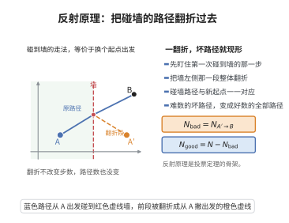

# 反射原理

> **一句话大白话**：要数"碰到某条直线的走法有多少"，不用硬数，把起点关于这条直线翻折过去，问题立刻变成"从翻折后的起点走到终点有多少种走法"。
>
> **小例子**：从 $(0,0)$ 走到 $(3,3)$、每步走右或走上的格路共 $\binom{6}{3}=20$ 条；其中"踩到直线 $y=x+1$"的（即走到对角线以下的）有 $\binom{6}{2}=15$ 条，故始终不越过对角线的只有 $20-15=5$ 条，正是卡特兰数 $C_3=5$。

## 介绍

反射原理（reflection principle）是组合计数中的一个巧妙工具，常用于"带边界约束"的格路计数。它的原始形式由安德烈（Désiré André）在 1887 年解决伯特兰投票问题时给出，故也称安德烈反射法。其核心思想是：把"越界"的路径与"无约束"的路径建立一一对应，从而把难以直接计数的路径数化为标准的二项式系数。

这一方法之所以有效，是因为反射是一条对合变换：先越界的路径经过"首段翻折"后变成任意一条从翻折点出发的路径，而任意一条这样的路径又必然穿越边界，可以反过来唯一地还原。这种双向即可逆的对应，正是组合双射证明的典型范例。

反射原理的经典应用包括：卡特兰数的计数公式、伯特兰投票定理、随机游走的首次通过分布，以及布朗运动与热方程中的反射原理。它也常被视为容斥思想在有序路径问题上的具体实现。

## 几何直观

图意在说明：碰墙路径与换一个起点出发的全部路径一一对应，难数的量由此变成好数的量。

## 分析

加法原理、乘法原理、二项式系数、格路模型、卡特兰数。

**定理内容**（格路版）：设 $L$ 是平面上的一条格线（如 $y=x+1$），$A,B$ 是 $L$ 同侧的两个格点，$A'$ 是 $A$ 关于 $L$ 的对称点。每一步都是"向右一格"或"向上一格"。则

$$\#\{A\to B\ \text{的路，且至少与}\ L\ \text{相交}\}=\#\{A'\to B\ \text{的全部路}\}$$

从而"从 $A$ 到 $B$ 且不与 $L$ 相交"的路数为

$$\#\{A\to B\}-\#\{A'\to B\}$$

**推论（卡特兰数）**：从 $(0,0)$ 到 $(n,n)$ 且始终不越过直线 $y=x$（即每一步都满足所在点纵坐标不大于横坐标）的格路数为

$$C_n=\binom{2n}{n}-\binom{2n}{n+1}=\frac{1}{n+1}\binom{2n}{n}$$

## 思考过程

先数"不受约束"的路径：从 $A=(0,0)$ 到 $B=(p,q)$ 共用 $p+q$ 步，其中 $q$ 步向上，故总数为 $\binom{p+q}{q}$。

再数"越界"的路径。对一条越界路径，令 $P$ 为它第一次与 $L$ 相交的位置（存在且唯一）。把 $P$ 之前的首段关于 $L$ 反射，得到从 $A'$（$A$ 的对称点）到 $P$ 的一段，再接上原来的尾段 $P\to B$，就得到一条从 $A'$ 到 $B$ 的路径。反向：从 $A'$ 到 $B$ 的任意路径必定在某处穿过 $L$（因为 $A'$ 与 $B$ 分居 $L$ 两侧），取最后一次与 $L$ 相交的点 $P$，把首段反射回去即得一条从 $A$ 出发、至少碰 $L$ 一次的路径。两个方向互逆，故越界路径与 $A'\to B$ 的路径一一对应。这就是"反射"一词的由来。

## 证明过程

**步骤 1：无约束路径的计数。**

从 $A=(0,0)$ 到 $B=(p,q)$ 的每条路恰含 $p$ 个向右步与 $q$ 个向上步，共 $p+q$ 步。每条路由 $q$ 个向上步的位置唯一确定，故总数为

$$N(A\to B)=\binom{p+q}{q}=\binom{p+q}{p}$$

**步骤 2：构造映射（越界路 $\Rightarrow$ $A'\to B$ 的路）。**

设 $L$ 为格线，$A'$ 是 $A$ 关于 $L$ 的对称点。取一条从 $A$ 到 $B$ 且与 $L$ 相交的路 $\gamma$。沿路前进，令 $P$ 为**首次**落在 $L$ 上的点（由路与 $L$ 相交及路的连续性，这样的点存在，且因 $L$ 是格线而 $P$ 是格点）。把 $\gamma$ 的首段（$A$ 到 $P$）关于 $L$ 作反射，得到一条从 $A'$ 到 $P$ 的路；它的每一步仍是向右或向上（因为 $L$ 是斜率 $\pm1$ 的格线，反射把 $\{右,上\}$ 步集映到自身）。再把原路尾段 $P\to B$ 接上，得到一条从 $A'$ 到 $B$ 的路 $\Phi(\gamma)$。

**步骤 3：构造逆映射。**

任取一条从 $A'$ 到 $B$ 的路 $\eta$。因 $A'$ 与 $B$ 位于 $L$ 的两侧（$B$ 与 $A$ 同侧而 $A'\ne A$ 在另一侧），$\eta$ 必与 $L$ 相交。令 $Q$ 为 $\eta$ 与 $L$ 的**最后一次**公共点。把首段 $A'\to Q$ 关于 $L$ 反射，得到一条从 $A$ 到 $Q$ 的路，再与尾段 $Q\to B$ 相接，得到一条从 $A$ 到 $B$、且至少与 $L$ 相交（在 $Q$ 处）的路。

**步骤 4：验证互逆。**

对越界路 $\gamma$，设其首次相交点为 $P$。$\Phi(\gamma)$ 的首段是 $\gamma$ 首段反射、尾段与 $\gamma$ 相同，故 $\Phi(\gamma)$ 与 $L$ 的最后交点仍是 $P$（尾段自 $P$ 起不再碰 $L$，因为 $P$ 是首次相交点）。于是逆映射把 $\Phi(\gamma)$ 还原为 $\gamma$。反之，对任意 $\eta$ 从 $A'$ 到 $B$，其最后交点 $Q$ 在逆映射所得的路中是首次交点，故两映射复合为恒等。因此

$$\#\{A\to B\ \text{且与}\ L\ \text{相交}\}=N(A'\to B)=\binom{\Delta x+\Delta y}{\Delta y},\qquad \Delta x=x_B-x_{A'},\ \ \Delta y=y_B-y_{A'}$$

**步骤 5：卡特兰数（推论）。**

取 $A=(0,0)$，$B=(n,n)$，$L:y=x+1$。一条路"越过对角线下方"当且仅当它触及 $L$，因为格路的纵坐标只会整步变化，从 $y\le x$ 变为 $y>x$ 必先经过 $y=x+1$。$A=(0,0)$ 关于 $L$ 的对称点为 $A'=(-1,1)$。从 $A'=(-1,1)$ 到 $B=(n,n)$ 需向右 $(n+1)$ 步、向上 $(n-1)$ 步，共 $2n$ 步，数目为 $\binom{2n}{n-1}=\binom{2n}{n+1}$。于是

$$C_n=\binom{2n}{n}-\binom{2n}{n+1}=\binom{2n}{n}\left(1-\frac{n}{n+1}\right)=\frac{1}{n+1}\binom{2n}{n}$$

证毕。

## 课堂问答

**老师**：要数"从 $A$ 到 $B$ 且一定踩到某条格线 $L$ 的路径数"，你怎么办？

**学生**：把它变成"从 $A$ 关于 $L$ 的对称点 $A'$ 到 $B$ 的全部路径数"：

$$
\#\{A\to B\ \text{且与}\ L\ \text{相交}\}=\#\{A'\to B\}
$$

理由是首段反射给出双射：越界路径取首次交点 $P$，反射 $A\to P$ 段；反过来 $A'\to B$ 的路必穿 $L$，取最后交点反射回来，两映射互逆。

**老师（追问）**：反射为什么不会把"向右/向上"的步变成不合法的步？

**学生**：因为 $L$ 是斜率 $\pm1$ 的格线，关于它反射会交换"向右"与"向上"两个方向，把集合 $\{\text{右},\text{上}\}$ 映到自身，所以反射后的每一步仍是合法的右或上步，路径仍是格路。

**老师（拓展）**：反射原理在哪些结论里充当关键工具？它和容斥思想有何联系？

**学生**：它是卡特兰数 $\frac{1}{n+1}\binom{2n}{n}$、伯特兰投票定理以及随机游走首次通过分布的核心工具。它本质上是"带否定条件计数"的一种容斥实现：用无约束总数减去越界数。常见误区是把对称点算错，例如对 $y=x+1$ 的对称点是 $(-1,1)$，符号一旦取反，整个计数随之出错。

## 相关条目

- [卡特兰数公式](./卡特兰数公式.md)：反射原理最经典的应用，给出 $C_n=\frac{1}{n+1}\binom{2n}{n}$。
- [伯特兰投票定理](./伯特兰投票定理.md)：反射原理的原始应用场景，处理票数始终领先的计数。
- [容斥原理一般形式](./容斥原理一般形式.md)：反射原理可视为计数"满足否定条件"的容斥思想的一种实现。
