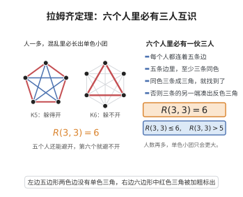

# 拉姆齐定理

> **一句话大白话**：只要人够多，随便怎么"交朋友/不交朋友"（把每个人对的边染红或蓝），人群中必然能找出 $r$ 人两两都认识或 $s$ 人两两都不认识——混乱中藏着必然的秩序。
>
> **小例子**：$R(3,3)=6$：5 人不够，但 6 个人无论朋友关系怎么摆，必能找到 3 个两两认识或 3 个两两不认识的三元组。

## 介绍

拉姆齐定理（Ramsey's Theorem）是组合数学中一个深刻而优美的结果，由英国数学家弗兰克·拉姆齐于 1930 年证明。它断言：在任意足够大的完全图中，对边进行任意染色，必然存在一个单色的完全子图。更精确地说，对任意正整数 $r, s$，存在一个最小整数 $R(r, s)$（称为拉姆齐数），使得对 $K_{R(r,s)}$ 的边进行红蓝染色，必然存在一个红色 $K_r$ 或一个蓝色 $K_s$。拉姆齐定理是拉姆齐理论的起点，该理论研究"在任意大的结构中必然存在某种有序子结构"这一普遍现象。

## 几何直观

图意在说明：五个顶点的两色完全图还能避开单色三角，加到六个顶点就无论如何都躲不开。

## 分析

**前置依赖**：鸽巢原理、数学归纳法原理、组合数学基础。

**数学内涵**：
- 拉姆齐数 $R(r, s)$ 是满足以下条件的最小整数 $n$：对 $K_n$ 的边进行红蓝染色，要么存在红色 $K_r$，要么存在蓝色 $K_s$。
- 已知值：$R(1, s) = 1$，$R(2, s) = s$，$R(3, 3) = 6$，$R(3, 4) = 9$，$R(3, 5) = 14$，$R(4, 4) = 18$。
- 一般上界：$R(r, s) \leq R(r-1, s) + R(r, s-1)$。
- 一般下界：$\binom{r+s-2}{r-1} \leq R(r, s)$。

**结构**：
1. 对 $r+s$ 进行归纳，证明 $R(r, s)$ 的存在性。
2. 给出上界估计。

## 思考过程

拉姆齐定理的证明思路是典型的归纳法，但其中的关键步骤非常巧妙。考虑 $K_{n}$ 的任意一个顶点 $v$，它连接着 $n-1$ 条边，每条边是红色或蓝色。由鸽巢原理，如果 $n$ 足够大，$v$ 要么有足够多的红边邻居，要么有足够多的蓝边邻居。然后利用归纳假设，在这些邻居构成的子图中寻找单色完全子图。

这一证明方法展示了"鸽巢原理 + 归纳法"这一组合数学中经典论证方式的力量。拉姆齐定理的深刻之处在于它断言：完全的随机性是不可能的——在足够大的结构中，必然存在某种秩序。

## 证明过程

**定理**（拉姆齐定理）：对任意正整数 $r, s \geq 1$，存在最小整数 $R(r, s)$，使得对 $K_{R(r,s)}$ 的边进行红蓝染色后，必然存在红色 $K_r$ 或蓝色 $K_s$。

**证明**：

对 $r + s$ 进行归纳。

**基础**：$R(1, s) = 1$（红色 $K_1$ 总是存在），$R(2, s) = s$（要么存在红边，要么所有边都是蓝的，形成蓝色 $K_s$）。同理 $R(r, 2) = r$。

**归纳步骤**：假设 $R(r-1, s)$ 和 $R(r, s-1)$ 都存在。令 $n = R(r-1, s) + R(r, s-1)$。我们证明 $R(r, s) \leq n$。

考虑 $K_n$ 的任意红蓝染色。任选一个顶点 $v$，设 $A$ 是与 $v$ 通过红边相连的顶点集，$B$ 是与 $v$ 通过蓝边相连的顶点集。则 $|A| + |B| = n-1$。

由鸽巢原理，$|A| \geq R(r-1, s)$ 或 $|B| \geq R(r, s-1)$。

**情况 1**：$|A| \geq R(r-1, s)$。在 $A$ 诱导的子图中，由 $R(r-1, s)$ 的定义，要么存在红色 $K_{r-1}$，要么存在蓝色 $K_s$。若存在蓝色 $K_s$，则结论成立。若存在红色 $K_{r-1}$，则加上顶点 $v$（与 $A$ 中所有点通过红边相连），得到红色 $K_r$。

**情况 2**：$|B| \geq R(r, s-1)$。类似地，要么存在红色 $K_r$，要么存在蓝色 $K_{s-1}$，后者加上 $v$ 得到蓝色 $K_s$。

因此 $R(r, s) \leq n$，由归纳法，$R(r, s)$ 对所有 $r, s$ 存在。$\square$

**推论**（上界）：
$$
R(r, s) \leq \binom{r+s-2}{r-1}
$$

*证明*：由 $R(r, s) \leq R(r-1, s) + R(r, s-1)$ 和组合恒等式 $\binom{a-1}{b-1} + \binom{a-1}{b} = \binom{a}{b}$，通过归纳即得。$\square$

## 课堂问答

**老师**：$6$ 个人里为什么必有 $3$ 人两两相识或 $3$ 人两两不识？$R(3,3)$ 到底等于几？

**学生**：$R(3,3)=6$。把它看成 $K_6$ 的红蓝染色：任取一人 $v$，他连出 $5$ 条边，由鸽巢原理至少有 $3$ 条同色。这 $3$ 人之间若有一条边与 $v$ 同色，即得同色三角形；否则这 $3$ 人内部全为另一色，也构成同色三角形。

**老师（追问）**：一般地 $R(r,s)$ 怎么证明存在？上界从哪来？

**学生**：对 $r+s$ 归纳，核心递推是

$$
R(r,s)\le R(r-1,s)+R(r,s-1)
$$

取 $n=R(r-1,s)+R(r,s-1)$，顶点 $v$ 的红邻居集 $A$、蓝邻居集 $B$ 满足 $|A|+|B|=n-1$，鸽巢给出 $|A|\ge R(r-1,s)$ 或 $|B|\ge R(r,s-1)$，再对相应子图用归纳假设即可。

**老师（拓展）**：这个上界是精确值吗？$R(3,3)=6$、$R(4,4)=18$ 能说明什么？

**学生**：上界一般不紧。$R(3,3)\le R(2,3)+R(3,2)=3+3=6$ 恰好取等，但 $R(4,4)=18$ 靠的是构造与大量分析，远不能由递推直接读出。常见误区是以为"规模足够大必然出现秩序"意味着能写出精确公式——事实上拉姆齐数增长极快，精确值多数未知，递推只保证存在并给出粗糙上界 $\binom{r+s-2}{r-1}$。
