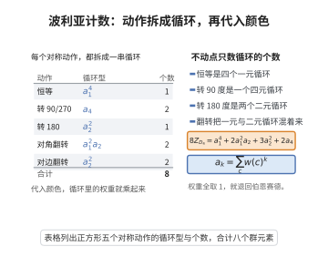

# 波利亚计数定理

> **一句话大白话**：在伯恩赛德只数"有多少类"的基础上更进一步：通过"循环指标"把颜色种类编码进多项式，能一次性读出"每种配色各有多少个本质不同的方案"。
>
> **小例子**：给正方形的 4 顶点用 $k$ 色着色，代入颜色数 $k$：$\frac18(k^4+2k+k^2+4k^3)$，$k=2$ 得 $6$，正是伯恩赛德算出的本质不同着色数，而展开每项还能看各类型的个数。

## 介绍

波利亚计数定理（Pólya's Enumeration Theorem）是伯恩赛德引理的重要推广，由匈牙利数学家乔治·波利亚于 1937 年提出。该定理不仅计算轨道数，还能给出每个轨道中不同"颜色配置"类型的计数。它通过引入群元素的"循环指标"和"颜色权重"，系统地解决了在对称群作用下不同着色方案的计数问题。波利亚计数定理在化学（分子异构体计数）、图论（非同构图的计数）等领域有广泛应用。

## 几何直观

图意在说明：每个对称动作拆成若干循环，循环型一代入颜色权重，就能按类型数出轨道。

## 分析

**前置依赖**：伯恩赛德引理、群作用、置换群、生成函数。

**数学内涵**：
- 设 $G$ 是作用在 $X$ 上的置换群，$C$ 是颜色集，$w: C \to R$ 是权重函数。
- 对每个着色 $f: X \to C$，定义其权重为 $W(f) = \prod_{x \in X} w(f(x))$。
- 波利亚计数定理：轨道权重和等于群元素的循环指标在颜色权重下的取值。
- 当所有颜色权重为 $1$ 时，退化为伯恩赛德引理。

**结构**：
1. 定义置换的循环指标。
2. 建立波利亚计数定理的公式。
3. 从伯恩赛德引理推导定理。

## 思考过程

波利亚计数定理的核心思想是将伯恩赛德引理中的"不动点计数"推广为"带权不动点计数"。对于置换 $g$，一个着色在 $g$ 作用下不变，当且仅当每个循环中的元素着相同颜色。因此，$g$ 的不动点集可以通过将同一循环内的元素赋予相同颜色来计数。

如果颜色 $c$ 有权重 $w(c)$，则一个循环着颜色 $c$ 贡献权重 $w(c)$。$g$ 的不动点集的权重和就是 $g$ 的循环指标的生成函数值。

## 证明过程

**定义**：设 $g$ 是 $X$ 上的一个置换，将其分解为不相交循环的乘积。设 $g$ 有 $c_k(g)$ 个长度为 $k$ 的循环，则 $g$ 的循环指标（cycle index）定义为
$$
Z(g; s_1, s_2, \ldots, s_n) = \prod_{k=1}^n s_k^{c_k(g)}
$$
其中 $n = |X|$。

群 $G$ 的循环指标为
$$
Z(G; s_1, \ldots, s_n) = \frac{1}{|G|} \sum_{g \in G} Z(g; s_1, \ldots, s_n)
$$

**定理**（波利亚计数定理）：设 $G$ 是 $X$ 上的置换群，$C$ 是颜色集。对每个颜色 $c \in C$ 赋予权重 $w(c)$，则不同着色轨道（等价类）的权重和为
$$
\sum_{[f]} W(f) = Z\left(G; \sum_{c \in C} w(c), \sum_{c \in C} w(c)^2, \ldots, \sum_{c \in C} w(c)^n\right)
$$
其中 $[f]$ 表示着色 $f$ 所在的轨道，$W(f) = \prod_{x \in X} w(f(x))$。

**证明**：

由伯恩赛德引理，轨道权重和为
$$
\sum_{[f]} W(f) = \frac{1}{|G|} \sum_{g \in G} \sum_{f: g \cdot f = f} W(f)
$$

对于固定的 $g$，$f$ 是 $g$-不变着色当且仅当 $f$ 在每个循环上取常值。设 $g$ 的循环分解为 $C_1, C_2, \ldots, C_m$，其中 $m$ 是循环总数。则 $g$-不变着色 $f$ 由每个循环的颜色选择唯一确定，且
$$
W(f) = \prod_{i=1}^m \prod_{x \in C_i} w(f(x)) = \prod_{i=1}^m w(f(C_i))^{|C_i|}
$$
因此
$$
\sum_{f: g \cdot f = f} W(f) = \sum_{c_1, \ldots, c_m \in C} \prod_{i=1}^m w(c_i)^{|C_i|} = \prod_{i=1}^m \left(\sum_{c \in C} w(c)^{|C_i|}\right)
$$
设 $g$ 有 $c_k(g)$ 个长度为 $k$ 的循环，则上式等于
$$
\prod_{k=1}^n \left(\sum_{c \in C} w(c)^k\right)^{c_k(g)} = Z\left(g; \sum_{c \in C} w(c), \sum_{c \in C} w(c)^2, \ldots\right)
$$
代入轨道权重和公式即得定理。$\square$

**推论**（无权情形）：若所有颜色权重为 $1$，则 $W(f) = 1$，定理退化为伯恩赛德引理：
$$
N = \frac{1}{|G|} \sum_{g \in G} |C|^{c(g)}
$$
其中 $c(g)$ 是 $g$ 的循环个数，$N$ 是不同着色方案数。$\square$

## 课堂问答

**老师**：伯恩赛德只能数"有多少类"，若要按颜色种类分别计数怎么办？

**学生**：用波利亚计数定理，把颜色权重代入循环指标，还能按类型精确分配。对正方形四顶点 $k$ 色着色，$D_4$ 的循环指标为

$$
Z=\frac18\left(s_1^4+2s_1^2s_2+3s_2^2+2s_4\right)
$$

令所有 $s_i=k$，得 $\frac18(k^4+2k^3+3k^2+2k)$，$k=2$ 时还原出伯恩赛德算的 $6$。

**老师（追问）**：循环指标里 $s_k$ 为什么要取 $\sum_c w(c)^k$？

**学生**：因为置换 $g$ 固定一个着色，当且仅当 $g$ 的每个循环内元素同色。长度为 $k$ 的循环贡献权重 $w(c)^k$，对颜色求和即为 $\sum_c w(c)^k$；而循环指标正是 $\prod_k s_k^{c_k(g)}$ 的形式，代入即得不动点集的带权和。

**老师（拓展）**：波利亚定理与伯恩赛德是什么关系？常见误区？

**学生**：波利亚是伯恩赛德的加权推广，所有颜色权重取 $1$ 时退化回 $N=\frac{1}{|G|}\sum_g|C|^{c(g)}$（$c(g)$ 为循环个数）。常见误区是只把颜色数当常数代入、忽略"按类型计数"时需保留 $s_k$ 的幂次：一旦令 $s_i=k$，类型信息就被抹掉，只能得到总数。
