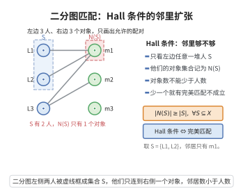

# 二分图匹配定理（Hall 定理）

> **一句话大白话**：想让左边每个人都能配到右边一个对象，当且仅当"任意一堆左边的人，他们的可用对象总数不比人少"——哪堆人"对象不够"，就配不出完美匹配。
>
> **小例子**：3 位女士各有可接受男士名单：$L_1=\{m_1\},L_2=\{m_1\},L_3=\{m_1,m_2\}$。拿 $S=\{L_1,L_2\}$，其可行人选仅 $\{m_1\}$，$|N(S)|=1<2$，违反了 Hall 条件，故给每位女士都配一位男士不可能。

## 介绍

Hall 定理（Hall's Marriage Theorem）是二分图匹配理论中的核心定理，由菲利普·霍尔于 1935 年提出。它给出了二分图中存在完美匹配（或饱和某一侧所有顶点的匹配）的充要条件：对于左部 $X$ 的任意子集 $S$，其邻居集合 $N(S)$ 的大小至少为 $|S|$。这一定理在组合数学、指派问题、调度理论中有广泛应用，其名称"婚姻定理"源于一个经典比喻：给定若干女士和男士，每位女士有可接受的男士名单，每位男士可与多位女士结婚，问是否存在一种安排使得每位女士都嫁给一位可接受的男士。

## 几何直观

图意在说明：Hall 条件要求左边任意一堆人的可选对象不少于人数，条件一破，完美匹配就配不出来。

## 分析

**前置依赖**：二分图定义、匹配、增广路径。

**数学内涵**：
- 设 $G = (X \cup Y, E)$ 是二分图，$X$ 和 $Y$ 是两部分顶点集。
- 存在完美匹配（$X$ 中所有顶点都被匹配）当且仅当对任意 $S \subseteq X$，$|N(S)| \geq |S|$。
- 更一般的结论：$G$ 中存在匹配覆盖 $X$ 中所有顶点当且仅当 Hall 条件成立。

**结构**：
1. 必要性：显然，匹配给出了 $S$ 到 $N(S)$ 的单射。
2. 充分性：对 $|X|$ 进行归纳，或利用增广路径论证。

## 思考过程

Hall 定理的必要性是显然的：如果存在匹配覆盖 $X$ 中的所有顶点，则对任意 $S \subseteq X$，匹配给出了 $S$ 到 $N(S)$ 的一个单射，因此 $|N(S)| \geq |S|$。

充分性的证明有多种方法。归纳法证明通过考虑两种情形：如果存在非空真子集 $S \subset X$ 使得 $|N(S)| = |S|$，则可以将问题分解为 $S \cup N(S)$ 和剩余部分两个子问题；否则，对任意 $S$ 都有 $|N(S)| > |S|$，此时可以任意匹配一个顶点并继续。

## 证明过程

**定理**（Hall 定理）：设 $G = (X \cup Y, E)$ 是二分图。则存在匹配覆盖 $X$ 中所有顶点的充要条件是：对任意 $S \subseteq X$，$|N(S)| \geq |S|$。

**证明**：

### 必要性

若存在匹配 $M$ 覆盖 $X$ 中所有顶点，则对任意 $S \subseteq X$，$M$ 将 $S$ 中的每个顶点匹配到 $N(S)$ 中的不同顶点，因此 $|N(S)| \geq |S|$。

### 充分性

对 $|X|$ 进行归纳。$|X| = 1$ 时显然成立。

假设 $|X| \geq 2$ 且 Hall 条件成立。分两种情况：

**情况 1**：存在非空真子集 $S \subset X$ 使得 $|N(S)| = |S|$。

考虑子图 $G_1 = G[S \cup N(S)]$。对任意 $T \subseteq S$，$N_{G_1}(T) = N_G(T) \subseteq N(S)$，且由 Hall 条件 $|N_G(T)| \geq |T|$，故 $|N_{G_1}(T)| \geq |T|$。由归纳假设，$G_1$ 中存在匹配 $M_1$ 覆盖 $S$。

考虑子图 $G_2 = G[(X \setminus S) \cup (Y \setminus N(S))]$。对任意 $T \subseteq X \setminus S$，若 $N_{G_2}(T) = \varnothing$，则 $N_G(T) \subseteq N(S)$，于是 $N_G(S \cup T) = N(S)$，但 $|S \cup T| = |S| + |T| > |S| = |N(S)|$，与 Hall 条件矛盾。故 $N_{G_2}(T) \neq \varnothing$，且由 Hall 条件 $|N_{G_2}(T)| \geq |T|$。由归纳假设，$G_2$ 中存在匹配 $M_2$ 覆盖 $X \setminus S$。

$M_1 \cup M_2$ 即为覆盖 $X$ 的匹配。

**情况 2**：对任意非空真子集 $S \subset X$，$|N(S)| > |S|$。

任取 $x \in X$ 和其邻居 $y \in N(\{x\})$。匹配 $x$ 与 $y$，删除 $x$ 和 $y$ 得到 $G' = G[(X \setminus \{x\}) \cup (Y \setminus \{y\})]$。对任意 $T \subseteq X \setminus \{x\}$，$N_{G'}(T) = N_G(T) \setminus \{y\}$。由 $|N_G(T)| \geq |T| + 1$（因为 $|N_G(T)| > |T|$），得 $|N_{G'}(T)| \geq |T|$。由归纳假设，$G'$ 中存在匹配覆盖 $X \setminus \{x\}$，加上边 $(x, y)$ 即得覆盖 $X$ 的匹配。$\square$

**推论**（König 定理）：在二分图中，最大匹配的大小等于最小顶点覆盖的大小。

**推论**：正则二分图（所有顶点度数相同）存在完美匹配。

## 课堂问答

**老师**：二分图 $G=(X\cup Y,E)$ 中，$X$ 能全部被匹配覆盖的充要条件是什么？

**学生**：Hall 条件：对任意 $S\subseteq X$ 都有 $|N(S)|\ge|S|$。必要性近乎显然——匹配把 $S$ 单射入 $N(S)$，故 $|N(S)|\ge|S|$。

**老师（追问）**：充分性怎么证？归纳时两种情形分别怎么处理？

**学生**：对 $|X|$ 归纳。若存在真子集 $S$ 使 $|N(S)|=|S|$，则把问题拆成 $G[S\cup N(S)]$ 与 $G[(X\setminus S)\cup(Y\setminus N(S))]$ 两个仍满足 Hall 条件的子问题，各用归纳假设；若对任意非空真子集都有 $|N(S)|>|S|$，则任取 $x$ 与其邻居 $y$，匹配后删去二者，剩余图仍满足 Hall 条件（$|N_{G'}(T)|\ge|N_G(T)|-1\ge|T|$），归纳即得。

**老师（拓展）**：Hall 定理和 König 定理、最大流有什么关系？常见误区？

**学生**：把匹配问题化为单位容量的网络流（源接 $X$、$Y$ 接汇、容量均 $1$），Hall 条件恰是割的容量约束，由最大流-最小割定理即可推出 König 定理：最大匹配大小等于最小顶点覆盖大小。常见误区是只验证单个顶点 $|N(\{x\})|\ge1$，那远远不够，必须对**所有子集** $S$ 检验——"人群"里任意一群人的可选对象都不能少于人数。
