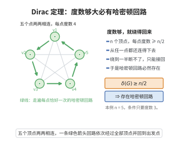

# 哈密顿路径充分条件（Dirac 定理）

> **一句话大白话**：每个顶点的度数都不少于总人数的一半，那么必能走出一个"每个点恰好逛一次"的环（哈密顿回路）——充分条件虽强却管用。
>
> **小例子**：$n=5$ 的简单图中每个顶点度数至少 $\lceil5/2\rceil=3$（满足 Dirac 条件 $\ge n/2=2.5$），则必存在哈密顿回路，如 $1\!-\!2\!-\!3\!-\!4\!-\!5\!-\!1$。

## 介绍

哈密顿路径问题是图论中一个经典而困难的问题，它要求判断一个图中是否存在经过每个顶点恰好一次的路径（哈密顿路径）或回路（哈密顿回路）。与欧拉路径问题不同，哈密顿路径问题已被证明是 NP 完全的。然而，有许多充分条件可以保证哈密顿路径或回路的存在性。Dirac 定理（1952）是其中最早也是最著名的结果：如果 $n \geq 3$ 个顶点的简单图中每个顶点的度数至少为 $n/2$，则图中存在哈密顿回路。

## 几何直观

图意在说明：当每个顶点的度数都不少于顶点数的一半时，图必然拥有一条走遍所有点恰好一次的回路。

## 分析

**前置依赖**：图的基本定义、路径和回路、极值论证。

**数学内涵**：
- Dirac 定理：若 $G$ 是 $n \geq 3$ 个顶点的简单图，且 $\delta(G) \geq n/2$，则 $G$ 有哈密顿回路。
- Ore 定理（推广）：若 $G$ 中任意两个不相邻顶点的度数之和至少为 $n$，则 $G$ 有哈密顿回路。
- 这些条件是充分的但不是必要的。

**结构**：
1. 用反证法，假设不存在哈密顿回路。
2. 考虑最长路径并进行极值论证。
3. 利用度数条件导出矛盾。

## 思考过程

Dirac 定理的证明是一个经典的极值图论论证。假设图 $G$ 满足度数条件但没有哈密顿回路，则 $G$ 中存在一条最长路径 $P = v_1 v_2 \ldots v_k$。由于 $G$ 没有哈密顿回路，$k < n$，且 $v_1$ 和 $v_k$ 的邻居都在 $P$ 上。

通过分析 $v_1$ 和 $v_k$ 的邻居关系，可以证明存在一个回路 $v_1 \to v_2 \to \cdots \to v_i \to v_k \to v_{k-1} \to \cdots \to v_{i+1} \to v_1$。由于 $\delta(G) \geq n/2$，这个回路长度至少为 $n/2 + 1$，从而回路外还有顶点与回路相连，可以构造更长的路径，与 $P$ 的最长性矛盾。

## 证明过程

**定理**（Dirac 定理，1952）：设 $G$ 是 $n \geq 3$ 个顶点的简单图。若 $\delta(G) \geq n/2$，则 $G$ 包含哈密顿回路。

**证明**：

用反证法。假设 $G$ 满足条件但没有哈密顿回路。在 $G$ 的所有路径中，取一条最长的路径 $P = v_1 v_2 \ldots v_k$。由于 $G$ 没有哈密顿回路，$k < n$。

**断言 1**：$v_1$ 和 $v_k$ 的所有邻居都在 $P$ 上。

若 $v_1$ 有邻居不在 $P$ 上，则可将路径延长，与 $P$ 的最长性矛盾。同理对 $v_k$。

**断言 2**：存在 $i$（$1 \leq i < k$）使得 $v_1 v_{i+1} \in E$ 且 $v_i v_k \in E$。

设 $S = \{i \mid v_1 v_{i+1} \in E\}$，$T = \{i \mid v_i v_k \in E\}$。则 $|S| = \deg(v_1) \geq n/2$，$|T| = \deg(v_k) \geq n/2$。由于 $S, T \subseteq \{1, 2, \ldots, k-1\}$，有
$$
|S| + |T| \geq n > k-1
$$
因此 $S \cap T \neq \varnothing$，存在 $i \in S \cap T$，即 $v_1 v_{i+1} \in E$ 且 $v_i v_k \in E$。

于是得到回路 $C = v_1 v_2 \ldots v_i v_k v_{k-1} \ldots v_{i+1} v_1$，长度为 $k$（如图）。

由于 $k < n$，存在顶点 $u$ 不在 $C$ 上。又因为 $\delta(G) \geq n/2$ 且 $G$ 连通，$u$ 必然与 $C$ 上的某个顶点 $v_j$ 相邻。于是可以构造一条更长的路径（从 $u$ 出发，沿 $C$ 扩展），与 $P$ 的最长性矛盾。

故 $k = n$，$P$ 是哈密顿路径，且由上述论证，$G$ 有哈密顿回路。$\square$

**推论**（Ore 定理，1960）：若 $G$ 是 $n \geq 3$ 的简单图，且对任意不相邻的顶点 $u, v$ 有 $\deg(u) + \deg(v) \geq n$，则 $G$ 有哈密顿回路。

*证明*：与 Dirac 定理的证明类似，但使用 Ore 条件代替度数条件。$\square$

## 课堂问答

**老师**：什么样的图一定有哈密顿回路？Dirac 给的条件是什么？

**学生**：若 $n\ge3$ 的简单图满足最小度 $\delta(G)\ge n/2$，则必有哈密顿回路。证明取一条最长路径 $P=v_1\cdots v_k$，由最长性，$v_1,v_k$ 的邻居全在 $P$ 上。

**老师（追问）**：怎么由度数条件凑出一个回路？

**学生**：令 $S=\{i: v_1v_{i+1}\in E\}$、$T=\{i: v_iv_k\in E\}$，则 $|S|=\deg(v_1)\ge n/2$、$|T|=\deg(v_k)\ge n/2$，而 $S,T\subseteq\{1,\dots,k-1\}$ 且 $|S|+|T|\ge n>k-1$，故 $S\cap T\ne\varnothing$，取 $i\in S\cap T$ 得回路

$$
C=v_1v_2\cdots v_iv_kv_{k-1}\cdots v_{i+1}v_1
$$

长度为 $k$，再借 $\delta(G)\ge n/2$ 把回路外的点接进来即得矛盾。

**老师（拓展）**：Dirac 条件是必要还是充分？能推广吗？常见误区？

**学生**：只是充分条件，绝非必要——存在大量最低度很小的图也有哈密顿回路。它可推广为 Ore 定理：只要任意两个**不相邻**顶点的度数之和 $\ge n$，就有哈密顿回路（Dirac 是特例）。常见误区有二：一是把度数条件当成判定法则去否定哈密顿性；二是忘记哈密顿问题本身是 NP 完全的，充分条件只保证存在性、并不提供有效算法。
