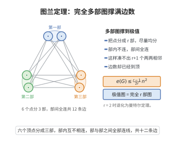

# 图兰定理

> **一句话大白话**：如果一张图里不允许出现 $r+1$ 个两两相连的顶点，那么它的边数最多只能达到"把顶点尽量均匀地分成 $r$ 组、组间全连、组内不连"时的水平。
>
> **小例子**：不许出现三角形（$r=2$）时，$n$ 个顶点最多只能有 $\lfloor n^2/4\rfloor$ 条边，例如 $n=5$ 时为 $6$ 条，由完全二部图 $K_{2,3}$ 达到。

## 介绍

图兰定理（Turán's theorem）是极值图论的开创性定理，由匈牙利数学家保尔·图兰（Pál Turán）在 1941 年提出。它精确地给出：不含 $(r+1)$ 阶完全子图 $K_{r+1}$ 的 $n$ 顶点图，其边数的最大值是多少，以及达到该最大值的唯一的图结构。

定理中的极值图是一个完全 $r$ 部图，各部之间两两全连、同一部内无边，且各部顶点数尽量相等（相差不超过 $1$），称为图兰图，记作 $T_r(n)$。它在 $r+1$ 个顶点上任取至多 $r$ 部的顶点，至多选出 $r$ 个两两相邻的顶点，故不含 $K_{r+1}$；其边数恰为定理给出的上界。

图兰定理的 $r=2$ 情形就是曼特尔定理（1907），即无三角形图的边数上界 $\lfloor n^2/4\rfloor$。图兰定理也等价于说：$n$ 顶点图的团数不超过 $r$ 时边数最大化问题是完全多部图。它启发了后来极值图论的整个方向，包括 Erdős–Stone–Simonovits 定理与稳定性方法；在图上色数、Turán 型数论问题（如 Erdős–Moser 问题）中都有重要应用。

## 几何直观

图意在说明：不许出现 r+1 个两两相邻的顶点时，把点尽量均分成 r 部、部间全连就能把边数推到最大。

## 分析

**前置依赖**：完全图与完全多部图、握手定理、极值图论的基本思想、对 $r$ 与 $n$ 的数学归纳法。

**定理内容**：设 $r\ge2$，$G$ 是 $n$ 个顶点、不含 $K_{r+1}$ 的简单图，则

$$e(G)\le\left(1-\frac{1}{r}\right)\frac{n^2}{2}$$

更精确地，$e(G)\le t_r(n)$，其中 $t_r(n)=\mathrm{ex}(n,K_{r+1})$ 为图兰图 $T_r(n)$ 的边数：

$$t_r(n)=\binom{n}{2}-\min\Big\{\sum_{i=1}^{r}\binom{n_i}{2}:\ n_i\in\mathbb{Z}_{\ge0},\ \sum_{i=1}^{r}n_i=n\Big\}=\frac{n^2-\sum_{i=1}^{r}n_i^2}{2}$$

且各 $n_i$ 相差不超过 $1$，从而 $t_r(n)=\left\lfloor\left(1-\frac{1}{r}\right)\frac{n^2}{2}\right\rfloor$。当 $r=2$ 时即为曼特尔定理 $e(G)\le\lfloor n^2/4\rfloor$。

## 思考过程

最自然的想法是对顶点数 $n$ 作归纳：删去一个顶点 $v$ 后，$e(G)=e(G-v)+d(v)$。若 $G-v$ 仍是 $K_{r+1}$-自由的，则由归纳假设 $e(G-v)\le t_r(n-1)$；于是只需控制 $d(v)$。为让归纳走得通，应当取度最小的顶点 $v$。

问题化为一个独立的引理：**任何 $n$ 顶点的 $K_{r+1}$-自由图都有一个顶点，其度不超过 $n-\lceil n/r\rceil$**。这个界限的来历很直观——在图兰图中，同一部内的顶点度恰好是 $n-\lceil n/r\rceil$。引理本身对 $r$ 归纳：$v$ 的邻域 $N(v)$ 内不能含 $K_r$（否则加上 $v$ 得到 $K_{r+1}$），于是把 $r$ 降到 $r-1$，对 $N(v)$ 用归纳假设，再用"每个 $u\in N(v)$ 在 $N(v)$ 内的度不会比它在全图中的度小多少"来导出矛盾。

主证明的归纳步骤还用到恒等式 $t_r(n)-t_r(n-1)=n-\lceil n/r\rceil$：在图兰图上每加入一个顶点（放进最小的部），恰好新增这么多条边。

## 证明过程

**引理 1（最小度界）。** 设 $r\ge1$，$G$ 为 $n$ 个顶点的 $K_{r+1}$-自由简单图，则

$$\delta(G)\le n-\left\lceil\frac{n}{r}\right\rceil$$

**证明（对 $r$ 归纳）。** $r=1$ 时 $K_2$-自由意味着 $G$ 无边，$\delta(G)=0=n-\lceil n/1\rceil$，成立。

设 $r\ge2$ 且结论对 $r-1$ 成立。反设 $\delta(G)\ge n-\lceil n/r\rceil+1$。任取顶点 $v$，记

$$m:=d(v)\ge n-\left\lceil\frac{n}{r}\right\rceil+1$$

导出子图 $G[N(v)]$ 有 $m$ 个顶点且不含 $K_r$（否则 $N(v)$ 中的 $K_r$ 与 $v$ 组成 $K_{r+1}$）。由归纳假设（参数 $r-1$），存在 $u\in N(v)$ 使

$$d_{G[N(v)]}(u)\le m-\left\lceil\frac{m}{r-1}\right\rceil$$

另一方面，对任意 $u\in N(v)$，那些在 $N(u)$ 中却不在 $N(v)$ 中的顶点都落在 $V\setminus\big(N(v)\cup\{v\}\big)$ 里，该集合有 $n-m-1$ 个顶点，故 $|N(u)\setminus N(v)|\le n-m$，于是

$$d_{G[N(v)]}(u)=|N(u)\cap N(v)|=|N(u)|-|N(u)\setminus N(v)|\ge d(u)-(n-m)\ge\Big(n-\left\lceil\frac{n}{r}\right\rceil+1\Big)-(n-m)$$

即

$$d_{G[N(v)]}(u)\ge m-\left\lceil\frac{n}{r}\right\rceil+1$$

再由 $m\ge n-\lceil n/r\rceil+1\ge n-\frac nr=\frac{(r-1)n}{r}$ 得 $\frac{m}{r-1}\ge\frac nr$，由向上取整的单调性 $\left\lceil\frac{m}{r-1}\right\rceil\ge\left\lceil\frac nr\right\rceil$。结合上一式，

$$d_{G[N(v)]}(u)\ge m-\left\lceil\frac{n}{r}\right\rceil+1>m-\left\lceil\frac{m}{r-1}\right\rceil$$

对每个 $u\in N(v)$ 都成立，与归纳假设矛盾。故 $\delta(G)\le n-\lceil n/r\rceil$。引理得证。

**引理 2（图兰图边数的差分）。** 对 $r\ge2$，$t_r(n)-t_r(n-1)=n-\left\lceil\frac{n}{r}\right\rceil$。

**证明。** $T_r(n-1)$ 的各部大小相差不超过 $1$；取一个大小最小的部（大小为 $\lfloor (n-1)/r\rfloor$），在其中添加一个新顶点，得到各部大小相差不超过 $1$ 的完全 $r$ 部图，即 $T_r(n)$。新增顶点与所有不在同一部的顶点相邻，边数为

$$n-1-\left\lfloor\frac{n-1}{r}\right\rfloor=n-\left\lceil\frac{n}{r}\right\rceil$$

（用到恒等式 $\lceil n/r\rceil=\lfloor (n-1)/r\rfloor+1$）。反过来说，$T_r(n)$ 删去任一部中最后加入的顶点也回到 $T_r(n-1)$，差分即为新增边数。引理得证。

**主定理证明（对 $n$ 归纳）。**

*基始 $n\le r$：* 此时任何 $n$ 顶点简单图满足 $e(G)\le\binom n2=t_r(n)$（因为不超过 $r$ 部的图兰图就是完全图 $K_n$）。同时由 $\binom n2\le\big(1-\frac1r\big)\frac{n^2}{2}$（等价于 $n(n-1)\le\frac{r-1}{r}n^2\iff r(n-1)\le n(r-1)\iff n\le r$）知两种上界一致。

*归纳步骤 $n>r$：* 设 $G$ 为 $n$ 顶点的 $K_{r+1}$-自由图，取度最小的顶点 $v$。由引理 1，

$$d(v)=\delta(G)\le n-\left\lceil\frac{n}{r}\right\rceil$$

删去 $v$ 后 $G-v$ 是 $n-1$ 顶点的 $K_{r+1}$-自由图，由归纳假设 $e(G-v)\le t_r(n-1)$。于是

$$e(G)=e(G-v)+d(v)\le t_r(n-1)+\Big(n-\left\lceil\frac{n}{r}\right\rceil\Big)$$

由引理 2，$n-\lceil n/r\rceil=t_r(n)-t_r(n-1)$，代入得

$$e(G)\le t_r(n-1)+\big(t_r(n)-t_r(n-1)\big)=t_r(n)$$

归纳完成，故任何 $n$ 顶点的 $K_{r+1}$-自由图满足 $e(G)\le t_r(n)$。

**收尾：化为闭式并给出估计。** 完全 $r$ 部图 $T_r(n)$ 的边数为"总对数减去各部内部对数"：

$$t_r(n)=\binom n2-\sum_{i=1}^{r}\binom{n_i}{2}=\frac{n^2-n}{2}-\frac{\sum_i n_i^2-n}{2}=\frac{n^2-\sum_i n_i^2}{2}$$

其中 $n_i$ 为各部大小。各部相差不超过 $1$ 时 $\sum_i n_i^2$ 最小，由 $\sum_i n_i^2\ge\frac{1}{r}\big(\sum_i n_i\big)^2=\frac{n^2}{r}$（柯西–施瓦茨不等式）得

$$t_r(n)=\frac{n^2-\sum_i n_i^2}{2}\le\frac{n^2-\frac{n^2}{r}}{2}=\left(1-\frac{1}{r}\right)\frac{n^2}{2}$$

又 $T_r(n)$ 至多 $r$ 部，任一完全子图在每部至多取一个顶点，故不含 $K_{r+1}$，即上界是可达到的。于是 $\mathrm{ex}(n,K_{r+1})=t_r(n)$，且因 $t_r(n)$ 为整数，$t_r(n)=\left\lfloor\left(1-\frac1r\right)\frac{n^2}{2}\right\rfloor$。定理得证。

**等号情形（补充说明）。** 当 $e(G)=t_r(n)$ 时必须每一步都取等：$G$ 应同构于完全 $r$ 部图且各部大小相差不超过 $1$，即 $G\cong T_r(n)$。直观上，取等要求删点归纳中每个最小度顶点都达到界 $n-\lceil n/r\rceil$，且 $G-v\cong T_r(n-1)$，把 $v$ 放回后它必须与不在其所在部的所有顶点相邻、与同部顶点不相邻，逐层回推即得完全 $r$ 部且均匀的结构。

## 课堂问答

**老师**：不含 $K_{r+1}$ 的 $n$ 顶点图最多能有多少条边？

**学生**：至多 $t_r(n)$，即完全 $r$ 部图 $T_r(n)$ 的边数，各部大小相差不超过 $1$。粗界为 $e(G)\le(1-\frac1r)\frac{n^2}{2}$，$r=2$ 时退化为曼特尔定理 $\lfloor n^2/4\rfloor$。

**老师（追问）**：归纳证明的关键引理是什么？它为什么成立？

**学生**：关键是最小度引理 $\delta(G)\le n-\lceil n/r\rceil$。对 $r$ 归纳：取度最小顶点 $v$，其邻域 $G[N(v)]$ 不含 $K_r$（否则加 $v$ 即成 $K_{r+1}$），对 $r-1$ 用归纳得某 $u\in N(v)$ 在 $N(v)$ 内的度 $\le m-\lceil m/(r-1)\rceil$；又由 $|N(u)\setminus N(v)|\le n-m$ 得它在 $N(v)$ 内的度 $\ge m-\lceil n/r\rceil+1$，两式矛盾。有了它，再配合差分 $t_r(n)-t_r(n-1)=n-\lceil n/r\rceil$ 即可完成归纳。

**老师（拓展）**：取等时所确定的图结构唯一吗？常见误区？

**学生**：唯一，必须是各部尽量均匀的完全 $r$ 部图 $T_r(n)$——取等要求每一步都贴着界走。常见误区是把 $\frac{n^2}{2}(1-\frac1r)$ 当成精确极值，实际精确值是带下取整的 $\lfloor(1-\frac1r)\frac{n^2}{2}\rfloor$；另一误区是把它当成"含 $K_{r+1}$"的充分条件，它只解决**无** $K_{r+1}$ 情形下的上界。该定理还是 Erdős–Stone–Simonovits 定理与稳定性方法的起点。

## 相关条目

- [曼特尔定理](./曼特尔定理.md)：图兰定理在 $r=2$ 时的特殊情形，即无三角形图的边数上界。
- [握手定理](./握手定理.md)：顶点度之和等于边数两倍，是度方法的基本恒等式。
- [图的着色数上界](./图的着色数上界.md)：图的染色与极值边数问题紧密相关，团数约束常转化为部数约束。
