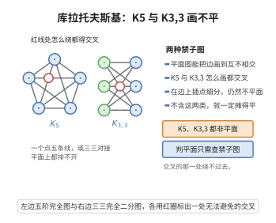

# 库拉托夫斯基定理

> **一句话大白话**：一张图能不能画到平面上不打结？只要它不"藏"着 $K_5$ 或 $K_{3,3}$ 这两种禁止子结构（及其细分），就一定可以摊平。
>
> **小例子**：接线面包板问题 $K_{3,3}$（3 个开关接 3 盏灯全部连线）必有一根线要压过另一根，无法平面化；若在某边中间"插入一个点"变成细分，同理仍平面画不开。

## 介绍

库拉托夫斯基定理（Kuratowski's Theorem）是平面图理论中的核心定理，由波兰数学家卡齐米日·库拉托夫斯基于 1930 年证明。该定理给出了一个图是平面图的充要条件：一个图是平面图当且仅当它不包含 $K_5$（5 个顶点的完全图）或 $K_{3,3}$（3+3 完全二分图）的细分。这一定理将平面图的判定问题转化为对禁止子图的检测，在图论和计算机科学中有着重要应用。

## 几何直观

图意在说明：K5 与 K3,3 无论怎样摆放都必然有边相交，而只要不含这两类子图的细分，图就一定可以摊平。

## 分析

**前置依赖**：平面图定义、图的细分、$K_5$ 和 $K_{3,3}$ 的非平面性、欧拉公式。

**数学内涵**：
- 图的细分：在边上插入顶点得到的新图。
- $K_5$ 和 $K_{3,3}$ 是最小的非平面图。
- 库拉托夫斯基定理：$G$ 是平面图 $\iff$ $G$ 不含 $K_5$ 或 $K_{3,3}$ 的细分。
- 等价地，$G$ 是非平面图 $\iff$ $G$ 包含 $K_5$ 或 $K_{3,3}$ 的细分。

**结构**：
1. 证明 $K_5$ 和 $K_{3,3}$ 是非平面图。
2. 证明必要性：平面图不含 $K_5$ 或 $K_{3,3}$ 的细分。
3. 证明充分性：不含 $K_5$ 或 $K_{3,3}$ 细分的图是平面图。

## 思考过程

库拉托夫斯基定理的证明分为两个方向。必要性方向相对容易：如果 $G$ 是平面图，则其任何子图（包括细分）也是平面的，由于 $K_5$ 和 $K_{3,3}$ 不是平面的，$G$ 不能包含它们的细分。

充分性方向是证明的核心：如果一个图不含 $K_5$ 或 $K_{3,3}$ 的细分，则它可以嵌入到平面上。证明通过对图的边数进行归纳，利用极值图论和平面图的结构性质。

## 证明过程

**定理**（库拉托夫斯基定理）：一个图是平面图当且仅当它不包含 $K_5$ 或 $K_{3,3}$ 的细分。

**证明**：

### 必要性

显然，如果 $G$ 是平面图，则 $G$ 的任何子图（包括细分）也是平面图。由于 $K_5$ 和 $K_{3,3}$ 不是平面图（可由欧拉公式证明），$G$ 不能包含 $K_5$ 或 $K_{3,3}$ 的细分。

### 充分性

充分性的证明比较复杂，这里给出证明思路。

设 $G$ 是不含 $K_5$ 或 $K_{3,3}$ 细分的连通图。对 $|V| + |E|$ 进行归纳。

**基础**：当 $|V| \leq 4$ 时，所有图都是平面图。

**归纳步骤**：若 $G$ 有一个割点，则 $G$ 可以分解为若干块。由归纳假设，每个块是平面图，且可适当嵌入使得割点位于外部面，从而合并为 $G$ 的平面嵌入。

若 $G$ 是 2-连通的，考虑 $G$ 的某个边 $e$。若 $G - e$ 不包含 $K_5$ 或 $K_{3,3}$ 的细分，则由归纳假设，$G - e$ 是平面图。将 $e$ 加回，若 $e$ 的两个端点在 $G - e$ 的某个面中，则 $G$ 是平面图；否则 $G$ 包含 $K_5$ 或 $K_{3,3}$ 的细分。

若 $G - e$ 包含 $K_5$ 或 $K_{3,3}$ 的细分，则 $G$ 中存在一个子图 $H$ 是 $K_5$ 或 $K_{3,3}$ 的细分加上边 $e$。通过分析 $H$ 的结构，可以证明 $G$ 本身包含 $K_5$ 或 $K_{3,3}$ 的细分，矛盾。

因此 $G$ 是平面图。$\square$

**推论**：图 $G$ 是平面图当且仅当 $G$ 没有 $K_5$ 或 $K_{3,3}$ 的细分（或称 $K_5$ 和 $K_{3,3}$ 是极小非平面图）。

**应用**：库拉托夫斯基定理提供了判定平面性的理论标准，但实际应用中通常使用 Hopcroft-Tarjan 的线性时间平面性测试算法。$\square$

## 课堂问答

**老师**：怎么判断一张图能不能画在平面上不打结？

**学生**：库拉托夫斯基定理：$G$ 是平面图当且仅当它不含 $K_5$ 或 $K_{3,3}$ 的细分。等价地，$K_5$、$K_{3,3}$ 是仅有的两个"极小非平面图"。

**老师（追问）**：必要性容易，充分性为什么难？

**学生**：必要性是显然的——平面图的任何子图（含细分）仍平面，而 $K_5$、$K_{3,3}$ 非平面（由欧拉公式 $m\le3n-6$ 及二分图的 $m\le2n-4$ 可证）。充分性要对 $|V|+|E|$ 归纳：有割点时按块分解并让割点落在外部面；2-连通时取边 $e$，若 $G-e$ 仍不含禁止细分则用归纳，再讨论 $e$ 的两端点是否共面，否则会构造出违反假设的细分而导出矛盾。

**老师（拓展）**：这个判据在实际算法里怎么用？常见误区？

**学生**：理论上它是判定平面性的完整标准，但实际多采用 Hopcroft–Tarjan 的线性时间平面性测试，直接检测 $K_5/K_{3,3}$ 细分代价太高。常见误区有二：一是把"不含 $K_5$、$K_{3,3}$ 作为**子图**"当作条件，其实要求的是**细分**（允许在边上插入顶点），少了"细分"会误判很多非平面图；二是把 $K_{3,3}$ 当成普通二部图以为它平面，实际上它正是不平面的最小二部图。
