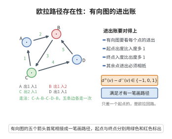

# 欧拉路径存在性

> **一句话大白话**：有向图里能否"每条边恰好走一次、一笔画完"：要么没有出发点与终点的度数差，要么刚好各有一个人度为 1 的出/入差，其余点进出持平。
>
> **小例子**：一条有向路径 $A\to B\to C$：$A$ 出 1 入 0，$C$ 出 0 入 1，$B$ 出入各 1——恰有一个"出发差"和一个"到达差"，故存在欧拉路径 $A\to B\to C$。

## 介绍

欧拉路径存在性定理是欧拉路径定理的直接推论，它给出了一个有向图存在欧拉路径的充要条件。有向图的欧拉路径问题在现实中有重要应用，例如在 DNA 序列组装（通过 de Bruijn 图）、交通路线规划、任务调度等领域都有广泛使用。

## 几何直观

图意在说明：有向图能一笔画完边时，恰有一个顶点的出度比入度多一，另一个少一，其余顶点进出相抵。

## 分析

**前置依赖**：欧拉路径定理、有向图的基本概念、强连通性。

**数学内涵**：
- 设 $D$ 是弱连通有向图。
- 存在有向欧拉回路的充要条件：每个顶点的入度等于出度。
- 存在有向欧拉路径（非回路）的充要条件：恰好有一个顶点的出度比入度大 $1$（起点），恰好有一个顶点的入度比出度大 $1$（终点），其余顶点入度等于出度。

**结构**：
1. 将无向图的欧拉路径定理推广到有向图。
2. 通过添加虚拟边将路径情形转化为回路情形。

## 思考过程

有向图欧拉路径的证明思路与无向图类似，但度数的概念需要替换为入度和出度。在欧拉回路中，每进入一个顶点后必须离开，因此入度和出度相等。在欧拉路径中，起点多一次出，终点多一次入。

证明的关键是：对于有向图，仍然可以使用 Hierholzer 算法构造欧拉回路，只需在每一步选择未使用的出边即可。

## 证明过程

**定理**（有向欧拉路径存在性）：设 $D = (V, E)$ 是弱连通有向图。
1. $D$ 存在有向欧拉回路当且仅当对每个 $v \in V$，$\deg^+(v) = \deg^-(v)$。
2. $D$ 存在有向欧拉路径（非回路）当且仅当存在顶点 $s, t \in V$ 使得 $\deg^+(s) = \deg^-(s) + 1$，$\deg^+(t) = \deg^-(t) - 1$，且对其他所有 $v \in V$，$\deg^+(v) = \deg^-(v)$。

**证明**：

### 必要性

若 $D$ 有有向欧拉回路 $C$，则回路每经过一个顶点一次，就使用一条入边和一条出边，因此每个顶点的入度等于出度。

若 $D$ 有从 $s$ 到 $t$ 的有向欧拉路径 $P$，则 $s$ 多一条出边，$t$ 多一条入边，其余顶点入度等于出度。

### 充分性

**情况 1**：对所有 $v$，$\deg^+(v) = \deg^-(v)$。

与无向图类似，用归纳法证明。从任意顶点出发，沿未使用的出边走，由于每个顶点出度等于入度，每次进入后必有出路，最终回到起点，形成有向回路 $C$。若 $C$ 包含所有边，则得证。

否则，删除 $C$ 的边，剩余图 $D'$ 中每个顶点的出度仍等于入度（因为回路中每个顶点出度和入度各减少相同数量）。由归纳假设，每个连通分支有有向欧拉回路。由于 $D$ 弱连通，$C$ 与每个分支有公共顶点，将分支的回路嵌入到 $C$ 中，即得 $D$ 的有向欧拉回路。

**情况 2**：存在 $s, t$ 满足条件。

在 $D$ 中添加一条从 $t$ 到 $s$ 的新边 $e'$，得到 $D'$。$D'$ 中所有顶点出度等于入度，由情况 1，$D'$ 有有向欧拉回路 $C'$。删除 $C'$ 中的边 $e'$，即得 $D$ 中从 $s$ 到 $t$ 的有向欧拉路径。$\square$

**算法**（Hierholzer 算法）：
1. 从起点出发，沿未使用的边走，直到回到起点，形成一个回路。
2. 若还有未使用的边，从回路上某个还有未用边的顶点出发，构造另一个回路。
3. 将新回路合并到原回路中。
4. 重复直到所有边都被使用。

该算法的时间复杂度为 $O(|E|)$。$\square$

## 课堂问答

**老师**：有向图何时存在"每条边恰好走一次"的路径？

**学生**：设 $D$ 弱连通。存在欧拉回路当且仅当每个顶点入度等于出度；存在欧拉路径（非回路）当且仅当恰有一个顶点满足 $\deg^+(s)=\deg^-(s)+1$（起点）、恰有一个顶点满足 $\deg^+(t)=\deg^-(t)-1$（终点），其余顶点入出相等。

**老师（追问）**：充分性怎么把"路径"化归为"回路"？

**学生**：路径情形在 $D$ 中添加一条从 $t$ 到 $s$ 的新边 $e'$，于是所有顶点入出相等，由回路情形得到欧拉回路 $C'$，再删去 $e'$ 即得从 $s$ 到 $t$ 的欧拉路径。回路情形本身用归纳：从任一点沿未用出边走必回到起点成环，删去环的边后每点入出仍相等，把子环嵌回主环即可（Hierholzer 算法，时间 $O(|E|)$）。

**老师（拓展）**：和无向图版本有何异同？常见误区？

**学生**：结构完全平行，只是无向图看"奇度顶点数为 $0$ 或 $2$"，有向图换成"入出度差为 $1$ 的起终两点各一、其余为 $0$"。常见误区有二：一是忘记弱连通这一前提（不连通时度数条件满足也拼不出一条路径）；二是把起点的条件写成"出度比入度大 $1$"却把方向记反，导致把终点当起点。
