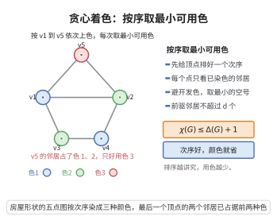

# 贪心着色算法

> **一句话大白话**：给顶点排一个次序，从头到尾逐个上色，每个顶点都挑"排在它前面的邻居还没用过的"最小颜色——这样用色数不超过"某顶点前面邻居数的最大值加一"，而精心挑选排序还能把这个界压低。

> **小例子**：完全图 $K_3$ 按 $v_1,v_2,v_3$ 的顺序着色：$v_1$ 用色 1，$v_2$ 看到 $v_1$ 用色 1 故用色 2，$v_3$ 看到色 1、2 故用色 3，共用 3 色，等于 $\chi(K_3)=\Delta+1=3$。

## 介绍

贪心着色算法（greedy coloring）是图着色问题中最简单也最基本的算法：给定顶点的一个排序 $v_1,\dots,v_n$，依次给每个顶点 $v_i$ 涂上尚未被它**已着色邻居**（即排在它前面的邻居）使用过的最小非负整数颜色。

它的价值在于给出两条普适上界：对任意图，$\chi(G)\le\Delta(G)+1$；更精细地，若存在一个顶点排序使每个顶点在排序中至多有 $d$ 个前驱邻居，则 $\chi(G)\le d+1$——这类排序存在的最小 $d$ 称为图的退化度（degeneracy）。Brooks 定理正是对贪心着色配合精细排序的运用：它说明除完全图与奇环外，$\Delta(G)+1$ 中"多出的那一个"可以省掉。贪心着色也是若干实际着色启发式算法（如 DSATUR）的骨架。

## 几何直观

图意在说明：按固定次序逐个涂色、每次挑最小可用色，用色数被前驱邻居的个数卡住，排序选得好还能再省。

## 分析

**前置依赖**：贪心算法、握手定理、数学归纳法原理。

**算法描述**：设 $G=(V,E)$ 是简单图，$|V|=n$，给定顶点排序 $v_1,\dots,v_n$，颜色取非负整数。

1. 依次对 $i=1,2,\dots,n$ 执行：令 $c(v_i)$ 为最小的整数 $k\ge0$，使得对一切满足 $j<i$ 且 $v_jv_i\in E$ 的 $j$ 都有 $c(v_j)\neq k$。
2. 输出着色 $c$。

**定理内容**：算法输出的 $c$ 是 $G$ 的正常着色（相邻顶点颜色不同），且所用颜色数不超过

$$\max_{1\le i\le n}\#\{\,j<i:\ v_jv_i\in E\,\}\;+\;1 .$$

**推论 1（平凡上界）**：取任意排序，每个顶点至多有 $\Delta(G)$ 个前驱邻居，故 $\chi(G)\le\Delta(G)+1$。

**推论 2（退化度上界）**：若 $G$ 是 $d$-退化的（即存在排序使每个顶点至多有 $d$ 个前驱邻居），则 $\chi(G)\le d+1$；且 $\chi(G)\le1+\max_{H\subseteq G}\delta(H)$，其中 $\delta(H)$ 是子图 $H$ 的最小度。这是 Brooks 定理证明中处理非正则图的关键一步。

## 思考过程

为什么前驱邻居的个数是关键？因为颜色的"可用性"只受前面邻居影响：给 $v_i$ 上色时，后面顶点的颜色尚未确定，约束不了 $v_i$。前面邻居最多占用 $m_i$ 种不同的颜色，于是候选色 $0,1,\dots,m_i$ 共有 $m_i+1$ 个，其中必有一个没被占用；算法取最小可用色，绝不会用到超过 $m_i$ 的颜色。

若只按任意顺序数前面邻居，每个顶点最多有 $\Delta$ 个，得到 $\Delta+1$。想更省颜色，就要"让每个顶点的前面邻居尽量少"：从度数最小的顶点出发作广度优先式的逆序排列，可以让除根之外的每个顶点都有一个邻居排在它后面，从而前面邻居至多 $\Delta-1$ 个，这就是 Brooks 定理对非正则图的处理方式；对正则图则要先删去两个不相邻顶点再造排序。

需要注意的是，贪心着色并不总能达到最优色数：排序的选取至关重要，糟糕的排序会浪费大量颜色（见证明步骤 6）。

## 证明过程

**步骤 1：算法总能顺利完成。** 归纳地设 $v_1,\dots,v_{i-1}$ 已着色。记 $m_i=\#\{j<i:\ v_jv_i\in E\}$，则前驱邻居至多使用了 $m_i$ 种不同颜色，而候选色集合 $\{0,1,\dots,m_i\}$ 有 $m_i+1$ 个元素，由鸽巢原理其中至少有一种未被使用，算法的可选色集合非空。故第 $i$ 步总能完成；由数学归纳法，算法对所有 $i$ 执行完毕。

**步骤 2：输出是正常着色。** 对任意边 $v_jv_i\in E$（$j<i$），算法选择 $c(v_i)$ 时明确排除了已着色邻居 $v_j$ 的颜色，故 $c(v_i)\neq c(v_j)$。每条边两端颜色都不同，$c$ 是正常着色。

**步骤 3：颜色数上界。** 由步骤 1，$c(v_i)\le m_i\le\max_i m_i$，故所用颜色全部落在 $\{0,1,\dots,\max_i m_i\}$ 中，颜色数不超过 $\max_i m_i+1$。特别地，任意排序都有 $m_i\le\Delta(G)$，于是 $\chi(G)\le\Delta(G)+1$。

**步骤 4：退化度形式。** 设 $G$ 是 $d$-退化的，即存在排序使一切 $m_i\le d$，由步骤 3 立即得 $\chi(G)\le d+1$。另一方面，"$d$-退化"等价于"每个非空子图 $H\subseteq G$ 都有 $\delta(H)\le d$"：若某子图最小度大于 $d$，则反复删除当前最小度顶点时最后剩下的顶点在该时刻的度数仍大于 $d$，无法得到所需排序；反之，若每个子图最小度不大于 $d$，则"反复删除最小度顶点"的逆序就是所需排序。取 $d=\max_{H\subseteq G}\delta(H)$，即得 $\chi(G)\le1+\max_{H\subseteq G}\delta(H)$。该排序可在多项式时间内构造，再执行算法即得 $d+1$ 着色。

**步骤 5：与 Brooks 定理的关系（说明界是紧的）。** 完全图 $K_{n}$ 在任意排序下，除第一个顶点外每个顶点都有全部 $n-1$ 个前驱邻居，算法恰好用 $n=\Delta+1$ 种颜色，无法更省；奇环 $C_{2k+1}$ 在任意排序下必有一个顶点至少有两个前驱邻居，算法会用到 $3=\Delta+1$ 色。Brooks 定理指出：除完全图与奇环之外，连通图总存在更好的排序，使贪心只需 $\Delta$ 种颜色，从而证明 $\chi\le\Delta$。

**步骤 6：与最优色数的差距（排序的重要性）。** 取完全二分图 $K_{n,n}$，两部分为 $A=\{a_1,\dots,a_n\}$ 与 $B=\{b_1,\dots,b_n\}$，按"先全部 $A$、再全部 $B$"排序：$A$ 中顶点互不相邻，全部得到颜色 0；而 $b_j$ 与所有 $a_i$（颜色 0）以及与 $b_1,\dots,b_{j-1}$（颜色 $1,\dots,j$）都相邻，故 $b_j$ 得到颜色 $j$，最终用到 $n+1$ 种颜色，远大于 $\chi(K_{n,n})=2$。这说明贪心着色一般达不到 $\chi(G)$，算法的效果完全取决于排序。

## 课堂问答

**老师**：按一个顶点序逐个涂"最小的未用色"，最多会用几种颜色？

**学生**：不超过"每个顶点前面邻居数的最大值加 $1$"。因为给 $v_i$ 上色时只有排在它前面的邻居构成约束，它们至多占用 $m_i$ 种颜色，而候选色 $\{0,1,\dots,m_i\}$ 有 $m_i+1$ 个，由鸽巢必有一个空闲，故 $c(v_i)\le m_i$。

**老师（追问）**：由此能得到哪两条上界？怎么把上界压得更紧？

**学生**：取任意排序，每个顶点至多 $\Delta$ 个前驱邻居，得 $\chi(G)\le\Delta+1$；若存在排序使每个顶点至多 $d$ 个前驱邻居（即 $G$ 是 $d$-退化的），得 $\chi(G)\le d+1$，且 $\chi(G)\le1+\max_{H\subseteq G}\delta(H)$。想让 $d$ 更小，就从最小度顶点出发做 BFS 逆序排列，使除根外每个顶点都有一个邻居排在后面，前驱邻居降到 $\Delta-1$。

**老师（拓展）**：为什么说排序至关重要？常见误区？

**学生**：贪心着色的用色数完全取决于排序，糟糕排序会浪费大量颜色——完全二分图 $K_{n,n}$ 若先排完 $A$ 再排 $B$，会用到 $n+1$ 色，而 $\chi(K_{n,n})=2$。常见误区是以为贪心着色总能达到最优色数：它一般做不到（求 $\chi$ 是 NP 困难的），$\Delta+1$ 与退化度上界都只是保证；Brooks 定理正是在"挑好排序"上把 $\Delta+1$ 收紧到 $\Delta$。

## 相关条目

- [图的着色数上界](./图的着色数上界.md)：Brooks 定理建立在本算法的精细排序之上。
- [贪心算法](./贪心算法.md)：本算法是贪心范式的直接实例。
- [握手定理](./握手定理.md)：用"逐点求和"的语言刻画度数与颜色计数的基本估计。
