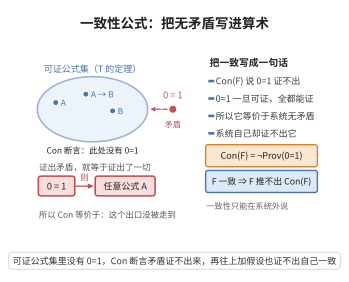

# 一致性公式

> **一句话大白话**：把"这个系统不会自相矛盾"这句话，用系统自己的算术语言写成一条公式——于是系统可以被问"你能证明自己无矛盾吗"，答案是不能。
>
> **小例子**：取 $\operatorname{Con}(\mathcal F)=\neg\operatorname{Prov}_{\mathcal F}(\ulcorner 0=1\urcorner)$，它说"$\mathcal F$ 证不出 $0=1$"，等价于"$\mathcal F$ 一致"。

## 介绍

一致性公式 $\operatorname{Con}(\mathcal F)$ 是把"$\mathcal F$ 无矛盾"这一元数学断言用算术公式写出来的语句。最常用的定义是

$$\operatorname{Con}(\mathcal F):=\neg\operatorname{Prov}_{\mathcal F}(\ulcorner 0=1\urcorner),$$

即"从 $\mathcal F$ 不能证明矛盾命题 $0=1$"。由于在含逻辑公理的系统中有 $\vdash 0=1\to A$ 对一切公式 $A$ 成立，只要能证明出 $0=1$ 就能证明一切，因此"证不出 $0=1$"与"系统一致"等价。

一致性公式是哥德尔第二不完备定理的核心对象。它把"系统一致"这一语义事实编码为系统内部的算术语句，使系统能够"谈论自己是否一致"。Gödel 第二不完备定理断言：若 $\mathcal F$ 一致且满足可推导性条件，则 $\mathcal F$ 不能证明 $\operatorname{Con}(\mathcal F)$。

这一结论宣告了希尔伯特纲领中"用有穷方法证明算术一致性"这一最强形式的计划无法实现：一致性证明必然要动用系统之外（或更强）的工具。

## 几何直观

图意在说明：Con(F) 只是系统内的一条普通算术语句，它说矛盾命题 0=1 不可证，而这句真话系统自己证不出。

## 分析

**前置依赖**：哥德尔不完备定理第一、哥德尔编码、可证性谓词 $\operatorname{Prov}_{\mathcal F}$、Hilbert–Bernays–Löb 可推导性条件、对角化引理

**定理内容（哥德尔第二不完备定理）**：设 $\mathcal F$ 是递归可公理化、包含足够算术（如 PA）且一致的系统，其可证性谓词 $\operatorname{Prov}_{\mathcal F}$ 满足可推导性条件：

- (D1) 若 $\mathcal F\vdash A$，则 $\mathcal F\vdash\operatorname{Prov}(\ulcorner A\urcorner)$；
- (D2) $\mathcal F\vdash\operatorname{Prov}(\ulcorner A\to B\urcorner)\to\big(\operatorname{Prov}(\ulcorner A\urcorner)\to\operatorname{Prov}(\ulcorner B\urcorner)\big)$；
- (D3) $\mathcal F\vdash\operatorname{Prov}(\ulcorner A\urcorner)\to\operatorname{Prov}(\ulcorner\operatorname{Prov}(\ulcorner A\urcorner)\urcorner)$。

则 $\mathcal F\nvdash\operatorname{Con}(\mathcal F)$。

**关键要点**：

- 一致性公式是"把元语言事实算术化"的范例：$\operatorname{Con}$ 是系统内的一条普通算术语句；
- 证明的实质内容是形式化"若 $G$ 可证则系统不一致"，即 $\mathcal F\vdash\operatorname{Con}\to G$；
- 条件 (D1)–(D3) 是"可证性谓词表现得像可证性"的最低要求。

## 思考过程

证明的主线是证明"一致性蕴含 Gödel 语句"：$\mathcal F\vdash\operatorname{Con}(\mathcal F)\to G$。直观上，Gödel 语句 $G$ 说"我不可证"；一致性说"不会有某个 $A$ 同时可证与其否定可证"。

设想 $G$ 可证。一方面，由 $G\leftrightarrow\neg\operatorname{Prov}(\ulcorner G\urcorner)$ 立得 $\neg\operatorname{Prov}(\ulcorner G\urcorner)$ 可证，即"$G$ 不可证"。另一方面，由 (D1)，$G$ 可证又给出 $\operatorname{Prov}(\ulcorner G\urcorner)$ 可证，即"$G$ 可证"。两者合起来，借助 (D2)——可证性对 modus ponens 封闭——就证明了 $0=1$，即系统不一致。

所以只要系统一致，就绝不能让 $G$ 可证。把上述推理形式化（用 (D1)–(D3) 代替每一步的元语言论证），就得到 $\operatorname{Con}\to G$。有了它，若再假设 $\mathcal F\vdash\operatorname{Con}$，就会推出 $\mathcal F\vdash G$，与第一不完备定理冲突。

## 证明过程

**步骤 1：记号。** 由对角化引理取 Gödel 语句 $G$ 满足

$$\mathcal F\vdash G\leftrightarrow\neg\operatorname{Prov}(\ulcorner G\urcorner).$$

记 $P=\operatorname{Prov}$，则 $\operatorname{Con}=\neg P(\ulcorner 0=1\urcorner)$。由上式和经典逻辑直接得到两个方向：

$$\mathcal F\vdash G\to\neg P(\ulcorner G\urcorner),\qquad \mathcal F\vdash \neg G\to P(\ulcorner G\urcorner).$$

**步骤 2：证明 $\mathcal F\vdash P(\ulcorner G\urcorner)\to P\big(\ulcorner\neg P(\ulcorner G\urcorner)\urcorner\big)$。** 由步骤 1，$G\to\neg P(\ulcorner G\urcorner)$ 是 $\mathcal F$ 的定理。由 (D1)，

$$\mathcal F\vdash P\big(\ulcorner G\to\neg P(\ulcorner G\urcorner)\urcorner\big).$$

对它应用 (D2)（取 $A=G$、$B=\neg P(\ulcorner G\urcorner)$），得

$$\mathcal F\vdash P(\ulcorner G\urcorner)\to P\big(\ulcorner\neg P(\ulcorner G\urcorner)\urcorner\big).$$

**步骤 3：证明 $\mathcal F\vdash P(\ulcorner G\urcorner)\to P\big(\ulcorner P(\ulcorner G\urcorner)\urcorner\big)$。** 直接由 (D3)（取 $A=G$）得到。

**步骤 4：从 $P(\ulcorner G\urcorner)$ 推出 $P(\ulcorner 0=1\urcorner)$。** 记 $A=P(\ulcorner G\urcorner)$。由步骤 2、3，在假定 $P(\ulcorner G\urcorner)$ 下同时有 $P(\ulcorner A\urcorner)$ 与 $P(\ulcorner\neg A\urcorner)$。又因在 $\mathcal F$ 中有定理 $A\to(\neg A\to 0=1)$，由 (D1) 与 (D2) 得

$$\mathcal F\vdash P(\ulcorner A\urcorner)\to\big(P(\ulcorner\neg A\urcorner)\to P(\ulcorner 0=1\urcorner)\big).$$

于是

$$\mathcal F\vdash P(\ulcorner G\urcorner)\to P(\ulcorner 0=1\urcorner).$$

**步骤 5：得到 $\operatorname{Con}\to G$。** 由步骤 1 的 $\mathcal F\vdash\neg G\to P(\ulcorner G\urcorner)$ 与步骤 4 传递得 $\mathcal F\vdash\neg G\to P(\ulcorner 0=1\urcorner)$。取逆否命题，

$$\mathcal F\vdash\neg P(\ulcorner 0=1\urcorner)\to G,\qquad\text{即}\qquad \mathcal F\vdash\operatorname{Con}(\mathcal F)\to G.$$

**步骤 6：结论。** 假设 $\mathcal F\vdash\operatorname{Con}(\mathcal F)$，则由步骤 5 与 modus ponens 得 $\mathcal F\vdash G$。但由第一不完备定理，当 $\mathcal F$ 一致时有 $\mathcal F\nvdash G$，矛盾。故 $\mathcal F\nvdash\operatorname{Con}(\mathcal F)$。$\square$

## 课堂问答

**老师**：怎么把"系统无矛盾"这句元数学断言写进系统自己的算术语言里？

**学生**：写成 $\mathrm{Con}(\mathcal F):=\neg\mathrm{Prov}_{\mathcal F}(\ulcorner 0=1\urcorner)$，即"证不出 $0=1$"。因为经典逻辑中有 $\vdash 0=1\to A$ 对一切 $A$ 成立，证出 $0=1$ 就能证出一切，故"证不出 $0=1$"与"一致"等价。

**老师（追问）**：第二不完备定理怎么把它和第一定理结合起来？

**学生**：先在 $\mathcal F$ 内证 $\mathcal F\vdash\mathrm{Con}(\mathcal F)\to G$：由 (D1)(D2) 得 $P(\ulcorner G\urcorner)\to P(\ulcorner\neg P(\ulcorner G\urcorner)\urcorner)$，由 (D3) 得 $P(\ulcorner G\urcorner)\to P(\ulcorner P(\ulcorner G\urcorner)\urcorner)$；两式借定理 $A\to(\neg A\to 0=1)$ 与 (D2) 推出 $P(\ulcorner G\urcorner)\to P(\ulcorner 0=1\urcorner)$，取逆否即得 $\mathrm{Con}\to G$。

**老师（拓展）**：有了 $\mathrm{Con}\to G$，定理为什么就完成了？

**学生**：若 $\mathcal F\vdash\mathrm{Con}(\mathcal F)$，则 MP 得 $\mathcal F\vdash G$，与第一定理的 $\mathcal F\nvdash G$ 矛盾，故 $\mathcal F\nvdash\mathrm{Con}(\mathcal F)$。可见可推导性条件 (D1)–(D3) 正是"可证性谓词表现得像可证性"的最低要求。

## 相关条目

- [哥德尔不完备定理第二](./哥德尔不完备定理第二.md)：本条目正是该定理的核心对象与证明。
- [哥德尔不完备定理第一](./哥德尔不完备定理第一.md)：$\mathcal F\nvdash G$ 是其结论，也是本证明最后一步所引用的事实。
