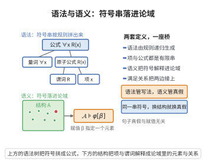

# 一阶逻辑的语法与语义

> **一句话大白话**：先规定一套"符号与合法写法"（语法），再规定这些写法在具体世界里"指什么、真假如何"（语义）——两者分开定义、再靠满足关系 $\models$ 挂钩，就是一阶逻辑的骨架。
>
> **小例子**：语法上 $\forall x\,(x+1>0)$ 只是按规则拼出的符号串；放到自然数结构 $\mathfrak N=(\mathbb N,+,\cdot,0,1,<)$ 并按"每个 $x$ 取遍 $\mathbb N$"解释后，它是一个真命题；若把论域换成整数 $\mathbb Z$，它仍是真命题；若换成 $\mathbb R$ 则不然——同一串符号，语义随结构而变。

## 介绍

一阶逻辑的语法与语义（syntax and semantics of first-order logic）是数理逻辑的入口：它给出"形式语言如何被书写"与"形式语言如何被解释"两套相互独立、又由满足关系 $\models$ 连接起来的定义。

**语法**方面规定：一阶语言 $\mathcal L$ 由常项符号、函数符号、谓词符号（含等号）组成；由变量与函数符号递归生成**项**（term）；由项与谓词符号生成**原子公式**；再用连接词 $\neg,\wedge,\vee,\to,\leftrightarrow$ 与量词 $\forall,\exists$ 逐步拼出**公式**（formula）。这一递归构造使"对公式作结构归纳"成为可能——几乎所有元定理都靠它证明。

**语义**方面规定：一个 $\mathcal L$-结构 $\mathfrak A$（含非空论域 $|\mathfrak A|$ 与各符号的解释）配上赋值 $\beta:\mathrm{Var}\to|\mathfrak A|$，递归定义项的值与公式的真假，得到满足关系 $\mathfrak A\models\varphi[\beta]$。由此可以定义"公式在结构中为真"、"句子（无自由变量）为真"、"理论 $T$ 的模型"等概念。

这套框架在 Frege 与 Russell 的著作中萌芽，由 Hilbert–Ackermann（1928）整理为现代形式，并在 Gödel（1930）完备性定理与 Tarski（1933）真概念理论中定型。它是命题逻辑的自然延伸，也是模型论、证明论、集合论、可计算性理论与形式化数学的共同语言。

## 几何直观

图意在说明：语法只管符号按规则怎么拼，语义才决定它在结构里指什么，真假由此而定。

## 分析

**前置依赖**：命题逻辑公理、数学归纳法原理、一阶语言与项、自由变量与约束变量、结构与赋值、满足关系、结构归纳法

**定义内容（语法）**：

1. **一阶语言** $\mathcal L$ 由三类非逻辑符号组成：常项符号集合 $C$、函数符号集合 $F$（每个 $f\in F$ 带元数 $n_f\ge1$）、谓词符号集合 $P$（每个 $R\in P$ 带元数 $n_R\ge1$，通常含二元等号 $=$）。逻辑符号为可数多个变量 $v_0,v_1,\dots$ 与连接词、量词、括号。

2. **项**由以下规则生成：
   - 每个变量是项；每个常项符号是项；
   - 若 $f\in F$ 是 $n$ 元函数符号且 $t_1,\dots,t_n$ 是项，则 $f(t_1,\dots,t_n)$ 是项。

3. **公式**由以下规则生成：
   - 若 $R\in P$ 是 $n$ 元谓词符号且 $t_1,\dots,t_n$ 是项，则 $R(t_1,\dots,t_n)$ 是原子公式；
   - 若 $\varphi$ 是公式，则 $\neg\varphi$ 是公式；若 $\varphi,\psi$ 是公式，则 $(\varphi\wedge\psi),(\varphi\vee\psi),(\varphi\to\psi),(\varphi\leftrightarrow\psi)$ 是公式；
   - 若 $\varphi$ 是公式、$x$ 是变量，则 $\forall x\,\varphi$ 与 $\exists x\,\varphi$ 是公式；
   - 公式的集合是满足以上条件的最小集合。

**定义内容（语义）**：

1. **结构** $\mathfrak A=(\left|\mathfrak A\right|,(c^{\mathfrak A})_{c\in C},(f^{\mathfrak A})_{f\in F},(R^{\mathfrak A})_{R\in P})$，其中论域 $\left|\mathfrak A\right|\neq\varnothing$，$f^{\mathfrak A}:\left|\mathfrak A\right|^{n_f}\to\left|\mathfrak A\right|$，$R^{\mathfrak A}\subseteq\left|\mathfrak A\right|^{n_R}$。赋值 $\beta:\mathrm{Var}\to\left|\mathfrak A\right|$。

2. **项的值** $\mathrm{val}^{\mathfrak A}(t,\beta)$ 递归定义为：$\mathrm{val}^{\mathfrak A}(x,\beta)=\beta(x)$；$\mathrm{val}^{\mathfrak A}(c,\beta)=c^{\mathfrak A}$；$\mathrm{val}^{\mathfrak A}(f(t_1,\dots,t_n),\beta)=f^{\mathfrak A}(\mathrm{val}^{\mathfrak A}(t_1,\beta),\dots,\mathrm{val}^{\mathfrak A}(t_n,\beta))$。

3. **满足关系** $\mathfrak A\models\varphi[\beta]$ 递归定义为：$\mathfrak A\models R(t_1,\dots,t_n)[\beta]\iff(\mathrm{val}^{\mathfrak A}(t_1,\beta),\dots,\mathrm{val}^{\mathfrak A}(t_n,\beta))\in R^{\mathfrak A}$；布尔连接词按真值表处理；$\mathfrak A\models\forall x\,\varphi[\beta]\iff$ 对所有 $a\in\left|\mathfrak A\right|$ 有 $\mathfrak A\models\varphi[\beta(x/a)]$；$\exists$ 对偶。

**数学内涵**：

- **语法与语义的分离**是这套框架的核心设计：语法是"符号串的有限组合规则"，可与任何具体数学对象脱钩；语义才引入"世界里指什么"。
- **句子**（无自由变量）的真假与赋值无关，"$\mathfrak A\models\sigma$"因此有意义；这使"理论 $T$ 的模型类"$\mathrm{Mod}(T)=\{\mathfrak A:\mathfrak A\models\sigma,\ \forall\sigma\in T\}$ 成为模型论的研究对象。
- **结构归纳法**是把语法定义"翻译"成元定理的标准工具：因为项与公式都是按最小封闭规则生成的，只要性质对生成元成立、并对每条生成规则保持，就对全体项与公式成立。

## 思考过程

语法部分的目标是"用有限条规则生成一整类符号串"。这里必须小心两点：一是**唯一可读性**（uniqueness of readability），即每个项或公式只有唯一的构造历史，这由括号的强制使用与函数、谓词符号的元数规定保证；二是**自由变量与约束变量**的区分——$\forall x\,\varphi$ 中的 $x$ 被量词约束，其余自由变量才是"外部可以赋值干预"的位置。

语义部分的递归定义与语法的递归生成"同构"：项怎么拼，值就怎么算；公式怎么拼，真假就怎么定。量词情形是唯一"非局部"的一步：它要求论域中所有的元素（而不只是当前赋值给 $x$ 的那一个）都参与判断。这使 $\forall$ 与 $\exists$ 成为交互的（$\neg\forall x\,\varphi$ 与 $\exists x\,\neg\varphi$ 同真），也解释了为什么"满足关系"必须由整份赋值 $\beta$ 而不仅是若干变量值来刻画。

语法与语义分开后，逻辑的中心问题便清晰浮现：**哪些公式在一切结构中为真**（有效式）、**哪些公式在给定理论的所有模型中为真**（逻辑推论）、**有效式能否被形式证明穷尽**（完备性）。这三个问题分别催生了模型论、证明论与可计算性理论。

## 证明过程

这里证明两条把语法与语义连接起来的基本事实，二者都依赖结构归纳法。

**步骤 1：项的值只依赖其自由变量的赋值（重合引理）。** 设 $\beta,\gamma$ 是两个赋值，且对 $t$ 中出现的每个变量 $x$ 都有 $\beta(x)=\gamma(x)$。断言 $\mathrm{val}^{\mathfrak A}(t,\beta)=\mathrm{val}^{\mathfrak A}(t,\gamma)$。

对项 $t$ 的结构归纳：若 $t=x$ 是变量，由假设 $\beta(x)=\gamma(x)$；若 $t=c$ 是常项，两边同为 $c^{\mathfrak A}$；若 $t=f(t_1,\dots,t_n)$，则对每个 $t_i$ 用归纳假设得 $\mathrm{val}^{\mathfrak A}(t_i,\beta)=\mathrm{val}^{\mathfrak A}(t_i,\gamma)$，再代入 $f^{\mathfrak A}$ 的同一自变量。归纳完成。

**步骤 2：公式的真假只依赖其自由变量（重合引理，公式版）。** 设 $\beta,\gamma$ 在 $\varphi$ 的自由变量上取值相同，则

$$
\mathfrak A\models\varphi[\beta]\iff\mathfrak A\models\varphi[\gamma].
$$

对公式 $\varphi$ 的结构归纳。原子式 $\varphi=R(t_1,\dots,t_n)$：每个 $t_i$ 的变量都自由出现在 $\varphi$ 中，由步骤 1 得 $\mathrm{val}^{\mathfrak A}(t_i,\beta)=\mathrm{val}^{\mathfrak A}(t_i,\gamma)$，故元组相同，$R^{\mathfrak A}$ 的隶属关系相同。

布尔连接词：分别对子公式用归纳假设，再按真值表逐条验证（例如 $\wedge$ 情形两侧同时为真或同时为假）；代数上可先在语法层用逻辑等价 $\varphi\to\psi\equiv\neg\varphi\vee\psi$ 把连接词约化为 $\{\neg,\vee\}$，再由归纳假设传递。

量词情形 $\varphi=\forall x\,\psi$：$\psi$ 的自由变量集是 $\varphi$ 的自由变量集至多再加上 $x$。给定 $a\in|\mathfrak A|$，赋值 $\beta(x/a)$ 与 $\gamma(x/a)$ 在 $\psi$ 的自由变量上取值相同（在 $x$ 上同为 $a$，在其余自由变量上由假设相同），故由归纳假设

$$
\mathfrak A\models\psi[\beta(x/a)]\iff\mathfrak A\models\psi[\gamma(x/a)].
$$

这对所有 $a$ 成立，故"对所有 $a$ 左侧成立"等价于"对所有 $a$ 右侧成立"，即 $\mathfrak A\models\forall x\,\psi[\beta]\iff\mathfrak A\models\forall x\,\psi[\gamma]$。$\exists$ 情形对偶。归纳完成。$\square$

**推论。** 若 $\sigma$ 是句子（无自由变量），则 $\mathfrak A\models\sigma[\beta]$ 的取值与 $\beta$ 无关，可简记为 $\mathfrak A\models\sigma$。这使"结构满足理论"成为一个仅依赖结构本身的判断，从而可以定义模型类 $\mathrm{Mod}(T)$ 与逻辑推论关系 $T\models\sigma$。

## 课堂问答

**老师**：先分清一件事——一阶逻辑里那串符号 $\forall x\,(x+1>0)$ 本身有没有真假？

**学生**：没有。结论是"符号串本身无真假，真假只在给定结构 $\mathfrak A$ 与赋值 $\beta$ 后才出现"。因为语法只规定项与公式的递归生成规则，语义才通过 $\mathfrak A=(\lvert\mathfrak A\rvert,\dots)$ 与 $\mathrm{val}$ 把符号送进论域。常见误区是把 $\forall x\,(x+1>0)$ 直接当成真命题，忘了它在 $\mathbb Z$、$\mathbb R$ 上真假并不相同。

**老师（追问）**：那为什么"$\mathfrak A\models\sigma$"可以不写赋值 $\beta$？

**学生**：因为 $\sigma$ 是句子（无自由变量）。由重合引理——真值只依赖自由变量的赋值——自由变量集为空时 $\beta$ 任意取值都不影响真假，故可省去 $\beta$、记作 $\mathfrak A\models\sigma$。这也正是能定义模型类 $\mathrm{Mod}(T)=\{\mathfrak A:\mathfrak A\models\sigma,\ \forall\sigma\in T\}$ 与推论关系 $T\models\sigma$ 的前提。

**老师（拓展）**：为什么这一整套元定理的证明都靠"结构归纳法"？

**学生**：因为项与公式被定义为"含生成元、对每条生成规则封闭"的最小集合。只要性质对生成元成立、并在每条规则下保持，就对全体成立。量词是唯一非局部的一步：$\mathfrak A\models\forall x\,\varphi[\beta]$ 要求对**所有** $a\in\lvert\mathfrak A\rvert$ 判断 $\varphi[\beta(x/a)]$，这也解释了 $\neg\forall x\,\varphi$ 与 $\exists x\,\neg\varphi$ 同真。

## 相关条目

- [命题逻辑公理](../../公理体系/05-命题逻辑公理/README.md)：不含量词与谓词的子语言，其公理与推理规则被一阶逻辑完整继承。
- [数学归纳法原理](../第01级-算术基础/数学归纳法原理.md)：项与公式的递归生成使"结构归纳法"合法，本条目全部证明均依赖它。
- [代入引理](./代入引理.md)：以本条目的项、公式、赋值、满足关系为语言，说明语法代换与语义重赋值的一致性。
- [哥德尔完备性定理](./哥德尔完备性定理.md)：把"语义有效"与"语法可证"对接，是本条目所建立框架的第一个深刻定理。
- [可靠性定理](./可靠性定理.md)：由满足关系的定义直接推出"可证者必有效"。
- [紧致性定理](./紧致性定理.md)：以本条目的满足关系为出发点得到的一阶逻辑核心性质。
