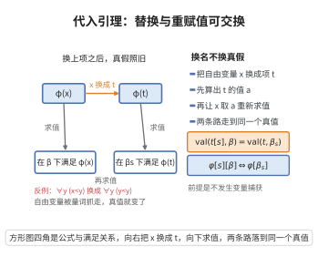

# 代入引理

> **一句话大白话**：公式里的自由变量可以"换成项"，就像把句子中的人名换成一段更长的描述；这条引理保证换完以后真假不变，前提是这种替换不会让自由变量被量词"抓走"（无变量捕获）。

> **小例子**：在自然数结构里取公式 $\varphi(x)$ 为 "$x+1>0$"。用项 $y+y$ 替换 $x$，得到 $\varphi[y+y]$ 即 "$y+y+1>0$"。对任意赋值 $y\mapsto k$，两式的真值都恰好由 $k$ 决定，这正是代入引理断言的"语法替换等于语义重赋值"。

## 介绍

代入引理（Substitution Lemma，又称替换引理）是一阶逻辑中连接"语法"与"语义"的最基本工具之一。它的思想在 Hilbert–Ackermann 的《理论逻辑基础》与 Gödel 1930 年的完备性证明中已经出现，并在 20 世纪后半叶随证明论、模型论的发展被提炼为一条独立命题。

其内容是：在公式 $\varphi$ 中把自由变量 $x$ 代换成一个项 $t$，随后在结构 $\mathfrak{A}$ 下求值，其效果与"先按原赋值给其他变量取值、再把 $x$ 解释为 $t$ 的值"完全一致。换句话说，语法层面的"变量替换"与语义层面的"重新赋值"是同一件事的两种描述。

代入引理看似平凡，却是演绎定理、可靠性定理、Gödel 完备性定理、Herbrand 定理、紧致性定理等几乎所有一阶元定理证明中的必备步骤；每当证明需要在公式内部"换掉一个变量"时，都要引用它。它也是 Skolem 化与预nex 范式处理的理论依据。

## 几何直观

图意在说明：公式里把自由变量换成项，等于在语义里把该变量的取值换成项的值，真假不变。

## 分析

**前置依赖**：一阶语言与项、一阶逻辑的语法与语义、自由变量与约束变量、结构（模型）与赋值、满足关系 $\models$、结构归纳法、合法代换（无变量捕获）。

**定理内容**：设 $\mathfrak{A}$ 是一阶语言 $\mathcal{L}$ 的结构，$\beta:\mathrm{Var}\to|\mathfrak{A}|$ 是赋值。设 $s$ 是一个代换，即对每个变量 $x$ 指定一个项 $s(x)$，并且 $s$ 对公式 $\varphi$ 合法（不产生变量捕获）。定义新赋值 $\beta_s$ 为

$$\beta_s(x)=\mathrm{val}_{\mathfrak{A}}\bigl(s(x),\beta\bigr),$$

即用 $\beta$ 解释项 $s(x)$ 后得到的元素。则：

1. 对每个项 $t$，有 $\mathrm{val}_{\mathfrak{A}}(t[s],\beta)=\mathrm{val}_{\mathfrak{A}}(t,\beta_s)$；
2. 对每个公式 $\varphi$，有 $\mathfrak{A}\models\varphi[s][\beta]\iff\mathfrak{A}\models\varphi[\beta_s]$。

**推论（单一变量代换）**：取 $s$ 只把变量 $x$ 替换为项 $t$、其余变量保持不变，则对 $x$ 自由出现的公式 $\varphi$ 有

$$\mathfrak{A}\models\varphi[x:=t][\beta]\iff\mathfrak{A}\models\varphi[\beta(x/a)],\qquad a=\mathrm{val}_{\mathfrak{A}}(t,\beta).$$

**依赖的概念**：项、公式、赋值、满足关系、自由/约束变量、代换的合法性。

## 思考过程

证明的思路是"语法怎么递归构造，语义就怎么递归求值"，因此对项与公式作结构归纳。项的情形几乎是把定义展开：变量的代换正好对应赋值的修改。公式的情形中，布尔连接词由归纳假设直接传递；唯一需要小心的是量词 $\exists x$：在 $\exists x\,\psi$ 内部，被量词约束的那个 $x$ 不参与代换，为此先把约束变量改名为一个全新的 $y$，再作代换，就能干净地把"约束变量与代换的项互不干扰"这一条件用上。

量词这一步的关键是：改名得到的自由变量 $y$ 不在任何 $s(z)$ 中出现（$y$ 是新的），于是赋值 $\beta_s$ 与"先取 $y\mapsto a$、再求 $\beta_s$"在除 $y$ 外的所有变量上一致，而 $y$ 恰好承担了原 $x$ 的角色。这样两侧的"存在某个 $a$"就对上了。

这一步之所以必须强调"无变量捕获"，是因为若 $s(x)$ 中含有被 $\psi$ 约束的变量，替换会改变量词的指代对象，命题就不成立。

## 证明过程

**步骤 1：项的结构归纳。** 设 $t$ 为项，按 $t$ 的形状分类。

- 若 $t=x$ 是变量：$t[s]=s(x)$，于是 $\mathrm{val}_{\mathfrak{A}}(t[s],\beta)=\mathrm{val}_{\mathfrak{A}}(s(x),\beta)=\beta_s(x)=\mathrm{val}_{\mathfrak{A}}(x,\beta_s)$。
- 若 $t=c$ 是常项：$c[s]=c$，两边都等于 $c^{\mathfrak{A}}$。
- 若 $t=f(t_1,\dots,t_n)$：按递归定义 $t[s]=f(t_1[s],\dots,t_n[s])$，于是

$$\mathrm{val}_{\mathfrak{A}}(t[s],\beta)=f^{\mathfrak{A}}\bigl(\mathrm{val}_{\mathfrak{A}}(t_1[s],\beta),\dots\bigr)=f^{\mathfrak{A}}\bigl(\mathrm{val}_{\mathfrak{A}}(t_1,\beta_s),\dots\bigr)=\mathrm{val}_{\mathfrak{A}}(t,\beta_s),$$

其中第二步用归纳假设，最后一步用项求值的递归定义。

**步骤 2：公式的结构归纳（非量词情形）。**

- 若 $\varphi$ 是原子式 $t_1=t_2$：由步骤 1，

$$\mathfrak{A}\models(t_1=t_2)[s][\beta]\iff\mathrm{val}_{\mathfrak{A}}(t_1,\beta_s)=\mathrm{val}_{\mathfrak{A}}(t_2,\beta_s)\iff\mathfrak{A}\models(t_1=t_2)[\beta_s].$$

- 若 $\varphi$ 是原子式 $R(t_1,\dots,t_n)$：同理，利用 $R^{\mathfrak{A}}$ 与步骤 1。
- 若 $\varphi$ 是 $\neg\psi$、$\psi_1\wedge\psi_2$、$\psi_1\vee\psi_2$、$\psi_1\to\psi_2$：对子公式用归纳假设；代入与布尔运算可交换，按真值表逐条成立。

**步骤 3：量词情形。** 设 $\varphi=\exists x\,\psi$。为排除约束变量与代换项的干扰，先把约束变量改名为全新变量 $y$（$y$ 不出现在 $\psi$ 与任何 $s(z)$ 中），于是

$$(\exists x\,\psi)[s]=\exists y\,\bigl(\psi[x:=y][s]\bigr).$$

逐条展开语义：

$$\mathfrak{A}\models\exists y\,(\psi[x:=y][s])[\beta]\iff\exists a\in|\mathfrak{A}|:\ \mathfrak{A}\models(\psi[x:=y][s])[\beta(y/a)].$$

对公式 $\psi[x:=y]$ 与赋值 $\beta(y/a)$ 应用归纳假设，得

$$\iff\exists a\in|\mathfrak{A}|:\ \mathfrak{A}\models(\psi[x:=y])\bigl[(\beta(y/a))_s\bigr].$$

现在辨认赋值 $(\beta(y/a))_s$。对任意 $z\ne y$：由于 $y$ 不出现在项 $s(z)$ 中，$\mathrm{val}_{\mathfrak{A}}(s(z),\beta(y/a))=\mathrm{val}_{\mathfrak{A}}(s(z),\beta)=\beta_s(z)$；而 $(\beta(y/a))_s(y)=\mathrm{val}_{\mathfrak{A}}(s(y),\beta(y/a))=\mathrm{val}_{\mathfrak{A}}(y,\beta(y/a))=a$。故该赋值恰是"在 $\beta_s$ 上把 $y$ 改为 $a$"。于是

$$\iff\exists a\in|\mathfrak{A}|:\ \mathfrak{A}\models\psi[\beta_s(x/a)]\iff\mathfrak{A}\models\exists x\,\psi[\beta_s],$$

最后一步用的是 $\psi[x:=y]$ 在 $y\mapsto a$ 下即为 $\psi$ 在 $x\mapsto a$ 下。全称量词 $\forall$ 的情形与之对偶（把"存在"换成"对一切"）。

由结构归纳法，两项结论对一切项与公式成立。证毕。

## 课堂问答

**老师**：把公式 $\varphi(x)$ 里的自由变量 $x$ 换成一个项 $t$，真假会怎样变化？

**学生**：不变，只要代换合法（无变量捕获）。结论是 $\mathfrak A\models\varphi[x:=t][\beta]\iff\mathfrak A\models\varphi[\beta(x/a)]$，其中 $a=\mathrm{val}_{\mathfrak A}(t,\beta)$——语法替换恰等于语义重赋值。一般形式写成 $\mathrm{val}_{\mathfrak A}(t[s],\beta)=\mathrm{val}_{\mathfrak A}(t,\beta_s)$，$\beta_s(x)=\mathrm{val}_{\mathfrak A}(s(x),\beta)$。常见误区：若 $s(x)$ 含被量词约束的变量，替换会改变量词的指代对象，命题失效。

**老师（追问）**：证明里唯一棘手的是哪一步，为什么要先把约束变量改名？

**学生**：量词情形 $\exists x\,\psi$。被约束的 $x$ 不参与代换，所以先把约束变量改名成全新 $y$（$y$ 不出现在 $\psi$ 与任何 $s(z)$ 中），得 $(\exists x\,\psi)[s]=\exists y\,(\psi[x:=y][s])$，再对 $\psi[x:=y]$ 用归纳假设。因为 $y$ 是新的，赋值 $(\beta(y/a))_s$ 在除 $y$ 外与 $\beta_s$ 一致，于是两侧"存在某个 $a$"就对上了。

**老师（拓展）**：为什么说它是几乎所有一阶元定理的必备步骤？

**学生**：凡证明需要在公式内部替换变量，都要靠它保真：演绎定理要比较赋值、可靠性要在公式内替换、完备性的典范模型构造反复处理项与赋值、Skolem 化与 prenex 范式也以它为理论依据。

## 相关条目

- [演绎定理](./演绎定理.md)：其证明需要对公式作代入并比较赋值，代入引理是基本工具。
- [可靠性定理](./可靠性定理.md)：证明中必须在公式内部替换变量，依赖代入引理保持真值。
- [哥德尔完备性定理](./哥德尔完备性定理.md)：典范模型构造中反复使用代入引理处理项与赋值的关系。
- [对角化引理](./对角化引理.md)：同样依赖对公式作语法代换并控制其语义效果。
