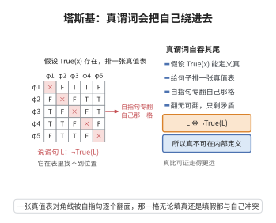

# 塔斯基不可定义定理

> **一句话大白话**：在够强的形式系统内部，写不出一个公式来"准确说出哪些句子为真"——"真"这个概念跳出了系统能圈住的范围，与"可证明"天然有别。
>
> **小例子**：皮亚诺算术里若存在 $\text{True}(x)$ 满足 $\text{True}(\ulcorner\varphi\urcorner)\leftrightarrow\varphi$，构造说谎句 $L$："$L$ 不为真"，代入即得矛盾，故这样的 $\text{True}$ 不存在。

## 介绍

塔斯基不可定义定理（Tarski's Undefinability Theorem）是阿尔弗雷德·塔斯基于 1936 年证明的一个深刻结果，它断言：在足够强的形式系统中（如皮亚诺算术），"真"的概念不能在系统内部被定义。具体来说，不存在一个公式 $\text{True}(x)$ 使得对于每个语句 $\varphi$，$\text{True}(\ulcorner \varphi \urcorner) \leftrightarrow \varphi$ 成立。这一定理揭示了"真"与"可证明"的本质区别，对语义学和数学基础产生了深远影响。

## 几何直观

图意在说明：若真能在系统内由一个公式定义，自指句就会逼着对角线上那一格同时为真又为假。

## 分析

**前置依赖**：哥德尔编码、对角化引理、一阶逻辑语义。

**数学内涵**：
- 设 $T$ 是包含 $\text{PA}$ 的理论，$\mathcal{N}$ 是标准模型。
- 不存在公式 $\text{True}(x)$ 使得对每个语句 $\varphi$，$\mathcal{N} \models \text{True}(\ulcorner \varphi \urcorner) \leftrightarrow \varphi$。
- 证明使用对角化引理构造"说谎者语句"：$L \leftrightarrow \neg\text{True}(\ulcorner L \urcorner)$。

**结构**：
1. 假设存在真谓词 $\text{True}(x)$。
2. 利用对角化引理构造自指语句 $L$。
3. 导出矛盾。

## 思考过程

塔斯基定理的证明非常简洁，它直接利用了说谎者悖论的形式化。假设存在一个公式 $\text{True}(x)$ 能够正确地断言每个语句的真假，那么我们可以构造一个语句 $L$，它说"$L$ 不是真的"。这直接导致了悖论：如果 $L$ 是真的，则 $L$ 不是真的；如果 $L$ 不是真的，则 $L$ 是真的。

这一结果与哥德尔不完备定理形成对比：哥德尔证明了"可证明性"可以在系统内定义（通过 $\text{Prov}$ 谓词），但"真"不能。这表明"真"是比"可证明"更强的概念。

## 证明过程

**定理**（塔斯基不可定义定理）：设 $T$ 是包含 $\text{PA}$ 的理论，$\mathcal{N}$ 是标准模型。则不存在公式 $\text{True}(x)$ 使得对于每个语句 $\varphi$，
$$
\mathcal{N} \models \text{True}(\ulcorner \varphi \urcorner) \leftrightarrow \varphi
$$

**证明**：

用反证法。假设存在这样的公式 $\text{True}(x)$。

由对角化引理，存在公式 $L$ 使得
$$
T \vdash L \leftrightarrow \neg\text{True}(\ulcorner L \urcorner)
$$

由于 $\mathcal{N} \models T$，在标准模型 $\mathcal{N}$ 中也有
$$
\mathcal{N} \models L \leftrightarrow \neg\text{True}(\ulcorner L \urcorner)
$$

但由 $\text{True}$ 的定义，对任意语句 $\varphi$，
$$
\mathcal{N} \models \text{True}(\ulcorner \varphi \urcorner) \leftrightarrow \varphi
$$

特别地，对 $\varphi = L$：
$$
\mathcal{N} \models \text{True}(\ulcorner L \urcorner) \leftrightarrow L
$$

结合 $L \leftrightarrow \neg\text{True}(\ulcorner L \urcorner)$，得
$$
\mathcal{N} \models \text{True}(\ulcorner L \urcorner) \leftrightarrow \neg\text{True}(\ulcorner L \urcorner)
$$

这是矛盾。因此不存在这样的 $\text{True}(x)$。$\square$

**推论**：
1. 在 $\text{PA}$ 中，真语句集不是可定义的。
2. 真语句集不是递归可枚举的（而可证明语句集是递归可枚举的）。
3. 一阶算术的真理不是算术可定义的。

**与哥德尔定理的关系**：
- 哥德尔定理说"可证明性"可以在系统内定义（$\text{Prov}$ 谓词），但一致的系统不能证明所有真语句。
- 塔斯基定理说"真"不能在系统内定义，即使我们只要求真谓词在标准模型中成立。
- 两者共同揭示了形式系统的根本局限：可证明性弱于真理，而真理不可定义。$\square$

## 课堂问答

**老师**：在 PA 里能不能写出一条公式 $\mathrm{True}(x)$，使它恰好对真语句成立？

**学生**：不能。结论：不存在公式 $\mathrm{True}(x)$ 使对每个语句 $\varphi$ 都有 $\mathcal N\models\mathrm{True}(\ulcorner\varphi\urcorner)\leftrightarrow\varphi$。由对角化引理取说谎句 $L\leftrightarrow\neg\mathrm{True}(\ulcorner L\urcorner)$，代入 $\varphi=L$ 得 $\mathrm{True}(\ulcorner L\urcorner)\leftrightarrow L\leftrightarrow\neg\mathrm{True}(\ulcorner L\urcorner)$，矛盾。

**老师（追问）**：为什么"可证明性"能定义，而"真"却不行？

**学生**：可证明集是递归可枚举的，$\mathrm{Prov}(y)=\exists x\,\mathrm{Proof}(x,y)$ 里 $\mathrm{Proof}$ 是原始递归关系，故可在系统内定义。真语句集不是递归可枚举的、更非算术可定义，所以"真"严格强于"可证明"，$\mathrm{Prov}$ 存在而 $\mathrm{True}$ 不存在。

**老师（拓展）**：它与哥德尔不完备定理的分工是什么？

**学生**：第一不完备定理说一致系统证明不了所有真语句（可证弱于真），塔斯基定理说真连**定义**都做不到（真不可定义）。两者都以对角化为引擎，共同揭示形式系统的根本局限。
