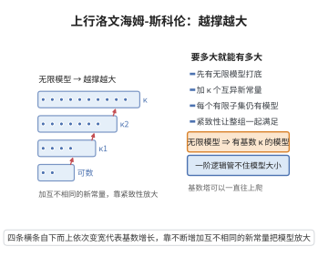

# 洛文海姆-斯科伦定理（上行）

> **一句话大白话**：只要一个一阶理论有无限模型，它就能"放大"成任意大基数的模型——想多大就能有多大，无限小的模型也能被撑到无穷大的"宇宙"。
>
> **小例子**：若 $\mathbb{Z}$ 上的加法理论有无限模型，选用任意大的基数 $\kappa$，就能构造一个元素个数为 $\kappa$ 的模型，让统一组公理继续在"超大型宇宙"里成立。

## 介绍

上行洛文海姆-斯科伦定理（Upward Löwenheim-Skolem Theorem）是下行洛文海姆-斯科伦定理的对偶版本，由塔斯基推广。该定理断言：如果一个一阶理论 $T$ 有无限模型，则对任意基数 $\kappa \geq \max(|T|, \aleph_0)$，$T$ 存在基数为 $\kappa$ 的模型。结合下行版本，这表明一阶逻辑无法控制无限模型的基数——只要一个理论有无限模型，它就有任意大基数的模型。

## 几何直观

图意在说明：只要理论有无限模型，就能借紧致性加上任意多的新常量，撑出任意大基数的模型。

## 分析

**前置依赖**：洛文海姆-斯科伦定理下行、紧致性定理、模型论基础。

**数学内涵**：
- 设 $T$ 是有无限模型的一阶理论。则对任意基数 $\kappa \geq \max(|L|, \aleph_0)$，$T$ 有基数为 $\kappa$ 的模型。
- 证明思路：添加 $\kappa$ 个新常量，构造理论要求它们两两不同，利用紧致性定理得到模型。
- 结合下行版本，一阶理论不能控制无限模型的基数。

**结构**：
1. 添加新常量 $\{c_i \mid i < \kappa\}$。
2. 构造理论 $T' = T \cup \{c_i \neq c_j \mid i \neq j\}$。
3. 证明 $T'$ 的每个有限子集有模型（由紧致性定理）。
4. 所得模型基数至少为 $\kappa$，再利用下行版本得到精确为 $\kappa$ 的模型。

## 思考过程

上行洛文海姆-斯科伦定理的证明巧妙地利用了紧致性定理。要得到一个基数为 $\kappa$ 的模型，我们添加 $\kappa$ 个不同的新常量，并添加公理要求它们两两不同。任意有限子集只涉及有限个新常量，因此可以在原无限模型中找到足够的元素来赋值，从而有模型。由紧致性定理，整个理论有模型，该模型至少包含 $\kappa$ 个不同的元素。

然后，如果需要精确的基数 $\kappa$，可以使用下行洛文海姆-斯科伦定理将模型"缩小"到基数为 $\kappa$ 的初等子模型。

## 证明过程

**定理**（上行洛文海姆-斯科伦定理）：设 $L$ 是可数一阶语言，$T$ 是 $L$ 中的理论。若 $T$ 有无限模型，则对任意基数 $\kappa \geq \aleph_0$，$T$ 有基数为 $\kappa$ 的模型。

**证明**：

### 1. 构造扩展理论

取一组新常量 $\{c_i \mid i < \kappa\}$，它们不在 $L$ 中。构造扩展语言 $L' = L \cup \{c_i \mid i < \kappa\}$。

定义 $T' = T \cup \{c_i \neq c_j \mid i < j < \kappa\}$。

### 2. 证明 $T'$ 有限可满足

设 $\Delta \subseteq T'$ 是有限子集。则 $\Delta$ 只涉及有限个新常量，不妨设为 $c_{i_1}, \ldots, c_{i_n}$。

由于 $T$ 有无限模型 $M$，$M$ 中有无限多个元素。在 $M$ 中选取 $n$ 个不同的元素 $a_1, \ldots, a_n$，将 $c_{i_k}$ 解释为 $a_k$（$k = 1, \ldots, n$），其余新常量任意赋值。则 $M$ 满足 $\Delta$。

因此 $T'$ 的每个有限子集都有模型。

### 3. 由紧致性定理

由紧致性定理，$T'$ 有模型 $N$。由于 $N \models c_i \neq c_j$（$i \neq j$），$N$ 中至少有 $\kappa$ 个不同的元素，故 $|N| \geq \kappa$。

### 4. 调整到精确基数

由下行洛文海姆-斯科伦定理，存在 $N$ 的初等子模型 $N'$ 使得 $|N'| = \kappa$（当 $\kappa \geq \aleph_0$ 时）。由于 $N' \preceq N$（初等子模型），$N' \models T$。

因此 $T$ 有基数为 $\kappa$ 的模型。$\square$

**推论**：一阶理论无法控制无限模型的基数。如果一个理论有无限模型，它对任意大基数都有模型。

**斯科伦悖论**：$\text{ZFC}$ 集合论断言存在不可数集，但由下行洛文海姆-斯科伦定理，$\text{ZFC}$ 如果有模型，则存在可数模型。在可数模型中，$\text{ZFC}$ 中的"不可数"概念被解释为模型内部的"不可数"，并不对应元理论中的不可数。这揭示了"相对性"的概念——基数概念依赖于模型。$\square$

## 课堂问答

**老师**：一阶理论有无限模型，能不能保证它也有"想要多大就多大"的模型？

**学生**：能。结论：设 $L$ 可数、$T$ 有无限模型，则对任意 $\kappa\geq\aleph_0$，$T$ 有基数为 $\kappa$ 的模型。构造是取 $\kappa$ 个新常量 $\{c_i:i<\kappa\}$，令 $T'=T\cup\{c_i\neq c_j:i<j<\kappa\}$。

**老师（追问）**：凭什么保证 $T'$ 一定有模型？

**学生**：靠紧致性定理。任意有限 $\Delta\subseteq T'$ 只涉及有限个新常量，在无限模型 $M$ 中挑足够多互异元素作解释即可满足，故 $T'$ 有限可满足；由紧致性定理 $T'$ 有模型 $N$，且 $\lvert N\rvert\geq\kappa$。若要精确为 $\kappa$，再用下行定理取初等子模型 $N'\preceq N$ 且 $\lvert N'\rvert=\kappa$。

**老师（拓展）**：和下行版本合起来说明了什么？

**学生**：一阶理论完全控制不了无限模型的基数——有无限模型就有任意大基数的模型。这也正是斯科伦悖论的来源：ZFC 断言有不可数集，却又（若一致）有可数模型。
