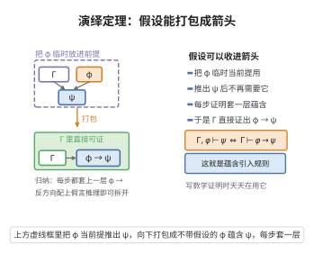

# 演绎定理

> **一句话大白话**：把"临时假设"当成前提去推结论，等价于把它"打包"成一个箭头放进原来就能证的语句里——从 $\psi$ 能推出 $\phi$，正好等价于能证出 $\psi\to\phi$。
>
> **小例子**：在假设 $P_1,P_2$ 下能推出 $\phi$，那么不用这些假设也能直接证明 $(P_1\wedge P_2)\to\phi$；反之亦然，推理过程中可以随时"拆开"这个蕴含。

## 介绍

演绎定理（Deduction Theorem）是数理逻辑中的基本定理，它建立了逻辑蕴含与条件语句之间的桥梁。在希尔伯特风格的形式系统中，演绎定理断言：如果 $\Gamma \cup \{\varphi\} \vdash \psi$，则 $\Gamma \vdash \varphi \to \psi$。这一结果使得条件语句的证明可以通过假设前提来简化，是数学证明实践中"若 $P$ 则 $Q$"类型的证明形式化的理论基础。

## 几何直观

图意在说明：在假设 φ 下能推出 ψ，等价于不加假设就能证出 φ 蕴含 ψ，两者可以自由转换。

## 分析

**前置依赖**：命题逻辑或一阶逻辑的希尔伯特公理化系统、证明概念。

**数学内涵**：
- 若 $\Gamma \cup \{\varphi\} \vdash \psi$，则 $\Gamma \vdash \varphi \to \psi$。
- 逆命题（假言推理，Modus Ponens）是公理系统的组成部分。
- 演绎定理在自然演绎系统中是内建的（$\to$-引入规则）。
- 在希尔伯特系统中，演绎定理需要证明，其证明通过归纳证明的长度来实现。

**结构**：
1. 对 $\Gamma \cup \{\varphi\} \vdash \psi$ 的证明长度进行归纳。
2. 将证明中的每一步转化为 $\Gamma \vdash \varphi \to \psi$ 的证明。

## 思考过程

演绎定理的证明通过对 $\psi$ 的证明序列进行归纳。假设 $\psi_1, \psi_2, \ldots, \psi_n = \psi$ 是从 $\Gamma \cup \{\varphi\}$ 到 $\psi$ 的证明。对每个 $\psi_i$，我们证明 $\Gamma \vdash \varphi \to \psi_i$。

有三种情况需要考虑：
1. $\psi_i$ 是公理或 $\Gamma$ 中的公式：则 $\varphi \to \psi_i$ 可从公理和 $\psi_i$ 推出。
2. $\psi_i = \varphi$：则 $\varphi \to \varphi$ 是公理。
3. $\psi_i$ 由 $\psi_j$ 和 $\psi_k = \psi_j \to \psi_i$ 通过假言推理得到：利用归纳假设和公理模式。

## 证明过程

**定理**（演绎定理）：设 $\Gamma$ 是公式集，$\varphi, \psi$ 是公式。若 $\Gamma \cup \{\varphi\} \vdash \psi$，则 $\Gamma \vdash \varphi \to \psi$。

**证明**：

设 $\psi_1, \psi_2, \ldots, \psi_n = \psi$ 是从 $\Gamma \cup \{\varphi\}$ 到 $\psi$ 的一个证明。对每个 $i = 1, 2, \ldots, n$，我们证明 $\Gamma \vdash \varphi \to \psi_i$。

对 $i$ 进行归纳。

**基础** $i = 1$：$\psi_1$ 要么是公理，要么是 $\Gamma \cup \{\varphi\}$ 中的公式。

- 若 $\psi_1$ 是公理或 $\psi_1 \in \Gamma$，则 $\Gamma \vdash \psi_1$。由公理 $\psi_1 \to (\varphi \to \psi_1)$ 和假言推理，得 $\Gamma \vdash \varphi \to \psi_1$。
- 若 $\psi_1 = \varphi$，则 $\Gamma \vdash \varphi \to \varphi$（由公理 $\varphi \to (\varphi \to \varphi)$ 和 $\varphi \to ((\varphi \to \varphi) \to \varphi)$ 等可证，或直接由公理 $\varphi \to \varphi$ 的证明）。

**归纳步骤**：假设对 $j < i$ 结论成立，考虑 $\psi_i$。

**情况 1**：$\psi_i$ 是公理或 $\Gamma \cup \{\varphi\}$ 中的公式。同基础情形。

**情况 2**：$\psi_i = \varphi$。同基础情形。

**情况 3**：$\psi_i$ 由 $\psi_j$ 和 $\psi_k = \psi_j \to \psi_i$（$j, k < i$）通过假言推理得到。

由归纳假设，$\Gamma \vdash \varphi \to \psi_j$ 且 $\Gamma \vdash \varphi \to (\psi_j \to \psi_i)$。

由公理 $(\varphi \to (\psi_j \to \psi_i)) \to ((\varphi \to \psi_j) \to (\varphi \to \psi_i))$ 和两次假言推理，得 $\Gamma \vdash \varphi \to \psi_i$。

由归纳法，$\Gamma \vdash \varphi \to \psi_n = \varphi \to \psi$。$\square$

**推论**：在命题逻辑中，$\vdash \varphi \to \psi$ 当且仅当 $\varphi \vdash \psi$。

**在一阶逻辑中的推广**：演绎定理在一阶逻辑中也成立，但需要处理量词。当 $\varphi$ 是封闭公式时，定理直接成立。当 $\varphi$ 含有自由变量时，需要对泛化规则的处理稍作调整。$\square$

## 课堂问答

**老师**：把假设 $\varphi$ 当条件直接推结论，与证明 $\varphi\to\psi$ 是一回事吗？

**学生**：是。结论：$\Gamma\cup\{\varphi\}\vdash\psi\iff\Gamma\vdash\varphi\to\psi$。证明是对证明序列 $\psi_1,\dots,\psi_n=\psi$ 归纳，把每个 $\psi_i$ 转成 $\Gamma\vdash\varphi\to\psi_i$。在自然演绎里这就是 $\to$-引入规则。

**老师（追问）**：归纳步骤里，假言推理那一步怎么把箭头"打包"进来？

**学生**：若 $\psi_i$ 由 $\psi_j$ 与 $\psi_k=\psi_j\to\psi_i$ 经 MP 得到，则由归纳假设已有 $\Gamma\vdash\varphi\to\psi_j$ 与 $\Gamma\vdash\varphi\to(\psi_j\to\psi_i)$，再用公理模式 $(\varphi\to(\psi_j\to\psi_i))\to((\varphi\to\psi_j)\to(\varphi\to\psi_i))$ 加两次 MP 得 $\Gamma\vdash\varphi\to\psi_i$。

**老师（拓展）**：推广到一阶逻辑要注意什么？

**学生**：量词。$\varphi$ 是封闭公式时定理直接成立；$\varphi$ 含自由变量时，泛化规则要受"$x$ 不在 $\varphi$ 中自由出现"之类的限制，否则打包箭头会与量词相冲突。
