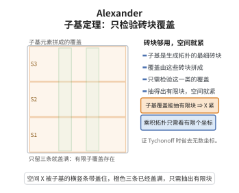

# Alexander 子基定理

> **一句话大白话**：要检查一个空间紧不紧，不必逐一验证所有开覆盖，只要验证那些由"子基"（生成拓扑的最小砖块）拼成的开覆盖就够了——这些都能抽出有限覆盖，那么一切开覆盖都能。

> **小例子**：用它证明 Tychonoff（吉洪诺夫）定理时，乘积拓扑正是由各投影的原像构成的子基生成的，于是只需处理"由有限多个坐标上的开集拉回"组成的覆盖，就能把任意多个紧空间的乘积问题化归为处理有限多个坐标。

## 介绍

Alexander 子基定理（Alexander Subbase Theorem）由美国数学家 James Waddell Alexander II 于 1939 年提出，是点集拓扑学中关于紧性的一个极其实用的判定准则。紧性的定义为"每个开覆盖都有有限子覆盖"，但一般拓扑空间的开集数量巨大，直接验证不可行；子基定理说明：只要对一类特别"小"的覆盖（由子基元素组成者）验证该性质，就能推出全部。

定理的价值主要体现在两点。其一，它给出紧性的一个等价刻画（必要性显然，充分性是实质内容），便于从"更粗"的覆盖族出发作证明。其二，它把证明 Tychonoff 定理（任意多个紧空间的乘积紧）变得非常简洁：乘积拓扑的子基就是各坐标投影的原像，验证子基覆盖时有有限的坐标信息可供操作，这正是 Tychonoff 定理通常的最短证明路线。

从证明技术上看，这条定理是"极大对象 + 局部可检验条件"这一模式（类似超滤子、极大理想方法）的典范：先用 Zorn 引理把反例放大成极大开覆盖，再证明这个极大覆盖必须由子基元素组成，从而与假设冲突。它也是 Banach–Alaoglu 定理、Krein–Milman 定理一类紧性论证常用的幕后工具。

## 几何直观

图意在说明：把开覆盖限制到子基元素上检验，有限子覆盖就能保证整个空间紧。

## 分析

**前置依赖**：拓扑空间、基与子基、开覆盖与有限子覆盖、紧性、Zorn 引理、极大开覆盖方法。

**定理内容**：设 $X$ 是拓扑空间，$\mathcal{S}$ 是 $X$ 上拓扑的一个子基（即 $\mathcal{S}$ 中元素的有限交构成拓扑的一个基）。若 $X$ 的每个由 $\mathcal{S}$ 中元素组成的开覆盖都存在有限子覆盖，则 $X$ 是紧空间。

**说明**：反向蕴含由紧性定义直接给出；因此该条件与紧性等价，可作为紧性的判别法。

**依赖的概念**：子基、有限交、开覆盖、Zorn 引理、极大元。

## 思考过程

直接证明"任意开覆盖有有限子覆盖"很困难，所以采用反证：假设 $X$ 不紧，则至少存在一个没有有限子覆盖的开覆盖。为把信息榨取干净，我们沿包含关系把它"撑大"成极大的这种覆盖 $\mathcal{O}$——Zorn 引理保证存在（覆盖链的并仍是开覆盖，且若并有了有限子覆盖，链上某个成员就早有了，矛盾）。

极大性带来两条极好用的性质。其一，若 $A,B$ 是开集且 $A\cap B\in\mathcal{O}$，则 $A$、$B$ 中至少一个属于 $\mathcal{O}$：否则用它们各自补齐成两个有限覆盖，取交即可把 $A\cap B$ 与 $\mathcal{O}$ 中有限多个成员拼成 $\mathcal{O}$ 的有限覆盖，与 $\mathcal{O}$ 无有限子覆盖矛盾。其二，$\mathcal{O}$ 关于"取更小的开子集"封闭：若 $A\subseteq B\in\mathcal{O}$ 而 $A\notin\mathcal{O}$，则用 $A$ 拼出的有限覆盖立刻给出 $\mathcal{O}$ 的有限覆盖。

有了这两条，就能证明每个点 $x$ 都被某个属于 $\mathcal{O}$ 的子基元素覆盖：取 $O\in\mathcal{O}$ 含 $x$，再用子基把 $x$ 装入一个"落在 $O$ 内的有限交" $S_1\cap\cdots\cap S_n$；由封闭性该交属于 $\mathcal{O}$，再由交的判据知某个 $S_i$ 属于 $\mathcal{O}$。于是这些子基元素组成 $X$ 的覆盖，按假设可抽有限覆盖，即得 $\mathcal{O}$ 的有限子覆盖，矛盾。

## 证明过程

**步骤 1：反设并取极大覆盖。** 设 $X$ 不紧。则在"由开集组成、且没有有限子覆盖"的覆盖族中按包含关系用 Zorn 引理取一个极大元 $\mathcal{O}$。若链 $\{\mathcal{O}_\alpha\}$ 递增且每个都无有限子覆盖，其并 $\bigcup_\alpha\mathcal{O}_\alpha$ 仍是开覆盖；且若它有有限子覆盖 $\{O_1,\dots,O_k\}$，每个 $O_i$ 落在某个 $\mathcal{O}_{\alpha_i}$ 中，取最大的 $\mathcal{O}_{\alpha}$ 即得 $\mathcal{O}_\alpha$ 的有限子覆盖，矛盾。故并仍是链的上界，$\mathcal{O}$ 存在，并且

$$X=\bigcup_{O\in\mathcal{O}}O,\qquad \mathcal{O}\ \text{没有有限子覆盖}.$$

**步骤 2：$\mathcal{O}$ 关于更小开集封闭。** 设 $A\subseteq B$ 为开集且 $B\in\mathcal{O}$。若 $A\notin\mathcal{O}$，则由 $\mathcal{O}$ 的极大性，$\mathcal{O}\cup\{A\}$ 有有限子覆盖，且必用到 $A$，即

$$X=A\cup O_1\cup\cdots\cup O_k,\qquad O_i\in\mathcal{O}.$$

因 $A\subseteq B$，有 $X=A\cup O_1\cup\cdots\cup O_k\subseteq B\cup O_1\cup\cdots\cup O_k\subseteq X$，故 $X=B\cup O_1\cup\cdots\cup O_k$ 是 $\mathcal{O}$ 的有限子覆盖，矛盾。所以 $A\in\mathcal{O}$。

**步骤 3：交的极大性判据。** 设 $A,B$ 为开集，若 $A\cap B\in\mathcal{O}$，则 $A\in\mathcal{O}$ 或 $B\in\mathcal{O}$。反设 $A,B\notin\mathcal{O}$。由极大性，$\mathcal{O}\cup\{A\}$ 与 $\mathcal{O}\cup\{B\}$ 都有用到新元的有限子覆盖：

$$X=A\cup O_1\cup\cdots\cup O_k,\qquad X=B\cup O'_1\cup\cdots\cup O'_m,\qquad O_i,O'_j\in\mathcal{O}.$$

考虑有限族 $\mathcal{F}=\{A\cap B\}\cup\{O_i\}\cup\{O'_j\}\subseteq\mathcal{O}$。对任意 $x\in X$：若 $x\notin\bigcup_iO_i$，则 $x\in A$；若 $x\notin\bigcup_jO'_j$，则 $x\in B$；于是当 $x\notin\bigcup_iO_i\cup\bigcup_jO'_j$ 时 $x\in A\cap B$。故 $\mathcal{F}$ 覆盖 $X$，是 $\mathcal{O}$ 的有限子覆盖，矛盾。由归纳，对任意有限个开集 $A_1,\dots,A_n$，若 $A_1\cap\cdots\cap A_n\in\mathcal{O}$，则某个 $A_i\in\mathcal{O}$。

**步骤 4：构造子基覆盖。** 断言族 $\{S\in\mathcal{S}:S\in\mathcal{O}\}$ 覆盖 $X$。取任意 $x\in X$，因 $\mathcal{O}$ 覆盖 $X$，存在 $O\in\mathcal{O}$ 使 $x\in O$。由于 $\mathcal{S}$ 是子基，存在 $S_1,\dots,S_n\in\mathcal{S}$ 使

$$x\in S_1\cap\cdots\cap S_n\subseteq O.$$

由步骤 2（$S_1\cap\cdots\cap S_n\subseteq O\in\mathcal{O}$）得 $S_1\cap\cdots\cap S_n\in\mathcal{O}$；再由步骤 3，某个 $S_i\in\mathcal{O}$，且 $x\in S_i$。故 $\{S\in\mathcal{S}:S\in\mathcal{O}\}$ 是 $X$ 的子基覆盖。

**步骤 5：导出有限子覆盖。** 按定理假设，该子基覆盖有有限子覆盖 $S_1,\dots,S_m$，而 $S_1,\dots,S_m\in\mathcal{O}$，故 $\mathcal{O}$ 有有限子覆盖，与步骤 1 矛盾。因此 $X$ 必为紧空间。证毕。

## 课堂问答

**老师**：紧性的定义要验证所有开覆盖，为什么 Alexander 子基定理说只要验证"由子基拼成的覆盖"就够了？

**学生**：结论先行——若 $\mathcal{S}$ 是拓扑的一个子基，且每个由 $\mathcal{S}$ 中元素组成的开覆盖都有有限子覆盖，则 $X$ 紧。理由是把反例放大成极大开覆盖 $\mathcal{O}$：Zorn 引理保证它在"无有限子覆盖"的覆盖族中存在，极大性推出若 $A\cap B\in\mathcal{O}$ 则 $A$ 或 $B$ 在 $\mathcal{O}$ 中，再对每个点用子基把 $x$ 装进落在某个 $O\in\mathcal{O}$ 内的有限交，就得到子基元素也覆盖 $X$，与假设矛盾。

**老师（追问）**：为什么极大性给出的是"$A\cap B\in\mathcal{O}$ 蕴含其一"，而不是别的性质？

**学生**：因为 $\mathcal{O}$ 无有限子覆盖。若 $A,B\notin\mathcal{O}$，由极大性 $\mathcal{O}\cup\{A\}$ 与 $\mathcal{O}\cup\{B\}$ 各有用到新元的有限覆盖，用 $A\cap B$ 替换 $A$、$B$ 即可拼出 $\mathcal{O}$ 自身的有限覆盖，矛盾。这一步是全程的技术核心，属于对更小开集封闭与交判据两种性质的配合。

**老师（拓展）**：这个"极大对象 + 局部可检验"的套路还能用在哪？

**学生**：它正是 Tychonoff 定理最短证明的引擎——乘积拓扑的子基是各投影原像，于是只需处理有限多个坐标的信息。一个常见误区：极大元必须取在"无有限子覆盖"这一性质上，若在任意开覆盖族上取极大，上界论证会失效。

## 相关条目

- [Tychonoff定理](./Tychonoff定理.md)：任意紧空间乘积的紧性，其标准证明正是对本定理的直接应用。
- [Banach-Alaoglu定理](./Banach-Alaoglu定理.md)：借助乘积拓扑的紧性与本定理得到对偶空间闭单位球的弱星紧性。
- [Krein-Milman定理](./Krein-Milman定理.md)：其证明依赖弱星紧性，可追溯到子基定理。
- [一致有界性原理](./一致有界性原理.md)：与紧性论证同属泛函分析中"局部化"技巧的典型。
