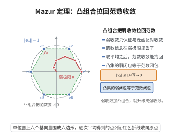

# Mazur 定理

> **一句话大白话**：一列点弱收敛到 $x$，虽然它们本身可能在范数下"跑偏"，但总能从它们中挑出凸组合，用范数干净利落地收敛到 $x$；等价地说，凸集在弱拓扑下的闭包就等于它在范数下的闭包。

> **小例子**：在 $\ell^2$ 中取标准正交基列 $\{e_n\}$，它弱收敛到 $0$ 却不范数收敛；但取凸组合 $y_n=\frac1n(e_1+\cdots+e_n)$，则 $\|y_n\|=n^{-1/2}\to0$，正是 Mazur 定理所保证的。

## 介绍

Mazur 定理（Mazur's theorem，其中关于凸组合的部分通常称 Mazur 引理）由波兰数学家 Stanisław Mazur 在 1932-1933 年间证明。它断言：赋范空间中弱收敛序列的适当凸组合序列在范数下收敛到同一极限；等价的集合形式是——凸集的范数闭包与弱闭包相同。它解决的问题是：弱拓扑比范数拓扑粗得多，弱极限丢失了大量范数信息，那么在什么意义下弱收敛还能"回升"为范数收敛？答案是取凸组合。其意义在于：它把 Hahn-Banach 分离定理的几何内容翻译成了可计算的收敛陈述，是证明"凸泛函的弱下半连续性"、变分法下界估计、Banach-Alaoglu 定理的应用（例如把弱-* 收敛列化为范数收敛的凸组合）以及遍历理论中收敛性结果的标准工具。

## 几何直观

图意在说明：弱收敛本身丢了范数信息，取凸组合后范数又能重新收敛到同一个弱极限。

## 分析

**前置依赖**：Hahn-Banach 延拓定理、Hahn-Banach 几何形式（凸集分离定理）、弱拓扑与弱收敛的定义、凸集与凸包、范数的连续性。

**定理内容**：设 $X$ 是赋范空间，$\{x_n\}\subseteq X$ 弱收敛到 $x\in X$。则存在 $\{x_n\}$ 的凸组合序列 $\{y_n\}$，即

$$y_n=\sum_{i=1}^{k_n}\lambda_i^{(n)}x_i,\qquad \lambda_i^{(n)}\ge0,\qquad \sum_{i=1}^{k_n}\lambda_i^{(n)}=1,$$

使得 $\|y_n-x\|\to0$。等价的集合形式为：若 $C\subseteq X$ 是非空凸集，则

$$\overline{C}^{\,\text{弱}}=\overline{C}^{\,\|\cdot\|},$$

即 $C$ 的弱闭包等于其范数闭包；特别地，范数闭凸集必是弱闭集。

**推论**：$(1)$ 若 $C$ 凸，则 $x$ 是 $\{x_n\}$ 的弱极限当且仅当 $x\in\bigcap_m\overline{\mathrm{conv}}\{x_n:n\ge m\}$，即弱极限必落在尾段凸包的范数闭包中。$(2)$ 凸且范数下半连续的泛函必弱下半连续。

## 思考过程

证明的枢纽是一句几何陈述：凸集在范数拓扑下闭，就在弱拓扑下闭。这一点正是 Hahn-Banach 几何形式（凸集分离定理）的直接翻译：对闭凸集 $C$ 与 $x_0\notin C$，存在 $f\in X^*$ 使 $f$ 在 $C$ 上有严格小于 $f(x_0)$ 的上界，于是 $\{f>\alpha\}$ 是 $x_0$ 的一个弱邻域且与 $C$ 不交，说明补集弱开。

有了它，Mazur 引理几乎是一行的事：令 $C$ 为 $\{x_n\}$ 的凸包的范数闭包。$C$ 闭凸，故弱闭；而弱收敛保证 $x$ 落在 $\{x_n\}$ 的弱闭包中，凸包的弱闭包又不比原集大多少，于是 $x\in C$。最后只剩一句要把"属于闭包"翻译成"存在凸组合逼近"，这由凸包的定义直接给出：$C$ 中每个点都是有限凸组合的范数极限。之所以不能直接说 $\|x_n-x\|\to0$，是因为弱收敛只控制 $f(x_n)$ 的极限，而要控制范数必须换用分离定理提供的泛函族——这正是凸组合必须出现的原因：单个 $x_n$ 可能永远留在"劣集"里，凸平均却能把各方向上的抵消变成范数的下降。

## 证明过程

**步骤 1：闭凸集是弱闭集。** 设 $C\subseteq X$ 非空凸且范数闭，$x_0\notin C$。由 Hahn-Banach 几何形式（单点集 $\{x_0\}$ 紧、$C$ 闭凸，二者可分离），存在 $f\in X^*$ 与实数 $\alpha$ 使得

$$\mathrm{Re}\,f(c)\le\alpha<\mathrm{Re}\,f(x_0)\qquad(\forall c\in C).$$

于是 $U=\{x\in X:\mathrm{Re}\,f(x)>\alpha\}$ 是 $x_0$ 的弱邻域，且 $U\cap C=\varnothing$。故 $X\setminus C$ 弱开，$C$ 弱闭。

**步骤 2：弱极限落在凸包的范数闭包里。** 设 $x_n\rightharpoonup x$，即对一切 $f\in X^*$ 有 $f(x_n)\to f(x)$。令

$$C=\overline{\mathrm{conv}}\{x_n:n\ge1\}^{\,\|\cdot\|}.$$

由步骤 1，$C$ 弱闭。又对每个 $n$ 有 $x_n\in\mathrm{conv}\{x_n\}\subseteq C$，故 $\{x_n\}$ 的弱闭包也被弱闭集 $C$ 包含。而由弱收敛的定义，$x$ 属于 $\{x_n\}$ 的弱闭包（$x$ 的每个弱邻域都含几乎所有的 $x_n$）。因此 $x\in C$。

**步骤 3：由闭包性质取出凸组合序列。** 由 $C$ 的定义，$x\in C$ 当且仅当存在 $y_n\in\mathrm{conv}\{x_n:n\ge1\}$ 使 $\|y_n-x\|\to0$（凸包的闭包中每点都是凸包中点列的极限）。而 $\mathrm{conv}\{x_n\}$ 中的元素恰是有限凸组合，故存在整数 $k_n$ 与 $\lambda_i^{(n)}\ge0$、$\sum_i\lambda_i^{(n)}=1$ 使

$$y_n=\sum_{i=1}^{k_n}\lambda_i^{(n)}x_i .$$

这就是所求的凸组合序列，且 $\|y_n-x\|\to0$。

**步骤 4：凸集的弱闭包等于范数闭包。** 设 $C$ 凸。取 $x$ 属于 $C$ 的弱闭包，则存在网 $\{c_\alpha\}\subseteq C$ 弱收敛到 $x$。由步骤 1，$\overline{C}^{\,\|\cdot\|}$ 是弱闭集，而 $C\subseteq\overline{C}^{\,\|\cdot\|}$，故 $\overline{C}^{\,\text{弱}}\subseteq\overline{C}^{\,\|\cdot\|}$。反向包含显然（弱拓扑比范数拓扑粗）。故两个闭包相等。

**步骤 5：推论 (1) 与 (2)。** 对 (1)：若 $x_n\rightharpoonup x$，则在步骤 2 中把序列从第 $m$ 项起重新编号，得到 $x\in\overline{\mathrm{conv}}\{x_n:n\ge m\}$ 对一切 $m$ 成立；反之若 $x$ 属于每个尾段凸包的范数闭包，则 $x$ 属于凸包的弱闭包，而弱收敛序列的弱极限唯一，故 $x$ 即弱极限。

对 (2)：设 $\varphi$ 凸且范数下半连续。对每个实数 $t$，水平集 $C_t=\{x:\varphi(x)\le t\}$ 是范数闭凸集，故由步骤 1 弱闭。于是 $\{\varphi>t\}=X\setminus C_t$ 弱开，对一切 $t$ 成立，故 $\varphi$ 弱下半连续。

证毕。

## 课堂问答

**老师**：Mazur 定理如何把弱收敛"救回"范数收敛？

**学生**：若 $x_n\rightharpoonup x$，则存在 $\{x_n\}$ 的凸组合 $y_n=\sum_i\lambda_i^{(n)}x_i$ 使 $\|y_n-x\|\to0$；集合形式是凸集 $C$ 的弱闭包等于范数闭包。理由是闭凸集在弱拓扑下闭，故 $x$ 落在 $\overline{\operatorname{conv}}\{x_n:n\ge1\}$ 中。

**老师（追问）**：为什么单个 $x_n$ 不能范数收敛？

**学生**：弱收敛只控制 $f(x_n)\to f(x)$ 而不控制范数。典型例子：$\ell^2$ 的标准正交基 $\{e_n\}$ 弱收敛到 $0$，却 $\|e_n\|=1$；而凸组合 $\frac1n(e_1+\cdots+e_n)$ 的范数为 $n^{-1/2}\to0$，凸平均把各方向的抵消变成了范数下降。

**老师（拓展）**：有一个常用推论吗？

**学生**：凸且范数下半连续的泛函必弱下半连续。证明：水平集 $\{\varphi\le t\}$ 是范数闭凸集，故弱闭，其补弱开。注意必须要求凸性——非凸的范数连续泛函未必弱下半连续。

## 相关条目

- [Hahn-Banach几何形式](./Hahn-Banach几何形式.md)：凸集分离定理是步骤 1 的全部依据，Mazur 定理本质上是它的收敛性表述。
- [Hahn-Banach延拓定理](./Hahn-Banach延拓定理.md)：分离定理由延拓定理推出，因此 Mazur 定理也间接依赖它。
- [Krein-Milman定理](./Krein-Milman定理.md)：端点表示与弱闭凸集的讨论都以"凸集弱闭包等于范数闭包"为前提。
- [Baire纲定理](./Baire纲定理.md)：弱拓扑下的连续性论证常与 Baire 纲论证配合使用，用于一致有界性原理等结论。
