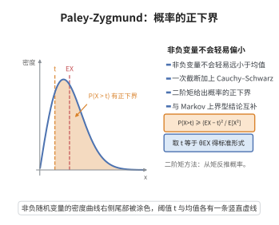

# Paley-Zygmund 不等式

> **一句话大白话**：一个非负随机变量不会"轻易地"远小于自己的平均值——它以可观的概率不小于平均值的一个给定份额，而这条下界的强弱由二阶矩控制。

> **小例子**：取常数随机变量 $X\equiv c$（$c>0$），则 $E[X]=c$、$E[X^2]=c^2$。取 $\theta=\frac12$，不等式给出 $P(X>\frac12EX)\ge\frac14$；左边实际等于 $1$，确实成立。

## 介绍

Paley–Zygmund 不等式由 Raymond Paley 与 Antoni Zygmund 在 1932 年研究 Fourier 级数与随机三角级数时提出。它是"二阶矩方法"的典型下界型结果，与 Markov 不等式、Chebyshev 不等式这类上界型工具正好互补：后两者回答"变量大于某个值的概率有多小"，而 Paley–Zygmund 回答"变量大于平均值某个份额的概率有多大"。

它的证明只用到一次截断（把随机变量按是否超过阈值劈成两半）与一次 Cauchy–Schwarz 不等式，形式简单，却用途极广。在分析中，它是证明 Khintchine 不等式（Rademacher 和的 $L^p$ 等价性）的关键一步；在概率论里用于说明随机级数为何几乎必然发散；在加性组合学中，它与"二阶矩法"一起给出集合和集大小的下界估计。

从方法论上看，该不等式示范了一个通用套路：先承认坏事件（变量偏小）发生的概率为某个待定值，再把一阶矩拆成"好事件上的贡献 + 坏事件上的贡献"用阈值夹住，最后用二阶矩与概率的关系把矩的信息翻译成概率的下界。凡是需要"从矩估计反推概率正下界"的场合，都会见到它的身影。

## 几何直观

图意在说明：二阶矩有限时，非负变量超过均值某个份额的概率有一个只依赖矩的正下界。

## 分析

**前置依赖**：随机变量与期望、二阶矩、Cauchy–Schwarz 不等式（或 Hölder 不等式）、Markov 不等式、切比雪夫不等式。

**定理内容**：设 $X$ 是非负随机变量，$E[X]>0$ 且 $E[X^2]<\infty$。则对任意 $0\le t<E[X]$ 有

$$P(X>t)\ \ge\ \frac{\bigl(E[X]-t\bigr)^2}{E[X^2]}.$$

特别地，取 $t=\theta E[X]$（$0\le\theta\le1$）得到标准形式

$$P\bigl(X>\theta E[X]\bigr)\ \ge\ (1-\theta)^2\,\frac{\bigl(E[X]\bigr)^2}{E[X^2]}.$$

**推论（与 Chebyshev 对偶）**：当二阶矩与一阶矩同阶，即 $E[X^2]\le C(E[X])^2$ 时，$X$ 以至少 $(1-\theta)^2/C$ 的概率超过 $\theta E[X]$；这是一条仅依赖前两阶矩的概率下界。

**依赖的概念**：期望、二阶矩、指示函数、Cauchy–Schwarz 不等式。

## 思考过程

证明的全部内容是"截断 + Cauchy–Schwarz"。把 $X$ 按阈值 $t$ 分成两部分：一部分在事件 $\{X>t\}$ 上，另一部分在 $\{X\le t\}$ 上。在坏事件上 $X\le t$，所以这部分对期望的贡献至多 $t\,P(X\le t)\le t$；这就迫使好事件上的贡献 $E[X\mathbf{1}_{\{X>t\}}]$ 至少是 $E[X]-t$，得到期望意义下"好部分不能太小"。

下一步要把这个关于积分的下界转成"事件概率"的下界。好事件的贡献写成 $X\cdot\mathbf{1}_{\{X>t\}}$ 的期望，用 Cauchy–Schwarz 把它拆成 $\|X\|_2$ 与指示函数的 $L^2$ 范数之积，后者恰是 $\sqrt{P(X>t)}$。把不等式两边平方整理即得结论。整个思路就是"矩的下界 → $L^2$ 估计 → 概率下界"。

## 证明过程

**步骤 1：截断并夹住期望。** 把 $X$ 按阈值 $t$ 分解：

$$X=X\,\mathbf{1}_{\{X>t\}}+X\,\mathbf{1}_{\{X\le t\}}.$$

取期望，并在坏事件 $\{X\le t\}$ 上用 $X\le t$ 逐点估计：

$$E[X]=E\bigl[X\mathbf{1}_{\{X>t\}}\bigr]+E\bigl[X\mathbf{1}_{\{X\le t\}}\bigr]\ \le\ E\bigl[X\mathbf{1}_{\{X>t\}}\bigr]+t\,P(X\le t)\ \le\ E\bigl[X\mathbf{1}_{\{X>t\}}\bigr]+t.$$

移项得

$$E\bigl[X\mathbf{1}_{\{X>t\}}\bigr]\ \ge\ E[X]-t\ >\ 0.$$

**步骤 2：用 Cauchy–Schwarz 估计好事件上的贡献。** 把 $X\mathbf{1}_{\{X>t\}}$ 视为 $X$ 与 $\mathbf{1}_{\{X>t\}}$ 的乘积，应用 Cauchy–Schwarz：

$$E\bigl[X\mathbf{1}_{\{X>t\}}\bigr]\ \le\ \bigl(E[X^2]\bigr)^{1/2}\bigl(E[\mathbf{1}_{\{X>t\}}]\bigr)^{1/2}=\bigl(E[X^2]\bigr)^{1/2}\,\sqrt{P(X>t)}.$$

**步骤 3：合并并平方。** 结合步骤 1 与步骤 2：

$$\bigl(E[X^2]\bigr)^{1/2}\sqrt{P(X>t)}\ \ge\ E\bigl[X\mathbf{1}_{\{X>t\}}\bigr]\ \ge\ E[X]-t.$$

右端为正，两边平方并除以 $E[X^2]$ 得

$$P(X>t)\ \ge\ \frac{\bigl(E[X]-t\bigr)^2}{E[X^2]}.$$

取 $t=\theta E[X]$，则 $E[X]-t=(1-\theta)E[X]$，代入即得

$$P\bigl(X>\theta E[X]\bigr)\ \ge\ (1-\theta)^2\,\frac{\bigl(E[X]\bigr)^2}{E[X^2]}.$$

证毕。

## 课堂问答

**老师**：Paley-Zygmund 给的是尾概率的上界还是下界？

**学生**：是下界：对非负随机变量 $X$，$\mathbb{P}(X>t)\ge(\mathbb{E}X-t)^2/\mathbb{E}X^2$；取 $t=\theta\mathbb{E}X$ 得 $\mathbb{P}(X>\theta\mathbb{E}X)\ge(1-\theta)^2(\mathbb{E}X)^2/\mathbb{E}X^2$。方向与 Markov、Chebyshev 的尾上界正好互补。

**老师（追问）**：证明的骨架是什么？

**学生**：截断加 Cauchy-Schwarz。把 $\mathbb{E}X=\mathbb{E}[X\mathbf{1}_{\{X>t\}}]+\mathbb{E}[X\mathbf{1}_{\{X\le t\}}]\le\mathbb{E}[X\mathbf{1}_{\{X>t\}}]+t$ 移项得 $\mathbb{E}[X\mathbf{1}_{\{X>t\}}]\ge\mathbb{E}X-t$；再由 $\mathbb{E}[X\mathbf{1}_{\{X>t\}}]\le\sqrt{\mathbb{E}X^2}\sqrt{\mathbb{P}(X>t)}$ 平方即得。

**老师（拓展）**：它在哪里被用到？

**学生**：它是 Khintchine 不等式在 $0<p<2$ 时下界的标准步骤，也用于证明随机级数几乎必然发散以及加性组合中集合和集的下界。常见误区：必须 $t<\mathbb{E}X$（否则右端非正，结论平凡）。

## 相关条目

- [Khintchine不等式](./Khintchine不等式.md)：Paley–Zygmund 不等式是其标准证明中的关键步骤，用于从二阶矩控制随机三角级数的大偏差概率。
- [切比雪夫不等式](../第24级-概率论基础/切比雪夫不等式.md)：由二阶矩给出尾概率的上界，与本不等式的下界方向互补。
- [马尔可夫不等式](../第24级-概率论基础/马尔可夫不等式.md)：仅用一阶矩给出尾概率上界，是同类矩方法的起点。
- [Cauchy-Schwarz不等式](../第14级-线性代数/Cauchy-Schwarz不等式.md)：本定理证明的核心工具（$L^2$ 形式的 Cauchy–Schwarz）。
- [Banach空间型与余型](./Banach空间型与余型.md)：Khintchine 不等式在 Banach 空间中的推广，与本不等式同源。
