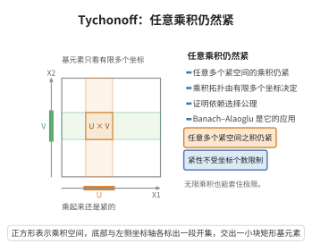

# Tychonoff 定理

> **一句话大白话**：任意多个紧空间的乘积，在乘积拓扑下仍然紧——紧性可以被"无限制地打包"到任意大小的坐标积里。
>
> **小例子**：$[0,1]^{\mathbb R}$ 在乘积拓扑下是紧的：即使有不可数多个坐标，其乘积空间的紧性依然成立。

## 介绍

Tychonoff 定理由苏联数学家 Andrey Tychonoff 于 1930 年证明，是点集拓扑中最重要、也最富应用价值的定理之一。它断言：任意一族（可以是不可数多的）紧拓扑空间的乘积空间，赋予乘积拓扑后仍然紧。

Tychonoff 定理深刻之处在于它依赖于选择公理（等价形式，如 Zorn 引理或超滤子引理），并且是"紧性不依赖于可数性"这一事实的集中体现。它在泛函分析中用于 Banach–Alaoglu 定理的证明：在弱*拓扑下，对偶空间的闭单位球是乘积空间 $\prod_x D_x$ 的闭子集，由 Tychonoff 定理紧。

在拓扑代数、数理逻辑（紧致性定理的拓扑证明）、测度论（紧测度、Prokhorov 定理）与随机过程（Kolmogorov 扩张定理）中，Tychonoff 定理都是构造紧性与极限的基石。

## 几何直观

图意在说明：乘积拓扑的基元素只由有限多个坐标决定，紧性因此能一路搬到任意大的乘积上。

## 分析

**前置依赖**：紧致性与有限交性质（FIP）、乘积拓扑与子基、Alexander 子基定理、Zorn 引理、闭集族的有限交性质

**定理内容**：设 $\{X_i\}_{i\in I}$ 是一族非空紧拓扑空间。则乘积空间

$$X=\prod_{i\in I}X_i$$

在乘积拓扑下是紧的。

**关键要点**：

- 乘积拓扑的子基由 $\pi_i^{-1}(U_i)$（$U_i$ 为 $X_i$ 中开集）构成；
- 证明不需要对 $I$ 的可数性作任何假设，但必须用到 Zorn 引理（选择公理）；
- 只需对子基验证紧性：这就是 Alexander 子基定理的作用。

## 思考过程

直接证明"任意开覆盖有有限子覆盖"很困难，因为乘积空间中的开集形状复杂。Alexander 子基定理把这个任务大幅简化：只需检查由子基本身构成的开覆盖即可。

利用"紧性等价于闭集族具有有限交性质即可推出整体交非空"，证明可以进一步简化：设 $\{C_\alpha\}$ 是一族子基闭集，且任意有限多个之交非空，要证全体之交非空。

子基闭集形如 $\pi_i^{-1}(F_i)$（$F_i$ 在 $X_i$ 中闭）。按坐标 $i$ 把这些 $F_i$ 分组。有限交性质在"同一坐标内"仍成立（把其它坐标取全空间再投影即可）。于是对每个固定的 $i$，收集到的闭集族 $\mathcal A_i$ 具有有限交性质；由 $X_i$ 紧，$\bigcap\mathcal A_i\ni x_i$。把各坐标的 $x_i$ 拼起来得到点 $(x_i)\in X$，它恰好落在每个 $\pi_i^{-1}(F_i)$ 中。这样就把"任意多个坐标"的困难化归为"逐个坐标"的紧性。

## 证明过程

**预备引理 1（紧性的有限交性质刻画）**：拓扑空间 $X$ 紧，当且仅当任意具有有限交性质（FIP）的闭集族 $\{F_\alpha\}$ 都有 $\bigcap_\alpha F_\alpha\ne\varnothing$。

*证明*：若存在 FIP 闭集族交为空，则其补集构成开覆盖且无有限子覆盖；反之若有开覆盖无有限子覆盖，取其补集即得 FIP 闭集族而交为空。$\blacksquare$

**预备引理 2（Alexander 子基定理）**：设 $\mathcal S$ 是空间 $X$ 的一个子基。若 $X$ 的每个由 $\mathcal S$ 中元素构成的开覆盖都有有限子覆盖，则 $X$ 紧。

*证明*：反设 $X$ 不紧。由 Zorn 引理，取一个没有有限子覆盖的开覆盖 $\mathcal U$，并使它在包含关系下极大（所有这样的覆盖组成的集合按包含成链有上界，故有极大元）。

先证 $\mathcal U$ 对有限交封闭：若 $O_1,O_2\in\mathcal U$ 而 $O_1\cap O_2\notin\mathcal U$，则 $\mathcal U\cup\{O_1\cap O_2\}$ 作为真扩充必有有限子覆盖；若该子覆盖不含 $O_1\cap O_2$，则它已是 $\mathcal U$ 的有限子覆盖，矛盾；若含 $O_1\cap O_2$，则把它替换为 $O_1$ 与 $O_2$（因 $O_1\cap O_2\subseteq O_i$）仍得 $\mathcal U$ 的有限子覆盖，仍矛盾。故 $O_1\cap O_2\in\mathcal U$。

令 $\mathcal V=\{S\in\mathcal S: S\in\mathcal U\}$。断言 $\mathcal V$ 覆盖 $X$。若不然，存在 $x$ 不在任何 $\mathcal V$ 的元素中。因 $\mathcal U$ 覆盖 $X$，取 $U_x\in\mathcal U$ 含 $x$；因 $\mathcal S$ 是子基，存在有限交 $B=S_1\cap\cdots\cap S_n$（$S_j\in\mathcal S$）使 $x\in B\subseteq U_x$。由 $x$ 不在任何 $\mathcal V$ 元素中知 $S_j\notin\mathcal U$。对每个 $j$，由极大性 $\mathcal U\cup\{S_j\}$ 有有限子覆盖，即 $X\setminus S_j$ 含于 $\mathcal U$ 的有限多个元素之并。于是

$$X\setminus B=X\setminus\bigcap_{j=1}^n S_j=\bigcup_{j=1}^n(X\setminus S_j)$$

也含于 $\mathcal U$ 的有限多个元素之并。结合 $B\subseteq U_x\in\mathcal U$，得 $X=B\cup(X\setminus B)$ 被 $\mathcal U$ 的有限多个元素覆盖，与 $\mathcal U$ 无有限子覆盖矛盾。故 $\mathcal V$ 覆盖 $X$。

但 $\mathcal V\subseteq\mathcal S$，由假设它有有限子覆盖，这同时是 $\mathcal U$ 的有限子覆盖，矛盾。故 $X$ 紧。$\blacksquare$

**Tychonoff 定理的证明**：由引理 2，只需考虑乘积拓扑子基 $\mathcal S=\{\pi_i^{-1}(U_i):U_i\subseteq X_i\text{ 开}\}$ 中的开集所构成的覆盖。等价地（引理 1），设 $\{C_\alpha\}$ 是一族子基闭集且具有有限交性质，要证 $\bigcap_\alpha C_\alpha\ne\varnothing$。每个子基闭集可写成 $C_\alpha=\pi_{i(\alpha)}^{-1}(F_{i(\alpha)})$，其中 $F_{i(\alpha)}\subseteq X_{i(\alpha)}$ 闭。

**步骤 1：按坐标分组。** 对每个 $i\in I$，令

$$\mathcal A_i=\big\{F\subseteq X_i\ \text{闭}:\ \pi_i^{-1}(F)\ \text{出现在上述闭集族中}\big\}.$$

**步骤 2：每个 $\mathcal A_i$ 具有有限交性质。** 设 $F^{(1)},\dots,F^{(m)}\in\mathcal A_i$。对应的 $\pi_i^{-1}(F^{(j)})$ 是族中有限多个成员，故由族的有限交性质

$$\bigcap_{j=1}^m\pi_i^{-1}(F^{(j)})=\pi_i^{-1}\Big(\bigcap_{j=1}^m F^{(j)}\Big)\ne\varnothing.$$

取其中一点并投影到第 $i$ 坐标，得 $\bigcap_{j=1}^m F^{(j)}\ne\varnothing$。故 $\mathcal A_i$ 有 FIP。

**步骤 3：逐坐标取点。** 若 $\mathcal A_i\ne\varnothing$，由 $X_i$ 紧与引理 1，

$$\bigcap_{F\in\mathcal A_i}F\ne\varnothing;$$

取 $x_i$ 属于该交。若 $\mathcal A_i=\varnothing$，任取 $x_i\in X_i$（空间非空）。

**步骤 4：拼成一点。** 令 $x=(x_i)_{i\in I}\in X$。对族中任一成员 $\pi_i^{-1}(F_i)$，有 $F_i\in\mathcal A_i$，故 $x_i\in F_i$，从而 $x\in\pi_i^{-1}(F_i)$。因此 $x\in\bigcap_\alpha C_\alpha\ne\varnothing$。

**步骤 5：结论。** 由引理 1，$X$ 中任意具有 FIP 的子基闭集族交非空；等价地，任意子基开覆盖有有限子覆盖；再由 Alexander 子基定理（引理 2），$X$ 紧。$\square$

## 课堂问答

**老师**：Tychonoff 定理为什么依赖选择公理？

**学生**：它断言任意一族（可不可数）紧拓扑空间的乘积紧。证明用 Alexander 子基定理，只需验证子基覆盖；反设存在无有限子覆盖的开覆盖，要取极大元本身就要用 Zorn 引理，而 Zorn 引理等价于选择公理。

**老师（追问）**：证明如何化归到逐坐标？

**学生**：等价地用有限交性质（FIP）。子基闭集形如 $\pi_i^{-1}(F_i)$，按坐标 $i$ 分组得闭集族 $\mathcal{A}_i$，它仍有 FIP；由 $X_i$ 紧，每个 $\bigcap\mathcal{A}_i\ne\varnothing$，取 $x_i$ 拼成 $x=(x_i)\in X$，它就落在每个 $\pi_i^{-1}(F_i)$ 中。

**老师（拓展）**：它的重要应用是什么？

**学生**：Banach-Alaoglu 定理：弱*紧性归约为 $\prod_xD_x$ 的紧性。常见误区是以为要对指标集 $I$ 可数才有结论——定理恰恰不需要可数性，这正是它深刻之处。

## 相关条目

- [Banach-Alaoglu定理](./Banach-Alaoglu定理.md)：证明中把弱*紧性归约为乘积空间 $\prod_x D_x$ 的紧性，直接用本定理。
- [Krein-Milman定理](./Krein-Milman定理.md)：其极值点存在性论证以紧凸集为前提，常由本定理提供。
