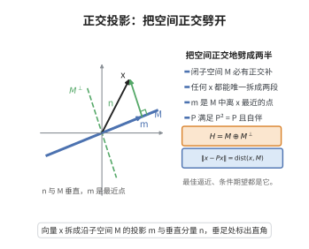

# 正交投影定理

> **一句话大白话**：希尔伯特空间里的闭子空间都有一个"垂直影子"——任意向量都能唯一地拆成"落在子空间里的部分"与"垂直于它的部分"。
>
> **小例子**：在 $\mathbb R^3$ 中取闭子空间为 $xy$-平面 $M$，则 $(1,2,3)=(1,2,0)+(0,0,3)$，其中 $(1,2,0)\in M$、$(0,0,3)\in M^\perp$。

## 介绍

正交投影定理是 Hilbert 空间几何的基石，它断言：Hilbert 空间 $H$ 关于任一闭子空间 $M$ 有正交分解 $H=M\oplus M^\perp$。这一结论把有限维欧氏空间中"作垂线求投影"的直观精确地推广到无穷维。

定理的核心是"最佳逼近元的存在唯一性"：对任意 $x\in H$，在闭子空间 $M$ 中存在唯一的 $m$ 使 $\|x-m\|=\operatorname{dist}(x,M)$，即 $m$ 是 $x$ 在 $M$ 中的最近点。相应的 $x-m$ 垂直于 $M$。

正交投影定理的应用遍及分析：在 Fourier 级数中它是"用正交系最佳逼近"的理论根据；在概率论中条件期望是 $L^2$ 上的正交投影；在偏微分方程与数值分析中（Galerkin 方法、最小二乘），它是把问题投影到有限维子空间求近似解的出发点；它也给出了 Riesz 表示定理与谱理论的基本工具。

## 几何直观

图意在说明：任意向量都能唯一拆成落在子空间与垂直于子空间的两段，投影点就是最近点。

## 分析

**前置依赖**：Hilbert 空间的内积与范数、平行四边形律、闭子空间与完备性、最佳逼近（距离的可达性）、正交补 $M^\perp$

**定理内容**：设 $H$ 是 Hilbert 空间，$M\subseteq H$ 是闭子空间。则

1. 对每个 $x\in H$，存在唯一的 $m\in M$ 使 $\|x-m\|=\operatorname{dist}(x,M)$；
2. $H=M\oplus M^\perp$，即每个 $x\in H$ 有唯一分解 $x=m+n$，其中 $m\in M$、$n\in M^\perp$；
3. 定义 $P_M x=m$，则 $P_M$ 是 $H$ 上的有界线性算子，满足 $P_M^2=P_M$、$P_M^*=P_M$、$\|P_M\|\le1$（当 $M\ne\{0\}$ 时 $\|P_M\|=1$），且 $\|x-P_Mx\|=\operatorname{dist}(x,M)$。

**关键要点**：

- $M$ 的闭性保证最近点存在（否则取极限点可能逃出 $M$）；$H$ 的完备性保证逼近序列收敛；
- 投影的刻画是"$m\in M$ 且 $x-m\perp M$"，即 $m$ 是最近点的充要条件；
- $P_M$ 是自伴幂等算子，且 $\operatorname{Ran}P_M=M$、$\ker P_M=M^\perp$。

## 思考过程

存在性的关键在于"用平行四边形律把极小化序列搓成 Cauchy 列"。设 $d=\operatorname{dist}(x,M)$，取 $m_k\in M$ 使 $\|x-m_k\|\to d$。令 $y_k=x-m_k$。由平行四边形律

$$\|y_j+y_k\|^2+\|y_j-y_k\|^2=2\|y_j\|^2+2\|y_k\|^2.$$

关键观察是 $(y_j+y_k)/2=x-\frac{m_j+m_k}{2}$，而 $\frac{m_j+m_k}{2}\in M$，故 $\|y_j+y_k\|\ge2d$。代入即得 $\|m_j-m_k\|^2=\|y_j-y_k\|^2\le2\|y_j\|^2+2\|y_k\|^2-4d^2\to4d^2-4d^2=0$，于是 $(m_k)$ 是 Cauchy 列，由 $M$ 闭（完备）收敛到某个 $m\in M$，且 $\|x-m\|=d$。唯一性同样用平行四边形律得到。

有了最近点，正交性是自然的：若 $m$ 是最近点而 $x-m$ 不够"垂直"，沿 $M$ 的方向做一点微调就能把距离进一步减小，与极小性矛盾。形式化即把 $\|x-m-tm'\|^2$ 视为 $t$ 的二次函数，在 $t=0$ 处取极小 ⇒ 一次项为零 ⇒ $\operatorname{Re}\langle x-m,m'\rangle=0$。

## 证明过程

**步骤 1：最近点的存在性。** 设 $x\in H$，$d=\operatorname{dist}(x,M)=\inf_{m\in M}\|x-m\|$。取 $m_k\in M$ 使 $\|x-m_k\|\to d$。记 $y_k=x-m_k$。由平行四边形律，

$$\|y_j+y_k\|^2+\|y_j-y_k\|^2=2\|y_j\|^2+2\|y_k\|^2.$$

由 $\frac{m_j+m_k}{2}\in M$ 得 $\|y_j+y_k\|=2\big\|x-\frac{m_j+m_k}{2}\big\|\ge2d$。因此

$$\|m_j-m_k\|^2=\|y_j-y_k\|^2=2\|y_j\|^2+2\|y_k\|^2-\|y_j+y_k\|^2\le2\|y_j\|^2+2\|y_k\|^2-4d^2\xrightarrow[j,k\to\infty]{}0.$$

故 $(m_k)$ 是 Cauchy 列；由 $M$ 闭（从而完备）存在 $m=\lim_k m_k\in M$，且由范数连续得 $\|x-m\|=d$。

**步骤 2：唯一性。** 若 $m,m'\in M$ 都满足 $\|x-m\|=\|x-m'\|=d$，对 $y=x-m$、$y'=x-m'$ 用平行四边形律，类似地得 $\|m-m'\|^2\le2d^2+2d^2-4d^2=0$，故 $m=m'$。

**步骤 3：最近点的正交刻画。** 设 $m$ 为最近点，任取 $m'\in M$。对实参数 $t$，$m+tm'\in M$，故

$$\|x-m\|^2\le\|x-m-tm'\|^2=\|x-m\|^2-2t\operatorname{Re}\langle x-m,m'\rangle+t^2\|m'\|^2.$$

右端作为 $t$ 的函数在 $t=0$ 取极小，故一次项系数为零：$\operatorname{Re}\langle x-m,m'\rangle=0$。把 $m'$ 换成 $im'$ 得虚部也为零，故 $\langle x-m,m'\rangle=0$。由 $m'$ 任意，$x-m\in M^\perp$。反之若 $m\in M$ 且 $x-m\in M^\perp$，则对任意 $m'\in M$，$\|x-m'\|^2=\|x-m\|^2+\|m-m'\|^2\ge\|x-m\|^2$，故 $m$ 是最近点。这同时证明：$m=P_Mx$ 当且仅当 $m\in M$ 且 $x-m\in M^\perp$。

**步骤 4：正交分解。** 对任意 $x$，令 $m=P_Mx$、$n=x-m$。由步骤 3，$m\in M$、$n\in M^\perp$，故 $x=m+n$。若又有 $x=m'+n'$（$m'\in M$、$n'\in M^\perp$），则 $m-m'=n'-n\in M\cap M^\perp=\{0\}$（因 $u\in M\cap M^\perp$ 蕴含 $\langle u,u\rangle=0$），故 $m=m'$、$n=n'$。于是 $H=M\oplus M^\perp$。

**步骤 5：投影算子的性质。** $P_M$ 线性：由分解的唯一性，对 $x=m+n$、$x'=m'+n'$ 有 $\alpha x+\beta x'=(\alpha m+\beta m')+(\alpha n+\beta n')$ 且两部分分别属于 $M$、$M^\perp$，故 $P_M(\alpha x+\beta x')=\alpha m+\beta m'=\alpha P_Mx+\beta P_Mx'$。有界：$\|P_Mx\|^2=\|x\|^2-\|n\|^2\le\|x\|^2$，故 $\|P_M\|\le1$，且 $M\ne\{0\}$ 时取 $0\ne m\in M$ 得 $\|P_Mm\|=\|m\|$，故 $\|P_M\|=1$。自伴：对 $x=m+n$、$y=m'+n'$，

$$\langle P_Mx,y\rangle=\langle m,m'+n'\rangle=\langle m,m'\rangle=\langle m+n,m'\rangle=\langle x,P_My\rangle.$$

幂等：$P_Mx=m\in M$ 且 $m=m+0$ 是其分解，故 $P_M^2x=P_Mm=m=P_Mx$。最后 $\|x-P_Mx\|=\|n\|=\operatorname{dist}(x,M)$ 由步骤 3。$\square$

## 课堂问答

**老师**：正交投影定理的内容是什么？

**学生**：Hilbert 空间对任一闭子空间 $M$ 有正交分解 $H=M\oplus M^\perp$。对每个 $x$ 存在唯一 $m\in M$ 使 $\|x-m\|=\operatorname{dist}(x,M)$，并且 $x-m\perp M$。

**老师（追问）**：最近点的存在性靠什么？

**学生**：靠平行四边形律把极小化序列搓成 Cauchy 列。设 $\|x-m_k\|\to d$，令 $y_k=x-m_k$，则 $\|y_j+y_k\|\ge2d$，代入 $\|y_j+y_k\|^2+\|y_j-y_k\|^2=2\|y_j\|^2+2\|y_k\|^2$ 得 $\|m_j-m_k\|^2\to0$，$M$ 闭完备给出极限；正交性由把 $\|x-m-tm'\|^2$ 视为 $t$ 的二次函数、一次项为零得到。

**老师（拓展）**：投影算子有哪些性质？

**学生**：$P_M$ 有界线性，满足 $P_M^2=P_M$、$P_M^*=P_M$、$\|P_M\|=1$（$M\ne\{0\}$），且 $\operatorname{Ran}P_M=M$、$\ker P_M=M^\perp$。它是 Riesz 表示定理证明的关键一步，也是条件期望与 Galerkin 方法的理论基础。

## 相关条目

- [Riesz表示定理](./Riesz表示定理.md)：借助本定理把连续线性泛函写成内积，是表示定理证明的关键一步。
- [谱定理紧自伴算子](./谱定理紧自伴算子.md)：特征子空间的正交分解依赖本定理提供投影工具。
