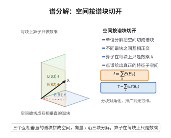

# 谱分解定理

> **一句话大白话**：谱测度把整个空间按谱的取值切成一堆互相垂直的"谱块"，算子在每个块上只是数乘——空间与算子同时被"分块对角化"。
>
> **小例子**：紧自伴算子的谱分解为 $T=\sum_k\lambda_kP_k$，其中 $P_k$ 是到特征空间 $\ker(T-\lambda_kI)$ 的正交投影，且 $I=\sum_kP_k$。

## 介绍

谱分解定理是谱定理的直接延续：有界自伴算子的谱测度 $E$ 不仅把算子写成 $T=\int\lambda\,dE(\lambda)$，还把整个 Hilbert 空间正交分解为一族互相正交的谱子空间 $E(B)H$，算子在这些子空间上"只差一个数乘"。

具体地，单位分解 $I=\int dE(\lambda)$ 表明空间被切成与谱集对应的若干块；每个 $E(B)$ 是约化 $T$ 的正交投影（与 $T$ 交换）；点谱对应真正的特征子空间，而连续谱对应"没有特征向量"的块。这就是线性代数中"分块对角化"的无穷维形式。

谱分解是量子力学中"测量导致投影"的数学原型，也是 Sturm–Liouville 理论、算子半群、遍历理论与随机过程谱表示的核心工具。

## 几何直观

图意在说明：谱测度把空间切成互相正交的谱块，算子在每一块上只做一个数乘动作。

## 分析

**前置依赖**：有界算子的谱定理（谱测度与谱积分）、投影值测度的性质、自伴算子的谱（点谱与连续谱）、正交投影、算子值 Stieltjes 积分

**定理内容**：设 $H$ 是复 Hilbert 空间，$T\in B(H)$ 自伴，$E$ 为其谱测度（见 [有界算子的谱定理](./有界算子的谱定理.md)）。则

1. （单位分解）$I=E(\sigma(T))=\int_{\sigma(T)}dE(\lambda)$，且对两两不交的 Borel 集 $B,C$，$E(B)E(C)=0$（正交性），$E(B)H\perp E(C)H$；
2. （约化）$E(B)T=TE(B)$ 对一切 Borel 集 $B$ 成立，故每个 $E(B)H$ 是 $T$ 的约化子空间，且 $\sigma\big(T|_{E(B)H}\big)\subseteq\overline B$；
3. （特征子空间）对 $\lambda\in\mathbb R$，$E(\{\lambda\})H=\ker(T-\lambda I)$；$\lambda$ 是 $T$ 的特征值当且仅当 $E(\{\lambda\})\ne0$；不同特征值对应的特征子空间互相正交；
4. （空间分解）设 $\sigma_d=\{\lambda\in\sigma(T):E(\{\lambda\})\ne0\}$ 为点谱、$\sigma_c=\sigma(T)\setminus\sigma_d$ 为连续谱，则

$$H=\Big(\bigoplus_{\lambda\in\sigma_d}\ker(T-\lambda I)\Big)\oplus E(\sigma_c)H,$$

且 $T$ 在 $E(\sigma_c)H$ 上没有特征向量。

**关键要点**：

- "正交性"来自 $\chi_B\chi_C=\chi_{B\cap C}$ 与函数演算的同态性；
- "约化"来自 $\chi_B\lambda=\lambda\chi_B$，即 $E(B)$ 与 $T$ 交换；
- 点谱给出真正的特征空间，连续谱则对应"谱测度连续"的部分。

## 思考过程

整个证明可以浓缩为一句话：谱测度是"测度的函数演算"，所以 Borel 集的示性函数 $\chi_B$ 满足的一切代数关系都自动翻译成 $E(B)$ 的关系。

具体地，$\chi_B$ 是实值幂等函数，故 $E(B)$ 是正交投影；$\chi_B\chi_C=\chi_{B\cap C}$，故 $E(B)E(C)=E(B\cap C)$，于是不交的 $B,C$ 给出正交投影。$\chi_B(\lambda)\lambda=\lambda\chi_B(\lambda)$ 作为函数恒等，翻译过来就是 $E(B)T=TE(B)$，即 $E(B)$ 约化 $T$。

特征子空间的刻画则利用"点质量"：若 $x$ 满足 $Tx=\lambda x$，则对任何函数 $f$ 有 $f(T)x=f(\lambda)x$，取 $f=\chi_{\{\mu\}}$ 可知 $E(\{\mu\})x$ 只在 $\mu=\lambda$ 时非零。反过来若 $x=E(\{\lambda\})x$，把 $T=\int\mu\,dE$ 作用到它上面，$\mu$ 被 $\chi_{\{\lambda\}}$ 挤成常数 $\lambda$，得 $Tx=\lambda x$。至于谱在闭包内，是因为在 $E(B)H$ 上可以用 $\int(\mu-\mu_0)^{-1}dE$（$\mu_0\notin\overline B$）显式写出 $T-\mu_0I$ 的逆。

## 证明过程

**步骤 1：正交投影与单位分解。** 由谱测度定义，每个 $E(B)$ 是正交投影且 $E(B_1\cap B_2)=E(B_1)E(B_2)$。取 $B_1=B$、$B_2=C$ 且 $B\cap C=\varnothing$，得 $E(B)E(C)=E(\varnothing)=0$。于是对 $x\in E(B)H$、$y\in E(C)H$，

$$\langle x,y\rangle=\langle E(B)x,E(C)y\rangle=\langle E(C)E(B)x,y\rangle=\langle E(B\cap C)x,y\rangle=0,$$

即 $E(B)H\perp E(C)H$。又 $E(\sigma(T))=I$，故 $I=\int_{\sigma(T)}dE(\lambda)$ 给出单位分解。

**步骤 2：约化性。** 利用函数演算的同态性，对任意 $f\in C(\sigma(T))$ 与 Borel 集 $B$ 有 $f(T)E(B)=E(B)f(T)$（因为 $\Phi(f)\Phi(\chi_B)=\Phi(f\chi_B)=\Phi(\chi_B f)=\Phi(\chi_B)\Phi(f)$，其中用到 $f\chi_B=\chi_Bf$ 以及 $\Phi$ 向有界 Borel 函数按强极限的延拓）。取 $f(\lambda)=\lambda$，得

$$TE(B)=E(B)T.$$

因此 $E(B)H$ 是 $T$ 的不变子空间，且 $M=E(B)H$ 的补也是不变的（$E(B)$ 投影），即 $M$ 是约化子空间。

**步骤 3：谱限制在 $E(B)H$ 上。** 设 $T_B=T|_{E(B)H}$。若 $\mu_0\notin\overline B$，则 $\delta=\operatorname{dist}(\mu_0,\overline B)>0$，函数 $g(\mu)=(\mu-\mu_0)^{-1}\mathbf 1_B(\mu)$ 在 $B$ 上有界。由函数演算，$g(T)$ 与 $E(B)$ 交换且

$$g(T)\,(T-\mu_0I)E(B)=(T-\mu_0I)g(T)E(B)=E(B).$$

故 $T_B-\mu_0I$ 在 $E(B)H$ 上可逆，$\mu_0\notin\sigma(T_B)$。因此 $\sigma(T_B)\subseteq\overline B$。

**步骤 4：特征子空间的刻画。** 设 $Tx=\lambda x$，$x\ne0$。对任意 $f\in C(\sigma(T))$ 有 $f(T)x=f(\lambda)x$（先对多项式验证，再由连续性延拓）。取逼近 $\chi_{\{\mu\}}$ 的连续函数并取极限，得 $E(\{\mu\})x=\chi_{\{\mu\}}(\lambda)x$，即当 $\mu=\lambda$ 时 $E(\{\mu\})x=x$，否则为 $0$。于是 $x\in E(\{\lambda\})H$，故 $\ker(T-\lambda I)\subseteq E(\{\lambda\})H$。

反之，设 $x=E(\{\lambda\})x$。则

$$Tx=\Big(\int_{\sigma(T)}\mu\,dE(\mu)\Big)E(\{\lambda\})x=\int_{\sigma(T)}\mu\,\chi_{\{\lambda\}}(\mu)\,dE(\mu)\,x=\lambda E(\{\lambda\})x=\lambda x,$$

即 $x\in\ker(T-\lambda I)$。故 $E(\{\lambda\})H=\ker(T-\lambda I)$。特别地，$E(\{\lambda\})\ne0\iff\lambda$ 是特征值。若 $\lambda\ne\mu$，则 $E(\{\lambda\})E(\{\mu\})=E(\varnothing)=0$，故特征子空间两两正交。

**步骤 5：空间分解。** 记 $\sigma_d=\{\lambda:E(\{\lambda\})\ne0\}$。由谱测度的可数可加性，在强算子拓扑下

$$E(\sigma_d)=\sum_{\lambda\in\sigma_d}E(\{\lambda\}).$$

这求和至多可数（因 $\sum_\lambda\|E(\{\lambda\})x\|^2\le\|x\|^2$），故 $\sigma_d$ 至多可数。令 $\sigma_c=\sigma(T)\setminus\sigma_d$，则 $E(\sigma_c)=I-E(\sigma_d)$。于是

$$H=E(\sigma_d)H\oplus E(\sigma_c)H=\Big(\bigoplus_{\lambda\in\sigma_d}\ker(T-\lambda I)\Big)\oplus E(\sigma_c)H,$$

且由步骤 4 与 $E(\{\mu\})E(\sigma_c)=E(\varnothing)=0$ 知 $T$ 在 $E(\sigma_c)H$ 上无非零特征向量。$\square$

## 课堂问答

**老师**：谱分解定理把空间怎么分解？

**学生**：用谱测度 $E$ 把 $H$ 正交分解为谱子空间 $E(B)H$：$I=\int dE(\lambda)$，不交的 $B,C$ 满足 $E(B)E(C)=0$ 且 $E(B)H\perp E(C)H$；又 $E(B)T=TE(B)$，故每个 $E(B)H$ 是 $T$ 的约化子空间。

**老师（追问）**：特征子空间如何识别？

**学生**：$E(\{\lambda\})H=\ker(T-\lambda I)$，且 $\lambda$ 是特征值当且仅当 $E(\{\lambda\})\ne0$；不同特征值对应的特征子空间互相正交。点谱 $\sigma_d$ 至多可数，于是 $H=\big(\bigoplus_{\lambda\in\sigma_d}\ker(T-\lambda I)\big)\oplus E(\sigma_c)H$。

**老师（拓展）**：证明的统一思路是什么？

**学生**：一切来自"测度的函数演算"：示性函数的代数关系 $\chi_B^2=\chi_B$、$\chi_B\chi_C=\chi_{B\cap C}$ 与 $\lambda\chi_B=\chi_B\lambda$ 自动翻译成 $E(B)$ 的幂等、正交与交换关系。注意连续谱部分 $E(\sigma_c)H$ 上没有特征向量。

## 相关条目

- [有界算子的谱定理](./有界算子的谱定理.md)：提供本定理所用的谱测度与谱积分表示。
- [谱定理紧自伴算子](./谱定理紧自伴算子.md)：紧自伴情形下 $\sigma_c$ 部分退化，谱分解成为纯点谱的级数。
