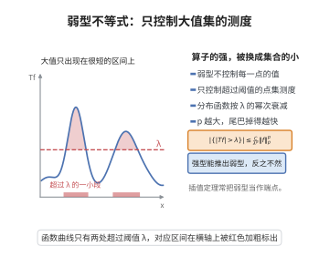

# 弱型不等式

> **一句话大白话**：算子的"大"不在于处处小，而在于取大值的点集足够小——控制住每条水平集 $\{|Tf|>\lambda\}$ 的测度，就控制住了算子。
>
> **小例子**：Hardy–Littlewood 极大算子满足 $|\{Mf>\lambda\}|\le\frac{5^n}{\lambda}\|f\|_1$，即它是弱 $(1,1)$ 型的。

## 介绍

弱型不等式（weak-type inequality）是调和分析与实分析中刻画算子有界性的基本概念。称算子 $T$ 是弱 $(p,q)$ 型的，若存在常数 $C$ 使对一切 $f$ 与一切 $\lambda>0$，

$$\mu\big(\{|Tf|>\lambda\}\big)\le C^q\Big(\frac{\|f\|_p}{\lambda}\Big)^q.$$

它比强型（即 $L^p\to L^q$ 有界）弱，但仍足以通过 Marcinkiewicz 插值定理导出强型不等式，因此在奇异积分与极大算子的理论中扮演枢纽角色。

最经典的例子是 Hardy–Littlewood 极大算子 $M$ 的弱 $(1,1)$ 估计。极大算子在 $L^1$ 上并非强型有界，却是弱 $(1,1)$ 型的；正是这一"退化到弱型"的现象，使得 Marcinkiewicz 插值能把 $L^p$（$1<p<\infty$）上的强型有界性拼装出来。

## 几何直观

图意在说明：弱型估计不逐点控制函数大小，只保证超过阈值的点集测度按阈值的幂次衰减。

## 分析

**前置依赖**：分布函数与层蛋糕表示公式、Vitali 覆盖引理、$L^p$ 空间与范数、Chebyshev 不等式、可测函数的上水平集

**定义**：设 $(X,\mu)$ 是测度空间，$T$ 是作用于可测函数的算子。称 $T$ 为**弱 $(p,q)$ 型**（$1\le p,q<\infty$），若存在常数 $C>0$ 使得对一切 $f\in L^p$ 与一切 $\lambda>0$，

$$\mu\big(\{x:|Tf(x)|>\lambda\}\big)\le\Big(\frac{C\|f\|_p}{\lambda}\Big)^q.$$

**模型定理（极大算子弱 $(1,1)$ 型）**：设 $f\in L^1(\mathbb R^n)$，定义 Hardy–Littlewood 极大函数

$$Mf(x)=\sup_{r>0}\frac{1}{|B(x,r)|}\int_{B(x,r)}|f(y)|\,dy.$$

则对一切 $\lambda>0$，

$$\big|\{x\in\mathbb R^n:Mf(x)>\lambda\}\big|\le\frac{5^n}{\lambda}\|f\|_1.$$

**关键要点**：

- 弱型与强型的关系：强 $(p,q)$ 型蕴含弱 $(p,q)$ 型（由 Chebyshev 不等式），反之不一定；
- 弱型的分布函数形式等价于对一切可测集 $E$ 的"限制型"估计 $\|Tf\|_{L^{q,\infty}}\le C\|f\|_p$；
- 弱 $(1,1)$ 的常数来自覆盖引理的膨胀倍数（$5^n$ 或 $3^n$）。

## 思考过程

为什么不是强型而是弱型？极大算子在 $L^1$ 上可能取无穷大，且不存在控制 $\int Mf$ 的常数（对 $f=\mathbf 1_{[0,1]}$，$Mf\sim1/|x|$，其积分发散）。但"$Mf>\lambda$"这一水平集可以很精细地估计：只要 $Mf(x)>\lambda$，就存在一个以 $x$ 为中心、其平均 $|f|$ 超过 $\lambda$ 的球。

于是关键转化为覆盖问题：用这样的球族覆盖水平集 $\{Mf>\lambda\}$，再从中挑出互不相交的一批球。核心工具是覆盖引理——从任意一族球中可以抽出互不相交的子族，使原族的球都被子族球的常数倍膨胀所覆盖。抽出互不相交的子族后，可以用各球上 $|f|$ 的积分来"付费"：每个球满足 $|B|<\frac1\lambda\int_B|f|$，互不相交使积分可加，膨胀倍数只贡献一个因子 $5^n$。这就把"测度"换成"$L^1$ 范数除以 $\lambda$"。

## 证明过程

**引理（有限球族的覆盖引理）**：设 $\{B_1,\dots,B_m\}$ 是 $\mathbb R^n$ 中的一族球。则存在互不相交的子族 $B_{j_1},\dots,B_{j_k}$ 使得

$$\bigcup_{i=1}^m B_i\subseteq\bigcup_{l=1}^k 5B_{j_l},$$

其中 $5B$ 表示与 $B$ 同心、半径为 $5$ 倍的球。

*证明*：按半径从大到小排序重排为 $B_{(1)},B_{(2)},\dots,B_{(m)}$。贪心地选取：先取 $B_{(1)}$；此后，若 $B_{(i)}$ 与所有已选球都不相交，就选取它，否则跳过。得到的子族互不相交。

对任一被跳过的球 $B_{(i)}$，必存在已选球 $B_{(j)}$（$j<i$，故半径 $\ge$ 半径 $(i)$）与之相交。则 $B_{(i)}$ 的半径不超过 $B_{(j)}$ 的半径，且两球相交，故 $B_{(i)}\subseteq5B_{(j)}$：只要注意到 $B_{(i)}$ 中任一点到 $B_{(j)}$ 中心的距离不超过 $r_i+2r_j\le3r_j<5r_j$。于是每个球（不论被选或被跳过）都含于某个 $5B_{j_l}$ 中，即 $\bigcup_iB_i\subseteq\bigcup_l5B_{j_l}$。$\blacksquare$

**定理的证明**：固定 $\lambda>0$，记 $E_\lambda=\{x:Mf(x)>\lambda\}$。

**步骤 1：用球覆盖 $E_\lambda$。** 对每个 $x\in E_\lambda$，由极大函数的定义存在以 $x$ 为中心的球 $B_x$ 使

$$\frac{1}{|B_x|}\int_{B_x}|f|>\lambda,\qquad\text{即}\qquad |B_x|<\frac{1}{\lambda}\int_{B_x}|f|.$$

于是 $\{B_x\}_{x\in E_\lambda}$ 覆盖 $E_\lambda$。

**步骤 2：紧性与选取有限子族。** 若 $E_\lambda$ 有界，便存在一个紧集 $K\subseteq E_\lambda$ 与有限个球覆盖 $K$ 且 $|K|>|E_\lambda|-\varepsilon$；若无界，按 $E_\lambda\cap B(0,R)$ 处理并令 $R\to\infty$。总之，对任意 $\varepsilon>0$ 存在有限球族 $\{B_1,\dots,B_m\}$ 使 $\bigcup_iB_i\supseteq K$ 且 $|K|\ge|E_\lambda|-\varepsilon$。

**步骤 3：抽出互不相交子族。** 由覆盖引理，存在互不相交子族 $B_{j_1},\dots,B_{j_k}$ 使 $\bigcup_iB_i\subseteq\bigcup_l5B_{j_l}$，从而 $K\subseteq\bigcup_l5B_{j_l}$。

**步骤 4：用 $L^1$ 范数付费。** 由步骤 1 的不等式与球的互不相交性，

$$\Big|\bigcup_{l=1}^k5B_{j_l}\Big|\le\sum_{l=1}^k|5B_{j_l}|=5^n\sum_{l=1}^k|B_{j_l}|<\frac{5^n}{\lambda}\sum_{l=1}^k\int_{B_{j_l}}|f|\le\frac{5^n}{\lambda}\int_{\mathbb R^n}|f|=\frac{5^n}{\lambda}\|f\|_1,$$

最后一步用到 $B_{j_l}$ 两两不交，故积分之和不超过全空间积分。于是

$$|E_\lambda|-\varepsilon\le|K|\le\frac{5^n}{\lambda}\|f\|_1.$$

令 $\varepsilon\downarrow0$，即得 $|\{Mf>\lambda\}|\le\frac{5^n}{\lambda}\|f\|_1$。这正是 $M$ 弱 $(1,1)$ 型的定义。$\square$

**推论**：

1. 由 Chebyshev 不等式，任何强 $(p,q)$ 型算子都是弱 $(p,q)$ 型；
2. 极大算子 $M$ 在 $L^p(\mathbb R^n)$（$1<p\le\infty$）上强型有界，而 $p=1$ 时只能弱型有界；
3. 由 Marcinkiewicz 插值定理，$T$ 兼具弱 $(p_0,p_0)$ 与弱 $(p_1,p_1)$ 型则对中间 $p$ 为强 $(p,p)$ 型，这正是 Calderón–Zygmund 理论的骨架。

## 课堂问答

**老师**：弱 $(p,q)$ 型与强型到底差在哪？

**学生**：结论：弱型只控制分布函数，不控制范数。称 $T$ 弱 $(p,q)$ 型，指存在 $C$ 使对一切 $\lambda>0$ 有 $\mu(\{|Tf|>\lambda\})\le(C\|f\|_p/\lambda)^q$；由 Chebyshev 不等式，强型蕴含弱型，反之不一定。

**老师（追问）**：极大算子为什么在 $p=1$ 只能是弱型？

**学生**：因为 $M$ 根本不是 $L^1$ 有界的。取 $f=\mathbf 1_{[0,1]}$，则 $Mf(x)\approx\frac{1}{2|x|}$（$|x|$ 稍大时），而 $\int\frac{dx}{|x|}=\infty$；但水平集仍可估：$|\{Mf>\lambda\}|\le\frac{5^n}{\lambda}\|f\|_1$。

**老师（拓展）**：弱型估计有什么战略价值？

**学生**：它是 Marcinkiewicz 插值的入口。奇异积分算子在 $L^1$ 上只有弱 $(1,1)$、在 $L^\infty$ 上有界，插值后即得任意 $L^p\,(1<p<\infty)$ 的强有界性——这正是 Calderón-Zygmund 理论的骨架。

## 相关条目

- [Vitali覆盖引理](./Vitali覆盖引理.md)：提供从球族抽出不交子族的覆盖工具，是本证明的核心。
- [Hardy-Littlewood极大不等式](./Hardy-Littlewood极大不等式.md)：极大算子的强 $(p,p)$ 估计，与本文的弱 $(1,1)$ 估计互补。
- [Marcinkiewicz插值定理](./Marcinkiewicz插值定理.md)：以弱型估计为输入导出强型不等式，是本概念的经典用途。
