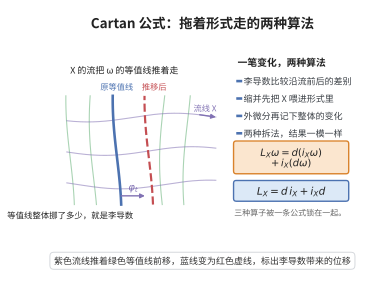

# Cartan 公式

> **一句话大白话**：沿向量场"拖着"微分形式的变化率，可以拆成"先缩并再外微分"与"先外微分再缩并"两步之和——李导数、外微分、内乘三者被一条公式串起来。
>
> **小例子**：对 $0$-形式（函数）$f$，$\mathcal L_Xf=Xf$，而 $d(\iota_Xf)+\iota_X(df)=0+Xf=Xf$，公式成立。

## 介绍

Cartan 公式（Cartan's magic formula），又称 Cartan 同伦公式，是 Élie Cartan 在微分形式理论中建立的基本恒等式。它把李导数 $\mathcal L_X$、外微分 $d$ 与内乘（缩并）$\iota_X$ 联系起来：

$$\mathcal L_X\omega=d(\iota_X\omega)+\iota_X(d\omega).$$

这条公式之所以被称为"魔法"，是因为它把三个来源不同、意义各异的运算用一次简洁的代数和统一起来：李导数源于流（几何动因），外微分源于斯托克斯定理（拓扑动因），内乘源于向量场与形式的缩并（代数动因）。

它是微分几何、辛几何、规范场论与代数拓扑中到处使用的计算工具。由它可立即推出李导数与外微分交换（$\mathcal L_Xd=d\mathcal L_X$），从而李导数作用在闭形式上仍闭、作用在恰当形式上仍恰当，这正是 de Rham 上同调上作用着向量场诱导的运算的原因；辛几何中"辛形式被同胚保持"的 Moser 技巧也以它为基础。

## 几何直观

图意在说明：形式沿向量场流动的变化，可以拆成先缩并再外微分与先外微分再缩并两项之和。

## 分析

**前置依赖**：外微分 $d$、内乘（缩并）$\iota_X$、李导数 $\mathcal L_X$、分次导子（反导子）与分次 Leibniz 律、微分形式的局部标准形 $f\,dg_1\wedge\cdots\wedge dg_k$

**定理内容**：设 $M$ 是光滑流形，$X$ 是 $M$ 上的光滑向量场，$\omega\in\Omega^k(M)$ 是光滑 $k$-形式。则

$$\mathcal L_X\omega=d(\iota_X\omega)+\iota_X(d\omega).$$

其中 $\iota_X:\Omega^k\to\Omega^{k-1}$ 由 $\iota_X\omega(\,\cdot\,)=\omega(X,\,\cdot\,,\dots,\,\cdot\,)$ 定义。

**关键要点**：

- 等式两端都是"次数为 $0$"的算子（不改变形式的次数）；
- 内乘 $\iota_X$ 是次数 $-1$ 的反导子，外微分 $d$ 是次数 $+1$ 的反导子，二者之和 $d\iota_X+\iota_Xd$ 恰好是次数 $0$ 的导子；
- 李导数与外微分交换：$\mathcal L_Xd=d\mathcal L_X$，这是公式的直接推论。

## 思考过程

证明的策略是"利用导子的刚性"：两个都保持形式次数、都满足分次 Leibniz 律的算子，只要在"生成元"上相等，就在所有形式上相等。局部上，任意 $k$-形式都可写成 $\sum_i f_i\,dg_{i1}\wedge\cdots\wedge dg_{ik}$，所以生成元可以取"函数"与"恰当 $1$-形式 $df$"。

第一步确认 $A:=d\iota_X+\iota_Xd$ 确实是一个次数 $0$ 的导子，即满足 $A(\omega\wedge\eta)=A\omega\wedge\eta+\omega\wedge A\eta$。这一步纯粹是分次 Leibniz 律的代数计算：把 $\iota_X(\omega\wedge\eta)$ 与 $d(\omega\wedge\eta)$ 展开，会发现"多出来"的交叉项两两抵消。

第二步验证 $A$ 与 $\mathcal L_X$ 在生成元上相同。对函数：$\mathcal L_Xf=Xf$，而 $Af=d(\iota_Xf)+\iota_X(df)=0+Xf=Xf$。对恰当 $1$-形式 $df$：$\mathcal L_X(df)=d(\mathcal L_Xf)=d(Xf)$，而 $A(df)=d(\iota_Xdf)+\iota_X(ddf)=d(Xf)+0=d(Xf)$。两者一致。

第三步由导子性质与局部标准形收尾：既然在函数与 $df$ 上一致，凡是它们的楔积也都一致，而所有形式都是这类楔积的线性组合，故处处一致。

## 证明过程

**步骤 1：$A=d\iota_X+\iota_Xd$ 是次数 $0$ 的导子。** 设 $\omega$ 是 $p$-形式、$\eta$ 是任意形式。由内乘与外微分的分次 Leibniz 律，

$$\iota_X(\omega\wedge\eta)=\iota_X\omega\wedge\eta+(-1)^{p}\,\omega\wedge\iota_X\eta,$$

$$d(\omega\wedge\eta)=d\omega\wedge\eta+(-1)^{p}\,\omega\wedge d\eta.$$

于是

$$A(\omega\wedge\eta)=d\iota_X(\omega\wedge\eta)+\iota_Xd(\omega\wedge\eta).$$

逐项展开并合并：来自 $d\iota_X(\omega\wedge\eta)$ 的项为

$$d\iota_X\omega\wedge\eta+(-1)^{p-1}\iota_X\omega\wedge d\eta+(-1)^{p}d\omega\wedge\iota_X\eta+\omega\wedge d\iota_X\eta,$$

来自 $\iota_Xd(\omega\wedge\eta)$ 的项为

$$\iota_Xd\omega\wedge\eta+(-1)^{p+1}d\omega\wedge\iota_X\eta+(-1)^{p}\iota_X\omega\wedge d\eta+\omega\wedge\iota_Xd\eta.$$

其中 $(-1)^{p-1}\iota_X\omega\wedge d\eta$ 与 $(-1)^{p}\iota_X\omega\wedge d\eta$ 相消，$(-1)^{p}d\omega\wedge\iota_X\eta$ 与 $(-1)^{p+1}d\omega\wedge\iota_X\eta$ 相消。余下

$$A(\omega\wedge\eta)=(d\iota_X\omega+\iota_Xd\omega)\wedge\eta+\omega\wedge(d\iota_X\eta+\iota_Xd\eta)=A\omega\wedge\eta+\omega\wedge A\eta.$$

故 $A$ 是保持次数的导子（并显然不改变形式的次数）。

**步骤 2：在函数上相等。** 对 $f\in C^\infty(M)$，视 $f$ 为 $0$-形式。由 $\iota_Xf=0$ 且 $\iota_X(df)=Xf$，

$$Af=d(\iota_Xf)+\iota_X(df)=0+Xf=Xf=\mathcal L_Xf.$$

**步骤 3：在恰当 $1$-形式上相等。** 对 $df$，用 $d^2=0$ 与 $\mathcal L_Xd=d\mathcal L_X$（李导数与外微分交换，因 $\mathcal L_X$ 由流的拉回取导数、与 $d$ 交换）：

$$A(df)=d(\iota_Xdf)+\iota_X(ddf)=d(Xf)+0=d(\mathcal L_Xf)=\mathcal L_X(df).$$

**步骤 4：由局部标准形推广到一般形式。** 由步骤 1，$A$ 是导子；$\mathcal L_X$ 也是导子（对流的拉回取导数，满足 $\mathcal L_X(\omega\wedge\eta)=\mathcal L_X\omega\wedge\eta+\omega\wedge\mathcal L_X\eta$）。局部上任意 $k$-形式可写为有限和

$$\omega=\sum_i f_i\,dg_{i1}\wedge\cdots\wedge dg_{ik},\qquad f_i,g_{ij}\in C^\infty(M).$$

对每个单项，反复使用导子性质与步骤 2、3（函数与 $dg$ 上两端相等），得 $A(f_i\,dg_{i1}\wedge\cdots\wedge dg_{ik})=\mathcal L_X(f_i\,dg_{i1}\wedge\cdots\wedge dg_{ik})$。由线性性，$A\omega=\mathcal L_X\omega$ 在每个坐标邻域成立；由局部到整体，结论在整个 $M$ 上成立：

$$\mathcal L_X\omega=d(\iota_X\omega)+\iota_X(d\omega).\qquad\square$$

**推论**：由 $\mathcal L_X=d\iota_X+\iota_Xd$ 立得

$$\mathcal L_Xd=d\iota_Xd+\iota_Xd^2=d\iota_Xd=d(\iota_Xd)+d^2\iota_X=d(d\iota_X+\iota_Xd)=d\mathcal L_X,$$

即李导数与外微分交换。因此 $\mathcal L_X$ 把闭形式映为闭形式、把恰当形式映为恰当形式，从而在 de Rham 上同调 $H^\bullet_{dR}(M)$ 上诱导线性算子（当 $X$ 是完备向量场时即由流诱导的同伦）。

## 课堂问答

**老师**：Cartan 公式号称把三种来源不同的运算缝在一起，是哪三种？公式怎么写？

**学生**：结论是"李导数等于外微分与内乘之和"：
$$
\mathcal L_X\omega=d(\iota_X\omega)+\iota_X(d\omega).
$$
它缝合的正是来自流的李导数 $\mathcal L_X$、来自斯托克斯定理的外微分 $d$、以及纯代数的内乘 $\iota_X$。之所以"魔法"，是因为 $d\iota_X+\iota_Xd$ 恰好是次数 $0$ 的导子，与 $\mathcal L_X$ 同型。

**老师（追问）**：你凭什么只用"函数"和"恰当 $1$-形式 $df$"两个生成元就断定处处相等？会不会漏？

**学生**：靠的是导子的刚性。$A=d\iota_X+\iota_Xd$ 满足分次 Leibniz 律 $A(\omega\wedge\eta)=A\omega\wedge\eta+\omega\wedge A\eta$，而任意 $k$-形式局部可写成 $\sum_i f_i\,dg_{i1}\wedge\cdots\wedge dg_{ik}$。在 $f$ 上 $Af=Xf=\mathcal L_Xf$；在 $df$ 上 $A(df)=d(Xf)$，而 $\mathcal L_X(df)=d(\mathcal L_Xf)=d(Xf)$。生成元一致，楔积便一致。常见误区是逐项硬算，其实导子性质已把无穷多项约化为两类验证。

**老师（拓展）**：由它能否直接看出 $\mathcal L_X$ 与 $d$ 交换？这对上同调意味着什么？

**学生**：能。$\mathcal L_Xd=d\iota_Xd+\iota_Xd^2=d\iota_Xd=d(d\iota_X+\iota_Xd)=d\mathcal L_X$，其中用了 $d^2=0$。因此 $\mathcal L_X$ 把闭形式映为闭、恰当形式映为恰当，从而在 de Rham 上同调 $H^\bullet_{dR}(M)$ 上诱导线性算子——这正是辛几何 Moser 技巧中辛结构不变的算子层根据。

## 相关条目

- [deRham上同调](./deRham上同调.md)：由本公式得 $\mathcal L_X$ 与外微分交换，从而作用在 de Rham 上同调上。
- [Stokes定理流形形式](./Stokes定理流形形式.md)：外微分 $d$ 的积分意义与内乘配合，本公式是其算子层面的补充。
