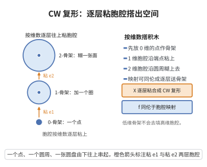

# CW 复形与胞腔逼近定理

> **一句话大白话**：CW 复形之间任意连续映射，都能同伦地"拉直"成胞腔映射——它把 $n$ 维骨架送进 $n$ 维骨架，不会用低维骨架去填高维胞腔。
>
> **小例子**：球面 $S^n$ 是 CW 复形（一个 $0$-胞腔加一个 $n$-胞腔），故 $S^m\to S^n$（$m<n$）的映射可同伦为常值映射，于是 $\pi_m(S^n)=0$。

## 介绍

CW 复形由 J. H. C. Whitehead 于 1949 年引入，是一类由"胞腔"逐维粘合而成的拓扑空间，兼具组合的便利与一般性的灵活。它要求骨架递增 $X^0\subseteq X^1\subseteq\cdots$，且 $X^n$ 由 $X^{n-1}$ 粘上若干 $n$-胞腔得到，并满足闭包有限与弱拓扑两条公理。

胞腔逼近定理（cellular approximation theorem）是 CW 复形理论的核心工具：CW 复形之间的任何连续映射都同伦于胞腔映射，即逐维保持骨架 $g(X^n)\subseteq Y^n$。这使拓扑问题化为"逐骨架、逐胞腔"的组合问题。

它是计算球面同伦群（如 $\pi_m(S^n)=0$ 对 $m<n$）、证明 Whitehead 定理（CW 复形间的弱同伦等价即同伦等价）、以及简化映射空间的同伦类的基本手段。它是代数拓扑中"连续映射可组合化"这一哲学的最干净体现。

## 几何直观

图意在说明：空间按维数逐层粘胞腔而成，连续映射也能同伦地拉直成逐层送骨架的胞腔映射。

## 分析

**前置依赖**：CW 复形的骨架与胞腔、相对同伦群、同伦扩张性质（HEP）、CW 对的连通性、商复形、相对同伦群的长正合序列

**定理内容**：设 $X,Y$ 是 CW 复形，$f:X\to Y$ 连续。则存在胞腔映射 $g:X\to Y$（即 $g(X^n)\subseteq Y^n$ 对一切 $n\ge0$）使 $f\simeq g$。更一般地，若 $A\subseteq X$ 是子复形且 $f|_A$ 已是胞腔映射，则可取同伦相对 $A$ 固定，即 $f\simeq g\ \operatorname{rel}A$。

**辅助引理（相对连通性）**：设 $Y$ 是 CW 复形，$Y^n$ 是其 $n$-骨架。则对一切 $1\le k\le n$，

$$\pi_k(Y,Y^n)=0.$$

即任何映射 $(D^k,S^{k-1})\to(Y,Y^n)$（$k\le n$）都同伦（相对 $S^{k-1}$）于一个映入 $Y^n$ 的映射。

**关键要点**：

- 定理要求映射定义在两个 CW 复形之间；对一般空间不成立；
- 相对形式的证明允许"在已处理好的子复形上不动"，这正是逐骨架归纳所需要的；
- 关键引理 $\pi_k(Y,Y^n)=0$（$k\le n$）的几何含义是：$n$-骨架在 $Y$ 中"向下看是 $n$-连通的"。

## 思考过程

证明用"逐骨架归纳"。先调 $f$ 在 $X^0$ 上，让它把离散的 $0$-骨架送进 $Y^0$（每个点沿所在连通分支内的一条道路走到 $Y^0$ 上的一点；由同伦扩张性质，这个同伦可扩展到整个 $X$）。接着假设已把 $f$ 调到 $f(X^{n-1})\subseteq Y^{n-1}$，要把它调到 $f(X^n)\subseteq Y^n$。

处理每个 $n$-胞腔：其特征映射 $\Phi:(D^n,S^{n-1})\to(X,X^{n-1})$ 的边界已映入 $Y^{n-1}\subseteq Y^n$，于是 $f\circ\Phi$ 给出一个映射

$$(D^n,S^{n-1})\longrightarrow(Y,Y^n).$$

由于 $n\le n$，辅助引理保证它可以相对边界同伦进 $Y^n$。对全部 $n$-胞腔同时做这些同伦，并由同伦扩张性质把各段同伦拼接、扩到 $X^n$ 上，就得到 $f|_{X^n}\simeq$（相对 $X^{n-1}$）一个映入 $Y^n$ 的映射，且不破坏下层的胞腔性。归纳推进到所有维数；用 CW 弱拓扑把可数多段同伦拼成整体同伦。

## 证明过程

**辅助引理的证明**：设 $k\le n$，$f:(D^k,S^{k-1})\to(Y,Y^n)$。记 $q:Y\to Y/Y^n$ 为把 $Y^n$ 坍缩成基点的商映射。因 $f(S^{k-1})\subseteq Y^n$，复合 $q\circ f$ 把 $S^{k-1}$ 送到基点，故 $q\circ f$ 代表 $\pi_k(Y/Y^n)$ 中的一个元素。

空间 $Y/Y^n$ 的胞腔分解只含维数 $\ge n+1$ 的胞腔（其 $n$-骨架被坍缩为基点）。对 CW 复形 $Y/Y^n$，其 $k$-骨架 $(Y/Y^n)^k$ 当 $k\le n$ 时即基点 $\{*\}$。任给映射 $S^k\to Y/Y^n$，用单纯逼近（球面的有限三角剖分）可将其同伦为把 $S^k$（维数 $k\le n$）映入 $k$-骨架 $\{*\}$ 的映射，故

$$\pi_k(Y/Y^n)=0\qquad(k\le n).$$

再由 CW 对 $(Y,Y^n)$ 与商复形的关系：对 $k\le n$，坍缩映射诱导同构 $\pi_k(Y,Y^n)\xrightarrow{\ \cong\ }\pi_k(Y/Y^n)$（这是相对同伦群长正合序列与 $\pi_k(Y^n,Y^n)=0$、以及 $Y^n\to Y\to Y/Y^n$ 的胞腔结构比较的标准结论）。故 $\pi_k(Y,Y^n)=0$（$k\le n$）。$\blacksquare$

**定理的证明**：

**步骤 1：调整 $X^0$。** 设 $A$ 已使 $f|_A$ 胞腔。对不在 $A$ 中的 $0$-胞腔 $x\in X^0\setminus A$，$f(x)$ 落在 $Y$ 的某个连通分支中，取该分支内 $Y^0$ 上一点 $y_x$ 与一条从 $f(x)$ 到 $y_x$ 的道路，得到 $f|_A$ 与目标映射在 $A\cup X^0$ 上的同伦（在 $A$ 上取常值同伦）。由同伦扩张性质，此同伦可扩张到 $X$（因 $(X,A\cup X^0)$ 是 CW 对，$\{0\}\times X\cup[0,1]\times A$ 是 $X\times I$ 的子复形，处处可用 HEP）。于是可设 $f(X^0)\subseteq Y^0$。

**步骤 2：归纳假设。** 设已把 $f$ 调整为满足 $f(X^{n-1})\subseteq Y^{n-1}$（对 $A$ 保持不动）。要调整 $f$ 在 $X^n$ 上，使它满足 $f(X^n)\subseteq Y^n$ 而 $f|_{X^{n-1}}$ 不变。

**步骤 3：逐胞腔同伦。** 设 $e^n$ 是 $X$ 的 $n$-胞腔，特征映射 $\Phi:(D^n,S^{n-1})\to(X,X^{n-1})$。由归纳假设 $f\circ\Phi|_{S^{n-1}}$ 映入 $Y^{n-1}\subseteq Y^n$，故 $f\circ\Phi$ 给出映射

$$(D^n,S^{n-1})\longrightarrow(Y,Y^n).$$

由辅助引理（$k=n\le n$），存在相对 $S^{n-1}$ 的同伦 $H^e:D^n\times I\to Y$，使 $H^e_0=f\circ\Phi$、$H^e_1(D^n)\subseteq Y^n$、$H^e_t|_{S^{n-1}}=f\circ\Phi|_{S^{n-1}}$。

**步骤 4：拼接并扩展。** 全部 $n$-胞腔的内部在 $X^n$ 中互不相交，且各同伦在边界（属于 $X^{n-1}$）上取常值，因此在 $X^{n-1}\cup\bigcup\partial e^n$ 上彼此相容。定义

$$H:X^n\times I\to Y,\qquad H(\Phi_e(y),t)=H^e(y,t)\ \ (y\in D^n),$$

它在 $X^{n-1}\times I$ 上等于常值同伦。由商拓扑（$X^n$ 由 $X^{n-1}$ 粘上各 $D^n$）这给出连续映射，且是 $f|_{X^n}$ 到 $\tilde f|_{X^n}$ 的同伦，其中 $\tilde f(X^n)\subseteq Y^n$、$\tilde f|_{X^{n-1}}=f|_{X^{n-1}}$。

**步骤 5：用 HEP 扩展到全空间。** 上述同伦定义在子复形 $X^n\times I\cup X\times\{0\}$ 上（在 $X\setminus X^n$ 上暂取常值同伦）；因 $X\times I$ 是 CW 复形、$X^n\times I\cup X\times\{0\}$ 是其子复形，由同伦扩张性质可把同伦扩到整个 $X\times I$。于是得到 $f\simeq \tilde f$（相对 $A\cup X^{n-1}$），且 $\tilde f(X^n)\subseteq Y^n$。

**步骤 6：归纳收尾。** 对 $n=1,2,\dots$ 重复步骤 2–5，得一系列同伦，其第 $n$ 段在 $X^{n-1}$ 与 $A$ 上均不动。用 CW 弱拓扑把这些同伦在时间上适当压缩并拼接（第 $n$ 段只改变 $X^n\setminus X^{n-1}$ 且该部分此后再也不被改动），得到整体同伦 $f\simeq g$，其中 $g$ 在每一维都保持骨架，即 $g(X^n)\subseteq Y^n$——这正是胞腔映射。$\square$

**推论（低维同伦群消失）**：取 $X=S^m$（CW 结构：一个 $0$-胞腔与一个 $m$-胞腔）、$Y=S^n$（$m<n$）。任一 $f:S^m\to S^n$ 由本定理同伦于胞腔映射 $g$，而 $g(S^m)=g(X^m)\subseteq Y^m$,又 $Y^m=\{*\}$（当 $m<n$ 时 $n$-胞腔尚未出现），故 $g$ 常值，$\pi_m(S^n)=0$。

## 课堂问答

**老师**：胞腔逼近定理的主结论是什么，为什么它有用？

**学生**：CW 复形间任意连续映射 $f:X\to Y$ 同伦于胞腔映射 $g$，即 $g(X^n)\subseteq Y^n$。这把拓扑问题化为逐骨架的组合问题，并可取相对 $A$ 固定。

**老师（追问）**：逐骨架归纳里，处理单个 $n$-胞腔时用了哪条引理？

**学生**：相对连通性引理 $\pi_k(Y,Y^n)=0$（$k\le n$）。$f\circ\Phi$ 给出 $(D^n,S^{n-1})\to(Y,Y^n)$，因 $n\le n$ 可相对边界同伦进 $Y^n$，再由 HEP 把各胞腔同伦拼接扩到 $X^n$，最后用弱拓扑把可数段拼成整体同伦。

**老师（拓展）**：给个立竿见影的推论。

**学生**：$\pi_m(S^n)=0$（$m<n$）：$S^m$ 的 CW 结构只有一个 $m$-胞腔，胞腔映射的像落在 $S^n$ 的 $m$-骨架 $\{*\}$ 上，故常值。常见误区是忘了定理要求两个空间都是 CW 复形，对一般空间并不成立。

## 相关条目

- [胞腔同调](./胞腔同调.md)：胞腔映射使链层面的诱导计算得以简化，两者共同构成 CW 复形的代数工具箱。
- [基本群定义与性质](./基本群定义与性质.md)：$\pi_1(S^n)=0$（$n\ge2$）等结论可由本定理直接推出。
