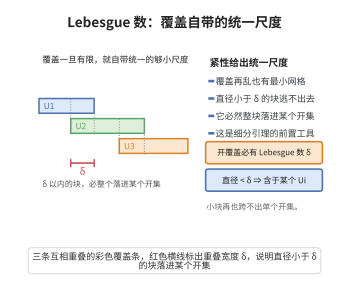

# Lebesgue 数引理

> **一句话大白话**：紧度量空间的每个开覆盖都有一个"统一的最小尺度"——只要一块地方足够小，它必然整个落进某个覆盖开集中。
>
> **小例子**：$\mathbb R$ 的开覆盖 $\{(-\infty,1),(0,\infty)\}$ 有 Lebesgue 数 $\delta=1$：任何长度 $<1$ 的区间必含于其中一个。

## 介绍

Lebesgue 数引理由 Henri Lebesgue 在讨论紧空间开覆盖的局部化性质时提出。它断言：紧度量空间 $X$ 的任意开覆盖 $\mathcal U$ 都对应一个正数 $\delta$（称为该覆盖的 Lebesgue 数），使得 $X$ 中任何直径小于 $\delta$ 的子集都含于覆盖的某个成员之中。

这条引理把"开覆盖"这一整体信息转化为"存在统一尺度"这一局部信息，是紧性最常用的定量形式之一。它在代数拓扑中被用来保证"足够小的单纯形落进指定开集"，从而把连续问题化归为组合问题——这正是奇异同调的切除定理与单纯逼近论证所必需的。

引理也常用于分析：例如证明紧度量空间上连续函数的等度连续性、构造有限子覆盖的精细版本、以及在覆盖空间理论中保证小片上的提升存在。

## 几何直观

图意在说明：紧空间的开覆盖自带一个统一尺度 δ，直径小于它的块必然整块落进某个开集。

## 分析

**前置依赖**：紧度量空间的性质、开覆盖、集合的直径、序列紧性（度量空间中紧等价于序列紧）

**定理内容**：设 $(X,d)$ 是紧度量空间，$\mathcal U=\{U_\alpha\}_{\alpha\in\Lambda}$ 是 $X$ 的开覆盖。则存在 $\delta>0$，使得对 $X$ 的任意子集 $A$ 有

$$\operatorname{diam}(A)<\delta\implies A\subseteq U_\alpha\ \text{对某个}\ \alpha\in\Lambda\ \text{成立}.$$

数 $\delta$ 称为覆盖 $\mathcal U$ 的一个 Lebesgue 数。

**关键要点**：

- 紧性是本质的：在非紧空间上结论可以失效（例如 $\mathbb R$ 上的开覆盖 $\{(-\infty,n)\}_{n\in\mathbb N}$ 无正 Lebesgue 数）；
- Lebesgue 数不唯一，任何更小的正数仍是 Lebesgue 数；
- "含于某个成员"只需直径足够小，不要求子集本身有界或闭。

## 思考过程

证明采用反证与序列紧性。假设不存在这样的 $\delta$，则对每个 $n$，"直径小于 $\frac1n$ 却不落进任何 $U_\alpha$"的子集 $A_n$ 都存在。从每个 $A_n$ 取一点 $x_n$，得到序列 $(x_n)$。

由于 $X$ 紧度量，$(x_n)$ 有收敛子列 $x_{n_k}\to x$。极限点 $x$ 属于覆盖的某个开集 $U_{\alpha_0}$，而开集包含以 $x$ 为心的一个小球。取 $k$ 充分大，使 $x_{n_k}$ 离 $x$ 足够近且 $\frac{1}{n_k}$ 足够小，则整个 $A_{n_k}$（直径小于 $\frac1{n_k}$，且含 $x_{n_k}$）都被挤进这个小球，从而落进 $U_{\alpha_0}$，与 $A_{n_k}$ 的选取矛盾。

## 证明过程

**证明（反证法）**：假设引理不成立。即对每个 $n\in\mathbb N$，存在子集 $A_n\subseteq X$ 使

$$\operatorname{diam}(A_n)<\frac1n,\qquad A_n\not\subseteq U_\alpha\ \text{对一切}\ \alpha\in\Lambda.$$

**步骤 1：构造点列。** 对每个 $n$，取 $x_n\in A_n$（$A_n$ 非空；若某个 $A_n$ 为空则它含于任何 $U_\alpha$，与假设矛盾）。得到序列 $(x_n)\subseteq X$。

**步骤 2：抽取收敛子列。** 因 $X$ 紧度量，$X$ 序列紧，故 $(x_n)$ 有子列 $x_{n_k}\to x\in X$（$k\to\infty$，$n_k\to\infty$）。

**步骤 3：极限点落入某开集。** 因 $\mathcal U$ 覆盖 $X$，存在 $\alpha_0$ 使 $x\in U_{\alpha_0}$。$U_{\alpha_0}$ 是开集，故存在 $\varepsilon>0$ 使开球

$$B(x,\varepsilon)\subseteq U_{\alpha_0}.$$

**步骤 4：导出矛盾。** 取 $k$ 充分大，使同时满足

$$d(x_{n_k},x)<\frac{\varepsilon}{2},\qquad \frac{1}{n_k}<\frac{\varepsilon}{2}.$$

对任意 $y\in A_{n_k}$，由 $\operatorname{diam}(A_{n_k})<\frac{1}{n_k}$ 得 $d(y,x_{n_k})<\frac{1}{n_k}$，于是

$$d(y,x)\le d(y,x_{n_k})+d(x_{n_k},x)<\frac{1}{n_k}+\frac{\varepsilon}{2}<\varepsilon,$$

即 $y\in B(x,\varepsilon)\subseteq U_{\alpha_0}$。因 $y\in A_{n_k}$ 任意，得 $A_{n_k}\subseteq U_{\alpha_0}$，与 $A_{n_k}$ 的选取矛盾。

故假设不成立，存在 $\delta>0$ 满足引理结论。$\square$

## 课堂问答

**老师**：什么叫开覆盖的 Lebesgue 数？

**学生**：紧度量空间 $X$ 的任意开覆盖 $\mathcal U$ 存在 $\delta>0$，使得任何满足 $\operatorname{diam}(A)<\delta$ 的子集 $A$ 都含于某个 $U_\alpha$。$\delta$ 就是该覆盖的 Lebesgue 数。

**老师（追问）**：为什么紧性不可少，证明怎么走？

**学生**：非紧会失效，如 $\mathbb R$ 上覆盖 $\{(-\infty,n)\}_{n\in\mathbb N}$ 无正 Lebesgue 数。证明用反证与序列紧：若不存在，取 $A_n$ 直径 $<1/n$ 却含于任何成员之外，选 $x_n\in A_n$，由序列紧得子列 $x_{n_k}\to x\in U_{\alpha_0}$，取 $k$ 大使 $\frac1{n_k}<\frac\varepsilon2$ 且 $d(x_{n_k},x)<\frac\varepsilon2$，则 $A_{n_k}\subseteq B(x,\varepsilon)\subseteq U_{\alpha_0}$，矛盾。

**老师（拓展）**：它在代数拓扑里怎么用？

**学生**：它保证足够小的单形落进指定开集，是切除定理与细分引理的定量基础，也用于覆盖空间小片上的提升。常见误区是以为子集必须闭或有界——结论只要求直径够小，且 Lebesgue 数不唯一，任何更小的正数仍可用。

## 相关条目

- [细分引理](./细分引理.md)：用 Lebesgue 数把覆盖的"小尺度"传递给重心重分后的单纯形。
- [覆盖空间提升定理](./覆盖空间提升定理.md)：小片上的提升的存在性依赖覆盖的相对 Lebesgue 数。
