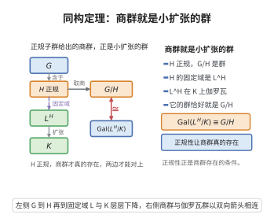

# 伽罗瓦群同构定理

> **一句话大白话**：伽罗瓦群的关系层层剥开——"扩张拼起来的群"等于各块伽罗瓦群的某种积，正规子群对应中间域，商群就是缩略后的扩张的伽罗瓦群，和普通群的三同构定理一个味道。
>
> **小例子**：$K$ 是 $E$ 与 $L$ 的复合，交集处受制：$\mathrm{Gal}(EL/L)\cong\mathrm{Gal}(E/E\cap L)$，正如同构定理中 $G/(N\cap H)\cong GH/N$ 的群论改写。

## 介绍

伽罗瓦群同构定理（Isomorphism Theorems for Galois Groups）是伽罗瓦理论中关于伽罗瓦群结构的一组基本定理。这些定理描述了在域扩张的复合和交的作用下伽罗瓦群的行为，以及伽罗瓦群子群与中间域之间的对应关系如何与群论中的同构定理相联系。它们是伽罗瓦基本定理的重要补充，为计算复杂域扩张的伽罗瓦群提供了有效的方法。

## 几何直观

图意在说明：正规子群的商群与对应中间域上的伽罗瓦群自然同构，正规性正是商群存在的条件。

## 分析

**前置依赖**：伽罗瓦扩张基本定理、域扩张、群论同构定理、复合域。

**数学内涵**：

**定理内容**：

1. **复合域定理**：若 $L/K$ 是伽罗瓦扩张，$F/K$ 是任意扩张，则 $LF/F$ 是伽罗瓦扩张，且
   $$
   \operatorname{Gal}(LF/F) \cong \operatorname{Gal}(L/L \cap F)
   $$

2. **同构对应**：设 $L/K$ 是伽罗瓦扩张，$F/K$ 是任意扩张，则限制映射
   $$
   \operatorname{Gal}(LF/F) \to \operatorname{Gal}(L/L \cap F)
   $$
   是群同构。

3. **塔扩张**：若 $K \subseteq F \subseteq L$，且 $L/K$ 是伽罗瓦扩张，则 $L/F$ 也是伽罗瓦扩张，且 $\operatorname{Gal}(L/F) \subseteq \operatorname{Gal}(L/K)$。

**数学内涵**：这些定理揭示了伽罗瓦群在域扩张复合下的行为，是计算伽罗瓦群的关键工具。

**证明策略**：利用伽罗瓦基本定理的对应关系，结合域扩张的度数和群论的同构定理。

## 思考过程

伽罗瓦群同构定理的核心思想是：将两个域扩张"拼接"起来时，伽罗瓦群可以被分解为更简单的部分的乘积。具体来说，当 $L/K$ 是伽罗瓦扩张而 $F/K$ 是任意扩张时，$LF/F$ 的伽罗瓦群同构于 $L/L \cap F$ 的伽罗瓦群。

这个定理在计算分圆域和有限域的伽罗瓦群时非常有用。例如，在计算 $\mathbb{Q}(\zeta_n)/\mathbb{Q}$ 的伽罗瓦群时，可以利用该定理将问题分解。

## 证明过程

**定理 1**（复合域定理）：设 $L/K$ 是有限伽罗瓦扩张，$F/K$ 是任意域扩张（在同一个代数闭包中）。则 $LF/F$ 是有限伽罗瓦扩张，且限制映射给出群同构：
$$
\operatorname{Gal}(LF/F) \cong \operatorname{Gal}(L/L \cap F)
$$

**证明**：

**步骤 1**：$LF/F$ 是伽罗瓦扩张。

由于 $L/K$ 是伽罗瓦扩张，$L$ 是某个可分多项式的分裂域，设 $L$ 是 $f(x) \in K[x]$ 的分裂域。则 $LF$ 也是 $f(x)$ 在 $F$ 上的分裂域，故 $LF/F$ 是正规扩张。可分性由 $L/K$ 的可分性继承，故 $LF/F$ 是伽罗瓦扩张。

**步骤 2**：构造限制映射。

定义 $\varphi: \operatorname{Gal}(LF/F) \to \operatorname{Gal}(L/K)$ 为 $\varphi(\sigma) = \sigma|_L$。由于 $L/K$ 是伽罗瓦扩张，$\sigma(L) \subseteq L$，且 $\sigma$ 保持 $K$ 中元素不变，故 $\sigma|_L \in \operatorname{Gal}(L/K)$。

**步骤 3**：$\varphi$ 的像在 $\operatorname{Gal}(L/L \cap F)$ 中。

对任意 $\sigma \in \operatorname{Gal}(LF/F)$，$\sigma$ 保持 $F$ 中元素不变。由于 $L \cap F \subseteq F$，$\sigma$ 也保持 $L \cap F$ 中元素不变，故 $\sigma|_L \in \operatorname{Gal}(L/L \cap F)$。

**步骤 4**：$\varphi$ 是单射。

若 $\sigma|_L = \operatorname{id}_L$，且 $\sigma|_F = \operatorname{id}_F$（因为 $\sigma \in \operatorname{Gal}(LF/F)$），则 $\sigma$ 在生成元集 $L \cup F$ 上恒等，故 $\sigma = \operatorname{id}_{LF}$。

**步骤 5**：$\varphi$ 是满射。

对任意 $\tau \in \operatorname{Gal}(L/L \cap F)$，需要将 $\tau$ 扩张到 $LF$ 上。由于 $LF$ 是 $L$ 和 $F$ 的复合，且 $\tau$ 在 $L \cap F$ 上恒等，由扩张定理，$\tau$ 可唯一扩张为 $\tilde{\tau} \in \operatorname{Gal}(LF/F)$，满足 $\tilde{\tau}|_L = \tau$。

因此 $\varphi$ 是满射，从而 $\varphi$ 是同构。$\square$

**定理 2**（塔扩张定理）：设 $K \subseteq F \subseteq L$ 是域扩张塔，且 $L/K$ 是伽罗瓦扩张。则 $L/F$ 也是伽罗瓦扩张，且 $\operatorname{Gal}(L/F) \subseteq \operatorname{Gal}(L/K)$。

**证明**：由于 $L/K$ 是可分正规扩张，$L/F$ 显然也是可分正规扩张，故 $L/F$ 是伽罗瓦扩张。$\operatorname{Gal}(L/F)$ 中的元素是保持 $F$ 中元素不变的自同构，由于 $F \supseteq K$，这些自同构自然也保持 $K$ 中元素不变，故 $\operatorname{Gal}(L/F) \subseteq \operatorname{Gal}(L/K)$。$\square$

**定理 3**（伽罗瓦对应与商群）：设 $L/K$ 是伽罗瓦扩张，$F/K$ 是中间域。

1. 若 $F/K$ 是正规扩张，则 $\operatorname{Gal}(L/F) \trianglelefteq \operatorname{Gal}(L/K)$，且
   $$
   \operatorname{Gal}(F/K) \cong \operatorname{Gal}(L/K)/\operatorname{Gal}(L/F)
   $$

2. 若 $F/K$ 是任意扩张，则
   $$
   \operatorname{Gal}(LF/F) \cong \operatorname{Gal}(L/L \cap F)
   $$

**证明**：第一部分是伽罗瓦基本定理的直接推论。第二部分是定理 1 的结论。$\square$

**推论**（伽罗瓦群的直积分解）：设 $L/K$ 和 $M/K$ 是伽罗瓦扩张，且 $L \cap M = K$，则 $LM/K$ 是伽罗瓦扩张，且
$$
\operatorname{Gal}(LM/K) \cong \operatorname{Gal}(L/K) \times \operatorname{Gal}(M/K)
$$

**证明**：由定理 1，$\operatorname{Gal}(LM/M) \cong \operatorname{Gal}(L/K)$。由于 $L \cap M = K$，且 $LM/K$ 是伽罗瓦扩张，$\operatorname{Gal}(LM/K)$ 中的元素由其在 $L$ 和 $M$ 上的限制唯一确定，且限制映射给出直积分解。$\square$

**应用**：伽罗瓦群同构定理是计算复合域扩张的伽罗瓦群的基本工具，在分圆域理论、类域论和代数数论中有广泛应用。$\square$

## 课堂问答

**老师**：把一个伽罗瓦扩张跟别的域"拼接"时，伽罗瓦群怎么变？

**学生**：核心是复合域定理：$L/K$ 伽罗瓦、$F/K$ 任意，则 $LF/F$ 伽罗瓦，且限制映射给出
$$
\operatorname{Gal}(LF/F)\cong\operatorname{Gal}(L/L\cap F)
$$
这像群论同构定理 $G/(N\cap H)\cong NH/N$ 的域论翻译；塔情形 $K\subseteq F\subseteq L$ 且 $L/K$ 伽罗瓦时，$\operatorname{Gal}(L/F)\subseteq\operatorname{Gal}(L/K)$。

**老师（追问）**：限制映射的单、满各怎么来？

**学生**：单：若 $\sigma$ 在 $L$ 与 $F$ 上都恒等，则在生成集 $L\cup F$ 上恒等，故 $\sigma=\operatorname{id}_{LF}$。满：任给 $\tau\in\operatorname{Gal}(L/L\cap F)$，它在 $L\cap F$ 上恒等，由扩张定理唯一延拓为 $\tilde\tau\in\operatorname{Gal}(LF/F)$ 且 $\tilde\tau|_L=\tau$。像确落在 $\operatorname{Gal}(L/L\cap F)$，是因为 $\sigma$ 固定 $F\supseteq L\cap F$。

**老师（拓展）**：能推出什么好用的分解？

**学生**：若 $L/K$、$M/K$ 都是伽罗瓦扩张且 $L\cap M=K$，则
$$
\operatorname{Gal}(LM/K)\cong\operatorname{Gal}(L/K)\times\operatorname{Gal}(M/K)
$$
元素由在 $L$、$M$ 上的限制唯一确定。这是把大扩张的伽罗瓦群拆成直积的常用手段，在分圆域 $\mathbb{Q}(\zeta_{mn})=\mathbb{Q}(\zeta_m)\mathbb{Q}(\zeta_n)$（$\gcd(m,n)=1$）上尤其方便。
