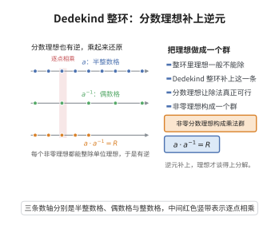

# Dedekind整环

> **一句话大白话**：普通整数里"任一数都能唯一分解为素数之积"，但在更一般的整环里这常常失效；Dedekind 整环就是"元素的唯一分解"退而求其次救成"理想（数）的唯一分解"的那个最完美的环——牺牲元素，成全理想。
>
> **小例子**：代数整数环如 $\mathbb{Z}[\sqrt{-5}]$ 不是 UFD（如 $6=2\cdot3=(1+\sqrt{-5})(1-\sqrt{-5})$ 分解不同，但都是不可约元素），可它仍是 Dedekind 整环：每个非零理想唯一分解为素理想之积。

## 介绍

Dedekind整环（Dedekind Domain）是代数数论中最重要的环之一，由理查德·戴德金在 19 世纪后期引入。Dedekind整环是数域中整数环的自然推广，其核心性质是：每个非零真理想可以唯一地分解为素理想的乘积。这一性质推广了整数环 $\mathbb{Z}$ 中的算术基本定理，是代数数论中理想理论的基础。

## 几何直观

图意在说明：补上分数理想后，非零理想都有逆元，乘起来回到单位理想，于是构成一个乘法群。

## 分析

**前置依赖**：交换代数、整环、分式理想、素理想、局部化、整闭包。

**数学内涵**：

**定义**：整环 $R$ 称为 Dedekind 整环，如果满足以下等价条件：
1. $R$ 是诺特整环、整闭的且维数为 1（即每个非零素理想是极大理想）。
2. $R$ 的每个非零真理想可以唯一地分解为素理想的乘积。
3. $R$ 的每个非零理想是可逆的（即 $I J = R$ 对某个分式理想 $J$ 成立）。

**定理内容**：
1. **理想唯一分解**：$R$ 的每个非零真理想 $I$ 可唯一地（忽略次序）表示为 $I = \mathfrak{p}_1^{e_1} \cdots \mathfrak{p}_r^{e_r}$，其中 $\mathfrak{p}_i$ 是不同素理想，$e_i \ge 1$。
2. **分式理想群**：$R$ 的非零分式理想构成一个群（理想群），记作 $\operatorname{Id}(R)$。
3. **理想类群**：$R$ 的主分式理想构成 $\operatorname{Id}(R)$ 的子群，商群 $\operatorname{Cl}(R) = \operatorname{Id}(R)/\operatorname{PId}(R)$ 称为理想类群，衡量了 $R$ 离主理想整环的距离。

**证明策略**：通过局部化证明 Dedekind 整环的局部环是离散赋值环，再通过离散赋值环的性质建立理想分解。

## 思考过程

Dedekind整环的核心思想是"理想的唯一因子分解"。在一般的 Dedekind 整环中，元素可能没有唯一的因子分解（例如 $\mathbb{Z}[\sqrt{-5}]$ 中 $6 = 2 \times 3 = (1+\sqrt{-5})(1-\sqrt{-5})$），但理想有唯一的素理想分解。

Dedekind 整环的等价刻画反映了其丰富的结构：
- 维数 1：非零素理想就是极大理想，没有更长的素理想链。
- 整闭：在分式域中取整闭包不改变环。
- 诺特：理想有限生成。
- 理想可逆：每个非零理想是局部主理想。

## 证明过程

### Dedekind整环的等价刻画

**定理 1**：对整环 $R$，以下条件等价：
1. $R$ 是诺特环、整闭的且 $\dim R = 1$。
2. $R$ 的每个非零真理想可以唯一地分解为素理想的乘积。
3. $R$ 的每个非零理想是可逆的。

**证明**：$(1) \Rightarrow (2)$：

**步骤 1**：首先证明 $R$ 的每个非零理想包含有限个素理想的乘积。

设 $S$ 是不包含有限个素理想乘积的理想的集合。若 $S \ne \varnothing$，取极大元 $I$。$I$ 不是素理想，故存在 $a, b \notin I$ 使得 $ab \in I$。则 $I \subsetneq (I:a)$ 和 $I \subsetneq (I:b)$。由极大性，$(I:a)$ 和 $(I:b)$ 包含有限个素理想的乘积，从而 $I$ 也包含有限个素理想的乘积，矛盾。

**步骤 2**：对 $\mathfrak{p} \in \operatorname{Spec} R$，$R_{\mathfrak{p}}$ 是离散赋值环（DVR）。因为 $\dim R_{\mathfrak{p}} = 1$，$R_{\mathfrak{p}}$ 是诺特整闭局部环，因此是 DVR。设 $v_{\mathfrak{p}}$ 是对应的赋值。

**步骤 3**：对任意非零理想 $I$，定义 $v_{\mathfrak{p}}(I) = \min\{v_{\mathfrak{p}}(a) \mid a \in I\}$。则 $v_{\mathfrak{p}}(I) = 0$ 对几乎所有 $\mathfrak{p}$ 成立，且 $I = \prod_{\mathfrak{p}} \mathfrak{p}^{v_{\mathfrak{p}}(I)}$。唯一性由赋值唯一确定。$\square$

$(2) \Rightarrow (3)$：若 $I = \mathfrak{p}_1^{e_1} \cdots \mathfrak{p}_r^{e_r}$，定义 $I^{-1} = \mathfrak{p}_1^{-e_1} \cdots \mathfrak{p}_r^{-e_r}$ 为分式理想，则 $I \cdot I^{-1} = R$，故 $I$ 可逆。$\square$

$(3) \Rightarrow (1)$：可逆理想是有限生成的，故 $R$ 是诺特环。若 $R$ 维数 $\ge 2$，存在素理想链 $(0) \subsetneq \mathfrak{p} \subsetneq \mathfrak{m}$，则 $\mathfrak{p}$ 不可逆。若 $R$ 不整闭，则存在分式域中元素 $x$ 满足整性方程但 $x \notin R$，可构造一个不可逆理想。$\square$

### 理想类群

**定义**：$R$ 的**分式理想群** $\operatorname{Id}(R)$ 由所有非零分式理想（即 $R$ 的 $R$-子模 $I \subseteq K$，存在 $0 \ne d \in R$ 使得 $dI \subseteq R$）构成，运算为乘法。**主分式理想**形如 $aR$，$a \in K^\times$，构成子群 $\operatorname{PId}(R)$。**理想类群**定义为：
$$
\operatorname{Cl}(R) = \operatorname{Id}(R) / \operatorname{PId}(R)
$$

**定理 2**：$\operatorname{Cl}(R)$ 是有限群当 $R$ 是代数数域的整数环。

**证明**：这是代数数论中 Minkowski 定理的推论，利用 Minkowski 界证明每个理想类包含一个范数有界的理想。$\square$

### 数域的整数环

**定理 3**：设 $K/\mathbb{Q}$ 是数域（有限扩张），$\mathcal{O}_K$ 是 $K$ 的整数环（即 $\mathbb{Z}$ 在 $K$ 中的整闭包）。则 $\mathcal{O}_K$ 是 Dedekind 整环。

**证明**：$\mathcal{O}_K$ 是 $\mathbb{Z}$ 上的有限生成模（因为 $\mathbb{Z}$ 是诺特环，且 $K/\mathbb{Q}$ 是有限可分扩张），故 $\mathcal{O}_K$ 是诺特环。$\mathcal{O}_K$ 是整闭的（由定义）。$\dim \mathcal{O}_K = 1$（因为 $\mathbb{Z}$ 的维数为 1，由 Going-up 定理，$\mathcal{O}_K$ 的维数也是 1）。因此 $\mathcal{O}_K$ 是 Dedekind 整环。$\square$

### 示例

**例 1**：$\mathbb{Z}$ 是 Dedekind 整环，理想分解对应算术基本定理：$(n) = \prod p_i^{e_i}$。

**例 2**：$\mathbb{Z}[\sqrt{-5}]$ 是 Dedekind 整环但不是 PID。例如 $(6) = (2, 1+\sqrt{-5})^2 (3, 1+\sqrt{-5})(3, 1-\sqrt{-5})$。

**例 3**：域上的多项式环 $k[x]$ 不是 Dedekind 整环（维数 $\ge 2$ 或维数 1 时是 PID），但 $k[x]$ 在有限扩张中的整闭包是 Dedekind 整环（对应曲线上的正则点）。

**应用**：Dedekind 整环是代数数论的核心对象，为研究数域的算术性质（如素理想分解、理想类群、单位群等）提供了代数框架。$\square$

## 课堂问答

**老师**：Dedekind 整环到底刻画了什么，为什么要把"元素唯一分解"换成"理想唯一分解"？

**学生**：结论先行——Dedekind 整环就是让"理想唯一分解"永远成立的那类整环。它有三个等价刻画：诺特且整闭、维数为 $1$；每个非零理想可逆；每个非零真理想唯一地分解为素理想之积。代数整数环如 $\mathbb{Z}[\sqrt{-5}]$ 不是 UFD，$6=2\cdot 3=(1+\sqrt{-5})(1-\sqrt{-5})$ 分解不唯一，但它仍是 Dedekind 整环。常见误区是把 Dedekind 当成 PID 或 UFD——它恰恰允许元素分解失败，只保住理想分解。

**老师（追问）**：维数 $1$ 加整闭，凭什么就能保证理想唯一分解？关键环节在哪里？

**学生**：关键在于局部化。对每个非零素理想 $\mathfrak{p}$，局部环 $R_{\mathfrak{p}}$ 是一维诺特整闭局部环，即离散赋值环，配有赋值 $v_{\mathfrak{p}}$。对非零理想 $I$ 定义 $v_{\mathfrak{p}}(I)=\min\{v_{\mathfrak{p}}(a)\mid a\in I\}$，则几乎处处 $v_{\mathfrak{p}}(I)=0$，且 $I=\prod_{\mathfrak{p}}\mathfrak{p}^{v_{\mathfrak{p}}(I)}$。唯一性由赋值唯一确定。整闭条件正是用来排除非 DVR 的退化情形。

**老师（拓展）**：那么"离 PID 有多远"这个度量是怎么定义的？

**学生**：用理想类群。非零分式理想在乘法下成群 $\operatorname{Id}(R)$，主分式理想构成子群 $\operatorname{PId}(R)$，商群 $\operatorname{Cl}(R)=\operatorname{Id}(R)/\operatorname{PId}(R)$。于是 $R$ 是 PID 当且仅当 $\operatorname{Cl}(R)=0$。当 $R$ 是数域的整数环时 $\operatorname{Cl}(R)$ 有限（Minkowski 定理的推论），例如 $\mathbb{Z}[\sqrt{-5}]$ 的类群阶为 $2$。
